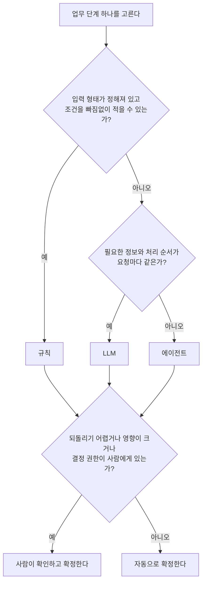
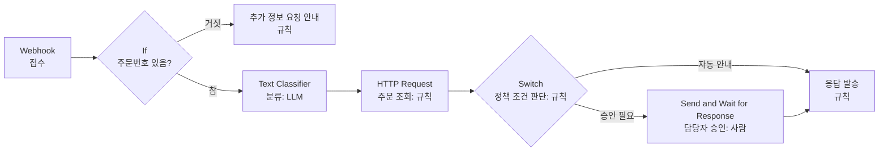

# 1장. 업무 자동화 방식과 n8n 사용 판단

> 적용 버전: n8n 2.43.7 셀프 호스팅 Community Edition. 공식 문서 확인일: 2026-09-14.

## 이 장에서 다루는 문제

자동화를 시작할 때 도구부터 떠올리기 쉽다. "고객 문의에 AI 에이전트가 답하게 만들자" 같은 계획이 대표적인 예다. 그런데 고객 문의 하나를 처리하는 일 안에는 성격이 전혀 다른 일이 섞여 있다. 예를 들어 주문번호의 형식을 확인하는 일은 기계적으로 할 수 있지만, 고객이 쓴 문장에서 요청의 의도를 알아내려면 언어를 이해해야 하고, 환불을 결정하는 일에는 돈과 책임이 따른다. 이 모든 일을 하나의 방식으로 처리하면 어떤 부분은 필요 이상으로 복잡해지고, 어떤 부분은 위험해진다.

이 장에서는 업무를 단계로 나누고, 단계마다 결과를 누가 정할지 고르는 방법을 다룬다. 선택지는 규칙, 대규모 언어 모델(LLM), 에이전트, 사람의 네 가지다. 이어서 n8n이 업무 흐름을 어떤 구조로 표현하는지 살펴보고, 어떤 조건의 업무에 n8n이 적합하며 어디서 한계가 드러나는지 판단한다. 마지막으로 이 판단을 다른 사람이 검토할 수 있는 문서로 남기는 방법을 정리한다.

이 장을 마치면 다음을 할 수 있다.

- 하나의 업무를 접수, 분류, 조회, 판단, 승인, 응답 단계로 나누고 각 단계의 입력과 결과를 설명한다.
- 단계마다 규칙, LLM, 에이전트, 사람 중 적합한 판단 주체를 고르고 그 이유를 업무 조건으로 설명한다.
- n8n의 워크플로우(workflow), 노드(node), 연결(connection), 데이터 흐름 구조를 설명하고, 업무가 n8n에 적합한지 판단 조건에 따라 평가한다.
- 자동화 범위, 사람의 책임, 도구 선택 근거를 담는 도구 선택서의 구성을 설명한다.

이 장은 설치나 조작 없이 설계 판단에 집중한다. n8n 실행 환경은 3장에서 준비한다.

이 교재는 가상의 온라인 쇼핑몰 '하루마켓'의 고객지원 업무를 1장부터 11장까지 이어서 발전시킨다. 이 장에서 만드는 업무 분해도가 그 출발점이다.

## 1.1 업무 분해도 - 업무를 단계로 나누기

### 업무 전체가 아니라 단계를 보는 이유

고객이 "사이즈가 커서 반품하고 싶어요"라고 문의했다고 하자. 숙련된 상담원은 이 문의를 금방 처리하므로 하나의 일처럼 느낀다. 하지만 실제로 상담원이 하는 일을 풀어 보면 여러 동작이 이어진다. 문의를 받고, 이것이 반품 요청임을 알아보고, 주문을 찾아 상품을 받은 날짜를 확인한다. 정책에 비추어 반품이 가능한지와 배송비를 누가 내는지 판단하고, 환불해도 되는지 확인을 받은 뒤, 고객에게 결과를 안내한다.

사람은 이 과정을 머릿속에서 한꺼번에 처리하지만, 자동화하려면 풀어서 적어야 한다. 단계로 나누면 다음 세 가지 이점이 있다.

첫째, 단계마다 필요한 능력이 다르다는 사실이 드러난다. 예를 들어 수령일로부터 며칠이 지났는지 계산하는 일과 고객 문장의 뜻을 파악하는 일에는 서로 다른 능력이 필요하다. 업무 전체를 한 덩어리로 보면 가장 어려운 부분에 맞춰 도구를 고르게 되고, 쉬운 부분까지 비싸고 불안정한 방식으로 처리하게 된다.

둘째, 문제가 생긴 위치를 찾을 수 있다. 예를 들어 고객에게 잘못된 안내가 나갔다면 분류가 틀렸는지, 조회한 정보가 틀렸는지, 정책 판단이 틀렸는지 구분할 수 있어야 고칠 수 있다.

셋째, 자동화 범위를 부분적으로 정할 수 있다. 자동화는 전부 하거나 전혀 하지 않는 선택이 아니다. 분류와 조회는 자동으로 하고 환불 결정은 사람이 하는 식으로 단계마다 다르게 정할 수 있다.

### 여섯 가지 기본 단계

이 교재는 요청을 처리하는 업무를 표 1-1의 여섯 단계로 나누어 본다.

**표 1-1. 요청 처리 업무의 기본 단계**

| 단계 | 하는 일 | 입력 | 결과 | 고객지원 예 |
|---|---|---|---|---|
| 접수 | 요청을 받아 처리할 수 있는 형태로 만들고 필수 정보가 있는지 확인한다 | 폼 입력, 메일, 메시지 | 문의 기록 | 주문번호와 문의 내용을 받는다 |
| 분류 | 요청의 종류와 긴급도를 분류한다 | 문의 내용 | 요청 유형 | 배송 문의, 단순 변심 반품, 불량 신고 |
| 조회 | 판단에 필요한 사실을 조회한다 | 식별자･검색어 | 조회 결과 | 주문 상태, 수령일 |
| 판단 | 사실과 정책에 비추어 처리 방법을 정한다 | 요청 유형, 조회 결과, 정책 | 처리안 | 기한 내 반품 가능, 배송비 고객 부담 |
| 승인 | 권한이 있는 주체가 처리안을 확정한다 | 처리안 | 승인 또는 거절 | 환불 승인 |
| 응답 | 결과를 알리거나 확정된 처리를 집행한다 | 확정된 처리안 | 안내문, 집행 결과 | 반품 접수 안내 메일 |

표 1-1에서 읽어야 할 핵심은 각 단계의 결과가 다음 단계의 입력이 된다는 점이다. 분류 결과가 틀리면 조회와 판단이 모두 엉뚱한 방향으로 진행된다.

모든 업무에 여섯 단계가 다 있지는 않을 수 있다. 또 이 순서대로 흐름이 진행되는 것도 아니다. 승인이 필요 없는 업무도 있고, 조회를 여러 번 하는 업무도 있다. 또 조회결과를 이용해 분류를 할 수도 있다. 이 틀은 모든 업무를 같은 모양으로 만들려는 것이 아니다. 빠뜨린 단계를 찾는 점검표로 사용한다. 예를 들어 설계 초안에 승인 단계가 없다면 "정말 아무도 확인하지 않아도 되는가"를 한 번 더 묻게 된다. 처리 과정을 남기는 기록은 모든 단계에 걸쳐 필요하며, 2장과 8장에서 따로 다룬다.

단계를 어디까지 나눌지는 **결과가 하나로 정해지는 단위를 기준**으로 삼는다. 예를 들어 "문의를 분류하고 주문을 찾아 반품 가능 여부를 정한다"는 일은 결과가 세 개이므로 세 단계로 나눈다. 반대로 결과를 정하는 방식이 같고, 실패하면 함께 다시 해야 하는 동작은 한 단계로 묶어도 된다.

같은 종류의 단계가 여러 번 나오면 업무 분해도에 행을 나누어 실제 처리 순서대로 적고 `조회 1`, `조회 2`처럼 번호를 붙인다. 판단하기 전에 가져온 값과 집행 직전에 다시 확인한 값은 조회 방법이 같아도 쓰임이 다르므로 서로 다른 단계다.

요청 유형에 따라 처리가 갈라지면 공통 단계는 한 번만 적고, 갈라지는 단계부터 행을 유형별로 나눈다. 예를 들어 경비 신청에서 출장비와 소모품비의 판단 기준이 다르면 `판단(출장비)`, `판단(소모품비)`처럼 단계 이름에 유형을 붙인다. 어느 행으로 갈지를 정하는 값은 갈라지기 직전 행의 결과에 드러나야 한다. 공통 단계가 거의 없거나 시작 계기가 다르면 표를 유형이나 흐름별로 나누고, 갈라지는 모양을 한눈에 보여 주어야 하면 개념도를 함께 그린다.

이 틀은 모든 자동화 작업에 적용 될 수 있다. 개인 작업이나 회사 업무 자동화에 똑 같이 적용 될 수 있다. 예를들어 카드 결제 알림 메일을 가계부에 기록하는 개인업무를 자동화 한다고 해보자. 새 메일을 받는 단계가 접수이고, 결제 알림인지 광고인지 나누는 단계가 분류다. 이번 달 누적 지출을 확인하는 단계가 조회이고, 예산을 넘었는지 따지는 단계가 판단이다. 가계부에 적고 예산 초과를 알리는 단계가 응답이며, 이 작업에는 보통 승인 단계가 없다.

회사 업무 작업으로 출장비 정산을 예를 들면, 영수증 제출이 접수, 교통비·숙박비·식비 구분이 분류, 출장 승인 내역과 규정 한도 확인이 조회, 한도 안인지 따지는 단계가 판단, 팀장 확인이 승인, 정산 결과 통보가 응답이다. 소재가 달라도 같은 틀로 나누어 볼 수 있다는 점이 중요하다. 이렇게 나누어 두어야 다음 절에서 단계마다 판단 주체를 고를 수 있다.

> 이 절의 내용은 [실습 1-1](실습/01/강사가이드/01_업무자동화방식과n8n사용판단_실습.md#실습-1-1-메일함-정리-업무-분해)과 [실습 1-3](실습/01/강사가이드/01_업무자동화방식과n8n사용판단_실습.md#실습-1-3-배송과-반품-문의의-업무-분해)의 1~2단계, [실습 1-2](실습/01/강사가이드/01_업무자동화방식과n8n사용판단_실습.md#실습-1-2-식단-기록-업무-분해)의 1단계에서 확인한다.

## 1.2 네 가지 판단 주체

업무를 단계로 나누었다면 각 단계의 결과를 누가 처리할지 선택해야 한다. 한 단계의 결과를 만들거나 확정하는 방식을 **판단 주체**라고 부르고 그 것은 **규칙, LLM, 에이전트, 사람의 네 가지**로 가 처리할 수 있다. 네 방식은 결과를 만드는 원리가 다르므로 잘하는 일과 위험도 다르다.

### 규칙

규칙은 조건과 결과를 미리 적어 둔 판단이다. "주문 상태가 `delivered`(배송 완료)이고 수령일로부터 7일 이내이면 단순 변심 반품이 가능하다"가 규칙의 예다. 규칙은 같은 입력에 항상 같은 결과를 낸다. 이 성질 덕분에 결과를 예측할 수 있고, 왜 그런 결과가 나왔는지 조건을 보여 주며 설명할 수 있다. 조건마다 입력을 넣어 보면 검증도 할 수 있고, 처리 비용과 시간도 거의 들지 않는다.

규칙의 한계는 입력이 정해진 형태여야 한다는 점이다. 날짜, 금액, 주문 상태처럼 값이 정해진 입력은 규칙으로 다루기 쉽다. 반면 사람이 형식에 얽매이지 않고 쓴 자연어 문장은 규칙으로 다루기 어렵다. 예를 들어 고객 문의에서 반품 의도를 규칙으로 찾으려 하면 '반품', '환불', '돌려보내'처럼 키워드를 계속 추가해야 하고, "반품 말고 교환만 원해요"를 반품으로 잘못 분류할 수 있다. 조건이 늘어날수록 조건끼리 충돌하는지 확인하기도 어려워진다.

### LLM

대규모 언어 모델(LLM, Large Language Model)은 대량의 텍스트로 학습해 주어진 입력과 지시에 맞는 텍스트를 생성하는 모델이다. 업무 자동화에서는 주로 자연어 문장을 분류하거나, 문장에서 정보를 뽑아내거나, 긴 글을 요약하거나, 답변 초안을 쓰는 데 사용한다. 규칙으로는 적기 어려운 언어 표현의 다양성을 다룰 수 있다는 것이 가장 큰 장점이다.

LLM은 규칙과 결과를 만드는 원리가 다르다. 규칙은 적어 둔 조건을 그대로 실행하지만, LLM은 입력과 지시, 즉 프롬프트(prompt)를 보고 가장 적절해 보이는 출력을 생성한다. 이 차이에서 세 가지 성질이 나온다.

- 같은 입력이라도 결과가 달라질 수 있다. 설정으로 차이를 줄일 수는 있지만 규칙처럼 같은 결과가 보장되지는 않는다.
- 입력에 없는 사실은 알지 못한다. 예를 들어 저장되어 있는 주문 상태를 조회해서 넣어 주지 않으면 모델은 주문 상태를 추측하거나 그럴듯하게 지어낼 수 있다.
- 호출할 때마다 시간과 비용이 든다.

'LLM 판단 주체'는 모델을 정해진 위치에서 호출해 결과를 받고, 그 결과를 다음 단계로 넘기는 방식을 뜻한다. 입력을 넣고 지시를 주고 결과를 받는 순서는 설계자가 정한다. 모델이 다음에 무엇을 할지 스스로 정하지 않는다는 점에서 다음에 설명할 에이전트와 구분된다.

LLM을 쓸 때는 출력을 정해진 값 중 하나로 고르게 하거나 형식을 제한하고, 그 결과를 규칙으로 검사한다. 예를 들어 문의 유형을 `shipping`, `return`, `defect`, `other` 중 하나로 답하게 하고, 결과가 이 목록에 있는지 규칙으로 확인한다. 뒤따르는 분기가 정해진 값에 의존하기 때문이다.

> **LangGraph와 연결:** 정해진 순서로 프롬프트와 모델 호출을 이어 쓰는 방식은 LangChain과 LangGraph에서 말하는 체인(chain)과 성격이 같다. n8n에서는 `Basic LLM Chain` 노드 등이 이 역할을 한다.

### 에이전트 (Agent)

에이전트(agent)는 LLM이 목표를 이루기 위해 어떤 도구(tool)를 쓸지 스스로 고르고, 도구의 결과를 보고 다음 행동을 다시 정하는 방식이다. 도구는 에이전트가 필요할 때 호출하는 기능으로, 주문 조회 API, 정책 문서 검색, 계산 기능 등이 해당한다.

에이전트는 다음 순서로 작동한다. 먼저 목표와 사용할 수 있는 도구 목록을 받는다. 모델은 바로 답할지, 도구를 호출할지 결정한다. 도구를 호출했다면 그 결과를 받아 다시 결정한다. 필요한 정보가 모였다고 판단하면 최종 결과를 낸다. 핵심은 **실행 경로를 설계자가 미리 고정하지 않고 모델이 실행 중에 정한다**는 점이다. 여기서 **실행 경로**는 에이전트가 결과를 내기까지 어떤 도구를 어떤 순서로 몇 번 호출하는지를 뜻한다. 1.4절에서 볼 `If`·`Switch` 노드가 나누는 분기 경로는 설계자가 미리 그려 둔 길이라는 점에서 실행 경로와 다르다.

에이전트가 필요한 경우는 필요한 정보와 처리 순서가 요청마다 달라 경로를 미리 그리기 어려울 때다. "지난주에 주문한 것 중 아직 안 온 게 뭔지 알려 주고, 그중 하나는 취소해 주세요"라는 요청을 처리하려면 고객의 주문 목록을 찾고, 주문마다 배송 상태를 확인하고, 취소할 수 있는 주문을 골라야 한다. 주문이 몇 개인지, 어떤 상태인지에 따라 조회 횟수와 순서가 달라진다.

그 대가도 분명하다. 실행마다 경로가 달라질 수 있어 결과를 예측하고 검증하기 어렵다. 예를 들어 앞의 요청을 두 번 실행했을 때, 한 번은 주문 목록 조회 → 주문 A 배송 상태 조회 → 주문 B 배송 상태 조회 순서로 진행하고, 다른 한 번은 주문 목록 조회 → 주문 A 배송 상태 조회 → 정책 문서 검색 순서로 진행할 수 있다. 두 번째 실행은 주문 B를 확인하지 않았으므로 최종 답이 우연히 같더라도 틀릴 위험이 있으며, 최종 답만 보아서는 이 차이를 알 수 없다. 도구 호출이 반복되면 시간과 비용이 늘어난다. 모델이 잘못된 도구나 잘못된 인자를 고를 위험도 있다. 특히 환불처럼 데이터를 바꾸는 도구를 에이전트에게 맡기면 잘못된 선택이 곧바로 실제 피해로 이어진다. 이 교재는 6장에서 모델의 판단과 집행 권한을 분리하는 방법을 다룬다.

에이전트가 LLM보다 발전한 방식이므로 항상 낫다고 생각하기 쉽지만 그렇지 않다. 경로가 고정된 업무를 에이전트로 만들면, 규칙으로 보장할 수 있었던 처리 순서를 모델의 선택에 맡기게 된다. 얻는 것 없이 예측 가능성만 잃는 셈이다.

> **LangGraph와 연결:** 모델이 도구 호출 여부를 정하고 결과를 받아 다시 판단하는 반복은 LangGraph에서 도구 호출(tool calling)로 구성하는 에이전트 루프와 같은 구조다. n8n에서는 `AI Agent` 노드가 이 반복을 담당한다.

### 사람

사람은 자동화가 실패했을 때 대신 처리하는 역할만 하지 않는다. 처음부터 사람에게 맡겨야 하는 단계가 있다.

- **책임과 권한이 사람에게 있는 결정:** 환불 승인, 계약 체결, 인사 결정처럼 조직이나 법이 특정 사람에게 권한을 준 결정이다.
- **되돌리기 어렵거나 영향이 큰 집행:** 결제 취소, 외부로 나가는 메일 발송, 데이터 삭제가 해당한다.
- **정책이 정하지 않은 예외:** 세트 상품 중 하나만 불량인 경우처럼 기준이 없는 상황이다.
- **감정이 격하거나 분쟁 가능성이 있는 대응:** 신고나 법적 조치를 언급하는 고객에게는 사람이 대응하는 편이 안전하다.
- **자동화로는 확인하기 어려운 정보:** 사진 속 파손 정도, 실물 상태처럼 사람이 직접 봐야 판단할 수 있는 정보다.

사람을 흐름에 넣는 방식도 구분할 수 있다. 사람이 해당 단계를 처음부터 끝까지 처리할 수도 있고, 자동화가 처리안이나 초안을 만들고 사람이 확인해 확정할 수도 있으며, 자동화가 처리하고 사람이 나중에 검토할 수도 있다. 자동화 흐름 중간에 사람의 확인이나 승인을 넣는 방식을 **휴먼 인 더 루프**(human-in-the-loop, HITL)라고 한다.

사람에게도 비용이 있다. 사람의 시간이 들고, 사람이 확인할 때까지 처리가 멈추므로 응답이 늦어진다. 혹시 몰라서 모든 단계에 승인을 넣으면 사람이 모든 문의를 다시 보게 되어 자동화의 효과가 사라진다. 사람의 확인은 결과의 영향이 큰 곳에 집중해야 한다.

### 네 가지 판단 주체 비교

**표 1-2. 판단 주체별 특징**

| 구분 | 규칙 | LLM | 에이전트 | 사람 |
|---|---|---|---|---|
| **결과를 정하는 방식** | 미리 적은 조건을 실행한다 | 입력과 지시를 보고 출력을 생성한다 | 모델이 도구와 순서를 실행 중에 고른다 | 사람이 판단하고 권한으로 확정한다 |
| **같은 입력의 결과** | 항상 같다 | 달라질 수 있다 | 결과뿐 아니라 도구 호출 순서(실행 경로)도 달라질 수 있다 | 담당자와 상황에 따라 달라질 수 있다 |
| **잘하는 일** | 형식 검사, 계산, 정해진 분기 | 자연어 문장의 분류·추출·요약·초안 작성 | 요청마다 다른 정보 탐색과 조합 | 책임 있는 결정, 예외 처리, 실물 확인 |
| **주요 위험** | 예외 입력을 놓치고 조건이 계속 늘어난다 | 사실과 다르거나 형식을 벗어난 출력 | 잘못된 도구 선택, 반복에 따른 비용 증가 | 지연, 누락, 담당자 간 기준 차이 |
| **검증 방법** | 조건별 입력으로 시험한다 | 평가 데이터로 정확도를 측정한다 | 도구 호출 경로를 추적하고 결과를 평가한다 | 판단 기준과 처리 기록을 점검한다 |
| **처리 비용과 시간** | 매우 적다 | 호출마다 발생한다 | 호출이 여러 번 발생한다 | 가장 크다 |

표 1-2에서 읽어야 할 핵심은 오른쪽으로 갈수록 다룰 수 있는 상황은 넓어지지만 예측 가능성은 낮아지고 비용은 커진다는 점이다. 단, 사람은 이 축과 별개로 책임과 권한 때문에 필요한 경우가 있다. 다음 절에서 이 두 가지를 나누어 판단 기준으로 정리한다.

> 이 절의 내용은 [실습 1-1](실습/01/강사가이드/01_업무자동화방식과n8n사용판단_실습.md#실습-1-1-메일함-정리-업무-분해)의 판단 주체 표시와 [실습 1-3](실습/01/강사가이드/01_업무자동화방식과n8n사용판단_실습.md#실습-1-3-배송과-반품-문의의-업무-분해)의 2단계, [실습 1-2](실습/01/강사가이드/01_업무자동화방식과n8n사용판단_실습.md#실습-1-2-식단-기록-업무-분해)의 2~3단계에서 확인한다.

## 1.3 단계별 판단 주체를 정하는 기준

### 다섯 가지 질문

단계마다 판단 주체를 고를 때는 다음 다섯 질문을 차례로 던진다.

1. **입력 형태가 정해져 있는가?** 
  - 선택지, 숫자, 날짜처럼 형태가 정해진 입력은 규칙으로 다룰 수 있다. 형식이 정해지지 않은 자연어 문장이면 LLM이 후보가 된다.
2. **판단 조건을 문장으로 빠짐없이 적을 수 있는가?** 
  - 정책 문서에 조건이 명확히 적혀 있다면 규칙으로 옮길 수 있다. "이런 느낌이면 긴급"처럼 예시로만 설명할 수 있다면 LLM이 후보가 된다.
3. **필요한 정보와 처리 순서가 요청마다 같은가?** 
  - 어떤 요청이든 같은 정보를 같은 순서로 확인한다면 설계자가 경로를 고정하고 규칙이나 LLM으로 처리한다. 예를 들어 배송 일정 문의는 항상 주문번호로 한 번 조회하면 되므로 경로를 고정할 수 있다. 반면 요청에 따라 확인할 정보와 횟수가 달라 경로를 미리 정할 수 없다면 에이전트가 후보가 된다.
4. **잘못되었을 때 되돌릴 수 있고 영향이 작은가?** 
  - 안내 문구와 같은 작은 실수는 정정할 수 있지만 잘못 집행한 환불은 되돌리기 어렵다. 되돌리기 어렵거나 영향이 크면 사람이 확인하게 한다.
5. **결정의 책임과 권한이 누구에게 있는가?** 
  - 정책이나 조직 규정이 사람에게 권한을 주었다면 사람이 확정한다. 질문 4와 5 모두에서 사람이 확정할 이유가 없다면 자동으로 확정한다.

질문 1~3은 "결과를 어떤 방식으로 만들 것인가"를 정하고, 질문 4~5는 "그 결과를 누가 확정할 것인가"를 정한다. 두 질문 묶음이 서로 다른 축이라는 점을 기억해야 한다. 두 질문에 대한 판단 주체가 다를 경우 "LLM이 초안을 만들고 사람이 확정한다"처럼 한 단계에 두 주체를 함께 적을 수 있다.

결과를 만드는 방식은 **단순한 방식부터** 고른다. 규칙으로 되면 규칙을 쓰고, 규칙으로 안 되면 LLM을 쓰고, 워크플로우 경로를 고정할 수 없을 때만 에이전트를 쓴다. 앞의 방식일수록 예측과 검증이 쉽고 비용이 적기 때문이다. 또한 한 단계 안에서 방식을 조합할 수 있다. LLM이 문장에서 금액을 추출하고 규칙이 그 값이 숫자 데이터 타입인지 검사하는 식이다.

그림 1-1은 이 판단 순서를 흐름으로 나타낸 것이다.

**그림 1-1. 단계별 판단 주체 선택 흐름**



그림 1-1에서 읽어야 할 핵심은 결과를 만드는 방식을 먼저 고른 뒤, 어떤 방식을 골랐든 확정 주체를 따로 한 번 더 묻는다는 점이다. 규칙으로 계산한 결과라도 환불처럼 영향이 큰 집행이면 사람이 확정한다.

### 적용 예: 배송 문의 한 건

하루마켓에 들어온 문의 한 건에 다섯 질문을 적용해 보자. 고객 이준호가 주문번호 `O-1002`와 함께 "요가 매트 주문했는데 언제쯤 도착할까요?"라고 물었다. 주문 정보를 조회하면 상태는 `shipped`(배송 중), 출고일은 2026-09-09이다. 하루마켓 정책은 출고 후 통상 1~3영업일 안에 도착한다고 정한다.

**표 1-3. 배송 일정 문의의 단계별 판단 주체**

| 단계 | 하는 일 | 판단 주체 | 이유 |
|---|---|---|---|
| 접수 | 주문번호와 문의 내용이 있는지, 주문번호가 `O-` 뒤에 숫자 네 자리인 형식인지 확인한다 | 규칙 | 입력 형태가 정해져 있다 |
| 분류 | 문장이 배송 일정 문의임을 파악한다 | LLM | 고객이 쓴 자연어 문장이라 표현이 다양하다. 결과는 정해진 유형 목록 안에서만 고르게 한다 |
| 조회 | 주문번호로 주문 상태와 출고일을 가져온다 | 규칙 | 항상 같은 대상을 한 번 조회하면 된다 |
| 판단 | 출고일에 1~3영업일을 더해 도착 예상 기간을 계산하고, 지연 기준을 넘었는지 확인한다 | 규칙 | 정책에 조건이 명확히 적혀 있다 |
| 승인 | 없음 | — | 정보 안내만 하며, 틀려도 정정 안내로 바로잡을 수 있다 |
| 응답 | 안내문 틀에 도착 예상 기간을 채워 보낸다 | 규칙 | 안내 내용이 정해진 형태다 |

이 문의는 분류 한 곳을 빼면 모두 규칙으로 처리할 수 있고, 에이전트도 사람도 필요하지 않다. 여기서 LLM을 쓴 이유는 고객 문장을 이해해야 하기 때문이며, 도착 예상일 계산까지 LLM에게 맡길 이유는 없다.

같은 쇼핑몰의 다른 문의와 비교해 보자. 고객 한지민은 "벌써 세 번째 문의인데 답이 없네요. 주전자에서 이상한 냄새가 나서 못 쓰겠어요. 오늘 안에 환불 안 해 주면 신고하겠습니다"라고 썼다. 분류는 여전히 LLM이 맡을 수 있지만, 불량인지는 사람이 사진이나 설명을 보고 판단해야 하고, 환불은 담당자가 승인해야 한다. 분쟁을 언급하고 있으므로 응답도 사람이 직접 쓰거나 LLM 초안을 사람이 고쳐서 보내는 편이 안전하다.

두 문의는 같은 업무에 속하지만 사람의 개입 정도가 크게 다르다. 따라서 설계는 문의 한 건마다 따로 하는 것이 아니라 **기본 경로와 사람에게 넘기는 조건**의 형태로 정리한다. "분쟁·신고를 언급하면 CS 담당자에게 넘긴다"처럼 조건을 명시해야 자동화가 그 조건을 검사할 수 있다.

### 자주 하는 실수

- **도구를 먼저 정하고 단계를 끼워 맞춘다.** 
  - "에이전트로 만든다"를 먼저 정하면 규칙으로 충분한 것도 모델에 맡기게 된다. 단계를 나누고 판단 주체를 정한 뒤 도구를 고른다.
- **분류와 판단을 한 단계로 묶어 LLM에게 맡긴다.** 
  - 예를 들어 "이 문의를 읽고 반품 가능 여부를 답하라"고 지시하면, 규칙으로 정확히 계산할 수 있는 수령일 경과 일수를 모델이 추측하게 된다. 분류는 LLM에게, 기한 계산은 규칙에 맡긴다.
- **에이전트에게 조회, 판단, 집행을 한꺼번에 맡긴다.** 
  - 결과가 틀렸을 때 어느 단계에서 틀렸는지 찾기 어렵고, 집행 권한까지 모델 선택에 걸리게 된다.
- **사람 승인을 모든 단계에 넣는다.** 
  - 사람의 확인은 되돌리기 어렵거나 권한이 필요한 곳에 둔다.
- **사람에게 넘기는 조건을 적지 않는다.** 
  - "애매하면 사람에게"라고만 적으면 무엇이 애매한지 아무도 검사할 수 없다. 조건을 관찰할 수 있는 사실로 적는다.

> 이 절의 내용은 [실습 1-1](실습/01/강사가이드/01_업무자동화방식과n8n사용판단_실습.md#실습-1-1-메일함-정리-업무-분해), [실습 1-3](실습/01/강사가이드/01_업무자동화방식과n8n사용판단_실습.md#실습-1-3-배송과-반품-문의의-업무-분해), [실습 1-4](실습/01/강사가이드/01_업무자동화방식과n8n사용판단_실습.md#실습-1-4-교환과-주문-취소-문의에-같은-기준-적용), [실습 1-2](실습/01/강사가이드/01_업무자동화방식과n8n사용판단_실습.md#실습-1-2-식단-기록-업무-분해)에서 확인한다.

## 1.4 n8n의 구조와 데이터 흐름

### n8n이 하는 일

n8n은 여러 서비스와 기능을 연결해 업무 흐름을 자동화하는 워크플로우 자동화 도구다. 편집 화면에서 기능 단위의 블록을 배치하고 선으로 연결해 흐름을 만들고, 필요한 곳에는 식이나 코드를 넣는다. 사용자가 직접 서버에 설치해 운영하는 셀프 호스팅(self-hosted) 방식과 n8n이 서버를 운영하는 n8n Cloud를 선택할 수 있다. 이 교재는 셀프 호스팅 Community Edition 2.43.7을 기준으로 하며, 설치 방식의 비교와 실행 환경 준비는 3장에서 다룬다.


**노코드(No Code)･로우코드(Low Code)**

업무 자동화 도구는 코드를 얼마나 작성해야 하는지에 따라 노크드와 로우코드 방식 자동화로 나누어 부르기도 한다. **노코드**(**no-code**) 방식은 프로그래밍 없이 화면에서 기능을 고르고 설정값을 입력해 자동화를 만든다. **로우코드**(**low-code**) 방식은 흐름의 대부분을 노코드와 같은 방식으로 시각적으로 구성하되, 화면 설정만으로 표현하기 어려운 계산이나 데이터 변환 등의 처리에는 짧은 식이나 코드를 덧붙인다. 두 방식 모두 서비스 연결과 인증처럼 반복되는 구현을 도구가 제공하므로, 사용자는 코드를 작성하는 일보다 업무 흐름을 설계하는 일에 집중할 수 있다. 대신 도구가 제공하는 기능의 범위를 벗어나는 처리는 만들기 어렵거나 결국 코드에 의존하게 된다.

n8n은 두 방식에 걸쳐 있다. 노드를 배치하고 설정하기만 해도 많은 워크플로우를 만들 수 있어 노코드 도구처럼 쓸 수 있고, 필요하면 표현식으로 앞 노드의 데이터를 참조하거나 `Code` 노드에 JavaScript나 Python 코드를 작성할 수 있어 로우코드 도구로도 쓸 수 있다. 다만 코드의 비중이 커질수록 흐름을 눈으로 확인할 수 있다는 장점이 줄어들며, 이 점은 1.5절에서 다시 다룬다.

이 절에서는 앞에서 정한 판단 주체가 n8n에서 어떤 구조로 표현되는지에 초점을 맞춘다. 화면 조작이나 노드 설정은 다루지 않는다.

### 워크플로우, 노드, 연결

n8n 공식 문서에서 **워크플로우**는 프로세스를 자동화하는 노드의 모음이다. 하루마켓의 배송 문의 처리처럼 하나의 업무 흐름을 하나의 워크플로우로 만들 수 있고, 규모가 커지면 여러 워크플로우로 나눌 수 있다.

**노드**는 워크플로우를 이루는 개별 구성 요소다. 노드는 워크플로우를 언제 실행할지 정하거나, 데이터를 가져오고 보내고 처리한다. 공식 문서는 노드를 역할에 따라 두 가지로 설명한다.

- **트리거 노드**(**trigger node**)는 특정 이벤트나 조건이 발생하면 워크플로우 실행을 시작한다. 외부에서 데이터가 들어오면 시작하는 `Webhook` 노드, 정해진 시각에 시작하는 `Schedule Trigger` 노드가 예다. 자동으로 운영하는 워크플로우에는 트리거가 적어도 하나 필요하다.
- **액션 노드**(**action node**)는 데이터를 가공하거나 외부 시스템에서 작업을 실행하는 등 워크플로우 안의 구체적인 작업을 담당한다. API를 호출하는 `HTTP Request` 노드가 예다.

**연결**은 한 노드의 출력을 다른 노드의 입력으로 전달하는 노드 사이의 링크다. 데이터는 연결을 따라 흐른다.

이 밖에 두 가지 용어를 알아 두면 이후 장을 읽기 쉽다. **실행**(**execution**)은 워크플로우를 한 번 수행한 단위다. 편집하면서 직접 시작한 수동 실행(manual execution)과 트리거로 자동 시작된 프로덕션 실행(production execution)을 구분한다. 실행 기록을 읽고 장애를 분석하는 방법은 8장에서 다룬다. **자격 증명**(**credential**)은 외부 서비스에 연결할 때 쓰는 인증 정보를 저장해 둔 항목이다. 노드는 자격 증명을 참조만 하므로 워크플로우 안에 비밀번호나 API 키를 직접 적지 않는다. 자세한 사용법은 4장에서 다룬다.

### 데이터는 아이템의 배열로 흐른다

n8n에서 노드 사이에 전달되는 데이터는 객체의 배열이다. 배열의 원소 하나를 **아이템**(**item**)이라고 한다. 일반 데이터는 각 아이템의 `json` 키 아래에 담기고, 파일은 `binary` 키 아래에 담긴다. 다음은 문의 두 건이 아이템 두 개로 전달되는 모습을 보여 주는 개념 설명용 예시다.

```json
[
  {
    "json": {
      "inquiry_id": "INQ-001",
      "order_id": "O-1001",
      "message": "9월 2일에 발송됐다고 뜨는데 아직도 이어폰을 못 받았어요."
    }
  },
  {
    "json": {
      "inquiry_id": "INQ-003",
      "order_id": "",
      "message": "어제 주문한 캠핑 의자 언제 보내 주시나요?"
    }
  }
]
```

노드는 여러 아이템을 받으면 **각 아이템을 하나씩 처리**한다. 위 데이터가 "`order_id`가 비어 있지 않은가"를 검사하는 `If` 노드에 들어가면, `If` 노드는 두 아이템을 각각 평가해 `INQ-001`은 참(true) 출력으로, `INQ-003`은 거짓(false) 출력으로 보낸다. 각 출력에 연결된 다음 노드는 자기에게 온 아이템만 처리한다.

이 동작 방식은 설계에 두 가지 영향을 미친다. 첫째, 요청 한 건을 처리하는 흐름을 그리면 여러 건이 들어와도 같은 흐름이 각 건에 적용된다. 앞 절에서 문의 한 건을 기준으로 단계를 나눈 방식이 그대로 워크플로우 구조로 이어진다. 둘째, 여러 건을 함께 보아야 하는 판단은 따로 설계해야 한다. 예를 들어 같은 고객이 같은 상품을 두 번 주문했는지 확인하려면 다른 주문과 비교하는 조회가 필요하다.

노드 설정에서는 표현식(expression)으로 현재 처리 중인 아이템의 필드를 참조한다. 예를 들어 `{{ $json.order_id }}`는 지금 처리 중인 아이템의 `order_id` 값을 가리킨다. 표현식과 필드 참조는 3장에서 실행해 보며 익힌다.

> **LangGraph와 연결:** n8n 워크플로우가 노드와 연결로 처리 순서를 정하는 것은 LangGraph에서 노드와 엣지로 그래프를 구성해 여러 단계를 조율하는 오케스트레이션과 비슷하다. 다만 LangGraph의 노드는 개발자가 작성한 함수이고 노드들이 공유 상태(State)를 읽고 쓰는 반면, n8n의 노드는 미리 만들어진 기능 단위이고 기본적으로 앞 노드가 출력한 아이템이 다음 노드의 입력으로 전달된다. n8n에서도 표현식으로 앞선 다른 노드의 출력을 참조할 수 있지만, 여러 실행에 걸쳐 유지되는 업무 상태는 별도로 저장해야 한다.

### 판단 주체를 n8n 기능으로 옮기기

앞에서 정한 네 판단 주체는 n8n에서 표 1-4의 기능들로 표현할 수 있다. 여기서 노드 이름은 기능을 찾는 출발점으로만 소개하며, 각 노드의 설정은 해당 기능을 구현하는 장에서 공식 문서와 함께 확인한다.

**표 1-4. 판단 주체에 대응하는 n8n 기능**

| 판단 주체 | n8n 기능 | 역할 | 자세히 다루는 장 |
|---|---|---|---|
| 규칙 | `If`, `Switch`, `Filter` 노드와 표현식 | `If`는 조건의 참·거짓에 따라 두 경로로, `Switch`는 규칙에 따라 여러 경로로 나눈다. `Filter`는 조건을 만족하는 아이템만 통과시킨다 | 3장 |
| LLM | `Basic LLM Chain`, `Text Classifier`, `Information Extractor` 노드와 채팅 모델(chat model) | 지시와 입력을 모델에 보내 결과를 받는다. `Text Classifier`는 지정한 범주 중 하나로 입력을 분류한다 | 4장 |
| 에이전트 | `AI Agent` 노드와 채팅 모델, 메모리(memory), 도구 | 모델이 연결된 도구 중 필요한 것을 골라 호출하며 요청을 처리한다 | 4~7장 |
| 사람 | Chat, Slack, Gmail 등의 노드가 제공하는 `Send and Wait for Response` 작업, `AI Agent`의 도구 호출에 대한 사람 승인 | 메시지를 보내고 사람이 응답할 때까지 실행을 멈춘다. 에이전트가 승인이 필요한 도구를 호출하면 사람이 승인하거나 거절한다 | 6장 |

`AI Agent`처럼 AI 기능을 담당하는 노드는 여러 노드가 함께 동작하는 클러스터 노드(cluster node)로 구성된다. 클러스터 노드는 주요 기능을 정의하는 루트 노드(root node) 하나와, 루트 노드에 연결되어 특정 서비스나 자원을 제공하는 하위 노드(sub-node)로 이루어진다. `AI Agent` 노드가 루트 노드이고, 거기에 연결하는 채팅 모델, 메모리, 도구가 하위 노드다. n8n 공식 문서는 `Basic LLM Chain` 노드가 연결된 모델과 대화하는 기능은 지원하지만 메모리와 도구는 지원하지 않는다고 설명한다. 이 차이가 앞에서 설명한 LLM과 에이전트의 구분과 일치한다.

그림 1-2는 표 1-3의 배송 문의 처리를 n8n 워크플로우로 옮긴다면 어떤 모양이 될지 보여 주는 개념도다. 실제 노드 이름과 연결 방식은 구현하는 장에서 확정한다.

**그림 1-2. 배송 문의 처리 워크플로우 개념도**



그림 1-2에서 읽어야 할 핵심은 업무 분해도의 단계가 거의 그대로 노드와 연결이 된다는 점이다. 규칙은 흐름 제어 노드로, LLM은 분류 노드로, 사람은 응답을 기다리는 작업으로 캔버스 위에 드러난다. 누가 어느 단계를 판단하는지 흐름을 보면서 확인할 수 있다는 점이 n8n으로 업무를 설계할 때의 장점이다.

> 이 절의 내용은 [실습 1-3](실습/01/강사가이드/01_업무자동화방식과n8n사용판단_실습.md#실습-1-3-배송과-반품-문의의-업무-분해)의 4단계에서 업무 분해도를 워크플로우 개념도로 옮기며 확인한다.

## 1.5 n8n이 적합한 업무와 한계

### 다섯 가지 판단 조건

어떤 업무를 n8n으로 자동화할지는 도구의 기능 목록이 아니라 업무의 조건으로 판단한다. 이 교재는 다섯 가지 조건을 함께 검토한다.

**업무 규칙의 명확성.** 흐름의 대부분이 명확한 규칙이고 일부 단계만 LLM 판단이 필요한 업무는 n8n으로 표현하기 좋다. 규칙이 분기 노드로 캔버스에 드러나므로 업무 담당자도 흐름을 확인할 수 있다. 반대로 수십 개의 조건이 서로 얽혀 있으면 분기 노드가 크게 늘어나 흐름을 읽기 어려워진다. 이런 경우에는 규칙을 표 형태의 데이터로 분리하거나, 규칙 판단 부분을 코드로 작성하는 방식을 검토한다.

**외부 서비스 연결 비중.** 메일, 메신저, 스프레드시트, 사내 API 연결이 업무의 큰 비중을 차지할수록 n8n이 유리하다. n8n은 서비스별 노드와 `HTTP Request` 노드, 자격 증명 관리 기능을 제공하므로 연결 부분의 코드를 직접 작성할 일이 줄어든다. 연결할 서비스가 거의 없고 계산이나 알고리즘이 핵심인 업무라면 이 장점이 크지 않다.

**상태 관리 복잡도.** 상태(state)는 업무가 지금 어느 지점에 있는지를 나타내는 정보다. 요청 하나가 들어와 몇 단계를 거쳐 끝나거나, 중간에 승인을 기다리는 정도의 흐름은 n8n에 잘 맞는다. 그러나 반품처럼 신청, 회수, 입고, 검수, 환불로 여러 날에 걸쳐 상태가 바뀌는 업무는 워크플로우 실행 한 번으로 끝까지 가지 않는다. 상태를 데이터베이스 등에 저장하고 상태가 바뀔 때마다 워크플로우를 실행하도록 설계해야 하며, 이 방법은 2장에서 다룬다. 상태 전이가 매우 복잡하거나, 에이전트가 반복하는 과정을 단계마다 세밀하게 제어해야 하는 업무는 LangGraph 같은 코드 기반 도구가 더 적합할 수 있다.

**변경 빈도.** 정책의 수치, 안내 문구, 연결 서비스가 자주 바뀌는 업무에서는 흐름이 눈에 보이고 노드 설정만 고치면 되는 점이 유리하다. 하지만 변경이 잦을수록 무엇을 언제 바꿨는지 기록하고, 바꾼 뒤 시험하고, 문제가 생기면 이전 상태로 되돌리는 절차가 필요하다. n8n 공식 문서의 Community Edition 기능 비교에 따르면 Git을 이용한 버전 관리와 환경(Environments) 기능은 Community Edition에 포함되지 않는다. 따라서 이 교재는 10장에서 워크플로우를 내보내 외부 Git으로 관리한다. 변경이 잦은 업무라면 이 절차에 드는 노력도 비용으로 계산해야 한다.

**운영 인력과 비용.** Community Edition은 라이선스 비용 없이 사용할 수 있지만, 셀프 호스팅에는 서버 비용과 함께 백업, 업데이트, 보안 관리를 맡을 사람이 필요하다. n8n Cloud는 서버 관리 부담이 줄어드는 대신 요금제에 따른 비용이 든다. LLM을 호출하는 단계가 있다면 모델 사용 비용이 별도로 발생한다. 운영을 맡을 사람이 워크플로우를 읽고 고칠 수 있는지도 함께 확인한다.

**표 1-5. n8n 사용 판단 조건**

| 조건 | n8n이 유리한 경우 | 다른 방식을 함께 검토할 경우 |
|---|---|---|
| 업무 규칙의 명확성 | 대부분 명확한 규칙이고 일부 단계만 LLM 판단이 필요하다 | 조건이 수십 개로 얽혀 분기가 크게 늘어난다 |
| 외부 서비스 연결 비중 | 여러 서비스와 API 연결이 업무의 중심이다 | 연결이 거의 없고 계산이나 알고리즘이 핵심이다 |
| 상태 관리 복잡도 | 요청 단위로 끝나거나 승인 대기 정도의 상태만 있다 | 복잡한 상태 전이, 에이전트 반복의 세밀한 제어가 필요하다 |
| 변경 빈도 | 수치·문구·연결 대상이 자주 바뀌고 흐름을 보며 고치는 것이 도움이 된다 | 변경마다 대규모 자동 테스트와 엄격한 코드 검토가 필요하다 |
| 운영 인력과 비용 | 서버 운영 또는 Cloud 요금을 감당할 수 있고 흐름을 관리할 사람이 있다 | 워크플로우를 맡아 관리할 사람이 없거나, 처리 빈도가 낮아 자동화로 절약하는 시간보다 구축과 운영에 드는 시간과 비용이 더 크다 |

표 1-5는 조건 하나로 결론을 내리는 표가 아니다. 다섯 조건을 함께 보고, 불리한 조건이 있다면 그 한계를 어떻게 다룰지까지 적어야 판단이 완성된다.

### 적합한 업무와 한계를 함께 보기

다섯 조건을 종합하면 n8n은 **서비스 연동과 승인 절차가 중심인 업무**에서 강점이 뚜렷하다. 여러 채널로 요청을 받고, API로 사실을 조회하고, 규칙과 LLM으로 판단하고, 사람의 승인을 기다렸다가 집행하는 흐름이 캔버스에 그대로 표현된다.

한계는 복잡한 상태 전이, 에이전트 반복의 정교한 제어, 제품 수준의 대규모 자동 테스트가 핵심인 업무에서 드러난다. 이 한계는 n8n으로 전혀 할 수 없다는 뜻이 아니라 구현하고 유지하는 비용이 커진다는 뜻이다. n8n에도 코드를 작성할 수 있는 노드가 있지만, 코드의 비중이 커질수록 흐름을 눈으로 확인할 수 있다는 장점이 줄어든다.

업무 처리에는 다양한 선택지가 있으며, 다음처럼 넓게 볼 수 있다.

- **자동화하지 않고 사람이 처리한다.** 빈도가 낮고 예외가 많은 업무에 맞다.
- **서비스에 내장된 자동화를 쓴다.** 메일 필터, 캘린더의 일정 제안, 스프레드시트 수식처럼 한 서비스 안에서 끝나는 업무에 맞다.
- **n8n으로 워크플로우를 만든다.** 여러 서비스를 연결하고 규칙, LLM, 사람 승인을 조합하는 업무에 맞다.
- **코드 기반 도구로 만든다.** 복잡한 상태 관리와 세밀한 제어, 대규모 테스트가 필요한 업무에 맞다.
- **섞어서 쓴다.** 전체 흐름은 n8n으로 만들고, 복잡한 판단 부분만 별도의 코드 서비스로 만들어 `HTTP Request` 노드로 호출할 수 있다.

두 가지 예로 판단을 연습해 보자. 개인 작업으로, 매주 금요일 카드사 결제 알림 메일을 모아 가계부 스프레드시트에 기록하고 주간 지출을 요약해 알림을 받고 싶다고 하자. 메일과 스프레드시트를 연결하는 일이 중심이고, 기록 규칙이 명확하며, 메일마다 형식이 조금 다른 금액 추출에만 LLM이 필요하다. n8n에 적합한 조건이다. 다만 사용하는 은행 앱이 이미 지출 분류와 주간 요약을 제공한다면 새로 만들 이유가 없다.

업무 작업으로, 보험 심사 챗봇이 고객과 여러 번 대화하며 수십 가지 심사 상태를 오가고, 단계마다 모델의 행동을 세밀하게 통제하며, 수백 개의 자동 테스트로 변경을 검증해야 한다고 하자. 상태 전이의 복잡도와 테스트 요구가 핵심이므로 코드 기반 도구를 먼저 검토한다. 이때도 심사 결과를 메일로 보내고 담당자에게 알리는 연동 부분은 n8n으로 만들 수 있다.


## 1.6 자동화 범위와 사람의 책임, 도구 선택 근거

### 자동화 범위의 세 수준

단계별 판단 주체를 정했다면 업무 전체로 보았을 때 어디까지 자동화할지 정리한다. 이 교재는 자동화 범위를 세 수준으로 나눈다.

**표 1-6. 자동화 범위의 세 수준**

| 수준 | 뜻 | 하루마켓 예 |
|---|---|---|
| 자동 처리 | 사람의 확인 없이 결과를 확정하고 집행한다 | 배송 일정 문의에 도착 예상 기간을 안내한다 |
| 사람 확인 후 처리 | 자동화가 처리안이나 초안을 만들고 사람이 확정한 뒤 집행한다 | 반품 기한과 배송비를 계산한 처리안을 담당자가 승인하면 환불을 진행한다 |
| 사람 처리 | 자동화는 정보를 모아 넘기고 사람이 판단과 응답을 맡는다 | 분쟁을 언급한 불량 신고를 담당자에게 넘긴다 |

수준을 정할 때는 1.3절의 질문 4와 5, 즉 되돌릴 수 있는지와 권한이 누구에게 있는지를 다시 적용한다. 운영 초기에는 사람 확인 범위를 넓게 잡고, 처리 결과를 기록하고 평가해 자동 처리해도 되는 근거가 쌓이면 범위를 넓히는 방식이 흔히 쓰인다. 평가 방법은 9장에서 다룬다.

### 사람의 책임을 구체적으로 적기

설계 문서에 "담당자 확인"이라고만 적으면 실제로 운영할 수 없다. 누가 확인하는지, 무엇을 보고 결정하는지, 담당자가 확인하지 않으면 어떻게 되는지가 빠져 있기 때문이다. 사람의 책임은 다음 항목으로 구체화한다.

- **누가:** 이름이 아니라 역할로 적는다. 예: CS 담당자.
- **무엇을 결정하는가:** 승인 대상을 적는다. 예: 반품 승인과 환불 금액.
- **어떤 정보를 보고 결정하는가:** 처리안, 주문 정보, 판단 근거가 된 정책 조항을 적는다.
- **언제까지 결정하는가:** 기한과, 기한을 넘기면 어떻게 처리할지 적는다.
- **결정한 뒤 무엇이 집행되는가:** 승인하면 무엇이 집행되고, 거절하면 고객에게 무엇을 안내하는지 적는다.

예를 들어 "CS 담당자는 반품 처리안, 주문의 수령일, 적용한 반품 정책 조항을 보고 환불 금액을 승인하거나 거절한다. 문의 접수 후 1영업일 안에 결정하지 않으면 CS 팀장에게 알린다. 승인하면 환불을 진행하고, 거절하면 거절 사유를 담은 안내를 고객에게 보낸다"처럼 적는다. 여기서 1영업일 기한과 팀장 알림은 설명을 위해 정한 예시이며, 실제 기한은 업무 조직이 정한다.

자동화된 판단에도 책임자가 필요하다는 점을 놓치기 쉽다. 규칙의 조건값과 LLM에 주는 지시는 누군가 정하고 관리해야 한다. 정책이 바뀌었는데 규칙을 고치지 않으면 자동화는 잘못된 안내를 계속 보낸다. 그래서 도구 선택서에는 결정을 승인하는 사람뿐 아니라 규칙과 프롬프트를 관리하는 역할도 적는다.

### 도구 선택서의 구성

도구 선택서는 앞의 판단을 다른 사람이 검토할 수 있도록 정리한 문서다. 표 1-7의 항목으로 구성한다.

**표 1-7. 도구 선택서의 구성**

| 항목 | 담을 내용 |
|---|---|
| 업무 요약 | 누가, 어떤 요청을, 얼마나 자주 처리하며 현재 어떤 어려움이 있는지 |
| 업무 조건 | 1.5절의 다섯 조건에 대한 이 업무의 상황과 n8n 사용에 미치는 영향 |
| 비교한 방식 | 검토한 자동화 방식들과 각각의 장점, 한계 |
| 자동화 범위 | 자동 처리, 사람 확인 후 처리, 사람 처리에 해당하는 단계나 요청 |
| 사람의 책임 | 역할, 결정하는 일, 확인하는 정보, 기한, 결정 후 집행되는 일 |
| 선택한 도구와 근거 | 선택한 도구와 방식, 업무 조건에 근거한 이유 |
| 한계와 대응 | 선택한 방식의 한계와 대응 방법 또는 다룰 시점 |
| 이후 확인할 사항 | 자료가 부족하거나 정책이 정해지지 않아 판단을 미룬 내용 |

도구 선택서에서 가장 중요한 부분은 근거 문장이다. 근거는 도구의 일반적인 특징이 아니라 **해당 업무와 관련된 조건**에서 나와야 한다. 표 1-8은 약한 근거를 업무 조건에 기반한 근거로 고친 예다.

**표 1-8. 도구 선택 근거 문장 고쳐 쓰기**

| 약한 근거 | 문제 | 업무 조건에 기반한 근거 |
|---|---|---|
| n8n은 노코드라 쉬워서 선택했다 | 어떤 업무에나 쓸 수 있는 말이며 이 업무의 조건이 없다 | 문의 처리의 대부분이 웹 문의 접수, 주문 조회 API 호출, 담당자 승인 요청이라는 서비스 연결이고, 이 연결을 노드와 자격 증명으로 구성할 수 있어 n8n을 선택했다 |
| AI 에이전트가 알아서 판단하게 한다 | 어떤 판단을 왜 모델에 맡기는지 설명하지 않는다 | 주문번호가 있는 문의는 조회 대상과 순서가 고정되어 있으므로 에이전트 대신 규칙 흐름으로 처리하고, 고객 문장 분류에만 LLM을 사용한다 |
| 중요하니까 사람이 확인한다 | 무엇이 왜 중요한지, 누가 확인하는지 없다 | 환불은 금전이 오가는 집행이라 되돌리기 어렵고 정책상 권한이 CS 담당자에게 있으므로, 처리안을 자동으로 만들되 CS 담당자가 승인한 뒤에만 집행한다 |

> 이 절의 자동화 범위는 [실습 1-3](실습/01/강사가이드/01_업무자동화방식과n8n사용판단_실습.md#실습-1-3-배송과-반품-문의의-업무-분해)와 [실습 1-4](실습/01/강사가이드/01_업무자동화방식과n8n사용판단_실습.md#실습-1-4-교환과-주문-취소-문의에-같은-기준-적용)의 처리 경로에서 확인한다. 도구 선택서를 직접 작성하는 실습은 두지 않는다. 리포트에 건강 조언을 넣을지 자동화 범위로 판단하는 예는 [실습 1-2](실습/01/강사가이드/01_업무자동화방식과n8n사용판단_실습.md#실습-1-2-식단-기록-업무-분해)의 3단계에 있다.

## 1.7 정리

이 장의 개념은 하나의 판단 순서로 이어진다. 먼저 업무를 접수, 분류, 조회, 판단, 승인, 응답 단계로 나누어 각 단계가 무엇을 입력받아 어떤 결과를 내는지 드러낸다. 다음으로 단계마다 결과를 만드는 방식을 규칙, LLM, 에이전트 순으로 단순한 것부터 고르고, 그와 별개로 되돌리기 어렵거나 권한이 필요한 결과는 사람이 확정하도록 정한다. 이렇게 정한 판단 주체는 n8n에서 흐름 제어 노드, AI 노드, 응답을 기다리는 작업으로 옮겨지며, 아이템 단위로 데이터가 흐르는 구조 덕분에 요청 한 건을 기준으로 한 설계가 그대로 워크플로우가 된다.

도구 선택은 이 설계 위에서 이루어진다. 업무 규칙의 명확성, 외부 서비스 연결 비중, 상태 관리 복잡도, 변경 빈도, 운영 인력과 비용을 함께 보고 n8n이 적합한지 판단하며, 불리한 조건이 있다면 그 한계를 어떻게 다룰지까지 적는다. 마지막으로 자동화 범위와 사람의 책임, 업무 조건에 근거한 선택 이유를 도구 선택서로 남겨 다른 사람이 판단을 검토할 수 있게 한다.

적용할 때는 세 가지를 주의한다. 도구를 먼저 정하고 업무를 끼워 맞추지 않는다. 사람에게 넘기는 조건을 관찰할 수 있는 사실로 적는다. 에이전트나 LLM을 쓰는 이유가 "더 똑똑해서"가 아니라 규칙으로 처리할 수 없는 조건 때문인지 확인한다.

2장에서는 이 장에서 만든 업무 분해도를 바탕으로 단계별 입력과 출력의 데이터 형식, 상태, 승인과 실패 경로, 종료 조건을 설계한다.

## 자기 점검 문제

해설은 문제 뒤의 [자기 점검 해설](#자기-점검-해설)에 있다. 먼저 스스로 답을 적어 본 뒤 확인한다.

**문제 1.** 카드사 결제 알림 메일에서 사용처와 금액을 뽑아 가계부 스프레드시트에 기록하고, 이번 달 식비 합계가 40만 원을 넘으면 알림을 받으려 한다. 결제 알림은 두 카드사에서 오며 두 회사의 메일 문구 형식이 서로 다르다. 접수, 분류, 추출, 판단, 응답 단계의 판단 주체를 정하고 이유를 쓰시오.

**문제 2.** 다음 두 업무 중 에이전트를 판단 주체로 검토할 만한 업무를 고르고 이유를 쓰시오.

- (가) 입사 지원서가 들어오면 필수 서류 다섯 가지가 첨부되었는지 확인하고, 빠진 서류가 있으면 지원자에게 안내 메일을 보낸다.
- (나) 직원이 사내 메신저로 질문하면 질문에 따라 인사 규정 문서 검색, 휴가 잔여일 조회, 교육 신청 내역 조회 중 필요한 것을 골라 확인하고 답한다. 한 질문에 여러 조회가 필요할 때도 있다.

**문제 3.** 하루마켓 운영팀이 "3만 원 이하 반품의 환불은 담당자 승인 없이 자동으로 집행하자"고 제안했다. 이 제안을 받아들일지 판단하기 위해 확인해야 할 조건을 세 가지 이상 쓰시오.

**문제 4.** 문의 3건이 아이템 3개로 `If` 노드에 들어간다. `If` 노드의 조건은 "`order_id`가 비어 있지 않다"이고, 3건 중 2건에만 주문번호가 있다. `If` 노드의 참 출력과 거짓 출력에는 각각 몇 개의 아이템이 나가는지, 그 이유와 함께 쓰시오.

**문제 5.** 다음 세 업무를 n8n으로 자동화하기에 적합한 업무, 코드 기반 도구를 먼저 검토할 업무, 새로 자동화할 필요가 적은 업무로 나누고 이유를 쓰시오.

- (가) 매일 아침 판매 스프레드시트, 광고 플랫폼 API, 결제 서비스에서 전날 수치를 모아 요약하고 팀 메신저로 보낸다.
- (나) 수십 가지 상태를 오가며 이전 단계로 되돌아가기도 하는 보험 심사 에이전트를 단계마다 세밀하게 제어하고, 변경할 때마다 수백 개의 자동 테스트로 검증한다.
- (다) 한 달에 한 번 클라우드 드라이브 한 곳에서 파일 5개의 이름을 날짜 형식으로 바꾼다.

**문제 6.** 다음 도구 선택 근거의 문제점을 설명하고, 하루마켓 배송 문의 업무의 조건을 사용해 다시 쓰시오.

> 요즘은 AI 에이전트가 대세이므로 고객 문의 처리 전체를 `AI Agent` 노드 하나로 만든다.

**문제 7.** 문의 유형 분류를 LLM에 맡기면서, 분류 결과가 정해진 유형 목록에 있는지 규칙으로 다시 검사하는 이유를 쓰시오.

## 자기 점검 해설

**문제 1 해설.**

| 단계 | 판단 주체 | 이유 |
|---|---|---|
| 접수 | 규칙 | 보낸 사람 주소가 두 카드사의 알림 주소인지로 결제 알림 메일만 가져올 수 있다 |
| 분류 | 규칙 또는 LLM | 가맹점 이름과 식비 여부를 연결한 목록이 있다면 규칙으로 충분하다. 처음 보는 가맹점이 많다면 LLM으로 분류하고 결과를 정해진 분류 목록 안에서만 고르게 한다 |
| 추출 | LLM + 규칙 검사 | 두 회사의 문구 형식이 달라 규칙이 늘어나기 쉬우므로 LLM으로 사용처와 금액을 추출한다. 금액이 숫자인지는 규칙으로 검사한다. 형식이 앞으로도 고정되어 있다고 확인되면 카드사별 규칙 두 개로 대신할 수 있다 |
| 판단 | 규칙 | 이번 달 식비 합계가 400,000원을 넘는지는 계산으로 정해진다 |
| 응답 | 규칙 | 기록과 알림 내용이 정해진 형태다 |

개인 가계부 기록은 틀려도 직접 고칠 수 있고 권한 문제가 없으므로 사람의 승인 단계를 두지 않아도 된다. 다만 추출 결과가 규칙 검사를 통과하지 못하면 본인에게 확인을 요청하는 조건을 두는 것이 좋다. 추출 단계를 규칙으로만 처리한 답도 문구 형식이 고정되어 있다는 조건을 밝혔다면 성립한다.

**문제 2 해설.** (나)가 에이전트를 검토할 만한 업무다. 질문에 따라 조회할 대상과 횟수가 달라져 경로를 미리 고정하기 어렵기 때문이다. (가)는 필수 서류 다섯 가지를 확인하는 순서가 항상 같으므로 규칙으로 처리할 수 있다. 첨부 파일의 종류를 파일명만으로 알 수 없다면 파일 내용 분류에 LLM을 쓸 수 있지만, 경로 자체는 고정되어 있으므로 에이전트까지 필요하지 않다. (나)도 질문 유형이 몇 가지로 한정되고 유형마다 조회 대상이 정해져 있다면, LLM으로 유형을 분류한 뒤 규칙으로 분기하는 방식이 더 단순하다. 에이전트는 이 조건이 성립하지 않을 때 선택한다.

**문제 3 해설.** 유일한 정답은 없으며, 다음 조건을 확인해 판단한다.

- **되돌릴 수 있는가와 오류의 규모:** 잘못 환불했을 때 회수할 수 있는지, 월별로 예상되는 오류 금액이 얼마인지 확인한다.
- **판단 입력의 신뢰도:** 수령일과 반품 사유가 조회로 확인된 사실인지, 불량처럼 사진을 보고 확인해야 하는 경우가 섞여 있는지 확인한다. 불량 반품은 금액이 작아도 사실 확인이 필요하다.
- **남용 가능성:** 같은 고객이 소액 반품을 반복하는 경우를 막는 조건이 있는지 확인한다.
- **책임과 사후 검토:** 자동 환불 결과를 누가 언제 검토하고, 문제가 발견되면 기준을 누가 바꾸는지 정해져 있는지 확인한다.
- **정책상 권한:** 하루마켓 정책은 환불 집행 전 CS 담당자 승인을 요구하므로 제안을 받아들이려면 정책 변경이 먼저 필요하다.

위 조건이 충족되면 금액 한도 안의 단순 변심 반품만 자동 처리하고 사후 검토를 두는 설계가 성립한다. 조건이 확인되지 않으면 사람 확인 후 처리를 유지한다.

**문제 4 해설.** 참 출력으로 아이템 2개, 거짓 출력으로 아이템 1개가 나간다. n8n의 노드는 여러 아이템을 받으면 각 아이템을 하나씩 처리하므로, `If` 노드는 3건을 묶어서 한 번 판단하지 않고 아이템마다 조건을 평가해 해당 출력으로 보낸다.

**문제 5 해설.**

- (가) **n8n에 적합하다.** 여러 서비스에서 데이터를 가져와 메신저로 보내는 연결이 업무의 중심이고, 매일 정해진 시각에 시작하며, 요청 단위로 끝나 복잡한 상태가 없다. 요약 문장 작성에만 LLM이 필요하다.
- (나) **코드 기반 도구를 먼저 검토한다.** 복잡한 상태 전이, 에이전트 반복의 세밀한 제어, 대규모 자동 테스트가 핵심이어서 n8n으로 만들면 구현과 유지 비용이 커진다. 심사 결과 알림 같은 연동 부분은 n8n과 섞어 쓸 수 있다.
- (다) **새로 자동화할 필요가 적다.** 한 서비스 안에서 끝나고 빈도가 낮으며 작업량이 작다. n8n으로 만들 수는 있지만 구축과 운영에 드는 노력이 이득보다 크다. 드라이브에 이름 일괄 변경 기능이 있다면 그것을 쓰거나 직접 처리한다.

**문제 6 해설.** 이 근거는 유행을 이유로 들 뿐 업무 조건을 설명하지 않는다. 또한 조회 순서가 고정된 단계와 금전 집행 단계까지 모델의 선택에 맡기게 되어, 결과가 틀렸을 때 원인을 찾기 어렵고 집행 권한도 통제하기 어렵다. 다음과 같이 고쳐 쓸 수 있다.

> 배송 일정 문의는 주문번호로 주문 상태와 출고일을 한 번 조회하면 되고 도착 예상 기간은 정책의 영업일 기준으로 계산할 수 있으므로, 조회와 판단은 규칙으로 처리한다. 고객이 쓴 문장의 유형 분류에만 LLM을 사용한다. 환불처럼 되돌리기 어려운 집행은 정책상 CS 담당자에게 권한이 있으므로 담당자 승인 후 집행한다. 에이전트는 주문번호 없이 여러 주문을 함께 확인해야 하는 문의처럼 경로를 고정할 수 없는 경우에 한해 이후 장에서 검토한다.

**문제 7 해설.** LLM은 같은 입력에도 결과가 달라질 수 있고, 지시한 목록에 없는 값이나 다른 형식의 답을 낼 수 있다. 분류 결과 뒤에는 유형별로 조회와 판단 경로가 나뉘는 분기가 이어지므로, 목록에 없는 값이 들어오면 어느 경로로도 가지 못하거나 엉뚱한 경로로 갈 수 있다. 규칙으로 검사해 목록에 없는 결과는 기타 유형이나 사람 확인으로 보내면, LLM의 불확실성이 뒤 단계로 퍼지는 것을 막을 수 있다.

## 참고 자료

모든 자료의 확인일은 2026-09-14이며, 적용 버전은 n8n 2.43.7이다.

- n8n Docs, [Key concept glossary](https://docs.n8n.io/key-concept-glossary) — 워크플로우, 노드, 트리거 노드, 자격 증명, 표현식, 에이전트, 체인, 도구, 메모리, 클러스터 노드의 정의
- n8n Docs, [Workflow components](https://docs.n8n.io/build/understand-workflows/workflow-components) — 워크플로우 구성 요소
- n8n Docs, [Work with nodes](https://docs.n8n.io/build/understand-workflows/workflow-components/work-with-nodes) — 트리거 노드와 액션 노드
- n8n Docs, [Connect nodes together](https://docs.n8n.io/build/understand-workflows/workflow-components/connect-nodes-together) — 연결의 정의
- n8n Docs, [Understand executions](https://docs.n8n.io/build/understand-workflows/understand-executions) — 수동 실행과 프로덕션 실행
- n8n Docs, [Understand n8n's data structure](https://docs.n8n.io/build/work-with-data/understand-n8ns-data-structure) — 아이템 배열, `json`·`binary` 키, 아이템별 처리
- n8n Docs, [Agents vs chains](https://docs.n8n.io/build/integrate-ai/understand-ai-components/agents-vs-chains) — `AI Agent`와 `Basic LLM Chain`의 차이
- n8n Docs, [Split with conditionals](https://docs.n8n.io/build/flow-logic/split-with-conditionals) — `If`, `Switch` 노드를 이용한 분기
- n8n Docs, [Filter](https://docs.n8n.io/integrations/builtin/core-nodes/n8n-nodes-base.filter), [Webhook](https://docs.n8n.io/integrations/builtin/core-nodes/n8n-nodes-base.webhook), [Schedule Trigger](https://docs.n8n.io/integrations/builtin/core-nodes/n8n-nodes-base.scheduletrigger) — 노드별 역할
- n8n Docs, [Text Classifier](https://docs.n8n.io/integrations/builtin/cluster-nodes/root-nodes/n8n-nodes-langchain.text-classifier) — 범주 분류 노드
- n8n Docs, [Chat](https://docs.n8n.io/integrations/builtin/core-nodes/n8n-nodes-langchain.chat) — `Send and Wait for Response` 작업
- n8n Docs, [Human-in-the-loop for AI tools](https://docs.n8n.io/build/integrate-ai/ai-examples/human-in-the-loop-for-tools) — 에이전트 도구 호출의 사람 승인과 지원 채널
- n8n Docs, [Community Edition features](https://docs.n8n.io/deploy/host-n8n/community-edition-features) — Community Edition에 포함되지 않는 기능
- n8n Docs, [Install options](https://docs.n8n.io/deploy/host-n8n/install-options) — 셀프 호스팅 설치 방식
