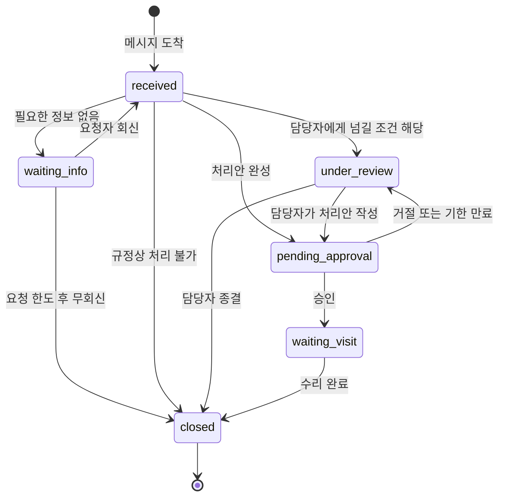
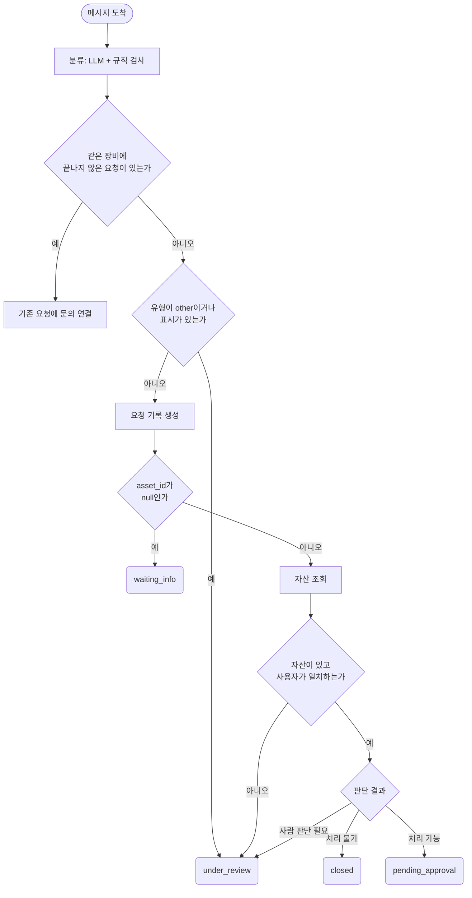

# 2장. 데이터·상태·책임을 포함한 워크플로우 설계

## 이 장에서 다루는 문제

1장에서는 업무를 접수, 분류, 조회, 판단, 승인, 응답 단계로 나누고 단계마다 결과를 누가 정할지 골랐다. 그 결과인 업무 분해도는 "각 단계의 결과를 누가 정하는가"에 답한다. 하지만 분해도만 들고 워크플로우(workflow)를 만들기 시작하면 곧 막힌다.

사내 IT 지원 업무를 자동화한다고 해 보자. 직원이 "노트북이 켜지지 않아요"라고 메시지를 보내면, 접수하고, 증상을 분류하고, 자산 정보를 조회하고, 수리인지 교체인지 판단하고, 비용이 크면 팀장 승인을 받고, 결과를 안내한다. 여기까지는 1장의 분해도로 적을 수 있다. 그런데 다음 질문에는 분해도가 답하지 못한다.

- 분류 단계가 정한 증상 값을 조회 단계는 어떤 이름의 필드에서 읽어야 하는가?
- 팀장의 승인을 기다리는 사흘 동안 이 수리 요청은 어디에 어떤 모습으로 남아 있는가?
- 직원이 자산 번호를 끝내 알려 주지 않으면 이 요청은 언제 어떻게 끝나는가?

이 장에서는 업무 분해도에 네 가지 질문을 더해 구현할 수 있는 설계로 바꾼다.

**표 2-1. 이 장에서 답할 네 가지 질문**

| 질문 | 설계 결과 | 다루는 절 |
|---|---|---|
| **단계 사이에 무엇을 주고받는가?** | 데이터 계약 | 2.1, 2.2 |
| **요청이 지금 어디에 있는가?** | 상태와 상태 전이표 | 2.3 |
| **기본 경로에서 벗어나면 무엇을 하는가?** | 실패 경로와 승인 흐름 | 2.4 |
| **언제, 어떤 상태로 끝나며 그것을 어떻게 확인하는가?** | 종료 조건, 반복 한도, 인수 조건 | 2.5, 2.6 |

네 질문의 답은 서로 이어진다. 데이터 계약에서 정한 필드가 분기의 조건이 되고, 분기의 끝은 이름 있는 상태가 되며, 그 상태가 인수 조건의 기대 결과가 된다.

이 장의 설명은 특정 업무에 매이지 않는다. 고객지원, 사내 IT 지원, 개인 기록 자동화 가운데 어떤 업무를 자동화하든 같은 네 질문에 답해야 한다. 각 절은 먼저 개념과 일반적인 예를 다루고, 마지막에 누적 프로젝트인 하루마켓 고객지원에 적용한 결과를 짧게 보여 준다. 하루마켓의 계약과 상태를 직접 설계하는 일은 실습 문서에서 한다.

이 장을 마치면 다음을 할 수 있다.

- 업무 데이터를 JSON으로 표현하고, 값의 데이터 타입을 잘못 정했을 때 뒤 단계에서 생기는 문제를 설명한다.
- 단계 사이에 주고받는 데이터를 필드명, 데이터 타입, 필수 여부, 형식·허용 값, 만드는 단계, 값이 없거나 틀릴 때의 행동으로 정의한 데이터 계약을 작성한다.
- 한 번의 실행 안에서 흐르는 데이터와 여러 실행에 걸쳐 남아야 하는 업무 상태를 구분하고 상태 전이표를 작성한다.
- 정보 누락, 조회 실패, 정책 불일치, 승인 거절의 실패 경로와 승인 흐름을 흐름도로 설계한다.
- 필요한 만큼만 둔 구조로 설계하고 종료 조건, 반복 한도, 인수 조건, 측정 초안, 기록 항목을 정한다.

이 장도 n8n을 설치하거나 실행하지 않는다. 여기서 만드는 데이터 계약은 3장에서 실제 데이터를 공통 형식(format)으로 맞출 때 목표가 되고, 4장 이후 도구와 에이전트의 입출력을 정할 때도 기준이 된다.

## 2.1 단계 사이를 오가는 데이터: JSON

### 표의 한 행이 JSON 객체가 되기까지

자동화할 데이터는 대개 표에서 출발한다. 개인 가계부를 정리하는 워크플로우를 예로 들어 보자. 지출 한 건이 표의 한 행으로 이렇게 적혀 있다.

|spent_at|merchant|category|amount|memo|
|---|---|---|---|---|
|2026-09-10T12:20:00+09:00|한빛식당|food|12000|점심|

n8n의 노드(node) 사이에서는 이 행이 JSON 객체 하나로 전달된다. **JSON**(JavaScript Object Notation)은 데이터를 텍스트로 표현하는 형식이다. 중괄호 `{}`로 감싼 **객체**는 이름과 값의 쌍을 담고, 대괄호 `[]`로 감싼 **배열**은 값의 목록을 담는다. 객체 안에서 이름으로 구분되는 값 하나를 **필드**(**field**)라고 부른다. 표에 비유하면 객체 하나가 행 하나이고 필드가 열이다. 다만 표와 달리 필드의 값으로 다시 객체나 배열을 넣을 수 있다.

위 행을 JSON으로 옮기면 다음과 같다.

```json
{
  "spent_at": "2026-09-10T12:20:00+09:00",
  "merchant": "한빛식당",
  "category": "food",
  "amount": 12000,
  "memo": "점심"
}
```

1장 1.4절에서 보았듯이 n8n에서 노드 사이에 전달되는 데이터는 아이템(item)의 배열이고, 각 아이템의 `json` 키 아래에 일반 데이터가 담긴다. 위 객체가 바로 그 `json` 아래에 들어가는 내용이다. 이 장에서 데이터 계약으로 정하는 대상도 이 객체의 필드들이다.

JSON에서 값은 표 2-2의 여섯 가지 데이터 타입 중 하나다.

**표 2-2. [JSON 값의 데이터 타입](https://www.json.org/json-ko.html)**

| 데이터 타입 | 표기 | 예 | 주로 담는 것 |
|---|---|---|---|
| 문자열 | 큰따옴표로 감싼 텍스트 | `"한빛식당"` | 식별자, 이름, 본문, 날짜와 시각, 정해진 값 목록 |
| 숫자 | 정수·실수. 따옴표 없이 숫자만 | `12000` | 금액, 수량, 경과일, 횟수 |
| 불리언 | `true` 또는 `false` | `false` | 예·아니오 표시 |
| `null` | `null` | `null` | 값이 없음 |
| 객체 | `{ }` | `{"amount": 390, "price":1000}` | 함께 쓰는 필드 묶음 |
| 배열 | `[ ]` | `["M-101", "M-102"]` | 같은 종류의 값 여러 개 |

여기서 주의할 점이 있다. 날짜와 시각 데이터 타입은 없다. JSON에서 날짜는 문자열로 작성한다. 그래서 어떤 형식(format)의 문자열로 적을지를 따로 약속해야 한다.

### 값의 데이터 타입이 뒤 단계의 규칙을 정한다

값의 데이터 타입은 사소한 표기 문제처럼 보이지만, 뒤 단계에서 규칙이 제대로 동작할지를 정한다. 가계부의 월별 합계를 예로 들어 보자. 금액을 `"12,000원"`처럼 문자열로 적으면 합계를 계산할 수 없다. 쉼표와 '원'이 붙어 있어 숫자로 읽히지 않기 때문이다. 쉼표 없이 `"12000"`으로 적어도 문자열인 이상 문제가 남는다. 문자열끼리 크기를 비교하면 글자를 앞에서부터 비교하므로 `"39000"`이 `"6000"`보다 작다고 판단될 수 있고, JavaScript 방식으로 계산하는 환경에서는 `"250"`과 `"310"`을 더하면 계산 대신 이어 붙여 `"250310"`이 된다. 금액은 원 단위 정수, 즉 `12000`으로 적어야 한다.

날짜와 시각은 문자열이지만 형식을 하나로 정한다. 이 교재는 국제 표준 형식인 ISO 8601을 따른다. 시각은 `2026-09-10T12:20:00+09:00`처럼 날짜, `T`, 시각, 시간대를 차례로 적고, 날짜만 필요하면 `2026-09-10`처럼 적는다. 이 형식은 글자 순서대로 정렬해도 시간 순서와 같고, 월과 일의 순서를 헷갈릴 일이 없다.

시각에 `+09:00`처럼 시간대를 붙이는 이유도 분명하다. 워크플로우가 실행되는 서버의 시간대 설정은 한국 시간과 다를 수 있다. 예를 들어 2026년 9월 10일 오전 8시 10분(한국 시간)은 협정 세계시(UTC)로 9월 9일 오후 11시 10분이다. 시간대 없이 시각만 저장한 뒤 서버 기준으로 날짜를 뽑으면 아침에 한 일이 전날 기록으로 들어간다. 실습 2-1의 식단 기록에서 이 문제를 직접 찾아본다.

식별자는 숫자처럼 보여도 문자열로 적는다. 자산 번호 `A-1042`처럼 문자가 섞여 있으면 당연하지만, 사번 `00321`처럼 숫자로만 된 식별자도 숫자로 적으면 앞의 `0`이 사라진다. 식별자는 계산하는 값이 아니라 구분하는 값이다.

### 값이 없음을 나타내는 방법

값이 없는 상황은 생각보다 자주 생긴다. 직원이 자산 번호를 모르거나, 영수증 사진에서 금액을 읽어내지 못하거나, 아직 승인이 나지 않아 승인 시각이 없을 수 있다. 이런 상황을 어떻게 표기하느냐에 따라 뒤 단계의 판단이 달라진다.

**표 2-3. 값이 없음을 나타내는 표기**

| 표기 | 뜻 | 문제가 되는 예 |
|---|---|---|
| `null` | 값이 없음을 명시한다 | 없음 (이 교재의 기본 표기) |
| `""` (빈 문자열) | 길이가 0인 텍스트다 | CSV의 빈 칸을 그대로 옮기면 생긴다. "값이 없는가"를 검사할 때 `null`과 따로 확인해야 한다 |
| `0` | 실제 값이 0이다 | 모르는 금액을 0으로 적으면 합계가 조용히 낮아지고, 값을 몰랐다는 사실도 사라진다 |
| 필드 자체가 없음 | 필드가 빠졌다 | 필드명 오타로 값이 안 들어온 경우와 구분할 수 없다 |

그래서 이 교재의 데이터 계약은 두 가지를 약속한다. 첫째, 값이 없으면 필드를 빼지 않고 `null`로 적는다. 둘째, 빈 문자열과 `0`은 각각 "빈 텍스트"와 "실제로 0"이라는 뜻으로만 쓴다. CSV나 스프레드시트처럼 `null`을 표현할 수 없는 저장소에서는 빈 칸을 값 없음으로 읽는다고 계약에 적고, 읽어 들일 때 `null`로 바꾼다. 이 변환을 n8n에서 구현하는 방법은 3장에서 다룬다.

### 필드를 묶을 것인가, 펼칠 것인가

한 단계가 여러 값을 한꺼번에 가져올 때가 있다. 앞의 IT 지원에서 자산 조회는 모델명, 구입일, 보증 만료일, 사용자 부서를 함께 돌려준다. 이 값들을 최상위에 나란히 둘 수도 있고, `asset`이라는 객체 하나로 묶을 수도 있다.

```json
{
  "asset_id": "A-1042",
  "asset": {
    "model": "노트북 15형",
    "purchased_at": "2024-03-11",
    "warranty_until": "2027-03-10",
    "department": "교육운영팀"
  }
}
```

묶을지 판단하는 기준은 두 가지다. 함께 만들어지고 함께 쓰이는 값이면 묶는다. 자산 정보는 조회 단계에서 한 번에 채워지고 판단 단계에서 한꺼번에 읽히며, 조회에 실패하면 네 값이 모두 없으므로 `asset` 하나를 `null`로 두면 된다. 반대로 분기 조건에 자주 쓰이거나 다른 기록과 연결하는 데 쓰는 값은 최상위에 둔다. 위 예에서 `asset_id`를 `asset` 밖에 둔 이유는, 자산을 조회하기 전부터 값이 있고 같은 자산의 다른 요청을 찾는 데 쓰이기 때문이다.

> 이 절의 내용은 [실습 2-1](실습/02/강사가이드/02_데이터상태책임을포함한워크플로우설계_실습.md#실습-2-1-식단-기록과-하루-리포트가-함께-쓰는-기록-설계)과 [실습 2-3](실습/02/강사가이드/02_데이터상태책임을포함한워크플로우설계_실습.md#실습-2-3-반품-요청의-데이터-계약과-예외-흐름-설계)의 2단계에서 확인한다.

## 2.2 입출력 계약

### 계약이 필요한 이유

1장에서 정한 대로 한 업무 안에서도 단계마다 결과를 만드는 주체가 다르다. 접수는 규칙이, 분류는 대규모 언어 모델(LLM)이, 승인은 사람이 맡는다. n8n에서는 이 단계들이 서로 다른 노드가 되고, 뒤의 노드는 앞 노드가 넘긴 값을 필드 이름으로 찾아 읽는다.

이름이 조금만 달라도 문제가 생긴다. 예를 들어 접수 단계가 자산 번호를 `assetId`라는 이름으로 넘겼는데 다음 단계는 `asset_id`가 비어 있는지 검사한다고 하자. 검사하는 쪽에서는 `asset_id`라는 필드가 없으니 값이 없다고 판단하고, 자산 번호를 멀쩡히 적은 직원에게까지 자산 번호를 다시 요청한다. 오류 메시지는 나지 않는다. 허용 값을 벗어난 값도 비슷하다. 분류 단계의 LLM이 `hardware` 대신 `"하드웨어 문제"`라고 답하면, 유형별로 경로를 나누는 분기는 이 값을 어느 경로로도 보내지 못한다.

이런 어긋남을 막으려면 단계 사이에 주고받는 데이터를 미리 약속해 두어야 한다. 이 교재는 이 약속을 **데이터 계약**이라고 부른다. 계약은 값을 만드는 쪽과 읽는 쪽이 같은 문서를 보고 일하게 한다. 나중에 한쪽을 고칠 때도 계약을 기준으로 다른 쪽에 영향이 있는지 확인할 수 있다.

### 계약의 여섯 항목

데이터 계약은 필드마다 표 2-4의 여섯 항목을 적는다.

**표 2-4. 데이터 계약의 여섯 항목**

| 항목 | 적는 내용 | 예: 자산 번호 필드 |
|---|---|---|
| **필드명** | 대소문자와 밑줄까지 정확한 이름 | `asset_id` |
| **데이터 타입** | 표 2-2의 데이터 타입과 `null` 허용 여부 | 문자열 또는 `null` |
| **필수 여부** | 어느 단계부터 값이 반드시 있어야 하는지 | 자산 조회 단계 전까지 반드시 있어야 한다 |
| **형식·허용 값** | 문자 패턴, 값 목록, 범위 | `A-` 뒤에 숫자 네 자리 |
| **만드는 단계**(**판단 주체**) | 누가 값을 만들고 누가 검사하는지 | 접수 단계. 신청 폼은 입력값을 규칙으로 검사하고, 메일은 LLM이 본문에서 추출한 뒤 규칙으로 검사한다 |
| **없거나 틀릴 때** | 어떤 행동과 상태로 이어지는지 | 직원에게 자산 번호를 요청하고 정보 요청 상태로 둔다 |

여섯 항목 중 놓치기 쉬운 것이 필수 여부다. 필수 여부를 "예·아니오"로만 적으면, 접수할 때는 없어도 되지만 조회하려면 반드시 있어야 하는 자산 번호 같은 필드를 표현할 수 없다. 그래서 **어느 단계부터 반드시 있어야 하는가**로 적는다. 마지막 항목인 "없거나 틀릴 때"도 반드시 채운다. 이 칸이 2.4절에서 실패 경로가 된다.

### 메시지 한 통과 처리 한 건: 문의 기록과 요청 기록

요청을 받아 처리하는 업무를 자동화할 때는 기록을 두 종류로 나누어야 한다. 사내 IT 지원에서 노트북 수리가 진행되는 과정을 따라가면 이유가 분명해진다.

**표 2-5. 수리 요청 한 건이 진행되는 동안의 두 기록**

| 날짜와 시각 | 일어난 일 | 메시지를 남기는 기록 | 처리를 남기는 기록 |
|---|---|---|---|
| 09-10 09:00 | 직원이 "노트북이 켜지지 않아요"라고 메시지를 보낸다 | 새로 만든다 | 수리 요청 한 건을 새로 만든다. 상태는 접수됨 |
| 09-10 14:00 | 팀장이 수리 비용을 승인한다 | 변화 없음 | 같은 요청의 상태가 수리 대기로 바뀐다 |
| 09-11 10:20 | 직원이 "언제 가져가나요?"라고 다시 묻는다 | 새로 만든다 | 새로 만들지 않는다. 기존 요청에 이 메시지를 연결한다 |
| 09-12 16:00 | 기사가 수리를 마친다 | 변화 없음 | 같은 요청의 상태가 완료로 바뀐다 |

표 2-5에서 읽어야 할 핵심은 두 기록이 서로 다른 사건에 반응한다는 점이다. 메시지 기록은 **요청하는 쪽이 메세지(요청)을 보낼 때만** 생긴다. 팀장의 승인이나 기사의 수리 완료는 메시지가 아니므로 이 기록에는 변화가 없다. 처리 기록은 **처리가 한 단계 나아갈 때마다** 같은 기록의 상태가 바뀐다. 과정이 끝나면 메시지 기록은 두 개, 처리 기록은 한 개가 남는다.

이 교재는 앞의 것을 **문의 기록**, 뒤의 것을 **요청 기록**이라고 부른다.

**표 2-6. 문의 기록과 요청 기록의 비교**

| 구분 | 문의 기록 | 요청 기록 |
|---|---|---|
| **답하는 질문** | 요청하는 쪽이 무엇을 말했는가? | 처리하는 쪽이 무엇을 처리하고 있는가? |
| **한 건의 기준** | 메시지 한 통 | 처리 한 건(업무마다 무엇을 한 건으로 볼지 정한다) |
| **언제 생기는가** | 메시지가 들어올 때마다 | 처리를 요구하는 메시지가 왔는데 같은 대상에 끝나지 않은 요청이 없을 때 |
| **언제 끝나는가** | 끝나는 개념이 없다 | 처리가 끝나 종료 상태가 될 때 |
| **바뀌는가** | 만든 뒤에는 분류 결과와 연결할 요청의 식별자를 채운다 | 처리가 진행될 때마다 상태와 근거가 바뀐다 |

기록을 한 종류만 두면 둘 중 하나가 틀어진다. 메시지마다 처리 기록을 만들면 수리 요청이 두 건으로 잡혀 기사가 같은 노트북을 두 번 가지러 간다. 반대로 처리 기록만 남기면 직원이 몇 번 물어봤는지 알 수 없다. 1장에서 고객이 "벌써 세 번째 문의"라고 했을 때 그 말이 사실인지 확인할 수 없었던 것도 같은 이유였다. 문의 기록을 요청 기록에 연결해 두면 한 처리에 몇 번 연락이 왔는지 기록으로 셀 수 있다.

**이 구분은 업무를 가리지 않는다.** 이름만 다를 뿐 같은 구조가 반복된다.

**표 2-7. 업무별 문의 기록과 요청 기록**

| 업무 | 문의 기록에 해당하는 것 | 요청 기록에 해당하는 것 | 처리 한 건의 기준 |
|---|---|---|---|
| 사내 IT 지원 | 직원이 보낸 메일이나 채팅 한 통 | 수리 요청 한 건 | 장비 한 대의 고장 한 번 |
| 병원 예약 | 예약 전화나 문자 한 번 | 예약 한 건 | 진료 한 번 |
| 휴가 관리 | 신청자와 주고받은 메신저 대화 | 휴가 신청 한 건 | 휴가 한 번 |
| 온라인 쇼핑몰 고객지원 | 고객이 보낸 웹 문의나 메일 한 통 | 반품·교환 요청 한 건 | 주문 하나에 대한 반품 한 번 또는 교환 한 번 |

고객지원용 서비스에서는 흔히 메시지를 메시지나 코멘트로, 처리 건을 티켓이나 케이스로 부르며 메시지 여러 개를 티켓 하나에 모은다. 이름은 도구마다 다르므로 이 교재는 두 기록을 문의 기록과 요청 기록으로 부른다. 업무마다 새로 정해야 하는 것은 이름이 아니라 **무엇을 처리 한 건으로 볼지**와 **새 메시지를 기존 요청에 언제 연결할지**다.

### 새 메시지가 들어왔을 때 요청 기록을 정하는 방법

문의 기록은 모든 메시지마다 만들지만, 요청 기록은 새로 만들 수도 있고 기존 요청에 연결할 수도 있고 만들지 않을 수도 있다. 새 메시지가 들어오면 다음 두 질문을 차례로 던진다.

1. **이 메시지가 처리하는 쪽이 진행할 처리와 관련 있는가?**
    - 처리를 요구하거나, 끝나지 않은 요청에 대해 묻는다면 관련 있다.
    - 둘 다 아니면 문의 기록만 남긴다. "회의실 와이파이 비밀번호가 뭔가요?" 같은 질문은 안내 한 번으로 끝나고 이어서 진행할 처리가 없다.
2. **같은 대상에 아직 끝나지 않은 요청이 있는가?**
    - IT 지원이라면 같은 장비, 쇼핑몰이라면 같은 주문처럼 업무마다 기준 대상을 정한다.
    - 있으면 새 요청을 만들지 않고 그 요청에 문의를 연결한다. 표 2-5의 09-11 메시지가 이 경우다.
    - 없으면 새 요청을 만든다. 이전 요청이 이미 끝났다면 같은 장비라도 새 처리이므로 새 요청을 만든다.

대상을 아직 모르는 경우도 있다. 직원이 자산 번호 없이 "노트북이 안 켜져요"라고만 보냈다면 처리를 요구한 것이므로 요청 기록은 만들되, `asset_id`를 `null`로 두고 자산 번호를 받는 대로 채운다.

### 요청 기록에 담는 것

요청 기록에는 처리를 진행하고 설명하는 데 필요한 값만 담는다. 업무가 달라도 다음 묶음은 대부분 필요하다.

- **식별자:** 요청을 구분하는 값. 연결된 문의의 목록은 요청 기록에 담지 않고, 문의 기록이 이 값을 가리키게 한다
- **요청자:** 누가 요청했는지. 본인 확인이 필요한 업무에서는 대상의 소유자와 대조한다
- **대상:** 장비, 주문, 신청 기간처럼 처리의 대상이 되는 정보와 조회 결과
- **분류와 처리 방식:** 분류 결과(`category`: 수리)와 사람에게 넘길지 정하는 표시(`needs_human`: true)
- **상태:** 지금 어디에 있는지, 왜 사람에게 넘겼는지, 왜 끝났는지
- **근거:** 판단에 사용한 사실, 적용한 규정, 계산 값
- **승인:** 승인 진행 상태, 기한, 결정 내용과 승인한 대상

근거를 남기는 이유는 두 가지다. 승인하는 사람이 그 값만 보고 결정할 수 있고, 결과가 틀렸을 때 분류가 틀렸는지 계산이 틀렸는지 찾을 수 있다. 1장에서 단계를 나눈 이유 중 하나였던 "문제가 생긴 위치 찾기"가 이 필드로 가능해진다. 4장에서 도구와 에이전트의 결과를 `status`, `answer`, `evidence`로 받을 때도 같은 이름을 쓴다.

승인한 대상을 따로 기록하는 것도 중요하다. 팀장이 "수리비 12만 원"을 승인했다면 그 금액을 승인 시점의 값으로 남긴다. 승인한 뒤 견적이 바뀌더라도 무엇을 승인했는지 남기기 위해서다. 집행 직전에 승인한 대상과 집행하려는 값을 다시 대조하는 방법은 6장에서 다룬다.

### LLM이 만드는 값의 계약

LLM이 만드는 값은 계약에서 특히 꼼꼼히 다룬다. 1장에서 보았듯이 LLM은 같은 입력에도 결과가 달라질 수 있고, 지시한 목록에 없는 값이나 다른 형식의 답을 낼 수 있다. 분류 단계의 계약에는 허용 값 목록, 표시 필드의 데이터 타입, 검사 규칙, 검사에 실패했을 때의 행동을 모두 적는다. 예를 들어 증상 분류라면 "`hardware`, `software`, `network`, `other` 중 하나로 답하게 하고, 목록에 없으면 한 번 다시 분류하고, 그래도 없으면 `other`로 기록해 담당자에게 넘긴다"처럼 적는다.

표시 필드처럼 예·아니오로 답해야 하는 값이 불리언이 아니면 어느 쪽으로 볼지도 정한다. "긴급 여부"를 알 수 없을 때 `false`로 보면 급한 요청이 자동 경로로 흘러가므로, 사람에게 넘기는 쪽인 `true`로 보는 편이 안전하다. 틀렸을 때의 영향이 작은 쪽으로 기본값을 정하는 것이다.

n8n은 AI 노드의 결과를 JSON 스키마(schema)에 맞춘 필드로 돌려받는 `Structured Output Parser` 하위 노드(sub-node)를 제공하며, 4장에서 사용한다. 스키마는 데이터의 필드와 데이터 타입을 기계가 검사할 수 있게 적은 명세다. 이런 기능으로 데이터 타입과 형식을 맞추더라도, 뒤 단계의 분기가 의존하는 값은 계약에 적은 규칙으로 한 번 더 확인하는 편이 안전하다.

### 계약에 넣지 않는 정보

계약은 필요한 필드를 정하는 동시에 넣지 않을 필드도 정한다. 요청 기록에는 판단과 안내, 측정에 쓰는 값만 둔다. 요청자의 메시지 원문은 문의 기록에만 두고, 연락처 전체나 결제 수단처럼 이 업무의 판단에 쓰지 않는 개인정보는 넣지 않는다. 기록에 담긴 정보가 많을수록 관리할 책임도 커지기 때문이다.

### 하루마켓에 적용하기

하루마켓 고객지원에서는 처리 한 건을 **주문 하나에 대한 반품 한 번 또는 교환 한 번**으로 정한다. 새 문의가 들어오면 같은 주문에 끝나지 않은 요청이 있는지 찾아 연결하거나 새로 만든다. 배송 일정을 묻는 문의처럼 안내 한 번으로 끝나는 문의는 요청 기록을 만들지 않는다. 1장에서 정한 문의 필드(`inquiry_id`, `received_at`, `channel`, `customer_name`, `order_id`, `message`)의 데이터 타입과 필수 여부를 확정하고, 반품 요청 기록의 필드를 묶음별로 정하는 일은 실습 2-3에서 한다.

> **LangGraph와 연결:** LangGraph에서 도구를 정의할 때 입력 인자의 이름과 데이터 타입을 스키마(Tool schema)로 적으면, 모델은 그 약속에 맞춰 도구를 호출한다. 데이터 계약은 같은 약속을 모델과 도구 사이뿐 아니라 규칙과 사람을 포함한 모든 단계 사이로 넓힌 것이다.

> 이 절의 내용은 [실습 2-1](실습/02/강사가이드/02_데이터상태책임을포함한워크플로우설계_실습.md#실습-2-1-식단-기록과-하루-리포트가-함께-쓰는-기록-설계)의 2~3단계, [실습 2-2](실습/02/강사가이드/02_데이터상태책임을포함한워크플로우설계_실습.md#실습-2-2-주간-업무-보고서-작성-흐름-설계)의 1단계, [실습 2-3](실습/02/강사가이드/02_데이터상태책임을포함한워크플로우설계_실습.md#실습-2-3-반품-요청의-데이터-계약과-예외-흐름-설계)의 2~3단계, [실습 2-5](실습/02/강사가이드/02_데이터상태책임을포함한워크플로우설계_실습.md#실습-2-5-메일함-정리의-청구서-납부-상태-설계)의 2단계에서 확인한다.

## 2.3 상태: 한 번의 실행과 여러 날에 걸친 업무

### 실행은 끝나도 업무는 끝나지 않는다

표 2-5의 수리 요청은 사흘에 걸쳐 진행되었고, 그 사이 워크플로우는 네 번 따로 실행되었다. n8n에서 **실행**(**execution**)은 워크플로우를 한 번 수행한 단위다. 9월 10일 9시의 실행 안에서 노드 사이를 흐르던 아이템은 그 실행이 끝나면 더 이상 다음 노드로 전달되지 않는다. 그런데 9월 12일에 수리 완료 통지를 받은 실행은 "이 장비의 수리는 승인을 받았고 기사 방문을 기다리던 중"이라는 사실을 알아야 다음 일을 할 수 있다. 이 사실은 어느 실행의 아이템에도 남아 있지 않다.

그래서 두 가지 데이터를 구분해야 한다.

**표 2-8. 한 번의 실행 안의 데이터와 여러 실행에 걸친 업무 상태**

| 구분 | 한 번의 실행 안의 데이터 | 여러 실행에 걸친 업무 상태 |
|---|---|---|
| **유지되는 기간** | 그 실행이 끝날 때까지 | 업무가 끝날 때까지, 필요하면 그 뒤로도 |
| **담는 것** | 이번에 들어온 입력, 중간 계산, 이번에 보낼 결과 | 업무가 지금 어디에 있는지, 무엇을 기다리는지, 지금까지의 근거 |
| **저장 위치** | 노드 사이를 흐르는 아이템 | 워크플로우 밖의 업무 데이터 저장소 |
| **IT 지원 예** | 방금 받은 메시지의 본문, 분류 노드가 방금 돌려준 증상 값 | 수리 요청이 팀장 승인을 기다리는지, 기사 방문을 기다리는지 |
| **개인 작업 예** | 오늘 아침 받은 택배 알림 메시지 | 주문한 택배 세 개가 각각 배송 중인지 도착했는지 |
| **업무 작업 예** | 방금 제출된 휴가 신청서의 입력값 | 그 신청이 승인을 기다리는지, 승인·반려되었는지 |

**상태**(**state**)는 1장에서 설명했듯이 업무가 지금 어느 지점에 있는지를 나타내는 정보다. 업무 상태는 워크플로우 밖의 저장소, 예를 들어 데이터베이스 테이블이나 스프레드시트에 둔다. 이 과정에서는 3장에서 준비하는 PostgreSQL 업무 데이터베이스가 그 역할을 맡는다. 이 장에서는 저장할 기록의 구조와 상태 변화 규칙까지만 설계한다.

n8n도 실행 기록을 보관하지만, 실행 기록은 워크플로우가 어떻게 동작했는지 확인하기 위한 기록이다. "지금 승인을 기다리는 요청이 몇 건인가"처럼 업무 담당자가 조회하는 기준으로 쓰지 않는다. 실행 기록을 읽고 장애를 분석하는 방법은 8장에서 다룬다.

### 상태 값과 상태 전이표

상태 값은 요청이 지금 어디에 있고 무엇을 기다리는지를 하나의 값으로 나타낸다. 상태 값만 정해서는 부족하다. 어떤 상태에서 어떤 상태로 바뀔 수 있는지를 정해야 한다. 이것을 표로 정리한 것이 **상태 전이표**다. 상태 전이표는 현재 상태, 상태를 바꾸는 사건, 조건, 다음 상태, 그때 실행되는 일의 다섯 열로 적는다. 표 2-9는 수리 요청의 전이표에서 정상 경로만 뽑은 것이다.

**표 2-9. 수리 요청의 상태 전이표**(정상 경로)

| 현재 상태 | 사건 | 조건 | 다음 상태 | 실행되는 일 |
|---|---|---|---|---|
| (없음) | 메시지 도착 | 같은 장비에 끝나지 않은 요청이 없다 | `received` | 요청 기록을 만든다 |
| `received` | 판단 완료 | 수리 비용이 승인 기준을 넘는다 | `pending_approval` | 승인을 요청하고 기한을 정한다 |
| `pending_approval` | 팀장 응답 | 승인 | `waiting_visit` | 승인 금액을 기록하고 기사 방문을 요청한다 |
| `waiting_visit` | 기사 통지 | 수리 완료 | `closed` | 완료를 안내하고 종료 사유를 남긴다 |

상태 전이표의 가장 중요한 역할은 **전이표에 없는 변화를 허용하지 않는 것**이다. 예를 들어 `pending_approval`에서 곧바로 `closed`로 가는 줄이 없으므로, 승인 없이 수리비가 지출된 요청은 설계상 있을 수 없는 일이 된다. 그런 변화가 일어나려 하면 오류로 기록하고 멈춘다. 이렇게 해 두면 "승인 후에만 집행한다"는 규정을 사람의 주의력이 아니라 구조로 지킬 수 있다.

그림 2-1은 실패 경로를 포함한 수리 요청의 상태 변화다. `waiting_info`는 자산 번호처럼 필요한 정보를 요청자에게 물어보고 기다리는 상태이고, `under_review`는 자동 처리를 멈추고 담당자에게 넘긴 상태다.

**그림 2-1. 수리 요청의 상태 변화**



그림 2-1에서 읽어야 할 핵심은 `closed`로 들어가는 화살표가 여러 개이고, `closed`에서 나가는 화살표는 끝을 뜻하는 것 하나뿐이라는 점이다. 어떤 경로로 들어왔든 요청은 결국 `closed`에서 끝나고, 왜 끝났는지는 2.5절의 종료 사유로 구분한다.

### 사건과 기한이 실행을 시작한다

상태가 바뀌려면 누군가 워크플로우를 실행해야 한다. 여러 날에 걸친 업무에서 실행을 시작하는 계기는 두 가지다.

첫째는 **사건이 도착하는 경우**다. 요청자의 회신, 승인자의 응답, 외부 시스템의 완료 통지처럼 무언가 일어났다는 알림이 오면 실행을 시작한다. 1장에서 소개한 `Webhook` 노드처럼 외부에서 데이터가 들어오면 실행을 시작하는 트리거 노드(trigger node)가 이 역할을 한다. 실행은 사건에 담긴 식별자로 요청 기록을 찾아 현재 상태를 읽고, 전이표에 맞는 변화만 적용한다.

둘째는 **기한을 확인하는 경우**다. "승인 기한이 지났는가", "요청자가 사흘째 답이 없는가"는 아무 사건도 일어나지 않았다는 사실이라서 알림이 오지 않는다. 그래서 `Schedule Trigger` 노드처럼 정해진 간격으로 실행을 시작해, 기한이 지난 요청을 찾아 처리한다.

한 번의 실행을 멈춘 채 기다리는 방법도 있다. n8n의 `Wait` 노드는 정한 시간이 지나거나, 지정한 시각이 되거나, 웹훅 호출이나 폼 제출이 있을 때까지 실행을 멈췄다가 재개한다. 이 방법은 흐름이 한 캔버스에서 이어져 보인다는 장점이 있다. 하지만 담당자가 "승인을 기다리는 요청 목록"을 조회하거나, 규정이 바뀌어 대기 중인 요청을 한꺼번에 다시 판단해야 한다면 대기 정보가 업무 기록에 있어야 한다. 여러 날에 걸친 업무에서는 멈춘 실행에 기대기보다 상태를 요청 기록에 남기는 설계를 기본으로 한다.

### 같은 요청에 대한 재문의를 기록으로 판단하기

문의 기록과 요청 기록을 나눈 효과가 여기서 드러난다. 새 메시지가 들어오면 접수 단계는 먼저 같은 대상에 끝나지 않은 요청이 있는지 찾는다. 있으면 새 요청을 만들지 않고 그 요청의 문의 목록에 메시지를 추가한다. 연결된 문의가 두 개 이상이면 그 요청에 대해 다시 연락이 왔다는 뜻이다.

표 2-5의 09-11 메시지가 그 예다. 이 값으로 "두 번 이상 다시 문의하면 담당자에게 넘긴다" 같은 규칙을 만들 수 있다. 요청자의 말이 아니라 기록으로 판단한다는 점이 중요하다.

### 상태는 몇 개가 적당한가

상태를 너무 잘게 나누면 전이표가 복잡해지고, 너무 뭉뚱그리면 무엇을 기다리는지 알 수 없다. 기준은 **요청이 그 상태에 머무를 수 있고, 머무는 동안 기다리는 대상이 다른가**다.

업무 단계마다 상태를 하나씩 만들고 싶을 수 있다. 앞의 수리 요청에서 분류 중인 상태(`classifying`)와 자산 조회 중인 상태(`looking_up`)를 따로 두는 식이다. 표 2-10으로 확인해 보자.

**표 2-10. 상태로 정의할지 판단하기 예**

| 상태 후보 | 요청이 머무는 시간 | 기다리는 대상 | 판단 |
|---|---|---|---|
| `pending_approval`(승인 대기) | 몇 시간에서 하루 | 승인자의 응답 | 상태로 둔다 |
| `waiting_visit`(기사 방문 대기) | 며칠 | 기사의 완료 통지 | 상태로 둔다 |
| `classifying`(분류 중) | 몇 초 | 없다. 같은 실행 안에서 바로 끝난다 | 두지 않는다 |
| `looking_up`(자산 조회 중) | 몇 초 | 없다. 같은 실행 안에서 바로 끝난다 | 두지 않는다 |

분류와 조회는 한 번의 실행 안에서 몇 초 만에 지나가므로 요청이 거기 머무르지 않는다. 둘 다 `received` 하나로 충분하다. 다만 조회하는 외부 시스템이 느려서 결과를 몇 시간씩 기다려야 한다면 그때는 요청이 실제로 머무르므로 상태로 둘 이유가 생긴다. 상태로 둘지는 이름이 아니라 **요청이 거기 머무르는지**로 판단한다.

승인 결과를 요청 상태로 둘지도 같은 기준으로 판단한다. `approved`와 `rejected`를 요청 상태로 만들면 승인 상태 필드와 같은 사실을 두 곳에 적게 되고, 두 값이 어긋날 위험이 생긴다. 그래서 승인 진행은 승인 상태 필드에만 두고, 요청 상태는 승인 뒤에 요청이 어디로 갔는지만 나타낸다.

끝난 상태도 하나만 둔다. 완료되어 끝났든 불가 안내로 끝났든 더 이상 상태가 바뀌지 않는다는 점은 같고, 달라지는 것은 안내 문구와 측정 분류뿐이기 때문이다. 그 차이는 종료 사유 필드가 맡는다.

### 하루마켓에 적용하기

하루마켓의 반품 요청도 구조가 같다. 접수되어 자동 처리 중인 상태, 고객에게 정보를 요청한 상태, 담당자에게 넘긴 상태, 승인을 기다리는 상태, 회수를 기다리는 상태, 검수 중인 상태, 끝난 상태로 나뉜다. 사건은 고객의 회신, 담당자의 승인 응답, 택배사의 회수 완료 통지, 창고의 검수 결과다. 상태 값과 전이표를 직접 만들고 사례로 검증하는 일은 실습 2-3의 4단계에서 한다.

> **LangGraph와 연결:** LangGraph에서 노드들이 읽고 쓰는 State는 여러 단계가 함께 쓰는 데이터이며, 체크포인터를 붙이면 실행 사이에도 저장된다. 이 절의 요청 기록도 여러 단계가 읽고 쓰는 데이터라는 점은 같다. 다만 n8n에서는 업무 상태를 워크플로우 밖에 두고, 저장 위치와 허용되는 상태 변화를 설계자가 직접 정한다.

> 이 절의 내용은 [실습 2-1](실습/02/강사가이드/02_데이터상태책임을포함한워크플로우설계_실습.md#실습-2-1-식단-기록과-하루-리포트가-함께-쓰는-기록-설계)의 4단계와 [실습 2-3](실습/02/강사가이드/02_데이터상태책임을포함한워크플로우설계_실습.md#실습-2-3-반품-요청의-데이터-계약과-예외-흐름-설계)의 4단계, [실습 2-5](실습/02/강사가이드/02_데이터상태책임을포함한워크플로우설계_실습.md#실습-2-5-메일함-정리의-청구서-납부-상태-설계)의 2~4단계에서 확인한다.

## 2.4 조건 분기, 실패 경로, 승인 흐름

### 분기 조건을 계약 필드로 적기

"애매하면 사람에게"처럼 말로 적은 조건은 기록된 값으로 확인할 수 없다. 1장에서는 사람에게 넘기는 조건을 "관찰할 수 있는 사실"로 적었고, 이 장에서는 그 사실을 계약의 필드와 값으로 적는다. 말로 적은 조건을 기록된 필드와 값으로 확인할 수 있는 조건으로 바꿔야 워크플로우를 구현할 때 n8n의 분기 노드의 조건으로 그대로 옮길 수 있다.

**표 2-11. 말로 적은 조건을 계약 필드로 옮기기 예**

| 말로 적은 조건 | 계약 필드로 적은 조건 |
|---|---|
| 자산 번호가 없으면 | `asset_id`가 `null`이다 |
| 증상 분류가 애매하면 | `category`가 `other`다 |
| 급한 요청이면 | `flags.urgent`가 `true`다 |
| 본인 장비가 아니면 | 조회한 장비의 사용자와 요청자가 다르다 |
| 같은 건으로 두 번 이상 다시 물으면 | 연결된 문의 기록이 3개 이상이다 |

표 2-11에서 읽어야 할 핵심은 오른쪽 열의 모든 조건이 기록된 값만으로 참·거짓을 정할 수 있다는 점이다. "요청자가 화가 난 것 같으면"처럼 값으로 적을 수 없는 조건이 남아 있다면, 그 판단을 맡을 단계와 결과 필드를 먼저 계약에 추가해야 한다.

> **LangGraph와 연결:** 기록된 값에 따라 다음 단계를 고르는 구조는 LangGraph의 조건부 엣지(conditional edge)와 같은 역할을 한다. n8n에서는 이 선택이 `If`, `Switch` 같은 분기 노드로 캔버스에 드러난다.

### 네 가지 실패 유형

기본 경로(정상 흐름)에서 벗어나는 경우는 원인에 따라 네 가지로 구분할 수 있다. 원인이 다르면 해야 할 행동도 다르다.

**표 2-12. 실패 유형과 기본 행동**

| 실패 유형 | 무엇이 문제인가 | 예 | 기본 행동 |
|---|---|---|---|
| **정보 누락** | 판단에 필요한 값을 아직 받지 못했다 | 자산 번호를 적지 않았다, 영수증 금액이 비어 있다 | 요청자에게 누락된 정보를 요청하고 반복 한도 안에서 기다린다 |
| **조회 실패** | 외부에서 사실을 확인하지 못했다 | 자산 번호가 목록에 없다, 조회 시스템이 응답하지 않는다 | 사실을 확인하지 못했으므로 단정해 안내하지 않고 담당자에게 넘긴다. 시스템 오류는 제한된 횟수만 다시 시도한다 |
| **정책 불일치** | 규정에 맞지 않거나 규정이 없다 | 보증 기간이 지났다, 규정에 없는 상황이다 | 조건 불충족 사유를 담아 불가를 안내하고 끝낸다. 규정이 없으면 담당자에게 넘긴다 |
| **승인 거절** | 사람이 처리안을 받아들이지 않았다 | 팀장이 수리 대신 교체를 지시했다 | 거절 사유를 기록하고 담당자 처리로 전환한다 |

**조회 실패**에서는 세 경우를 구분한다. 대상이 없거나 요청자가 소유자가 아니면 본인의 것인지 확인되지 않은 것이므로 어떤 정보도 안내하지 않는다. 조회 실패의 이유가 단순한 오타일 수도 있는데 이 경우 그 판단은 담당자가 한다. 조회 시스템이 응답하지 않는 경우(시스템 자체 문제)는 성격이 전혀 다르다. 대상이 없다는 사실을 확인한 것이 아니라 확인하지 못한 것이므로, "등록되지 않은 자산입니다"라고 안내하면 틀린 안내가 된다. 몇 번 다시 시도하고, 그래도 안 되면 담당자에게 넘긴다. 다시 시도하는 간격과 방법은 8장에서 다룬다.

**정책 불일치**는 다시 두 가지로 나눈다. 보증 기간이 지난 경우처럼 규정에 조건이 명확하고 그 조건을 충족하지 않는다면, 규칙이 사유를 담은 불가 안내를 보내고 끝낼 수 있다. 반면 회수한 장비를 열어 보니 규정에 없는 손상이 있는 경우처럼 기준 자체가 없다면 자동화가 정할 수 없다. 이 경우는 담당자에게 넘기고, 같은 사례가 반복되면 규정을 보완하도록 기록을 남긴다.

### 승인 흐름 설계

1장에서는 사람의 책임을 누가, 무엇을, 어떤 정보로, 언제까지 결정하고 결정 뒤에 무엇이 집행되는지로 구체화했다. 승인 흐름은 이 항목을 요청 기록의 필드와 상태 변화로 옮긴 것이다.

**표 2-13. 승인 흐름의 설계 항목**

| 항목 | 정해야 할 것 | 예: 사내 장비 수리 비용 승인 |
|---|---|---|
| **승인하는 역할**(**승인자**) | 규정상 권한이 있는 역할 | 요청자의 팀장 |
| **승인 대상** | 무엇을 승인하는가 | 수리 방식과 예상 비용 |
| **승인 요청에 담는 정보** | 결정에 필요한 값 | 장비 정보, 증상, 견적, 적용한 규정, 요청자 안내 초안 |
| **기한과 기한을 넘겼을 때** | 대기 한도와 그 뒤의 행동 | 1영업일. 넘기면 상위자에게 알리고, 다시 1영업일이 지나면 만료로 바꾸어 담당자 처리로 전환한다 |
| **거절했을 때** | 사유 기록과 다음 경로 | 사유를 남기고 담당자 처리로 전환한다 |
| **기록하는 값** | 나중에 확인할 값 | 승인 상태, 기한, 알림 시각, 결정 시각, 사유, 승인한 금액 |

승인 상태는 `pending`(대기), `approved`(승인), `rejected`(거절), `expired`(만료)의 네 가지로 둔다. 이 가운데 `expired`는 빠뜨리기 쉽다. 1장에서 사람의 확인에는 처리가 멈추는 비용이 따른다고 했다. 기한과 만료가 없으면 승인자가 휴가 중일 때 요청이 영원히 대기에 머문다. 만료는 "승인하지 않았다"는 뜻이지 "거절했다"는 뜻이 아니므로 `rejected`와 구분해 남긴다. 둘을 섞으면 승인 대기 시간이 문제인지 처리안의 품질이 문제인지 구분할 수 없다.

기한 경과 알림을 보낸 시각을 따로 기록하는 이유는 기한 확인이 정해진 간격으로 여러 번 실행되기 때문이다. 이 값이 없으면 기한 확인이 실행될 때마다 같은 알림이 다시 간다. 한 번만 일어나야 하는 일은 일어났다는 사실을 기록해 두어야 한다.

n8n에서는 여러 서비스 노드가 제공하는 `Send and Wait for Response` 작업이 승인·거절 버튼을 보내는 Approval 응답 유형을 지원하고, `Limit Wait Time` 옵션으로 정한 시간이 지나면 응답이 없어도 실행을 재개할 수 있다. 사람 승인을 구현하는 방법은 6장에서 다룬다.

> **LangGraph와 연결:** 실행을 멈추고 사람의 입력을 받아 재개하는 구조는 LangGraph에서 interrupt로 구성하는 휴먼 인 더 루프(HITL)와 비슷하다. 이 절에서는 여기에 기한과 만료, 승인한 대상의 기록까지 설계에 포함했다.

### 흐름도로 그리기

실패 경로와 승인 흐름을 문장과 표로만 적으면 경로 전체를 한눈에 보기 어렵다. 흐름도를 함께 그리면 끝이 정해지지 않은 경로나 두 조건이 겹치는 곳을 찾기 쉽다. 이 교재는 흐름도를 표 2-14의 규칙으로 그린다.

**표 2-14. 이 교재의 흐름도 표기**

| 모양 | 뜻 | Mermaid 표기 |
|---|---|---|
| **양 끝이 둥근 상자** | 흐름을 시작하는 사건 | `([메시지 도착])` |
| **사각형** | 단계 또는 실행되는 일 | `[자산 조회]` |
| **마름모** | 조건 | `{asset_id가 null인가}` |
| **모서리가 둥근 상자** | 요청이 머무르거나 끝나는 상태 | `(pending_approval)` |

그림 2-2는 수리 요청이 접수되어 승인 요청에 이르기까지의 흐름이다.

**그림 2-2. 접수부터 승인 요청까지의 흐름**



그림 2-2에서 읽어야 할 핵심은 모든 조건 마름모의 두 갈래가 어딘가의 상태 상자로 이어진다는 점이다. 분류가 요청 기록 생성보다 앞에 있는 것도 함께 읽는다. 무엇을 요구하는 메시지인지 알아야 어떤 요청 기록을 만들지, 만들지 않을지 정할 수 있다. 담당자에게 넘기는 경우에도 요청 기록은 만들어지며 상태가 `under_review`로 시작한다. 끝이 없는 화살표가 하나라도 있다면 그 경우의 처리를 아직 설계하지 않은 것이다.

설계한 흐름의 요소는 이후 장에서 표 2-15의 n8n 기능으로 구현한다. 여기서는 이름만 소개한다.

**표 2-15. 설계 요소와 n8n 기능**

| 설계 요소 | n8n 기능 | 다루는 장 |
|---|---|---|
| **조건 분기** | `If`, `Switch` 노드 | 3장 |
| **사람의 승인과 승인 기한** | `Send and Wait for Response` 작업의 Approval 응답 유형과 `Limit Wait Time` 옵션 | 6장 |
| **실행 안에서 기다리기** | `Wait` 노드 | 필요한 장에서 |
| **실행 실패 알림** | 오류 워크플로우(error workflow), `Error Trigger` 노드, `Stop And Error` 노드 | 8장 |

오류 워크플로우는 다른 워크플로우의 실행이 실패했을 때 실행되도록 지정한 워크플로우로, `Error Trigger` 노드로 시작한다. 이 절에서 설계한 실패 경로는 업무 규칙에 따른 예상된 실패이고, 오류 워크플로우는 노드 오류처럼 예상하지 못한 실패를 알리는 장치라는 점에서 역할이 다르다.

### 하루마켓에 적용하기

하루마켓 반품에서는 주문번호가 없을 때가 정보 누락, 주문이 없거나 주문자 이름이 다를 때가 조회 실패, 반품 기한이 지났을 때가 정책 불일치, 담당자가 처리안을 거절했을 때가 승인 거절이다. 1장에서 "사람에게 넘긴다"로 묶여 있던 조건이 원인에 따라 서로 다른 행동으로 나뉜다. 네 유형의 조건과 행동을 계약 필드로 적고 흐름도로 그리는 일은 실습 2-3의 1단계와 5단계에서 한다.

> 이 절의 내용은 [실습 2-2](실습/02/강사가이드/02_데이터상태책임을포함한워크플로우설계_실습.md#실습-2-2-주간-업무-보고서-작성-흐름-설계)의 2단계, [실습 2-3](실습/02/강사가이드/02_데이터상태책임을포함한워크플로우설계_실습.md#실습-2-3-반품-요청의-데이터-계약과-예외-흐름-설계)의 5단계, [실습 2-4](실습/02/강사가이드/02_데이터상태책임을포함한워크플로우설계_실습.md#실습-2-4-교환-요청에-같은-구조-적용)에서 확인한다.

## 2.5 최소 구조와 종료 조건

### 필드와 상태, 분기를 늘리는 기준

설계를 하다 보면 필드와 상태와 분기를 계속 추가하고 싶어진다. 나중에 쓸지도 모르는 필드, 혹시 모를 상황을 위한 상태, 조심스러운 마음에 넣는 승인 단계가 그렇다. 하지만 구조가 커질수록 계약을 지키고 전이표를 검증하는 비용도 함께 커진다. 1장에서 판단 주체를 "단순한 방식부터" 골랐던 원칙을 구조에도 적용한다. 이렇게 필요한 것만 담은 설계를 이 교재는 **최소 구조**라고 부른다.

필드·상태·분기를 추가할지는 다음 세 질문으로 판단한다. 하나라도 "예"이면 추가하고, 모두 "아니오"이면 넣지 않는다.

- 이 값에 따라 행동이 달라지는 단계가 있는가?
- 사람이 이 값을 보고 결정하는가?
- 품질·시간·비용을 측정하는 데 이 값을 쓰는가?

**표 2-16. 과설계와 설계 부족의 예**

| 구분 | 예 | 문제 | 고치는 방법 |
|---|---|---|---|
| **과설계** | 월 지출 합계만 보는 가계부에 결제 시각의 초, 결제 장소의 좌표, 그날 날씨 칸을 만든다 | 어떤 계산에도 쓰지 않는다. 입력이 번거로워지고 빈 칸만 쌓인다 | 합계와 분류에 쓰는 칸만 남기고, 필요해지면 그때 추가한다 |
| **과설계** | 고객에게 보여 줄 배송 상태를 포장 시작, 포장 완료, 송장 출력등을 포함해 10단계로 나눈다 | 고⁠객⁠이 배⁠송 상⁠태⁠를 확⁠인⁠하⁠고 할 수 있⁠는 일⁠은 기⁠다⁠리⁠거⁠나 물⁠건⁠을 받⁠는 것⁠뿐⁠이⁠다⁠. 10⁠단⁠계 대⁠부⁠분⁠은 알⁠아⁠도 고⁠객⁠이 할 일⁠이 달⁠라⁠지⁠지 않⁠는⁠다 | 고객 화면에는 준비 중, 배송 중, 도착 세 가지만 둔다. 창고 담당자처럼 각 단계에서 할 일이 있는 사람에게는 따로 둔다 |
| **과설계** | 3일 연차를 팀장, 파트장, 본부장, 인사팀이 차례로 승인하게 한다 | 결정을 바꾸는 사람은 한 명인데 대기 시간과 기한 처리만 네 배가 된다 | 결정을 바꿀 수 있는 승인만 남긴다 |
| **설계 부족** | 종료 사유가 없다 | 왜 끝났는지 안내하거나 측정할 수 없다 | 종료 사유를 정해진 값으로 남긴다 |
| **설계 부족** | 승인 기한이 없다 | 승인자가 응답하지 않으면 요청이 끝나지 않는다 | 기한과 만료 경로를 둔다 |
| **설계 부족** | 정보 요청의 횟수 한도가 없다 | 요청자에게 계속 요청하거나 영원히 기다린다 | 한도와 한도 도달 시 행동을 둔다 |
| **설계 부족** | 데이터 계약에 "없거나 틀릴 때" 항목을 적지 않는다 | 값이 빠지거나 틀려도 갈 경로가 정해져 있지 않아, 오류 메시지 없이 엉뚱한 경로로 가거나 처리가 멈춘다 | 필드마다 값이 없거나 틀릴 때의 행동과 상태를 계약에 적는다 |
| **설계 부족** | 판단 근거와 승인한 금액을 기록하지 않는다 | 승인자가 그 값만 보고 결정할 수 없고, 결과가 틀렸을 때 분류와 계산 중 어디가 틀렸는지 찾을 수 없다 | 판단에 쓴 사실, 적용한 규정, 계산 값과 승인 시점의 금액을 요청 기록에 남긴다 |

최소 구조는 지금 필요한 만큼만 두는 것이지 앞으로도 늘리지 않는다는 뜻이 아니다. 예를 들어 "환불을 집행하는 중"이라는 상태는 지금 설계에 없다. 8장에서 집행 요청의 응답이 유실되는 장애를 다룰 때 이 상태가 행동을 바꾸는지 다시 판단한다.

### 모든 경로는 종료 상태에서 끝난다

모든 요청은 결국 끝나야 한다. 처리가 끝나 더 이상 상태 변화가 일어나지 않는 상태를 **종료 상태**라고 한다. 요청이 종료 상태가 된 이유는 **종료 사유**로 남긴다. 종료 사유는 업무마다 다르지만 대개 표 2-17의 네 가지로 나뉜다.

**표 2-17. 종료 사유의 네 가지 갈래**

| 갈래 | 뜻 | 예 |
|---|---|---|
| **완료** | 요구한 처리를 끝냈다 | 수리 완료, 환불 완료 |
| **처리 불가** | 규정상 해 줄 수 없어 사유를 안내했다 | 보증 기간 초과, 반품 기한 초과 |
| **요청자 무응답** | 필요한 정보를 받지 못해 종결했다 | 자산 번호를 끝내 받지 못했다 |
| **담당자 종결** | 사람이 넘겨받아 처리하고 끝냈다 | 담당자가 직접 안내하고 종결했다 |

여기서 "담당자에게 넘김"은 종료 상태가 아니라는 점에 주의한다. 넘기면 자동화의 흐름은 거기서 멈추지만 요청은 끝나지 않았다. 담당자가 처리안을 만들어 다시 승인 요청으로 보내거나 직접 종결해야 끝난다. 이 구분이 흐려지면 두 가지 문제가 생긴다. 요청자는 사람에게 넘어간 요청을 끝난 것으로 오해할 수 있고, 운영 측면에서는 넘긴 건수까지 처리 완료로 세어 자동화의 성과가 부풀려진다.

### 반복 한도

기다리고 다시 시도하는 동작에는 모두 한도가 필요하다. **반복 한도**는 되풀이되는 동작의 최대 횟수나 기간과, 한도에 도달했을 때의 행동을 함께 정한 것이다. 한도만 적고 도달 시 행동을 적지 않으면 "세 번 요청한 다음에는 어떻게 하는가"라는 질문이 다시 남으므로, 두 가지를 반드시 함께 적는다.

**표 2-18. 한도를 정해야 하는 동작**

| 반복되는 동작 | 정해야 할 것 | 한도에 도달했을 때의 예 |
|---|---|---|
| **요청자에게 정보 요청** | 재요청 횟수와 간격, 무응답으로 볼 기간 | 종료 사유를 요청자 무응답으로 남기고 끝낸다 |
| **승인 대기** | 기한, 기한 경과 알림, 만료로 볼 시점 | 승인 상태를 만료로 바꾸고 담당자 처리로 전환한다 |
| **외부 시스템 오류 재시도** | 다시 시도할 횟수 | 담당자에게 넘긴다. 재시도 간격과 방법은 8장에서 다룬다 |
| **모델 결과 검사 실패** | 다시 생성할 횟수 | 기타 값으로 기록하고 담당자에게 넘긴다 |
| **같은 요청에 대한 재문의** | 몇 번째 재문의부터 사람에게 넘길지 | 즉시 담당자에게 넘긴다 |

한도를 정하면 요청이 언제 어떻게 끝나는지 날짜로 계산할 수 있다. 예를 들어 "1영업일 간격으로 최대 두 번 다시 요청하고, 마지막 요청 뒤 3영업일 동안 답이 없으면 종결한다"고 정하면, 목요일에 접수된 요청이 언제 종결되는지 달력에서 셀 수 있다. 끝나는 시각을 계산할 수 없는 설계는 아직 종료 조건이 완성되지 않은 것이다.

에이전트가 도구 호출을 반복하는 횟수에도 한도가 필요하며, 이것은 4장에서 다룬다.

> 이 절의 내용은 [실습 2-1](실습/02/강사가이드/02_데이터상태책임을포함한워크플로우설계_실습.md#실습-2-1-식단-기록과-하루-리포트가-함께-쓰는-기록-설계)의 4단계, [실습 2-2](실습/02/강사가이드/02_데이터상태책임을포함한워크플로우설계_실습.md#실습-2-2-주간-업무-보고서-작성-흐름-설계)의 3단계, [실습 2-3](실습/02/강사가이드/02_데이터상태책임을포함한워크플로우설계_실습.md#실습-2-3-반품-요청의-데이터-계약과-예외-흐름-설계)의 6단계, [실습 2-5](실습/02/강사가이드/02_데이터상태책임을포함한워크플로우설계_실습.md#실습-2-5-메일함-정리의-청구서-납부-상태-설계)의 4단계에서 확인한다.

## 2.6 인수 조건, 측정 초안, 기록 항목

### 인수 조건

설계가 끝났다는 것을 어떻게 알 수 있을까? "요청을 정확하게 처리한다"는 목표는 누구나 동의하지만 확인할 수 없다. 무엇이 정확한 처리인지 사례마다 달라지기 때문이다. **인수 조건**은 설계나 구현이 완성되었다고 받아들이기 위해 사례별로 확인할 입력, 기대 경로, 기대 결과, 확인 방법을 정한 것이다.

**표 2-19. 인수 조건의 예: 승인 기한이 지난 수리 요청**

| 항목 | 내용 |
|---|---|
| **사례 입력** | 09-10(목) 14:30에 접수되어 같은 시각에 승인을 요청한 수리 요청. 승인자가 응답하지 않는다 |
| **기대 경로** | 접수 → 분류 → 조회 → 판단 → 승인 요청 → 기한 확인(상위자 알림) → 기한 확인(만료) → 담당자 처리로 전환 |
| **기대 상태** | 09-11 14:30 이후 첫 기한 확인에서 알림 기록이 남고 상태는 승인 대기로 유지된다. 09-14 14:30 이후 첫 기한 확인에서 담당자에게 넘긴 상태가 된다 |
| **핵심 필드의 기대 값** | 승인 상태는 만료, 기한 경과 알림 시각에 값이 있고, 승인한 금액은 `null`, 종료 사유는 `null` |
| **확인 방법** | 기록 항목에서 기한 확인 두 번의 시각을 대조하고, 수리 요청이나 비용 집행 기록이 없는지 확인한다 |

좋은 인수 조건은 결과뿐 아니라 **일어나지 말아야 할 일**도 확인한다. 위 예에서 승인한 금액이 `null`이라는 조건은 승인 없이 비용이 집행되지 않았는지를 확인한다.

인수 조건의 사례는 정상 사례, 경계 사례, 실패 사례를 섞어 구성한다. 경계 사례는 조건이 바뀌는 바로 그 지점의 입력이다. 예를 들어 보증 기간의 마지막 날에 접수된 요청은 무상 수리에 들어가야 하고, 하루 뒤는 들어가지 않아야 한다. 이런 사례가 날짜 계산의 작은 실수를 찾아낸다. 11장의 최종 인수에서는 정상, 경계, 악성·권한 위반, 장애 사례를 함께 사용한다. 이 장에서는 정상·경계·실패 사례로 시작하고, 악성 입력은 6장, 장애 사례는 8장에서 추가한다.

### 측정 초안

인수 조건이 "설계대로 동작하는가"를 확인한다면, 측정은 "얼마나 잘 동작하는가"를 확인한다. 측정은 운영이 시작된 뒤에 하지만, 무엇을 어떻게 셀지는 설계할 때 정해야 한다. 나중에 세고 싶은 값이 기록에 없으면 셀 수 없기 때문이다. 이렇게 측정 전에 정한 지표 정의를 이 교재는 **측정 초안**이라고 부른다.

**표 2-20. 측정 초안에 담을 지표**

| 구분 | 지표 | 세는 방법의 예 | 필요한 기록 |
|---|---|---|---|
| **품질** | 분류 일치율 | 인수 조건 사례 중 기대한 유형과 같은 결과의 수 ÷ 분류까지 간 사례 수 | 분류 결과 필드 |
| **품질** | 판단 일치율 | 기대한 판단과 같은 결과의 수 ÷ 판단까지 간 사례 수 | 판단 결과 필드 |
| **품질** | 잘못된 안내 수 | 확인되지 않은 사실을 안내한 건수. 목표는 0 | 안내 기록 |
| **시간** | 첫 안내까지 걸린 시간 | 첫 안내 기록의 시각 − 요청 생성 시각 | 기록 항목, 생성 시각 |
| **시간** | 승인 대기 시간 | 승인 결정 시각 − 승인 요청 시각 | 승인 필드 |
| **비용** | 요청당 LLM 호출 수 | 판단 주체가 LLM인 기록 항목 수 ÷ 요청 수 | 기록 항목 |
| **비용** | 담당자 이관 비율 | 담당자에게 넘어간 요청 수 ÷ 전체 요청 수. 넘긴 사유별로 나누어 본다 | 이관 사유 필드 |

이관 비율을 사유별로 나누어 보는 이유는, 이관이 많다는 사실만으로는 분류가 부정확한지, 규정에 기준이 비어 있는지, 승인이 늦는지 구분할 수 없기 때문이다. 이 지표들은 9장에서 기준선을 만들고 개선 전후를 비교할 때 출발점이 된다.

### 기록 항목

요청 기록은 요청의 **현재** 모습만 담는다. 끝난 요청의 기록에는 마지막 상태만 남고, 그 사이 어떤 상태를 언제 거쳤는지는 남지 않는다. 변화의 이력은 별도로 남겨야 한다. **기록 항목**은 요청 처리 중 무엇이 언제 누구에 의해 바뀌었는지 남기기 위해 정한 로그 필드다.

**표 2-21. 기록 항목 초안**

| 필드 | 뜻 | 남기는 값의 예 |
|---|---|---|
| **기록 식별자** | 기록 한 줄의 식별자 | `LOG-000123` |
| **요청 식별자** | 관련 요청 | `REQ-0001` |
| **문의 식별자** | 이 기록을 만든 메시지(있을 때) | `INQ-016` |
| **실행 식별자** | n8n 실행의 식별자 | 3장 이후 실제 값을 채운다 |
| **단계** | 어느 단계에서 일어났는지 | 접수, 분류, 조회, 판단, 승인, 응답, 사건 수신, 기한 확인 |
| **판단 주체** | 규칙, LLM, 사람, 외부 시스템 중 무엇이 한 일인지 | `rule`, `llm`, `approver`, `external` |
| **상태 변화** | 이전 상태와 다음 상태. 변화가 없으면 같은 값 | `pending_approval` → `waiting_visit` |
| **결과** | 결과를 요약한 코드 | `eligible`, `not_found`, `reply_sent` |
| **오류** | 오류 코드. 없으면 `null` | `lookup_timeout` |
| **기록 시각** | 언제 일어났는지 | `2026-09-10T15:00:00+09:00` |
| **워크플로우 버전** | 어느 버전이 처리했는지 | 10장에서 채운다 |

기록 항목에는 메시지 원문, 요청자 이름, 안내문 전문을 넣지 않는다. 필요하면 식별자로 문의 기록을 찾아볼 수 있기 때문이다. 요청 식별자와 실행 식별자를 연결하고 장애를 추적하는 방법은 8장에서, 워크플로우 버전을 채우는 방법은 10장에서 다룬다.

> 이 절의 내용은 [실습 2-3](실습/02/강사가이드/02_데이터상태책임을포함한워크플로우설계_실습.md#실습-2-3-반품-요청의-데이터-계약과-예외-흐름-설계)의 7단계와 [실습 2-4](실습/02/강사가이드/02_데이터상태책임을포함한워크플로우설계_실습.md#실습-2-4-교환-요청에-같은-구조-적용)에서 확인한다.

## 2.7 정리

이 장의 네 질문은 하나의 설계로 이어진다. 먼저 단계 사이에 주고받는 데이터를 JSON으로 표현하고, 필드마다 데이터 타입과 필수 여부, 허용 값, 만드는 단계, 값이 없거나 틀릴 때의 행동을 데이터 계약으로 적는다. 계약의 마지막 칸인 "없거나 틀릴 때"는 그대로 실패 경로가 되고, 계약의 필드와 값은 분기 조건이 된다.

다음으로 한 번의 실행 안에서 흐르는 데이터와 여러 실행에 걸쳐 남아야 하는 업무 상태를 구분한다. 여러 날에 걸친 업무는 요청 기록에 상태를 남기고, 사건이 도착하거나 기한이 지날 때마다 새 실행이 그 상태를 읽어 상태 전이표에 정한 변화만 적용한다. 메시지를 남기는 문의 기록과 처리를 남기는 요청 기록을 나누어 두면, 한 처리에 몇 번 연락이 왔는지처럼 말로만 알던 사실을 기록으로 판단할 수 있다.

실패와 승인은 예외 처리가 아니라 설계된 경로다. 정보 누락, 조회 실패, 정책 불일치, 승인 거절은 원인이 다르므로 행동도 다르며, 승인에는 기한과 만료, 승인한 대상의 기록이 따른다. 모든 경로는 종료 상태에서 끝나야 하고, 기다리거나 다시 시도하는 동작에는 한도와 도달 시 행동을 함께 정한다. 마지막으로 인수 조건, 측정 초안, 기록 항목으로 설계가 맞게 동작하는지와 얼마나 잘 동작하는지를 확인할 수 있게 만든다.

적용할 때는 세 가지를 주의한다. 필드·상태·분기는 행동이나 결정, 측정으로 이어질 때만 추가한다. 담당자에게 넘기는 것을 업무의 종결로 세지 않는다. 끝나는 시각을 계산할 수 없는 경로가 있다면 아직 설계가 끝나지 않은 것이다.

3장에서는 n8n 실행 환경을 준비하고, 이 장에서 정한 계약을 목표 형식으로 삼아 여러 채널로 들어온 데이터를 정규화하고 분기한다.

## 자기 점검 문제

해설은 문제 뒤의 [자기 점검 해설](#자기-점검-해설)에 있다. 먼저 스스로 답을 적어 본 뒤 확인한다.

**문제 1.** 개인 운동 기록 앱이 달리기 한 번을 다음 JSON으로 저장한다. 이 기록을 모아 주간 달리기 거리 합계와 평균 심박수를 계산하려 한다. 계산에서 문제가 될 필드를 모두 찾아 이유를 쓰고, 고친 JSON을 쓰시오.

```json
{
  "workout_date": "9/10",
  "exercise": "running",
  "distance_km": "5km",
  "duration_min": 32,
  "heart_rate_avg": 0,
  "memo": ""
}
```

`heart_rate_avg`의 `0`은 그날 심박 측정 기기를 차지 않아 값을 알 수 없다는 뜻으로 넣은 것이다.

**문제 2.** 사내 비품 신청 워크플로우는 신청서를 받아 팀장 승인 후 구매 담당자에게 넘긴다. 신청서의 필드는 `request_no`, `requester`, `item_name`, `quantity`, `needed_by`(필요한 날짜)다. `quantity`와 `needed_by`에 대해 데이터 계약의 여섯 항목을 쓰시오.

**문제 3.** 다음 다섯 가지를 "한 번의 실행 안의 데이터"와 "여러 실행에 걸친 업무 상태"로 나누고 이유를 쓰시오.

- (가) 이번 실행에서 받은 메시지의 본문
- (나) 수리 요청이 기사 방문을 기다리고 있다는 사실
- (다) 분류 노드가 방금 돌려준 유형 값을 다음 노드가 읽어 분기하는 것
- (라) 승인 기한이 내일 오후 2시 30분이라는 값
- (마) 요청자가 같은 장비로 이미 한 번 문의했다는 사실

**문제 4.** 휴가 신청 워크플로우의 상태 전이표 초안이다. 상태 값은 `submitted`, `approved`, `rejected`, `cancelled`다. 이 전이표의 문제점을 두 가지 이상 찾아 고치시오.

| 현재 상태 | 사건 | 조건 | 다음 상태 | 실행되는 일 |
|---|---|---|---|---|
| `submitted` | 팀장 응답 | 승인 | `approved` | 인사팀에 알린다 |
| `submitted` | 팀장 응답 | 반려 | `rejected` | 신청자에게 반려 사유를 안내한다 |
| `rejected` | 신청자가 수정해 제출 | — | `approved` | — |
| `approved` | 신청자 취소 | 휴가 시작 전 | `cancelled` | 인사팀에 알린다 |

**문제 5.** 사내 IT 지원 워크플로우에서 다음 상황은 네 가지 실패 유형 중 어디에 해당하는지 쓰고, 기본 행동을 쓰시오.

- (가) 직원이 자산 번호 없이 "노트북이 안 켜져요"라고만 적었다.
- (나) 자산 관리 시스템이 세 번 연속 응답하지 않았다.
- (다) 보증 기간이 끝난 장비의 무상 수리를 요청했다.
- (라) 팀장이 견적을 보고 수리 대신 교체를 지시하며 승인을 거절했다.

**문제 6.** 동호회 총무가 회비 납부 요청을 자동화하려고 다음과 같이 설계했다. 이 설계의 문제를 종료 조건과 반복 한도 관점에서 설명하고 고친 설계를 쓰시오.

> 매일 오전 9시에 미납 회원 명단을 확인해 명단의 모든 회원에게 납부 요청 메시지를 보낸다. 회비를 낸 회원은 명단에서 뺀다.

**문제 7.** 다음 인수 조건을 확인할 수 있게 고쳐 쓰시오. 업무는 사내 비품 신청이며, 사례는 "9월 10일(목) 오전 10시에 신청서가 접수되었고 팀장이 승인 요청에 응답하지 않는다"이다. 승인 기한은 1영업일이고, 기한이 지나면 상위자에게 알린 뒤 다시 1영업일이 지나면 만료로 처리한다고 가정한다.

> 승인 기한이 지난 신청을 잘 처리한다.

**문제 8.** 사내 회의실 예약 워크플로우는 예약 요청을 받아 시간이 겹치는지 규칙으로 검사하고, 겹치지 않으면 확정, 겹치면 거절을 안내한다. 누군가 요청 기록을 다음과 같이 제안했다. 최소 구조의 기준으로 뺄 것과 남길 것을 고르고 이유를 쓰시오.

- 필드: `reservation_id`, `room`, `start_at`, `end_at`, `requester`, `requester_phone`, `requester_department`, `purpose`, `status`
- 상태 값: `requested`, `checking`, `confirmed`, `confirmed_notified`, `rejected`, `rejected_notified`

## 자기 점검 해설

**문제 1 해설.** 문제가 되는 필드는 세 가지다.

- `workout_date`: `"9/10"`은 연도가 없고 월/일인지 일/월인지 알 수 없다. 주간 범위로 기록을 고르거나 날짜순으로 정렬할 수 없다. `"2026-09-10"`처럼 ISO 8601 형식으로 적는다.
- `distance_km`: `"5km"`는 단위가 붙은 문자열이라 합계를 계산할 수 없다. 단위는 필드명에 이미 있으므로 숫자 `5`로 적는다.
- `heart_rate_avg`: 모르는 값을 `0`으로 적어 평균 심박수가 실제보다 낮아진다. `null`로 적고, 평균을 낼 때는 `null`인 기록을 빼고 계산한다.

`memo`의 `""`는 "적은 메모가 없다"는 뜻으로 읽을 수 있고 계산에 쓰이지 않으므로 그대로 두어도 된다. 다만 계약에서 빈 메모를 `""`로 적을지 `null`로 적을지 한 가지로 정해 두어야 한다. 고친 JSON은 다음과 같다.

```json
{
  "workout_date": "2026-09-10",
  "exercise": "running",
  "distance_km": 5,
  "duration_min": 32,
  "heart_rate_avg": null,
  "memo": ""
}
```

**문제 2 해설.** 예시 답은 다음과 같으며, 행동은 조직의 사정에 따라 달라질 수 있다.

| 필드 | 데이터 타입 | 필수 | 형식·허용 값 | 만드는 단계(판단 주체) | 없거나 틀릴 때 |
|---|---|---|---|---|---|
| `quantity` | 숫자(정수) | 팀장 승인 요청 전까지 | 1 이상. 비품별 1회 최대 수량 이하 | 신청서 제출(신청자 입력, 규칙 검사) | 숫자가 아니거나 1 미만이면 신청자에게 수정을 요청한다. 최대 수량을 넘으면 승인 요청에 초과 사실을 표시해 팀장이 판단하게 한다 |
| `needed_by` | 문자열(날짜) | 구매 담당자에게 넘기기 전까지 | `YYYY-MM-DD`, 신청일 이후 | 신청서 제출(신청자 입력, 규칙 검사) | 형식이 틀리거나 지난 날짜면 신청자에게 수정을 요청한다 |

`needed_by`를 "팀장 승인 전까지"로 적은 답도, 팀장이 필요 날짜를 보고 승인 여부를 판단한다는 조건을 밝혔다면 성립한다. 핵심은 필수 여부를 단계 기준으로 적고, 틀린 값마다 행동을 정했는지다.

**문제 3 해설.** (가)와 (다)는 한 번의 실행 안의 데이터이고, (나), (라), (마)는 여러 실행에 걸친 업무 상태다.

- (가)는 이번 실행의 입력이다. 원문은 문의 기록에 남기지만, 노드 사이를 흐르는 값 자체는 실행이 끝나면 전달이 끝난다.
- (다)는 한 실행 안에서 노드가 앞 노드의 결과를 읽는 동작이다. 다만 분류 결과는 뒤의 실행에서도 필요하므로 요청 기록에 따로 저장한다. 전달하는 동작과 저장하는 값을 구분하는 것이 이 문제의 핵심이다.
- (나)와 (라)는 완료 통지나 기한 확인이 오는 다른 실행이 읽어야 하는 값이다.
- (마)는 다음 메시지가 들어오는 실행이 읽어야 재문의 여부를 판단할 수 있다.

**문제 4 해설.** 다음 문제들이 있다.

- `rejected`에서 곧바로 `approved`로 간다. 수정해 다시 제출한 신청이 팀장 승인 없이 승인된다. 다음 상태를 `submitted`로 고치고 "팀장에게 다시 승인 요청"을 실행되는 일로 적는다.
- 팀장이 응답하지 않는 경우가 없다. 신청이 `submitted`에 영원히 머무를 수 있다. "기한 확인 / 승인 요청 후 2영업일 무응답 / `submitted` 유지 / 팀장의 상위자에게 알림" 같은 줄을 추가하고, 휴가 시작일이 지나면 어떻게 끝낼지도 정한다.
- `submitted`나 `rejected`에서의 취소가 없다. 승인 전에 신청자가 마음을 바꾸는 경우를 처리할 줄이 없다. 필요하면 `submitted` → `cancelled` 전이를 추가한다.
- 종료 상태가 분명하지 않다. `cancelled`는 끝나는 상태이지만, `approved`와 `rejected`가 끝나는 상태인지 적혀 있지 않다. 반려된 신청을 다시 제출할 수 있으므로 `rejected`는 종료 상태가 아니다. 휴가를 다 쓴 뒤의 처리를 어떻게 할지도 정한다.

**문제 5 해설.**

- (가) **정보 누락.** 자산 번호를 요청하고 정보 요청 상태로 둔다. 같은 이름의 장비가 있더라도 이름만으로 장비를 특정해 처리하지 않는다. 반복 한도가 끝날 때까지 회신이 없으면 요청자 무응답으로 종결한다.
- (나) **조회 실패**(**시스템 오류**). 한도만큼 다시 시도했으므로 담당자에게 넘긴다. 자산이 없다는 사실을 확인한 것이 아니므로 "등록되지 않은 자산입니다"라고 안내하지 않는다.
- (다) **정책 불일치**(**조건 불충족**). 보증 기간이 끝났다는 사유와 유상 수리 절차를 안내하고 종료한다.
- (라) **승인 거절.** 거절 사유를 기록하고 담당자 처리로 전환한다. 담당자가 교체 절차를 안내하면 담당자 종결로 끝난다.

**문제 6 해설.** 이 설계에는 두 가지 문제가 있다. 첫째, 반복 한도가 없다. 회비를 끝내 내지 않는 회원은 매일 요청을 받게 되어 불쾌감을 주고, 총무는 누가 몇 번 요청을 받았는지 알 수 없다. 둘째, 종료 조건이 "회비를 냈다" 하나뿐이다. 탈퇴한 회원이나 회비를 면제받은 회원에게도 계속 요청이 간다. 고친 설계의 예는 다음과 같다.

- 회원별로 납부 요청 기록을 두고 상태(`requested`, `paid`, `exempted`, `unpaid_closed`)와 요청 횟수를 남긴다.
- 요청은 3일 간격으로 최대 3회 보낸다. 3회 요청 뒤 7일이 지나도 납부하지 않으면 요청을 멈추고 총무에게 명단을 보낸 뒤 `unpaid_closed`로 끝낸다.
- 납부가 확인되면 `paid`, 총무가 면제하거나 회원이 탈퇴하면 `exempted`로 끝낸다.

간격과 횟수는 동호회의 사정에 따라 달라도 된다. 핵심은 한도와 한도 도달 시 행동, 모든 경우의 종료 상태가 적혀 있는지다.

**문제 7 해설.** 예시 답은 다음과 같다.

| 항목 | 내용 |
|---|---|
| **사례 입력** | 2026-09-10(목) 10:00에 접수된 비품 신청. 같은 시각에 팀장에게 승인을 요청했고 팀장이 응답하지 않는다 |
| **기대 경로** | 접수 → 검사 → 승인 요청 → 기한 확인(상위자 알림) → 기한 확인(만료) → 담당자 처리로 전환 |
| **기대 상태** | 2026-09-11(금) 10:00 이후 첫 기한 확인에서 상위자 알림 기록이 남고 상태는 승인 대기로 유지된다. 2026-09-14(월) 10:00 이후 첫 기한 확인에서 승인 대기가 풀리고 담당자에게 넘어간다 |
| **핵심 필드의 기대 값** | 승인 상태는 만료, 기한 경과 알림 시각에 값이 있고, 구매 요청 번호는 `null` |
| **확인 방법** | 기록 항목에서 기한 확인 두 번의 시각과 알림이 한 번만 갔는지 확인하고, 구매 담당자에게 넘어간 기록이 없는지 확인한다 |

9월 11일(금) 뒤의 1영업일은 주말을 건너뛴 9월 14일(월)이다. 거절이 아니라 만료로 남는지, 신청이 종료 상태가 되지 않았는지 확인하는 것이 중요하다.

**문제 8 해설.** 유일한 정답은 없으며, 다음은 판단의 예다.

- 상태 `checking`은 뺀다. 겹침 검사는 한 실행 안에서 끝나 요청이 머무르지 않는다.
- 상태 `confirmed_notified`와 `rejected_notified`는 뺀다. 안내를 보냈는지는 상태를 바꾸는 사건이 아니라 기록 항목으로 남기면 된다. 다만 안내 발송이 실패했을 때 다시 보내는 처리가 필요하다면 그 설계는 8장에서 다시 판단한다.
- 필드 `requester_phone`은 뺀다. 안내가 사내 메신저로 간다면 판단·안내·측정 어디에도 쓰이지 않는다. 문자로 안내한다면 남긴다.
- 필드 `requester_department`는 조건에 따라 남긴다. 부서별 회의실 사용량을 측정한다면 남기고, 그렇지 않다면 뺀다.
- 나머지는 남긴다. `room`, `start_at`, `end_at`은 겹침 검사에, `reservation_id`와 `requester`는 식별과 안내에, `purpose`는 사람이 예약 충돌을 조정할 때 쓰인다.

최소 구조의 판단은 사용 방식에 따라 달라지므로, 뺀 이유와 남긴 이유가 세 질문(행동, 사람의 결정, 측정) 중 어디에 해당하는지 설명했다면 성립한다.

## 참고 자료

모든 자료의 확인일은 2026-09-15이며, 적용 버전은 n8n 2.43.7이다.

- n8n Docs, [Understand n8n's data structure](https://docs.n8n.io/build/work-with-data/understand-n8ns-data-structure) — 아이템 배열과 `json` 키
- n8n Docs, [Wait](https://docs.n8n.io/integrations/builtin/core-nodes/n8n-nodes-base.wait) — 재개 조건(After Time Interval, At Specified Time, On Webhook Call, On Form Submitted)과 `Limit Wait Time`
- n8n Docs, [Chat](https://docs.n8n.io/integrations/builtin/core-nodes/n8n-nodes-langchain.chat) — `Send and Wait for Response` 작업의 Free Text·Approval 응답 유형과 `Limit Wait Time` 옵션
- n8n Docs, [Handle errors gracefully](https://docs.n8n.io/build/flow-logic/handle-errors-gracefully) — 오류 워크플로우, `Error Trigger` 노드, `Stop And Error` 노드
- n8n Docs, [Error Trigger](https://docs.n8n.io/integrations/builtin/core-nodes/n8n-nodes-base.errortrigger) — 오류 워크플로우를 시작하는 트리거 노드
- n8n Docs, [Structured Output Parser](https://docs.n8n.io/integrations/builtin/cluster-nodes/sub-nodes/n8n-nodes-langchain.outputparserstructured) — JSON 스키마에 따른 필드 반환
- n8n Docs, [Split with conditionals](https://docs.n8n.io/build/flow-logic/split-with-conditionals) — `If`, `Switch` 노드를 이용한 분기
- n8n Docs, [Webhook](https://docs.n8n.io/integrations/builtin/core-nodes/n8n-nodes-base.webhook), [Schedule Trigger](https://docs.n8n.io/integrations/builtin/core-nodes/n8n-nodes-base.scheduletrigger) — 사건과 일정에 따른 실행 시작
- IETF, [RFC 8259: The JavaScript Object Notation (JSON) Data Interchange Format](https://www.rfc-editor.org/rfc/rfc8259) — JSON 값의 데이터 타입
