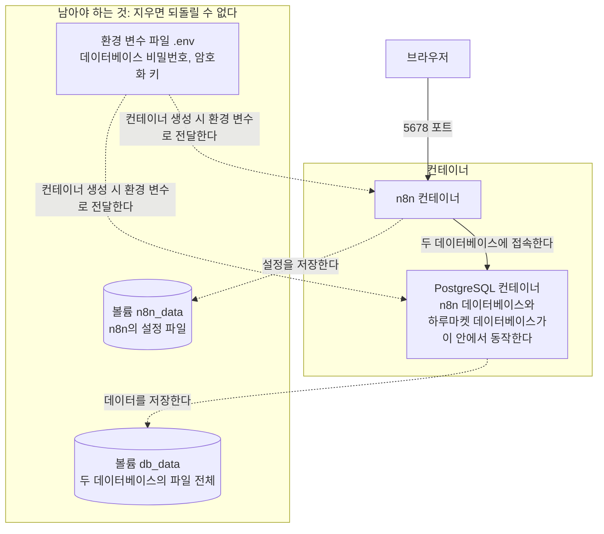
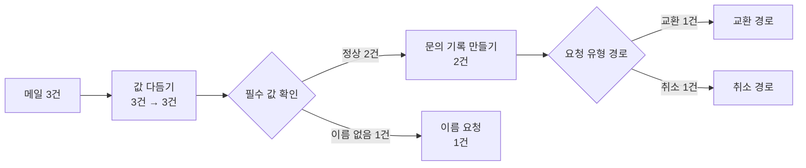
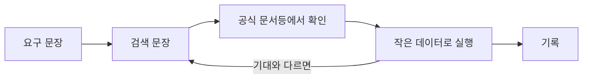

# 3장. 실행 환경과 데이터 흐름 읽기

> 적용 버전: n8n 2.43.7 셀프 호스팅 Community Edition. 공식 문서 확인일: 2026-09-16.

## 이 장에서 다루는 문제

1장에서는 업무를 단계로 나누고 단계마다 결과를 누가 정할지 골랐다. 2장에서는 단계 사이에 주고받을 데이터를 계약으로 정하고, 상태와 실패 경로와 인수 조건을 설계했다. 지금까지 만든 것은 모두 문서다. 아직 아무것도 실행되지 않는다.

이 장부터는 설계를 실행되는 워크플로우(workflow)로 옮긴다. 그런데 처음 도구를 실행하는 자리에서는 설계할 때 생각하지 않아도 되던 질문들이 한꺼번에 밀려온다. 만든 워크플로우는 어디에 저장되는가? 컴퓨터를 껐다 켜면 사라지는가? "지금 시각"은 어느 나라의 시각인가? 분명히 값을 넣었는데 다음 단계에서 빈 값이 나오면 어디를 봐야 하는가?

이 장은 그런 질문 세 가지에 답한다.

**표 3-1. 이 장에서 답할 세 가지 질문**

| 질문 | 다루는 내용 | 다루는 절 |
|---|---|---|
| **이 설계를 어디에서 실행하는가?** | 실행 방식의 선택과 환경이 지켜야 할 것 | 3.1, 3.2 |
| **실행 중에 데이터는 어떤 모습으로 흐르는가?** | 아이템, 필드 참조와 표현식, 실행 결과 읽기 | 3.3, 3.4, 3.5 |
| **필요한 기능을 어떻게 찾아 연결하는가?** | 요구에서 기능을 찾는 절차 | 3.6 |

세 질문은 순서대로 이어진다. 환경이 있어야 실행할 수 있고, 데이터가 어떤 모습으로 흐르는지 알아야 결과를 읽을 수 있고, 결과를 읽을 수 있어야 새 기능을 찾아 붙여 보고 맞는지 판단할 수 있다.

이 장을 마치면 다음을 할 수 있다.

- 컨테이너로 실행하는 방식, 직접 설치하는 방식, 서비스를 이용하는 방식을 업무 조건으로 비교하고 고른 이유를 설명한다.
- 실행 환경에서 지켜야 할 것이 무엇이고 그것이 어디에 저장되는지 설명한다. n8n이 자기 정보를 저장하는 데이터베이스와 업무 데이터를 저장하는 데이터베이스를 구분한다.
- 노드(node) 사이를 흐르는 아이템(item)의 구조를 설명하고, 어느 노드에서 아이템 수가 바뀌는지 예상한다.
- 표현식(expression)으로 필드를 참조하고, 값이 없거나 데이터 타입이 다른 값을 계약에 맞게 바꾼다.
- 실행 결과를 읽어 값이 처음 틀어진 지점을 찾는다.
- 업무 요구를 검색 문장으로 바꾸어 공식 문서에서 기능을 찾고, 작은 데이터로 확인한 뒤 연결한다.

이 장의 설명은 특정 업무에 매이지 않는다. 각 절은 먼저 개념과 일반적인 예를 다루고, 마지막에 누적 프로젝트인 하루마켓 고객지원에 적용한 결과를 짧게 보여 준다. 실제 환경을 만들고 워크플로우를 구성하는 일은 실습 문서에서 한다.

## 3.1 n8n을 어디에서 실행할 것인가

### 세 가지 실행 방식

n8n을 쓰려면 먼저 n8n을 설치해야 한다. 설치 방법은 크게 세 가지 방식이 있다.

**Docker 컨테이너로 실행하는 방식**은 n8n과 실행에 필요한 것들을 하나로 묶은 이미지를 내려받아 컨테이너로 실행하는 방식이다. 이 방식에는 세 가지 용어가 나온다.

- **이미지**(**image**)는 프로그램과, 그 프로그램을 실행하는 데 필요한 런타임·라이브러리·기본 설정을 하나로 묶은 실행용 템플릿이다. 템플릿은 같은 것을 여러 번 만들 때 그대로 쓰는 틀을 말한다. 이미지는 태그로 버전을 구분한다.
- **컨테이너**(**container**)는 이미지를 실제로 실행한 것이다. 같은 컴퓨터의 다른 프로그램과 분리되어 동작하고, 지웠다가 이미지로 다시 만들면 처음 상태로 돌아간다.
- **Docker Compose**는 여러 컨테이너를 함께 실행해야 할 때, 어떤 컨테이너를 어떤 설정으로 실행할지 구성 파일 하나에 적어 두고 한 번에 실행하는 도구다. 이 장의 실습에서는 n8n과 PostgreSQL을 함께 실행한다.

**직접 설치하는 방식**은 n8n이 필요로 하는 실행 환경(런타임)인 Node.js를 n8n을 실행할 컴퓨터나 서버에 먼저 설치하고, 그 위에 n8n 패키지를 설치하는 방식이다. n8n은 Node.js 위에서 동작하는 프로그램이고, n8n 패키지는 Node.js에 딸린 패키지 관리 도구인 npm으로 설치한다. n8n은 버전마다 지원하는 Node.js 버전 범위가 정해져 있어서, 컴퓨터에 설치된 Node.js가 그 범위를 벗어나면 설치나 실행이 실패할 수 있다.

**서비스를 이용하는 방식**은 n8n을 만든 쪽이 서버를 운영해 주는 n8n Cloud를 쓰는 것이다. 설치할 것이 없고 웹 주소로 접속해 바로 쓴다.

셋 중 무엇이 옳다고 정해져 있지 않다. 1장에서 도구를 고를 때 업무 조건을 근거로 삼았던 것처럼, 실행 방식도 조건으로 고른다.

**표 3-2. n8n을 실행하는 세 가지 방식**

| 구분 | 컨테이너로 실행 | 직접 설치 | n8n Cloud |
|---|---|---|---|
| **장점** | 환경이 같게 재현된다. 버전을 정확히 고정하고, 데이터베이스 같은 서비스를 구성 파일 하나로 함께 실행한다 | Docker 없이 Node.js만 있으면 바로 시작한다 | 설치와 서버 운영 없이 웹 주소로 접속해 바로 쓴다 |
| **단점** | Docker를 설치하고 기본 개념을 익혀야 한다. 서버를 운영하면 서버 비용이 든다 | Node.js 버전이나 다른 프로젝트와 충돌할 수 있고, 업그레이드를 직접 한다 | 요금제에 따른 이용료가 든다. 버전과 서비스 밖의 연결을 운영자가 정하기 어렵다 |
| **운영자가 관리하는 것** | 컨테이너 실행 환경과 구성 파일 | Node.js 버전, 전역 패키지, n8n 업그레이드 | 없다 |
| **버전 고정** | 이미지 태그로 정확히 고정한다 | 설치 명령으로 지정하되 Node.js 버전의 영향을 받는다 | 서비스가 올리는 버전을 따른다 |
| **다른 프로그램과의 충돌** | 컨테이너 안에 갇히므로 영향이 적다 | 같은 Node.js를 쓰는 다른 프로젝트와 충돌할 수 있다 | 해당 없다 |
| **함께 실행할 것이 있을 때** | 구성 파일에 서비스를 더한다 | 각각 따로 설치하고 연결한다 | 서비스 밖의 것은 따로 준비한다 |
| **비용의 성격** | n8n 자체는 무료다. 운영 서버 비용이 들 수 있다 | n8n 자체는 무료다. 운영 서버 비용이 들 수 있다 | 요금제에 따른 이용료(https://n8n.io/pricing/) |

이 **교재의 실습은 컨테이너로 실행하는 방식**으로 진행한다.

**n8n은 버전 업데이트가 잦다.** 새 노드와 기능이 자주 더해지고, 쓰던 노드의 이름이나 설정 칸이 바뀌기도 한다. 그래서 컨테이너로 실행할 때는 이미지 태그로 버전을 고정해 두고, 올릴 때는 바뀐 점을 확인하고 쓰던 워크플로우가 그대로 동작하는지 본 뒤에 올린다. 교재의 화면 설명과 다른 부분이 보인다면 자신이 쓰는 버전의 공식 문서를 먼저 확인한다.

### 무료로 쓸 수 있는 범위

라이선스 키 없이 셀프 호스팅(self-hosted)으로 실행하면 n8n은 Community Edition으로 동작한다. 이 교재의 실습은 모두 Community Edition에서 할 수 있다. 여러 사람이 권한을 나누어 쓰거나 운영·개발 환경을 분리하는 것처럼 조직 단위로 쓸 때 필요한 일부 기능은 상위 에디션에만 있다. 실무에 도입할 때는 필요한 기능이 어느 에디션에 있는지 공식 비교 문서로 확인한다.

## 3.2 실행 환경이 지켜야 하는 것

### 무엇이 어디에 남는가

컨테이너는 지웠다가 다시 만들 수 있다. 이미지로 다시 실행하면 처음 상태의 컨테이너가 생긴다. 그러면 사용자가 만든 워크플로우는 어디로 가는가?

컨테이너 안에 그냥 두면 컨테이너를 지울 때 함께 사라진다. 그래서 **실행하면서 쌓이는 데이터**는 컨테이너 바깥의 저장 공간에 둔다. 이 저장 공간을 Docker에서는 볼륨(volume)이라고 한다. 컨테이너는 볼륨을 자기 폴더처럼 쓰지만, 컨테이너를 지워도 볼륨은 남는다. 만든 워크플로우와 등록한 자격 증명, 쌓인 업무 데이터가 여기에 들어간다.

설정 값도 컨테이너 바깥에 둔다. 컨테이너는 이미지에서 그대로 만들어지므로 누가 실행하든 내용이 같다. 그래서 데이터베이스 비밀번호나 시간대처럼 **쓰는 사람마다 달라지는 값은 이미지 안에 넣을 수 없고**, 컨테이너를 만들 때 바깥에서 넣어 주어야 한다. 이렇게 전달하는 설정 값을 환경 변수(environment variable)라고 한다.

Docker Compose는 이 값들을 구성 파일과 같은 폴더의 `.env` 파일에서 읽는다. `.env`에는 이름과 값을 한 줄에 하나씩 적는다.

```ini
POSTGRES_PASSWORD=직접-정한-비밀번호
TIMEZONE=Asia/Seoul
```

구성 파일에서는 값을 직접 쓰지 않고 `${이름}`으로 자리만 비워 둔다. Compose가 구성 파일을 읽을 때 그 자리를 `.env`의 값으로 채운 뒤 컨테이너에 전달한다.

```yaml
environment:
  POSTGRES_PASSWORD: ${POSTGRES_PASSWORD}
  TZ: ${TIMEZONE}
```

두 파일로 나누는 이유는 **구성과 비밀을 따로 두기 위해서다.** 구성 파일은 어떤 서비스를 어떻게 실행하는지를 적은 것이라 팀에 공유하고 저장소에 올려도 된다. 반면 `.env`에는 비밀번호와 암호화 키가 들어 있어 공유해서도 저장소에 올려서도 안 된다. 나누어 두면 같은 구성 파일을 여러 사람이 받아 각자의 `.env`만 채워 각자의 환경을 만들 수 있다.

이 교재는 `.env`처럼 환경 변수를 모아 둔 파일을 **환경 변수 파일**이라고 부른다. 이름이 점으로 시작하는 것은 관례이며, 도구에 따라 다른 이름을 쓰기도 한다.

여기까지 컨테이너 바깥에 두는 것이 두 가지 나왔다. 둘은 성격이 다르다. **볼륨에는 컨테이너가 실행되는 동안 n8n과 데이터베이스가 데이터를 기록한다. 환경 변수 파일에는 운영자가 컨테이너를 만들기 전에 값을 적어 두고, 컨테이너를 만들 때 그 값을 전달한다.** 그래서 `.env`는 볼륨이 아니라 작업 폴더에 있는 보통 파일이다.

그림 3-1은 이 장의 실습에서 만들 구성을 지워도 되는 것과 남아야 하는 것으로 나누어 보여 준다. 원통 모양이 볼륨이다.

**그림 3-1. 실습 환경의 구성**



그림 3-1의 구성 요소는 다음과 같다.

- **컨테이너**
    1. **n8n 컨테이너**: n8n을 실행하는 환경이다. 브라우저에서 5678 포트로 접속해 워크플로우를 만들고 실행한다.
    2. **PostgreSQL 컨테이너**: PostgreSQL 데이터베이스를 실행하는 환경이다. 이 안에 데이터베이스 두 개를 만든다. 하나는 n8n이 워크플로우, 자격 증명, 실행 기록 같은 자기 데이터를 저장하는 n8n 데이터베이스이고, 다른 하나는 하루마켓의 문의 기록과 요청 기록을 저장하는 하루마켓 업무 데이터베이스다. 실습 환경에는 이 둘 외에 워크플로우 예제에서 데이터베이스 연동을 연습하는 예제용 데이터베이스 `n8n_exam`도 함께 만든다. 이 데이터베이스는 n8n 데이터베이스와 업무 데이터베이스를 구분하는 이 절의 논의와는 관계가 없다.
- **볼륨**
    1. **n8n 컨테이너에 연결한 볼륨** `n8n_data`: n8n의 설정 파일을 저장한다.
    2. **PostgreSQL 컨테이너에 연결한 볼륨** `db_data`: PostgreSQL 컨테이너 안에 있는 데이터베이스 파일 전체를 저장한다. 컨테이너를 지워도 같은 볼륨으로 다시 만들면 내용이 그대로 돌아온다.

정리하면 컨테이너 둘은 언제든 지웠다 다시 만들 수 있고, 볼륨 둘과 환경 변수 파일은 없어지면 되돌릴 수 없다. 환경을 다른 컴퓨터로 옮길 때 가져가야 하는 것도 이 셋이다. 볼륨과 환경 변수 파일은 둘 중 하나만 있어도 환경을 되살릴 수 없다. 자격 증명은 암호화된 상태로 볼륨 쪽에 저장되고, 그것을 푸는 암호화 키는 `.env`에 있기 때문이다. 자세한 내용은 이 절의 「암호화 키」에서 이어서 다룬다.

### 유지해야 할 것 다섯 가지


**표 3-3. 실행 환경에서 지켜야 할 다섯 가지**

| 점검 항목 | 설정 대상 | 역할 | 없거나 틀리면 생기는 일 |
|---|---|---|---|
| **영속 저장** | 볼륨(`n8n_data`, `db_data`) | 컨테이너를 다시 만들어도 워크플로우와 설정을 남긴다 | 컨테이너를 다시 만들 때 모두 사라진다 |
| **데이터베이스** | n8n이 쓰는 데이터베이스와 업무 데이터베이스(PostgreSQL) | 워크플로우, 자격 증명, 실행 기록, 업무 데이터를 저장한다 | 저장할 곳이 없거나, 업무 데이터와 도구의 데이터가 뒤섞인다 |
| **암호화 키** | `.env`의 `N8N_ENCRYPTION_KEY` | 저장한 자격 증명을 암호화하고 다시 읽게 한다 | 자격 증명을 열 수 없어 연결을 처음부터 다시 만들어야 한다 |
| **시간대** | `.env`의 시간대 값(일정 트리거와 컨테이너 시스템) | 시각 계산과 정해진 시각의 실행에 기준을 준다 | 정해진 시각의 실행과 기한 계산이 어긋난다 |
| **자격 증명** | n8n에 등록한 자격 증명(Credentials) | 연결 정보를 워크플로우 밖에 따로 저장한다 | 워크플로우를 내보낼 때 비밀이 함께 나간다 |

### 데이터베이스가 둘인 이유

n8n은 자기가 관리하는 정보를 데이터베이스에 저장한다. 워크플로우의 구성, 자격 증명(credential), 지난 실행(execution)의 기록이 그것이다. 별도 설정이 없으면 파일 하나에 저장하는 방식을 쓰고, 설정을 바꾸면 PostgreSQL 같은 데이터베이스에 저장한다. 이것을 이 교재에서는 **내부 저장 데이터베이스**라고 부른다.

업무 데이터는 다르다. 2장에서 설계한 문의 기록과 요청 기록은 n8n이 관리하는 정보가 아니라 **업무가 관리하는 정보**다. 이것을 저장하는 곳을 **업무 데이터베이스**라고 부른다.

**표 3-4. 두 데이터베이스의 구분**

| 구분 | 내부 저장 데이터베이스 | 업무 데이터베이스 |
|---|---|---|
| **무엇을 저장하는가** | 워크플로우, 자격 증명, 실행 기록 | 업무의 기록. 예를 들어 문의 기록과 요청 기록 |
| **누가 읽고 쓰는가** | n8n이 직접 | 워크플로우가 노드를 통해 |
| **구조를 누가 정하는가** | n8n | 설계자. 2장의 데이터 계약이 그 설계다 |
| **n8n을 다른 도구로 바꾸면** | 함께 사라지거나 옮겨야 한다 | 그대로 남는다 |
| **업무 상태 조회의 근거인가** | 아니다 | 그렇다 |

표 3-4의 마지막 줄이 가장 중요하다. 2장에서 "실행 기록은 워크플로우가 어떻게 동작했는지의 기록이지 업무 상태의 조회 기준이 아니다"라고 했다. 예를 들어 "이 반품이 지금 회수 단계인가"라는 질문에 실행 기록으로 답하려면 지난 실행들을 뒤져 마지막에 무슨 일이 있었는지 추측해야 한다. 요청 기록을 읽으면 `request_status` 한 칸으로 답할 수 있다. 두 저장소를 구분해 두어야 이 차이가 유지된다.

두 데이터베이스를 서로 다른 서버에 둘 수도 있고, 한 데이터베이스 서버 안에 이름이 다른 데이터베이스로 나란히 둘 수도 있다. 중요한 것은 물리적으로 몇 개인지가 아니라 **역할이 섞이지 않는 것**이다.

### 암호화 키

암호화 키는 자격 증명을 암호화할 때 사용한다. n8n은 외부 서비스의 연결 정보(자격 증명)를 데이터베이스에 저장할 때 이 키로 암호화하고, 워크플로우가 자격 증명을 쓸 때 같은 키로 다시 풀어 읽는다. 그래서 키가 없거나 바뀌면 저장해 둔 자격 증명을 열 수 없다.

암호화 키는 처음 실행할 때 자동으로 만들어져 n8n의 설정 폴더에 저장된다. 환경 변수로 키를 직접 지정할 수도 있다.

키를 직접 지정하는 이유는 환경을 옮기거나 다시 만들 때를 대비하기 위해서다. 자격 증명은 데이터베이스에, 키는 설정 폴더에 있으므로 둘 중 하나만 옮기면 자격 증명을 열 수 없다. 키를 환경 변수로 관리하면 **무엇을 함께 옮겨야 하는지가 눈에 보인다.**

여기서 주의할 점이 있다. 키는 암호이므로 워크플로우 파일이나 공유 문서에 적어 두면 안 된다. 실습에서는 값을 별도 파일에 두고 그 파일을 공유하지 않는 방식을 쓴다.

### 시간대

**시간대 설정이 중요한 이유.** 자동화 워크플로우는 시각을 두 가지 방식으로 쓴다. 하나는 "매일 9시에 시작한다"처럼 정해진 시각에 실행을 시작하는 것이고, 다른 하나는 문의 접수 시각처럼 "지금 시각"을 값으로 기록하는 것이다. 이때 "9시"와 "지금"이 어느 나라의 시각인지는 n8n에 설정한 시간대가 정한다. 그래서 n8n이 어느 시간대를 기준으로 할지 먼저 설정해야 한다.

**맞추지 않으면 생기는 문제.** 시간대를 맞추지 않으면 사람이 생각한 시각과 n8n이 실제로 실행하거나 저장한 시각이 달라진다. 시간대를 따로 정하지 않으면 n8n은 미국 뉴욕 시간대를 기준으로 동작한다. 2026년 11월 기준으로 뉴욕은 한국보다 14시간 늦다.

- **저장한 시각이 달라진다.** 2장은 모든 시각을 `+09:00`이 포함된 ISO 8601 형식(format)으로 적기로 했고, 승인 기한을 "승인 요청 후 1영업일"로 정했다. 시간대가 뉴욕 기준이면 한국 시각으로 오전 8시에 접수한 요청의 접수 시각이 전날 오후 6시로 저장된다. 접수 날짜가 하루 앞서므로 기한 계산이 전부 하루씩 어긋난다.
- **실행하는 시각이 달라진다.** 매일 밤 9시에 그날 기록을 모아 정리하는 워크플로우를 만들었다면, 뉴욕 시각 밤 9시인 한국 시각 다음 날 오전 11시에 실행된다. 정리 결과가 반나절 늦게 나오고, 다음 날 오전에 들어온 기록까지 섞여 들어간다.

시간대가 틀려도 실행은 성공하므로 오류가 나지 않는다. 그래서 기한이나 실행 시각이 어긋난 뒤에야 알아차리게 된다.

**설정하는 방법.** n8n이 기준으로 쓸 시간대를 `Asia/Seoul`로 지정한다. 시간대를 정하는 환경 변수는 둘이다.

- **`GENERIC_TIMEZONE`**: n8n의 시간대다. 일정으로 실행하는 트리거가 실행 시각을 계산할 때와, 표현식 `$now`로 지금 시각을 읽을 때 적용된다. 지정하지 않으면 미국 뉴욕 시간대가 쓰인다.
- **`TZ`**: 컨테이너 운영 체제의 시간대다. 컨테이너 안의 프로그램이 로그처럼 운영 체제의 시각을 쓸 때 적용된다. 지정하지 않으면 협정 세계시(UTC)가 쓰인다.

사용자가 생각하는 "9시"와 "지금"에 직접 적용되는 것은 `GENERIC_TIMEZONE`이다. `TZ`도 같은 값으로 지정해 두어야 로그 같은 운영 체제의 시각이 같은 기준으로 남는다. 그렇지 않으면 일정 트리거는 제시각에 돌아도 로그에는 9시간 다른 시각이 찍힌다. 실습에서는 `.env`에 `TIMEZONE=Asia/Seoul` 한 줄을 적고, 구성 파일이 이 값을 두 환경 변수에 함께 넣는다.

### 자격 증명

자격 증명은 외부 시스템에 연결할 때 쓰는 정보를 워크플로우 밖에 따로 저장한 것이다. 데이터베이스의 주소와 비밀번호, API의 키 같은 것이 여기 들어간다.

연결 정보를 노드 설정 칸에 직접 적지 않고 자격 증명으로 분리하는 이유는 두 가지다. 첫째, 워크플로우를 파일로 내보내거나 다른 사람과 공유해도 비밀이 함께 나가지 않는다. 둘째, 같은 연결을 여러 워크플로우가 함께 쓸 수 있고 비밀번호가 바뀌면 한 곳만 고치면 된다.

이 장에서는 먼저 업무 데이터베이스에 연결하는 자격 증명을 만든다. 외부 서비스 계정이 필요 없고 비용도 들지 않으면서 자격 증명이 어떻게 동작하는지 확인할 수 있는 연결이기 때문이다. 주제 실습에서는 Gmail과 Discord에 연결하는 자격 증명도 만든다. Gmail은 비밀번호 대신 Google 로그인으로 허락을 받는 방식이지만, 비밀을 워크플로우 밖에 둔다는 점은 같다.

### 하루마켓에 적용하기

실습 3-1에서 만드는 구성은 컨테이너 두 개로 이루어진다. n8n 컨테이너는 자기 설정을 볼륨에 두고, 워크플로우와 자격 증명과 실행 기록을 PostgreSQL의 `n8n` 데이터베이스에 저장한다. 같은 PostgreSQL 안의 `harumarket` 데이터베이스에는 2장 계약대로 만든 문의 기록과 요청 기록 테이블을 둔다. 이 장에서는 업무 데이터베이스를 읽기만 하고, 워크플로우가 여기에 값을 쓰는 일은 4장 이후에 다룬다.

> 이 절의 내용은 실습 3-1의 3~7단계와 9단계에서 확인한다.

## 3.3 노드 사이를 흐르는 데이터: 아이템

### 흐르는 것은 하나가 아니라 배열이다

1장에서 노드 사이를 흐르는 데이터를 아이템이라고 부른다고 했다. 여기서 중요한 것은 아이템이 **배열로** 흐른다는 점이다. 노드의 출력은 언제나 아이템 여러 개가 들어 있는 배열이고, 아이템이 한 건뿐일 때도 원소가 하나인 배열이다.

각 아이템은 `json` 키 아래에 실제 데이터를 담는다. 개인 가계부 워크플로우에서 지출 두 건이 흐르고 있다면 이런 모양이다.

```json
[
  { "json": { "used_at": "2026-09-01", "merchant": "한빛분식", "amount": 12000 } },
  { "json": { "used_at": "2026-09-02", "merchant": "모두문구", "amount": 8000 } }
]
```

2장에서 데이터 계약으로 정한 것은 바로 이 `json` 키 아래의 구조다. 계약의 필드가 여기 그대로 들어온다.

파일을 다루는 아이템은 `json` 대신 또는 함께 다른 키를 쓴다. 파일 처리는 이 장에서 다루지 않는다.

### 노드는 아이템을 하나씩 처리한다

노드는 배열을 받으면 아이템을 하나씩 꺼내 같은 설정을 적용한다. 지출 두 건이 "금액이 10,000원을 넘는가"를 검사하는 노드에 들어가면, 노드는 첫 아이템을 보고 참으로, 둘째 아이템을 보고 거짓으로 판정한다.

이 방식은 설계에 두 가지 영향을 미친다.

- **한 건을 기준으로 흐름을 그리면 여러 건에도 그대로 적용된다.**
    - 1장에서 문의 한 건을 기준으로 단계를 나눈 것이 워크플로우 구조로 그대로 이어진다. 사진 스무 장의 이름을 규칙에 맞게 바꾸는 개인 작업이든, 지원자 마흔 명에게 같은 형식의 안내를 보내는 업무든 흐름은 한 건 기준으로 그린다.
- **여러 건을 함께 보아야 하는 판단은 따로 설계해야 한다.**
    - "이번 달 지출 합계가 예산을 넘었는가"는 아이템 하나만 보고 답할 수 없다. 여러 아이템을 하나로 모으는 단계를 따로 두어야 한다.

### 아이템 수가 바뀌는 지점

초보자가 가장 자주 막히는 곳이 여기다. 노드를 지나면 아이템 수가 그대로일 수도 있고, 줄어들 수도 있고, 늘어날 수도 있다.

**표 3-5. 노드가 하는 일에 따른 출력 아이템 수**

| 노드가 하는 일 | 출력 아이템 수 | 입력 3건일 때 | 입력 3건일 때의 예 | 언제 쓰는가 |
|---|---|---|---|---|
| 필드의 값을 바꾸거나 새 필드를 추가한다 | 입력 수와 같다 | 3 | 지출 3건의 금액 "12,000원"을 숫자 12000으로 바꾼다 → 3건 | 계약 형식으로 값을 맞출 때 |
| 조건에 맞는 것만 통과시킨다 | 0부터 입력 수까지 | 0~3 | 금액이 10,000원을 넘는 지출만 통과시킨다 → 2건 | 볼 필요가 없는 아이템을 걸러 낼 때 |
| 조건에 따라 경로를 나눈다 | 경로마다 나뉘고, 합은 입력 수와 같다 | 합계 3 | 문의 3건을 교환과 취소로 나눈다 → 교환 2건, 취소 1건 | 유형별로 다르게 처리할 때 |
| 아이템 안의 목록을 아이템으로 나눈다 | 목록 길이의 합(늘거나 줄 수 있다) | 목록 길이의 합 | 기사가 4건, 2건, 0건 든 응답 3건을 나눈다 → 6건 | 한 응답에 여러 건이 들어 있을 때 |
| 여러 아이템을 하나로 모은다 | 항상 1 | 1 | 지출 3건을 모아 합계를 낸다 → 1건 | 합계를 내거나 한 통으로 보낼 때 |

표 3-5에서 읽어야 할 핵심은 **출력 아이템 수를 예상하지 못하면 다음 노드가 무엇을 받을지도 모른다**는 것이다. 예를 들어 뉴스 수집 결과가 기사 열 건이 들어 있는 목록 하나로 왔다면, 아이템은 한 건이다. 이 상태에서 "제목에 키워드가 있는가"를 검사하면 아이템 한 건 전체가 통과하거나 전부 걸러진다. 기사별로 판단하려면 목록을 아이템 열 건으로 나누는 단계를 먼저 두어야 한다.

### 중첩된 값

한 아이템 안의 값이 또 객체이거나 배열일 수 있다. 2장에서 요청 기록의 주문 정보를 `order` 객체로 묶은 것이 그 예다.

```json
{
  "json": {
    "request_id": "REQ-0001",
    "order": { "product_name": "린넨 셔츠", "amount": 39000 }
  }
}
```

이때 `order`는 아이템 한 건 안의 값일 뿐 별도의 아이템이 아니다. `order` 안의 값을 쓰려면 아이템 하나를 받아 그 안으로 들어가면 되고, 아이템을 나눌 필요가 없다. 반대로 한 아이템 안에 기사 열 건이 배열로 들어 있고 기사마다 다른 처리를 해야 한다면 아이템으로 나누어야 한다. **나눌지 말지는 그 값 하나하나가 따로 처리되어야 하는지로 판단한다.**

### 하루마켓에 적용하기

고객지원 메일함을 한 번 확인할 때 새 메일이 세 통 들어와 있다고 하자. 메일 세 통은 아이템 세 건으로 흐른다.

**그림 3-2. 문의 세 건이 분기를 지나는 모습**



그림 3-2에서 읽어야 할 핵심은 나뉜 뒤에도 각 경로가 자기에게 온 아이템만 처리한다는 점이다. 이 구조 덕분에 문의가 한 통이든 서른 통이든 같은 워크플로우가 그대로 동작한다.

> **LangGraph와 연결:** 입력을 받아 출력을 내는 단위를 이어 붙여 흐름을 만든다는 점은 LangGraph에서 Runnable을 연결하는 것과 같다. 다만 n8n의 단위는 화면에 놓인 노드이고, 입력과 출력이 언제나 아이템의 배열이라는 점이 다르다. 한 건이 아니라 여러 건이 한꺼번에 흐르는 것을 전제로 노드를 고르고 설정한다.

> 이 절의 내용은 실습 3-2, 실습 3-3, 실습 3-5, 실습 3-7에서 확인한다.

## 3.4 필드 참조와 표현식

### 고정값과 표현식

노드의 설정 칸에는 두 가지를 적을 수 있다. 하나는 언제나 같은 고정값이고, 다른 하나는 아이템마다 달라지는 값을 계산하는 표현식이다. 표현식은 `{{ }}` 안에 적는다.

`{{ $json.order_id }}`는 **지금 처리 중인 아이템**의 `order_id` 값을 가리킨다. 여기서 "지금 처리 중인"이 핵심이다. 표현식은 한 번 계산되어 고정되는 것이 아니라, 노드가 아이템을 하나씩 처리할 때마다 그 아이템을 기준으로 다시 계산된다. 아이템이 세 건이면 같은 표현식이 세 번 계산되어 세 개의 값이 나온다.

**표 3-6. 표현식에서 자주 쓰는 참조**

| 쓰는 것 | 가리키는 값 | 언제 사용하나 |
|---|---|---|
| `$json` | 지금 처리 중인 아이템의 데이터 | 바로 앞 노드가 넘긴 아이템을 쓸 때 |
| `$json.필드명` | 그 아이템의 특정 필드 | 대부분의 경우 |
| `$('노드 이름')` | 이름으로 지정한 다른 노드의 출력 | 바로 앞이 아닌 앞선 노드의 값이 필요할 때 |
| `$now` | 지금 일시 | 접수 시각처럼 실행 시점을 기록·확인할 때 |
| `$today` | 오늘 0시 | 날짜 단위로 비교할 때 |
| `$execution` | 지금 실행에 관한 정보 | 실행 식별자를 기록에 남길 때 |
| `$workflow` | 이 워크플로우에 관한 정보 | 어느 워크플로우의 결과인지 남길 때 |

중첩된 값은 점을 이어 적는다. `{{ $json.order.amount }}`는 `order` 객체 안의 `amount`를 가리킨다. 배열 원소는 번호로 적는다. 번호는 0부터 시작하므로 `{{ $json.articles[0].title }}`은 첫 번째 기사의 제목이다.

### 값이 없을 때 생기는 일

이 절에서 가장 많은 오류가 나오는 지점이다. 2장에서 빈 문자열과 `null`과 필드가 없는 경우를 구분해야 한다고 했는데, 그 이유가 여기서 눈에 보인다.

**표 3-7. 값이 없는 세 가지 경우**

| 경우 | 데이터의 모습 | 표현식으로 읽으면 | 주의할 점 |
|---|---|---|---|
| **값이 null 이.** | `"order_id": null` | 값이 없음을 뜻하는 값이 나온다 | 계약이 정한 올바른 표기다 |
| **값이 빈 문자열이다** | `"order_id": ""` | 빈 문자열이 나온다 | "값이 있다"로 잘못 판정될 수 있다 |
| **필드 자체가 없다** | `order_id` 키가 없다 | 값이 정해지지 않은 상태가 나온다 | 이 값에 문자열 기능을 써도 노드가 멈추지 않고 빈 값이 나온다 |

이 중 필드 자체가 없는 경우 특히 조심해야 한다. 없는 필드에 앞뒤 공백을 없애는 기능 같은 문자열 기능(메소드 호출)을 쓰면, 워크플로우를 실행해도 오류가 나지 않고 그 칸만 빈 값(null)이 된다. 실행은 성공으로 기록되므로 값이 없다는 사실을 아무도 알려 주지 않고, 빈 값이 다음 단계로 그대로 넘어간다. 반면 n8n이 표현식에 따로 제공하는 변환 기능 가운데 문자열을 숫자나 날짜로 바꾸는 기능(`toNumber()`, `toDateTime()`)은 같은 상황에서 오류로 멈춘다. 같은 "값 없음"이 쓰는 기능에 따라 조용히 넘어가기도 하고 멈추기도 하므로, 기능의 동작에 기대지 말고 값이 없는 경우를 직접 다루어야 한다.

세 경우가 다르게 다뤄지기 때문에, 계약이 정한 표기로 **먼저 통일한 다음** 조건을 검사해야 한다. 웹 양식은 빈 칸을 빈 문자열로 보내고, 어떤 양식은 아예 필드를 빼고 보낸다. 이렇게 빈 값을 없는 값을 표현하는 방법이 다른 경우, `null` 과 같이 하나로 통일해 두면 그다음 단계의 조건은 한 가지만 검사하면 된다.

n8n은 값이 비어 있을 때 대신 쓸 값을 정하는 `$ifEmpty` 기능을 제공한다. `{{ $ifEmpty($json.body.order_no, null) }}`은 값이 비어 있거나 없으면 `null`을, 있으면 그 값을 낸다. 필드가 없을 수도 있는 값을 다룰 때는 이렇게 감싸 두어야, 필드가 없을 때도 빈 값 대신 정해 둔 값으로 다음 기능을 이어 쓸 수 있다.

값의 존재 여부를 분기 조건으로 검사할 때는 노드가 제공하는 조건 연산을 쓰는 편이 안전하다. 조건 분기 노드에는 "값이 비어 있는가", "필드가 있는가" 같은 연산이 데이터 타입별로 준비되어 있어서, 필드가 없는 아이템이 들어와도 노드가 멈추지 않고 판정한다.

### 데이터 타입을 계약에 맞추기

2장에서 금액을 `"39,000원"` 같은 문자열로 두면 계산과 비교가 되지 않는다고 했다. 실제로 값을 바꾸는 일이 여기서 일어난다.

문자열에서 쉼표와 단위를 떼고 숫자로 바꾸려면 문자열 기능을 이어 쓴다. n8n은 문자열, 숫자, 날짜, 배열, 객체마다 쓸 수 있는 기능을 제공하며, 문자열에는 앞뒤 공백을 없애는 기능, 찾은 문자를 모두 바꾸는 기능, 숫자로 바꾸는 기능 등이 있다. 이어 쓰면 한 줄로 정리된다.


```
price:"39,000원"
```
```javascript
{{ $json.price.trim().replaceAll(",", "").replaceAll("원", "").toNumber() }}
```

날짜는 조금 더 조심해야 한다. n8n에서 문자열을 날짜로 바꾸는 기능은 널리 쓰이는 몇 가지 표기 방식만 알아본다. 하지만 사람이 손으로 적은 `2026/09/03 12:40` 같은 표기는 알아보지 못할 수 있다. **도구가 알아보지 못하는 표기는 입력 형식을 직접 알려 주어야 한다.** n8n에는 날짜를 다루는 전용 노드가 있고, 여기에 입력 형식을 지정하는 설정이 있다.

이 차이를 기억해 둘 필요가 있다. 값이 어떤 표기로 들어올지 모르는 채로 변환을 맡기면, 어떤 행은 변환되고 어떤 행은 변환되지 않거나 엉뚱한 날짜가 된다. 2장에서 계약에 형식을 적어 둔 이유가 여기 있다.

### 어디에 변환을 적을 것인가

같은 변환을 여러 방법으로 적을 수 있다.

**표 3-8. 값을 바꾸는 세 가지 방법**

| 방법 | 어떤 때 쓰는가 | 한계 |
|---|---|---|
| 표현식 | 필드 하나의 값을 한 줄로 바꿀 때(예: "39,000원" → 39000, 앞뒤 공백 없애기) | 규칙이 복잡해 값에 따라 처리가 여러 번 갈리면 한 줄로는 읽기 어려워진다 |
| 전용 노드 | 목록을 나누거나 모으거나 날짜를 다룰 때처럼 정해진 작업 | 준비된 작업의 범위 안에서만 쓴다 |
| 코드 | 규칙이 복잡하고 여러 단계를 거칠 때 | 화면에서 흐름이 보이지 않고, 읽고 고칠 사람이 코드를 알아야 한다 |

고르는 기준은 1장의 "단순한 방식부터 고른다"와 같다. 표현식으로 읽히면 표현식으로 두고, 전용 노드가 있으면 전용 노드를 쓰고, 둘 다 어려워질 때 코드로 옮긴다. **처음부터 코드로 가면 노코드 도구를 쓰는 이유가 줄어든다.** 흐름이 화면에 보이지 않으면 나중에 다른 사람이 어디를 고쳐야 할지 찾기 어렵다.

### 하루마켓에 적용하기

2장 문의 기록 계약의 필드 중 웹 문의에서 값을 만들어야 하는 것은 표 3-9와 같다. 웹 양식이 보내는 칸 이름과 계약의 필드명이 다르므로 여기서 맞춘다. 양식은 이름, 주문번호, 내용을 `name`, `order_no`, `content`라는 칸으로 보내고, 개인정보 수집 동의 여부를 `agree_privacy`로 함께 보낸다. 웹 요청을 받는 트리거 노드는 이 값을 `body` 아래에 넣는다. 반면 계약은 앞의 세 값을 `customer_name`, `order_id`, `message`라는 이름으로 정했고, 동의 여부에 해당하는 필드는 두지 않았다. 접수 시각과 채널은 양식이 아예 보내지 않으므로 워크플로우가 직접 만든다.

**표 3-9. 웹 양식의 값을 문의 기록 계약의 필드로 맞추는 방법**

| 웹 양식이 보내는 값 | 계약 필드 | 맞추는 방법 |
|---|---|---|
| `body.name` | `customer_name` | 이름을 바꾸고 앞뒤 공백을 없앤다 |
| `body.order_no` | `order_id` | 이름을 바꾸고, 비어 있으면 `null`, 있으면 공백을 없앤 값 |
| `body.content` | `message` | 이름을 바꾸고 앞뒤 공백을 없앤다 |
| `body.agree_privacy` | (옮기지 않는다) | 하루마켓 양식은 동의 칸에 체크해야 보내지므로, 들어온 문의는 모두 동의한 문의다. 계약에 없는 값이므로 맞추는 과정에서 버린다 |
| (보내지 않는다) | `received_at` | 워크플로우가 지금 시각을 ISO 8601로 만든다 |
| (보내지 않는다) | `channel` | 웹 문의를 받는 워크플로우이므로 `web`으로 채운다 |

맞추는 일은 값을 바꾸는 노드 두 개에 나누어 한다. 앞 노드는 양식의 칸에서 값을 꺼내 앞뒤 공백을 없애고, 필드가 없거나 비어 있으면 빈 문자열로 통일한다. 예를 들어 이름은 `{{ $ifEmpty($json.body.name, "").trim() }}`으로 다듬는다. 이렇게 다듬은 값으로 필수 값이 비었는지 먼저 검사한다. 이름이나 내용이 빈 문의는 계약 형식으로 만들기 전에 다른 경로로 보내야 하기 때문이다. 검사를 통과한 문의만 뒤 노드가 계약의 필드명으로 옮기고, 비어 있을 수 있는 주문번호는 이때 `null`로 바꾼다. 뒤 노드를 지나면 양식의 칸 이름과 다듬는 중에 쓴 값은 사라지고 계약의 필드명만 남으므로, 그다음 노드는 양식이 어떤 이름으로 보냈는지 몰라도 된다. 메일처럼 다른 이름으로 들어오는 채널도 같은 계약 형식으로 맞추면 뒤의 분기와 처리를 함께 쓸 수 있다.

`inquiry_id`는 이 표에 없다. 계약은 접수 단계가 만든다고 했지만 중복되지 않는 번호를 발급하려면 번호를 관리하는 곳이 있어야 하고, 그 자리는 업무 데이터베이스다. 값을 만들 수 없을 때 아무 값이나 넣는 것은 계약을 지키는 것이 아니다. 이 문제는 실습 3-6에서 직접 다룬다.

> **LangGraph와 연결:** 앞 단계가 만든 값을 뒤 단계가 읽어 쓴다는 점은 LangGraph에서 노드들이 State를 읽고 쓰는 것과 목적이 같다. 다만 n8n에는 그래프 전체가 공유하는 State 객체가 없다. 각 노드의 출력이 다음 노드의 입력이 되고, 더 앞선 노드의 값이 필요하면 `$('노드 이름')`처럼 이름으로 참조한다. 여러 실행에 걸쳐 남아야 하는 업무 상태는 2장에서 설계한 대로 워크플로우 밖의 저장소에 둔다.

> 이 절의 내용은 실습 3-2, 실습 3-3, 실습 3-4, 실습 3-6에서 확인한다.

## 3.5 실행 결과 읽기

### 두 가지 실행

1장에서 수동 실행(manual execution)과 프로덕션 실행(production execution)을 구분했다. 이 차이가 결과를 어디에서 읽는지를 정한다.

편집 화면에서 고친 내용은 자동으로 저장되지만, 저장만으로 프로덕션에 반영되지는 않는다. 저장된 버전을 **Publish** 버튼으로 올려야 그 버전이 프로덕션에서 동작한다. **프로덕션 실행은 올린 버전을 그대로 사용하며**, 그 뒤에 편집한 내용은 다시 **Publish**하기 전까지 반영되지 않는다. 프로덕션에서 내릴 때는 **Publish** 옆의 메뉴에서 **Unpublish**를 고른다.

> n8n 1.x에서는 이 자리에 Activate·Deactivate 토글이 있었고, 켜 둔 워크플로우를 저장하면 변경이 곧바로 프로덕션에 반영되었다. 2.0부터 저장(Save)과 **Publish**가 나뉘어 만들다 만 상태가 실수로 올라가지 않는다. 다른 자료에서 워크플로우를 '활성화한다'고 적은 설명은 이 버튼을 가리킨다.

**표 3-10. 수동 실행과 프로덕션 실행**

| 구분 | 수동 실행 | 프로덕션 실행 |
|---|---|---|
| **언제 일어나는가** | 편집 화면에서 직접 시작할 때 | **Publish**한 워크플로우의 트리거가 시작할 때 |
| **결과를 보는 곳** | 편집 화면의 노드별 입력·출력 패널 | 실행 목록에서 지난 실행을 열어 본다 |
| **무엇에 쓰는가** | 만드는 중에 값을 확인하며 고친다 | 실제로 동작한 결과를 확인한다 |

만드는 동안에는 수동 실행으로 값을 보며 고치고, 다 만든 뒤에 **Publish**해 프로덕션 실행으로 넘긴다.

### 값이 처음 틀어진 곳을 찾는다

결과가 기대와 다를 때 마지막 노드부터 거꾸로 훑는 사람이 많다. 앞에서부터 보는 편이 대개 빠르다. 값이 한 번 틀어지면 그 뒤의 모든 노드가 틀린 값을 받으므로, 뒤에서 보면 틀린 노드를 여러 개 지나야 진짜 원인에 닿는다.

**표 3-11. 결과가 기대와 다를 때 보는 순서**

| 순서 | 확인할 것 | 무엇을 알 수 있는가 |
|---|---|---|
| 1 | 트리거 노드의 출력 | 애초에 들어온 데이터가 예상과 같은가 |
| 2 | 각 노드의 입력과 출력을 앞에서부터 비교 | 어느 노드에서 값이 처음 달라졌는가 |
| 3 | 그 노드의 설정과 표현식 | 참조한 필드 이름이 맞는가, 값이 없을 때를 처리했는가 |
| 4 | 그 노드를 지난 아이템 수 | 걸러지거나 나뉘면서 예상과 달라지지 않았는가 |

오류로 멈춘 실행에서는 멈춘 노드, 그 노드가 받은 입력, 오류 메시지를 함께 본다. 메시지만 읽고 설정을 고치면 원인을 지나치기 쉽다. 값이 없는 필드에 문자열 기능을 쓴 경우라면, 고쳐야 하는 곳은 그 노드가 아니라 **값을 통일하지 않고 넘긴 앞 단계**일 수 있다.

### 실행 기록과 실행 식별자

실행할 때마다 기록이 남고 각 실행에는 식별자가 붙는다. 표현식에서 `$execution`으로 이 정보를 읽을 수 있다. 2장 기록 항목에서 실행 식별자 칸을 비워 두고 "3장 이후 채운다"고 한 것이 이 값이다. 요청 기록에 처리 결과를 남길 때 실행 식별자를 함께 적어 두면, 나중에 "이 값이 어느 실행에서 만들어졌는지"를 따라갈 수 있다.

다시 강조하면 실행 기록은 워크플로우가 어떻게 동작했는지의 기록이다. 업무가 지금 어디까지 왔는지는 요청 기록으로 답한다. 실행 기록은 보관 기간이 지나면 정리될 수 있고, 한 요청이 여러 실행에 걸쳐 진행되기 때문이다.

### 같은 입력을 반복해 쓰기

만드는 중에는 같은 입력으로 여러 번 실행하며 고치게 된다. 그런데 트리거가 외부에서 오는 요청이라면 고칠 때마다 요청을 다시 보내야 한다. n8n은 노드의 출력 데이터를 고정해 두고 다음 실행에서 그 값을 쓰는 데이터 고정(data pinning) 기능을 제공한다. 고정한 데이터는 편집 화면에서 직접 고칠 수도 있어서, 값이 없는 경우나 형식이 틀린 경우 같은 상황을 실제로 만들지 않고도 시험할 수 있다.

주의할 점은 **고정한 데이터는 편집 중에만 쓰인다**는 것이다. **Publish**한 워크플로우의 프로덕션 실행은 고정 데이터를 무시하고 실제로 들어온 값을 쓴다. 편집 화면에서는 잘 되는데 실제로는 다르게 동작한다면 고정 데이터가 남아 있지 않은지 확인한다.

### 하루마켓에 적용하기

웹 문의를 정규화한 결과에서 `customer_name`이 비어 있다고 하자. 앞에서부터 보면 원인이 셋 중 하나로 좁혀진다. 트리거 출력에 이름 칸이 아예 없었거나, 값을 다듬는 노드가 참조한 필드 이름이 양식이 보낸 이름과 달랐거나, 조건 검사가 빈 문자열을 "값이 있다"로 판정해 통과시켰거나다. 세 경우 모두 트리거 출력 한 번, 다듬은 결과 한 번을 보면 어느 쪽인지 드러난다.

> 이 절의 내용은 실습 3-4, 실습 3-5, 실습 3-6, 실습 3-7에서 확인한다.

## 3.6 요구에서 기능을 찾아 연결하기

### 노드를 외우지 않는다

n8n에는 수백 개의 노드가 있고 버전마다 늘어난다. 이름을 외워서 쓰는 방식은 오래가지 않는다. 대신 **요구에서 출발해 기능을 찾는 절차**를 익히면 처음 보는 연동에도 같은 방법을 쓸 수 있다. 이 절차는 3장부터 7장까지 같은 양식으로 반복한다.

**그림 3-3. 기능 탐색 절차**



그림 3-3에서 읽어야 할 핵심은 **문서를 읽은 것만으로는 그 기능을 고른 것이 아니라는** 점이다. 문서에서 찾은 노드는 후보일 뿐이고, 작은 데이터를 넣어 출력을 본 뒤에야 쓸 수 있다고 판단한다.

### 요구 문장을 검색 문장으로

업무 요구는 업무 용어로 적혀 있고 문서는 기능 용어로 적혀 있다. 둘 사이를 옮기는 것이 첫 번째 일이다. 요령은 "무엇을 하고 싶은가"를 "어떤 동작인가"로 바꾸는 것이다.

**표 3-12. 요구 문장을 검색 문장으로 바꾼 예**

| 요구 문장 | 검색 문장 | 찾게 되는 갈래 |
|---|---|---|
| 매주 금요일 오후에 시작하게 하고 싶다 | 일정에 따라 워크플로우를 시작하는 트리거 | 트리거 |
| 다른 시스템이 보내는 알림을 받고 싶다 | 외부 요청을 받는 트리거 | 트리거 |
| 사내 시스템에서 주문 정보를 가져오고 싶다 | 외부 API를 호출해 응답을 받는 기능 | 연결 |
| 담당자에게 메신저로 알리고 싶다 | 외부 서비스로 메시지를 보내는 기능 | 연결 |
| 빈 칸이 있으면 다음으로 넘어가지 않게 하고 싶다 | 조건으로 아이템을 걸러 내는 기능 | 흐름 제어 |
| 종류별로 다르게 처리하고 싶다 | 여러 경로로 나누는 기능 | 흐름 제어 |
| 나뉘었던 두 경로의 결과를 한자리에 모으고 싶다 | 여러 입력을 하나로 합치는 기능 | 흐름 제어 |
| 답이 올 때까지 다음 단계를 미루고 싶다 | 실행을 멈췄다가 재개하는 기능 | 흐름 제어 |
| 응답 하나에 여러 건이 들어 있다 | 목록을 아이템으로 나누는 기능 | 변환 |
| 같은 항목이 여러 번 들어온다 | 중복을 없애는 기능 | 변환 |
| 날짜 표기를 통일하고 싶다 | 날짜 형식을 바꾸는 기능 | 변환 |

기능은 크게 네 갈래로 묶인다. 언제 시작하는가(**트리거**), 워크플로우 밖에서 가져오거나 밖으로 내보내는가(**연결**), 값을 어떻게 바꾸는가(**변환**), 흐름을 어떻게 이어 가는가(**흐름 제어**)다. 처음 보는 요구도 이 넷 중 어디에 해당하는지 먼저 정하면 찾을 범위가 좁아진다.

네 갈래로 나누는 기준은 **데이터가 어디에서 와서 어디로 가는가**다. 트리거는 흐름을 시작하고, 연결은 워크플로우 밖의 시스템과 데이터를 주고받으며, 변환은 이미 들어와 있는 값을 바꾸고, 흐름 제어는 값을 바꾸지 않고 아이템이 지나갈 길만 정한다. 1장에서 본 노드의 두 갈래(트리거 노드와 액션 노드) 중 액션 노드가 하는 일을 연결·변환·흐름 제어로 나눈 것이다.

흐름 제어에는 조건으로 경로를 나누는 분기 말고도 나뉜 경로를 합치기, 여러 건을 나누어 반복 처리하기, 정해진 조건까지 기다리기, 다른 워크플로우를 불러 쓰기가 들어간다. 이 장에서는 분기만 쓰고 나머지는 필요한 장에서 다룬다.

이 넷에 들어가지 않는 기능도 있다. 모델에게 판단을 맡기는 AI 기능은 1장에서 정한 판단 주체와 함께 4장부터 다루고, 실행이 실패했을 때 알리고 되살리는 기능은 2장에서 설계한 실패 경로와 함께 8장에서 다룬다. 두 가지는 기능을 찾는 문제이기 전에 설계 판단의 문제여서 따로 둔다.

### 공식 문서에서 확인할 것

후보를 찾았으면 문서에서 네 가지를 확인한다.

**표 3-13. 공식 문서에서 확인할 네 가지**

| 확인할 것 | 왜 확인하는가 |
|---|---|
| **이 기능이 하는 일** | 이름만 보고 짐작한 것과 실제 동작이 다를 수 있다 |
| **필요한 인증** | 계정이나 키가 필요하면 준비 비용이 생긴다 |
| **입력과 출력** | 앞뒤 노드와 아이템 구조가 맞는지 판단한다 |
| **적용 버전에서의 이름** | 버전에 따라 이름과 설정 칸이 바뀐다 |

특히 입력과 출력은 표 3-5와 함께 본다. 아이템 수가 바뀌는 기능인지 알아야 다음 노드가 무엇을 받을지 예상할 수 있다.

### 생성형 AI가 알려 준 이름

요즘은 "n8n에서 이런 걸 하려면 어떤 노드를 쓰나요"라고 물어 답을 얻는 경우가 많다. 출발점으로는 쓸 만하지만 그대로 믿고 쓰면 안 된다. 이유는 두 가지다.

- **버전에 따라 이름과 설정이 달라진다.**
    - 예전 이름으로 알려 주면 화면에서 찾을 수 없다.
- **존재하지 않는 이름을 그럴듯하게 알려 주기도 한다.**
    - 있을 법한 이름이라 검증 없이 넘어가기 쉽다.

그래서 검색 할 때 사용하는 n8n의 버전을 작성해서 물어보고 n8n 공식문서를 검색해서 있는지 여부를 확인하로고 프롬프트를 작성한다.

### 탐색 결과를 기록으로 남기기

찾은 노드는 기록해 둔다. 같은 일을 다시 만났을 때 처음부터 찾지 않아도 되고, 다른 사람이 워크플로우를 이어받을 때도 어떤 노드를 왜 썼는지 알 수 있다. 이 교재에서는 이 기록을 **기능 탐색 기록**이라고 부른다. 과정을 보고하는 문서가 아니라 찾아 둔 노드를 정리해 두는 문서다. 하고 싶은 일 하나를 한 줄로 적고, 칸은 다섯 개만 둔다.

- **하고 싶은 일**: 다음에 찾을 때 이 칸으로 찾는다.
- **쓴 노드**: 찾아서 고른 노드 이름.
- **핵심 설정**: 기본값에서 바꾼 설정만 적는다.
- **주의할 점**: 작은 데이터로 실행해 보고 알게 된 것, 다른 노드를 고르지 않은 이유처럼 다음에 다시 헷갈릴 만한 것.
- **참고한 문서**: 다시 확인할 때 볼 공식 문서 링크 하나.

빈 양식은 [`기능탐색기록_양식.md`](실습/03/템플릿_가이드/templates/기능탐색기록_양식.md)에 있다.

### 하루마켓에 적용하기

실습 3-6의 요구 세 가지를 검색 문장으로 바꾸면 다음과 같다.

- 웹 양식에서 보낸 문의를 받는다 → "웹 입력 양식을 통해 외부 요청을 받는 트리거"(트리거)
- 필수 값이 비어 있으면 다음으로 넘기지 않는다 → "값이 비어 있는지 검사해 경로를 나누는 기능"(흐름 제어)
- 요청 유형별로 경로를 나눈다 → "여러 경로로 나누는 기능"(흐름 제어)

세 요구가 모두 트리거와 흐름 제어 갈래에 들어가고 연결과 변환 갈래가 없다는 점에서, 이 워크플로우가 값을 바꾸거나 밖에서 가져오기보다 받고 나누는 일에 가깝다는 것을 미리 알 수 있다. 밖에서 주문 정보를 가져오는 연결 갈래는 4장에서 이 경로의 끝에 붙인다.

찾아서 실행해 본 결과를 기능 탐색 기록으로 정리하면 표 3-14와 같다.

**표 3-14. 실습 3-6의 기능 탐색 기록(예)**

| 하고 싶은 일 | 쓴 노드 | 핵심 설정 | 주의할 점 | 참고한 문서 |
|---|---|---|---|---|
| 웹 양식에서 보낸 문의를 받는다 | `Webhook` | HTTP Method `POST`, Path `harumarket-inquiry` | 받은 값은 `body` 아래에 있다(`$json.body.name`). 응답 200은 접수만 뜻하므로 처리 결과는 실행 기록에서 본다. 문의가 언제 올지 몰라 `Schedule Trigger`로는 받을 수 없다 | [Webhook](https://docs.n8n.io/integrations/builtin/core-nodes/n8n-nodes-base.webhook/) |
| 필수 값이 비었으면 다른 경로로 보낸다 | `Switch` | 규칙: 본문 없음, 이름 없음 / Fallback Output: Extra | Fallback이 없으면 정상 문의가 사라진다. `Filter`는 걸러진 아이템이 사라져 "이름을 요청한다"를 할 수 없다. 공백뿐인 본문은 앞에서 `trim()`해야 빈 값으로 잡힌다 | [Switch](https://docs.n8n.io/integrations/builtin/core-nodes/n8n-nodes-base.switch/) |
| 요청 유형별로 경로를 나눈다 | `Switch` | 규칙마다 `message` contains 낱말 / Fallback Output: Extra | 경로가 셋 이상이면 `If`보다 읽기 쉽다. 두 유형이 섞인 문장은 낱말로 나누면 오류 없이 틀린다. 분류는 4장에서 모델로 한다 | [Switch](https://docs.n8n.io/integrations/builtin/core-nodes/n8n-nodes-base.switch/) |

> 이 절의 내용은 실습 3-5의 3~4단계, 실습 3-6의 1단계, 실습 3-7에서 확인한다.

## 3.7 정리

이 장의 세 질문은 하나의 사슬로 이어진다.

**어디에서 실행하는가**는 지켜야 할 다섯 가지로 답한다. 영속 저장, 두 데이터베이스의 구분, 암호화 키, 시간대, 자격 증명이다. 이 다섯 가지를 설정 대상과 함께 "없으면 어떤 일이 생기는가"로 이해해 두면 다른 환경으로 옮길 때도 확인할 목록이 된다. 특히 두 데이터베이스의 구분은 2장에서 설계한 업무 상태가 도구의 기록과 섞이지 않게 지켜 준다.

**데이터가 어떤 모습으로 흐르는가**는 아이템의 배열로 답한다. 노드는 아이템을 하나씩 처리하므로 한 건을 기준으로 그린 흐름이 여러 건에도 적용되고, 대신 아이템 수가 바뀌는 지점을 알아야 다음 노드가 무엇을 받을지 예상할 수 있다. 표현식은 지금 처리 중인 아이템을 가리키며, 2장에서 계약으로 정한 값의 표기를 실제로 맞추는 일이 여기서 일어난다. 값이 없는 세 가지 경우를 계약이 정한 표기로 먼저 통일하고 조건을 검사하는 것이 요령이다.

**기능을 어떻게 찾는가**는 요구 문장을 검색 문장으로 바꾸고, 공식 문서에서 네 가지를 확인하고, 작은 데이터로 실행한 뒤 기록하는 절차로 답한다. 노드 이름은 이 절차의 결과이지 출발점이 아니다.

세 질문은 서로를 필요로 한다. 환경의 시간대를 맞추지 않으면 `$now`가 만든 값이 계약을 어기고, 아이템 구조를 모르면 실행 결과를 읽어도 무엇이 틀렸는지 알 수 없으며, 결과를 읽지 못하면 새로 찾은 기능이 맞는지 판단할 수 없다.

이 장에서 만든 워크플로우는 문의를 계약 형식으로 맞추고 경로를 나누는 데까지다. 나눈 경로의 끝은 아직 비어 있다. 4장에서는 그 자리에 외부 시스템을 조회하는 도구를 붙이고, 2장에서 정한 계약을 도구의 입출력 계약으로 넓힌다. 규칙만으로는 가릴 수 없었던 요청 유형의 분류도 4장에서 다시 다룬다.

## 자기 점검 문제

해설은 다음 절에 있다. 먼저 스스로 답해 본 뒤 비교한다.

**문제 1.** 아래 세 조직이 n8n을 도입하려 한다. 각각에 어떤 실행 방식을 권하겠는가? 표 3-2의 어느 칸이 근거인지 함께 적는다.

- 가: 사내 재고 관리 시스템이 회사 네트워크 안에만 열려 있다. 서버를 관리하는 팀이 있다.
- 나: 직원 다섯 명인 회사다. 서버를 관리할 사람이 없고 연동할 시스템은 모두 인터넷 서비스다.
- 다: 개인이 자기 노트북에서 자동화를 시험해 보려 한다. 여러 버전을 오가며 비교하고 싶다.

**문제 2.** 워크플로우 세 개와 자격 증명 두 개를 만든 뒤, 컨테이너를 지우고 같은 구성으로 다시 만들었다. 볼륨은 지우지 않았다. 다음 중 남아 있는 것과 사라진 것을 구분하고 이유를 적는다.

- 만든 워크플로우 세 개
- 등록한 자격 증명 두 개
- 컨테이너 안에서 임시로 만들었던 파일
- 지난 실행 기록

**문제 3.** 개인 자동화 서버를 새 컴퓨터로 옮기려 한다. 옛 컴퓨터에서 데이터베이스 내용만 복사해 새 환경에 넣었더니 워크플로우는 모두 보이는데 자격 증명을 열 수 없다. 무엇을 빠뜨렸는가? 다음부터 무엇을 함께 챙겨야 하는가?

**문제 4.** 아이템 세 건이 아래 순서로 노드를 지난다. 각 단계를 지난 뒤의 아이템 수를 적는다. 세 아이템은 각각 기사 4건, 2건, 0건이 들어 있는 `articles` 배열을 가지고 있고, 그중 키워드를 포함한 기사는 차례로 2건, 1건, 0건이다.

1. `articles` 배열을 아이템으로 나눈다.
2. 키워드를 포함한 기사만 통과시킨다.
3. 통과한 기사를 하나로 모은다.

**문제 5.** 회의실 예약 시스템이 아래 아이템을 보냈다. 요청한 사람의 이름, 두 번째 참석자의 메일 주소, 예약 시작 시각을 각각 표현식으로 적는다.

```json
{
  "json": {
    "booking": { "room": "3층 회의실", "start_at": "2026-09-16T14:00:00+09:00" },
    "requester": { "name": "한지민", "team": "교육운영팀" },
    "attendees": [
      { "name": "김도윤", "email": "doyoon@example.com" },
      { "name": "박서진", "email": "seojin@example.com" }
    ]
  }
}
```

**문제 6.** 하루마켓 문의 기록 계약은 `order_id`를 "문자열 또는 `null`"로 정했다. 그런데 웹 양식에서 온 세 건이 각각 `"O-1004"`, `""`, 필드 없음으로 들어왔다. "주문번호가 있으면 조회하고, 없으면 고객에게 요청한다"를 구현하려 할 때 이 세 건을 그대로 조건 검사에 넣으면 어떤 문제가 생기는가? 계약에 맞게 고치려면 어느 단계에서 무엇을 해야 하는가?

**문제 7.** 매일 아침 담당자에게 그날 처리할 목록을 보내는 워크플로우가 있다. 오늘 김 대리가 받아야 할 목록이 이 대리에게 갔다. 표 3-11의 순서대로 무엇을 어떤 순서로 확인하겠는가? 각 단계에서 무엇을 알 수 있는지도 적는다.

**문제 8.** "설문 응답이 들어올 때마다 같은 사람이 여러 번 낸 응답은 마지막 것만 남기고, 부서별로 나누어 담당자에게 전달하고 싶다"는 요구가 있다. 이 요구를 검색 문장으로 나누어 적고, 각각이 트리거·연결·변환·흐름 제어 중 어느 갈래인지 표시한다.

## 자기 점검 해설

**문제 1 해설.** 정답이 하나로 정해지지는 않지만 근거는 분명해야 한다.

- 가: 셀프 호스팅(컨테이너 또는 직접 설치)을 권한다. 근거는 "사내망 안의 시스템 접근" 칸이다. 서비스형은 바깥에서 사내 시스템으로 들어오는 경로를 따로 열어야 하는데, 이는 보안 검토가 필요한 일이다. 서버 관리 팀이 있으므로 운영 부담도 감당할 수 있다.
- 나: n8n Cloud를 권한다. 근거는 "운영자가 관리하는 것" 칸이다. 연동 대상이 모두 인터넷 서비스라 사내망 접근 조건이 없고, 서버를 관리할 사람이 없는 것이 가장 큰 제약이다.
- 다: 컨테이너로 실행하는 방식을 권한다. 근거는 "버전 고정"과 "다른 프로그램과의 충돌" 칸이다. 태그만 바꾸어 여러 버전을 실행해 보고 지울 수 있고, 노트북의 다른 개발 환경에 영향을 주지 않는다.

**문제 2 해설.** 남아 있는 것은 워크플로우, 자격 증명, 실행 기록이다. 세 가지 모두 컨테이너 안이 아니라 데이터베이스에 저장되고, 데이터베이스의 내용은 볼륨에 있기 때문이다. 사라진 것은 컨테이너 안에서 임시로 만든 파일이다. 컨테이너를 지우면 그 안의 파일 시스템은 함께 사라진다. 이것이 "남아야 하는 것은 볼륨에 둔다"는 원칙이 필요한 이유다.

**문제 3 해설.** 암호화 키를 빠뜨렸다. 자격 증명의 값은 암호화되어 데이터베이스에 저장되고, 암호를 푸는 키는 n8n의 설정 폴더에 따로 있다. 데이터베이스만 옮기면 암호화된 값은 있지만 열 수가 없다.

다음부터는 데이터베이스와 함께 암호화 키를 챙긴다. 키를 환경 변수로 지정해 관리하면 옮길 때 무엇을 가져가야 하는지가 분명해진다. 키를 완전히 잃었다면 자격 증명을 되살릴 방법이 없으므로 연결을 다시 등록해야 한다.

**문제 4 해설.**

1. 나눈 뒤: 6건이다. 4 + 2 + 0으로 각 아이템 안의 배열 길이를 합한 수다. 세 번째 아이템은 배열이 비어 있어 아무 아이템도 만들지 않는다. 이 점을 놓치면 "아이템 세 건이 들어갔으니 최소 세 건은 나오겠지"라고 잘못 예상하게 된다.
2. 걸러 낸 뒤: 3건이다. 2 + 1 + 0이다.
3. 모은 뒤: 1건이다. 기사 3건이 한 아이템 안의 목록으로 들어간다.

**문제 5 해설.**

- 요청한 사람의 이름: `{{ $json.requester.name }}`
- 두 번째 참석자의 메일 주소: `{{ $json.attendees[1].email }}`. 번호가 0부터 시작하므로 두 번째는 `[1]`이다.
- 예약 시작 시각: `{{ $json.booking.start_at }}`

세 값 모두 아이템 하나 안에 있으므로 아이템을 나눌 필요가 없다. 참석자마다 따로 안내를 보내야 한다면 그때는 `attendees`를 아이템으로 나눈다.

**문제 6 해설.** 세 건이 서로 다르게 다뤄진다. `"O-1004"`는 값이 있는 것으로, 필드가 없는 건은 값이 없는 것으로 판정되지만, 빈 문자열은 검사 방법에 따라 "값이 있다"로 판정될 수 있다. 그러면 빈 주문번호로 조회를 시도해 조회 실패 경로로 흘러가고, 2장에서 정한 "고객에게 주문번호를 요청한다"가 아니라 엉뚱한 경로를 타게 된다. 더 나쁜 것은 필드가 없는 건에 문자열 기능을 쓰면 노드가 멈추지 않고 빈 값을 낸 채 다음 단계로 넘어간다는 점이다. 실행은 성공으로 기록되므로 무엇이 잘못되었는지 드러나지 않는다.

고치려면 **조건 검사보다 앞선 단계에서 표기를 통일한다.** 접수 직후 값을 다듬는 단계를 두고, 필드가 없거나 빈 문자열이면 `null`로 맞춘다. 그 뒤의 조건은 "`null`인가" 하나만 검사하면 된다. 여기서 형식까지 검사해 `O-` 뒤 숫자 네 자리가 아닌 값도 같은 경로로 보내면, 2장 계약의 "없거나 틀릴 때" 칸을 그대로 구현한 것이 된다.

**문제 7 해설.**

1. 트리거 노드의 출력을 본다. 목록을 가져오는 단계가 애초에 누구의 목록을 가져왔는지 확인한다. 여기서 이미 이 대리의 데이터가 들어와 있다면 원인은 조회 조건에 있다.
2. 노드의 입력과 출력을 앞에서부터 비교한다. 담당자를 정하는 값이 어느 노드에서 바뀌었는지 찾는다.
3. 그 노드의 표현식을 본다. 받는 사람을 `{{ $json.담당자 }}`처럼 지금 아이템에서 읽어야 하는데 `$('노드 이름')`으로 다른 노드의 첫 아이템을 참조하고 있다면, 아이템이 여럿일 때 모두 같은 사람에게 가게 된다. 이것이 이런 증상의 흔한 원인이다.
4. 아이템 수를 확인한다. 아이템이 하나로 합쳐졌다면 목록 전체가 한 사람에게 간 것이다.

**문제 8 해설.** 네 갈래로 나뉜다.

| 검색 문장 | 갈래 |
|---|---|
| 외부 요청이 들어올 때 워크플로우를 시작하는 트리거 | 트리거 |
| 같은 값을 가진 아이템의 중복을 없애는 기능 | 변환 |
| 값에 따라 여러 경로로 나누는 기능 | 흐름 제어 |
| 외부 서비스로 메시지를 보내는 기능 | 연결 |

마지막 줄을 빠뜨리기 쉽다. “담당자에게 전달한다”는 경로를 나누는 일까지 하고 나면 끝난 것처럼 보이지만, 나눈 결과를 실제로 보내는 기능이 따로 필요하다.

"마지막 것만 남긴다"는 조건은 중복을 없애는 기능이 어느 것을 남기는지에 따라 달라지므로, 문서에서 **무엇을 기준으로 남기는지** 확인해야 한다. 기준을 정할 수 없다면 먼저 시각 기준으로 정렬한 뒤 중복을 없애는 식으로 단계를 나눈다. 이처럼 "기능이 정확히 무엇을 하는가"를 문서로 확인하는 것이 표 3-13의 첫 줄이다.

## 참고 자료

모든 자료의 확인일은 2026-09-16이며, 적용 버전은 n8n 2.43.7이다. 공식 문서의 주소 체계가 개편 중이어서 검색 결과에 옛 주소가 함께 나올 수 있다. 아래는 확인 시점의 주소다.

- n8n Docs, [Install options](https://docs.n8n.io/deploy/host-n8n/install-options) — 셀프 호스팅 설치 방식의 종류
- n8n Docs, [Install with Docker](https://docs.n8n.io/deploy/host-n8n/install-options/install-with-docker) — 볼륨 연결, 이미지 태그로 버전 지정, `GENERIC_TIMEZONE`과 `TZ`의 역할
- n8n Docs, [Install using Docker Compose](https://docs.n8n.io/deploy/host-n8n/install-options/install-using-docker-compose) — 구성 파일로 여러 서비스를 함께 실행하는 방식
- n8n Docs, [Install with npm](https://docs.n8n.io/deploy/host-n8n/install-options/install-with-npm) — 직접 설치 방식
- n8n Docs, [Choose n8n's database](https://docs.n8n.io/deploy/host-n8n/configure-n8n/choose-n8ns-database) — 내부 저장 데이터베이스의 저장 대상과 PostgreSQL 설정
- n8n Docs, [Set a custom encryption key](https://docs.n8n.io/deploy/host-n8n/configure-n8n/basic-configuration/configuration-examples/set-a-custom-encryption-key) — 암호화 키의 생성과 지정
- n8n Docs, [Compare editions](https://docs.n8n.io/deploy/host-n8n/community-edition-features) — Community Edition과 상위 에디션의 차이
- n8n Docs, [Understand n8n's data structure](https://docs.n8n.io/build/work-with-data/understand-n8ns-data-structure) — 아이템 배열과 `json` 키, 아이템별 처리
- n8n Docs, [Approaches for transforming data](https://docs.n8n.io/build/work-with-data/transform-data/approaches-for-transforming-data) — 표현식, 전용 노드, 코드의 구분
- n8n Docs, [Expression reference](https://docs.n8n.io/build/work-with-data/transform-data/expression-reference) — `$json`, `$now`, `$today`, `$execution`, `$workflow`, `$ifEmpty`, `$('노드 이름')`
- n8n Docs, [String functions](https://docs.n8n.io/build/work-with-data/transform-data/expression-reference/string.md) — `trim`, `isEmpty`, `toNumber`, `toDateTime`, `match`, `replaceAll`
- n8n Docs, [Pin and mock data](https://docs.n8n.io/build/work-with-data/pin-and-mock-data) — 데이터 고정과 프로덕션 실행에서의 동작
- n8n Docs, [Understand executions](https://docs.n8n.io/build/understand-workflows/understand-executions) — 수동 실행과 프로덕션 실행
- n8n Docs, [Save and publish workflows](https://docs.n8n.io/build/understand-workflows/save-and-publish-workflows) — 자동 저장, **Publish**와 **Unpublish**, **Publish**한 버전이 프로덕션 실행에 쓰이는 방식
- n8n Docs, [Date & Time](https://docs.n8n.io/integrations/builtin/core-nodes/n8n-nodes-base.datetime) — 날짜 형식 변환과 입력 형식 지정
