# 7장. 역할 분담과 상태 전달을 갖춘 멀티 에이전트


## 이 장에서 다루는 문제

4장부터 6장까지 만든 에이전트는 모두 혼자 일했다. 에이전트 하나가 도구 몇 개를 쓰며 질문에 답하거나 초안을 썼고, 앞뒤의 판단과 집행은 규칙과 사람이 맡았다. 일이 작을 때는 이 구성으로 충분하다.

일이 커지면 에이전트 하나에 도구와 지시가 계속 늘어난다. 사내 총무 도우미를 예로 들면, 처음에는 회의실 예약만 조회하던 에이전트에 비품 재고 조회, 택배 조회, 규정 검색, 메일 초안 쓰기, 비용 계산이 차례로 붙는다. 지시문도 도구마다 규칙이 붙어 몇십 줄이 된다. 어느 시점부터 에이전트가 엉뚱한 도구를 고르고, 틀린 답의 원인을 찾기 어려워진다.

이때 떠오르는 해결책이 **일을 나누어 여러 에이전트에게 맡기는 것**이다. 조사하는 에이전트와 글을 쓰는 에이전트를 따로 두고, 필요하면 둘을 지휘하는 에이전트를 하나 더 둔다. 그러나 나누는 순간 새 문제가 생긴다. 에이전트 사이에 무엇을 넘기는지, 다음에 어느 에이전트가 일할지 누가 정하는지, 한 에이전트가 틀렸을 때 다음 에이전트가 그 결과를 믿어도 되는지, 언제 끝내는지를 모두 설계해야 한다.

이 장은 세 가지 질문에 답한다.

**표 7-1. 이 장에서 답할 세 가지 질문**

| 질문 | 다루는 내용 | 다루는 절 |
|---|---|---|
| **언제 나누고, 나눈 구성은 어떤 모양이 될 수 있는가?** | 단일 에이전트의 한계와 기준선, 멀티 에이전트의 기본 개념, 주요 패턴 | 7.1, 7.2, 7.3 |
| **무엇을 기준으로 나누고, 나눈 역할 사이에 무엇을 넘기며, 다음 역할은 누가 정하는가?** | 역할 계약, 공유 상태, 설계자가 정하는 연결과 모델이 정하는 위임의 구현 | 7.4, 7.5, 7.6, 7.7 |
| **나눈 뒤에도 결과를 믿을 수 있고 권한이 지켜지는가?** | 결과 검증, 충돌 처리, 종료 조건, 실행 추적, 승인 경로 | 7.8, 7.9 |

이 장을 마치면 다음을 할 수 있다.

- 단일 에이전트의 한계를 역할 충돌, 컨텍스트 오염, 도구 선택 오류, 검증 실패 등 일곱 가지 현상으로 설명하고, 기준선을 재서 단일 에이전트를 개선할 경우와 나누어야 하는 경우를 구분한다.
- 멀티 에이전트를 정의하고, 구성 요소 다섯 가지로 설계할 항목을 정리한다.
- 주요 멀티 에이전트 패턴 여덟 가지의 구조, 알맞은 경우, 대가를 설명하고 업무에 맞는 패턴을 고른다.
- 역할 계약을 써서 역할 사이에 넘기는 값의 형식과 역할마다 할 수 없는 일을 정한다.
- 공유 상태를 워크플로우만 쓰게 설계하고, 여러 요청의 정보가 섞이지 않게 한다.
- 순차 연결, 라우팅, 감독 에이전트를 n8n으로 구현하고 서로 비교한다.
- 역할 사이의 결과 검증, 충돌 처리, 종료 조건, 실행 추적을 설계한다.
- 에이전트가 여러 개여도 승인은 워크플로우가 요청하고 집행 권한은 모델 밖에 두도록 만든다.

이 장의 설명은 특정 업무에 매이지 않는다. 각 절은 개념과 일반적인 예를 먼저 다루고, 필요한 절에는 마지막에 하루마켓 고객지원에 적용하는 소절을 둔다.

## 7.1 단일 에이전트로 부족해지는 때

단일 에이전트에서 멀티 에이전트로 전환해야 하는 시점은 작업이 복잡해졌을 때가 아니라, **하나의 에이전트가 여러 역할을 수행하면서 품질·안정성·효율성이 떨어지기 시작할 때**다. 특히 중요한 것은 **역할 충돌**, **컨텍스트 오염**(**context pollution**), **도구 선택 오류**, **작업 검증 실패**다.

### 멀티 에이전트 전환을 고려해야 하는 일곱 가지 현상

**표 7-2. 멀티 에이전트 전환을 고려해야 하는 일곱 가지 현상**

| 관찰되는 현상 | 구체적인 증상 | 멀티 에이전트의 해결 방식 |
|---|---|---|
| **① 역할 충돌** | 검색, 분석, 작성, 검증을 한 에이전트가 수행하면서 역할을 혼동한다 | 역할별로 전문 에이전트를 분리한다. 성격이 다른 일마다 쓰는 도구와 판단 기준을 따로 두는 것을 **역할 전문화**(**specialization**)라고 한다 |
| **② 컨텍스트 오염** | 앞선 작업의 정보나 지침이 뒤의 작업에 불필요하게 영향을 준다 | 에이전트마다 컨텍스트를 격리한다 |
| **③ 도구 선택 오류** | 도구가 많아지면서 잘못된 도구를 호출하거나 불필요한 호출이 증가한다 | 역할마다 접근할 수 있는 도구를 제한한다 |
| **④ 검증 실패** | 자신이 작성한 결과를 스스로 검증하면서 오류를 놓친다 | 독립적인 검증 에이전트를 배치한다 |
| **⑤ 프롬프트 복잡화** | 예외 규칙과 분기 조건이 늘어나 프롬프트를 수정할 때 다른 기능이 망가진다 | 역할마다 프롬프트를 분리한다 |
| **⑥ 처리 시간 증가** | 독립적인 검색·분석 작업을 순차로 실행하면서 지연이 커진다 | 에이전트를 병렬로 실행한다 |
| **⑦ 장애 영향 확대** | 특정 도구나 작업의 실패가 전체 워크플로우의 실패로 이어진다 | 작업마다 오류 처리와 재시도를 분리한다 |

다만 이 현상들이 나타난다고 해서 반드시 멀티 에이전트가 정답인 것은 아니다. 단순한 조건 분기, 도구 제한, 서브워크플로우, 컨텍스트 정리만으로 해결되는 경우도 많다.

### 실제로 전환을 판단하는 방법

그림 7-1은 단일 에이전트의 문제를 진단하는 의사결정 흐름이다.

**그림 7-1. 단일 에이전트의 문제를 진단하는 의사결정 흐름**

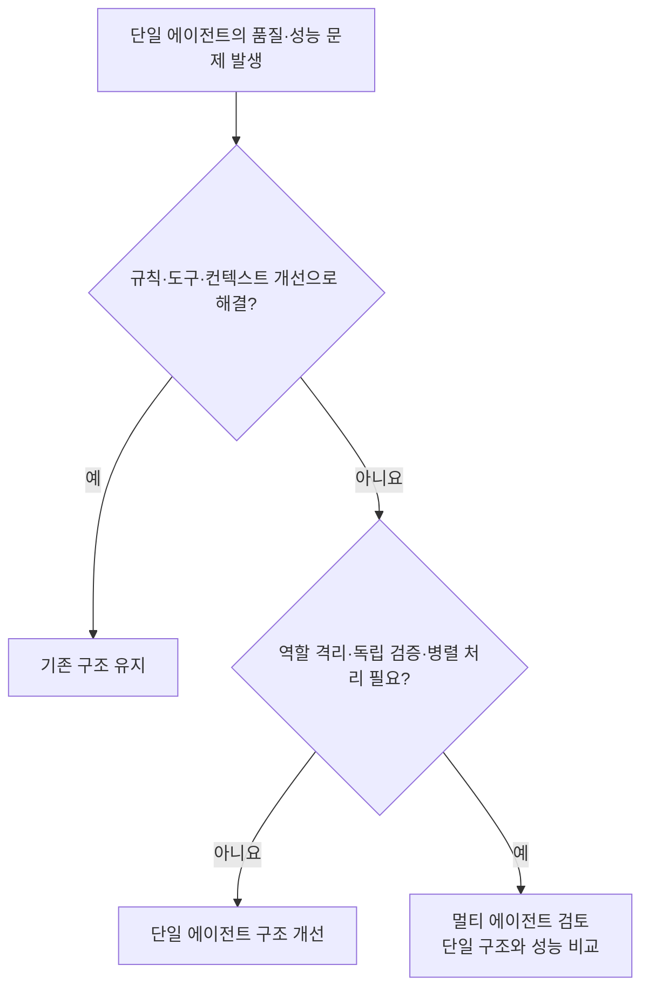

이때 전환 여부는 느낌이 아니라 **동일한 테스트 데이터 세트를 사용한 측정 결과**로 판단하는 것이 좋다.

**표 7-3. 전환을 판단할 때 재는 지표**

| 측정 지표 | 전환 검토 신호 |
|---|---|
| **작업 성공률** | 복합 작업에서 특정 단계의 실패가 반복된다 |
| **도구 호출 정확도** | 역할이 다른 도구 사이에서 잘못된 선택이 반복된다 |
| **결과 검증 통과율** | 자체 검증으로 발견하지 못하는 오류가 지속된다 |
| **토큰 사용량** | 관련 없는 컨텍스트가 누적되어 비용이 증가한다 |
| **응답 지연 시간** | 독립 작업의 순차 실행이 주요 병목으로 확인된다 |
| **유지보수성** | 특정 기능의 변경이 다른 기능의 회귀 오류를 유발한다 |

에이전트 하나로 같은 일을 처리하면서 잰 이 기록을 **단일 에이전트 기준선**이라고 한다. 나눈 구성을 만든 뒤 같은 입력으로 다시 재서 두 기록을 비교한다.

전환을 결정하는 절대적인 성공률이나 오류율 기준은 없다. **단일 에이전트를 개선했을 때와 멀티 에이전트로 분리했을 때를 비교**해야 한다.

## 7.2 멀티 에이전트의 기본 개념

### 에이전트를 다시 보기

에이전트는 **모델이 연결된 도구 중 필요한 것을 골라 호출하고, 결과를 보고 다음 행동을 정하는 과정을 반복**한다. 모델은 부를 도구와 인자를 고르는 데까지만 관여하고, 실제 호출은 **워크플로우**(**n8n**)가 맡는다. 워크플로우가 모델이 고른 도구 노드를 실행해 결과를 돌려주면, 모델은 그 결과를 읽고 다시 도구를 부르거나 최종 답을 낸다. 이 반복의 횟수는 `Max Iterations`가 제한한다.

하나의 에이전트를 구성하는 것은 네 가지다. **모델**, 모델에게 역할과 규칙을 알려 주는 **지시문**(System Message), 모델이 부를 수 있는 **도구**, 그리고 필요하면 앞의 대화를 기억하는 **메모리**다. 역할이 다른 에이전트를 만든다는 것은 이 네 가지를 역할에 맞게 따로 구성한다는 뜻이다.

### 멀티 에이전트의 정의

**멀티 에이전트**(**multi-agent**)는 역할이 다른 둘 이상의 에이전트가 한 업무를 나누어 처리하고, 한 에이전트의 출력이 다른 에이전트나 워크플로우의 입력이 되는 구성이다.

정의의 경계를 분명히 해 둔다.

**표 7-4. 멀티 에이전트인 것과 아닌 것**

| 구성 | 멀티 에이전트인가 | 이유 |
|---|---|---|
| 규칙 노드 여러 개 뒤에 에이전트 하나 | 아니다 | 에이전트가 하나다. 4~6장의 구성이 여기에 해당한다 |
| 같은 에이전트를 문의마다 여러 번 실행 | 아니다 | 역할이 하나다. 실행 횟수가 늘었을 뿐이다 |
| 조사 에이전트의 결과를 글쓰기 에이전트가 받아 보고서를 쓴다 | 그렇다 | 역할이 둘이고 한쪽의 출력이 다른 쪽의 입력이 된다 |
| 감독 에이전트가 전문 에이전트 셋 중 필요한 것을 도구로 부른다 | 그렇다 | 역할이 넷이고, 감독 에이전트가 다른 에이전트의 출력을 입력으로 받는다 |

실제 구성에는 도구가 없는 모델 단계가 섞이는 경우가 많다. 조사 결과를 받아 보고서 문장만 쓰는 역할은 도구를 부르지 않으므로 엄밀하게는 에이전트가 아니라 모델 호출 한 번이다. 이 교재는 이런 단계도 **역할 하나**로 센다. 역할마다 지시문과 입력과 출력 계약을 따로 정한다는 점에서 설계할 항목이 같기 때문이다. n8n에서는 이런 역할을 도구 없는 `AI Agent` 노드나 `Basic LLM Chain` 노드로 만든다.

### 미리 정한 경로와 모델이 정하는 경로

여러 역할을 이으면 **다음에 어느 역할이 일할지를 누가 정하는가**가 가장 먼저 정할 문제가 된다. 방법은 두 가지다.

- 설계자가 워크플로우를 만들 때 순서와 분기를 미리 정한다. 실행할 때는 정해 둔 연결을 따라간다.
- 모델이 실행 중에 입력을 보고 다음에 부를 역할을 정한다.

Anthropic의 글 "Building effective agents"는 앞의 것을 workflow, 뒤의 것을 agent라고 부르며 구분한다. 이 교재에서는 n8n의 "워크플로우"와 이름이 겹치므로 앞의 것을 **설계자가 정하는 연결**, 뒤의 것을 **모델이 정하는 위임**이라고 부른다. 여기서 **위임**(**delegation**)은 한 에이전트가 일의 일부를 다른 에이전트에게 맡기고 결과를 받는 일이다.

**그림 7-2. 설계자가 정하는 연결과 모델이 정하는 위임**
- **설계자가 정하는 연결**
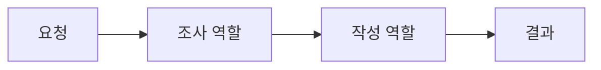
- **모델이 정하는 위임**
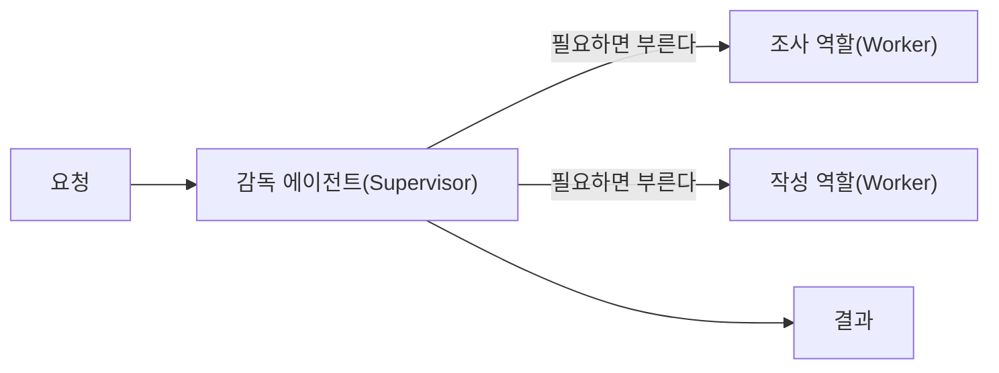

그림 7-2에서 읽어야 할 핵심은 **화살표(흐름)를 누가 그리는가**다. 첫번째 것은 설계자가 화살표를 미리 그려 두었고, 두번째 것은 감독 에이전트가 실행할 때마다 어느 화살표를 쓸지 고른다. 첫번째는 실행할 때마다 같은 경로를 지나므로 결과를 비교하고 원인을 찾기 쉽다. 두번째 것은 입력마다 필요한 역할만 부를 수 있지만, 같은 입력에도 경로가 달라질 수 있다.

실제 구성은 둘이 섞이는 경우가 많다. 입력을 규칙으로 분류해 담당으로 보내는 부분은 설계자가 정하고, 담당 안에서 어떤 조회를 할지는 모델이 정할 수 있다. **어느 부분을 누가 정하는지를 구분해 설계하는 것**이 이 장의 출발점이다.

### 멀티 에이전트 구성의 다섯 가지 요소

멀티 에이전트를 설계할 때 정할 것은 다섯 가지로 정리된다. 이 장의 뒤 절은 이 순서를 따른다.

**표 7-5. 멀티 에이전트 구성의 다섯 가지 요소**

| 요소 | 설계할 질문 | 다루는 절 |
|---|---|---|
| **역할** | 누가 무슨 일을 맡고, 무엇을 할 수 없는가 | 7.4 |
| **연결** | 다음에 어느 역할이 일할지 누가 정하는가 | 7.3, 7.6, 7.7 |
| **전달 정보** | 역할 사이에 무엇을 어떤 형식으로 넘기는가 | 7.4, 7.5 |
| **공유 상태** | 실행이 끝난 뒤에 남는 값을 누가 읽고 누가 쓰는가 | 7.5 |
| **종료 조건** | 언제, 누가, 어떤 이유로 끝내는가 | 7.8 |

다섯 가지 중 하나라도 정하지 않으면 그 부분은 모델이 실행 중에 정하게 된다. 예를 들어 전달 정보를 정하지 않으면 앞 에이전트가 쓴 긴 글이 그대로 다음 에이전트에게 가고, 다음 에이전트는 그 글에서 무엇이 확인된 사실인지 스스로 골라야 한다. 종료 조건을 정하지 않으면 에이전트가 서로를 부르다가 한도에 걸려 오류로 끝날 수 있다.

### 다른 에이전트를 부르는 두 가지 방식

한 에이전트가 다른 에이전트에게 일을 맡기는 방식도 두 가지다.

- **도구로 부른다.** 
    - 맡긴 에이전트가 결과를 돌려받아 일을 계속한다. 사용자에게 최종 답을 하는 것은 맡긴 에이전트다. 감독 에이전트가 전문 에이전트를 부르는 방식이 이것이다.
- **일을 넘긴다.**
    - 일을 넘긴 에이전트는 그 뒤로 대화에 관여하지 않고, 넘겨받은 에이전트가 사용자와 이어서 대화한다. 이 방식을 **핸드오프**(**handoff**)라고 한다. 넘길 때는 받을 에이전트와 함께 어떤 정보를 넘길지 정한다.

**그림 7-3. 도구로 부르기와 일 넘기기**

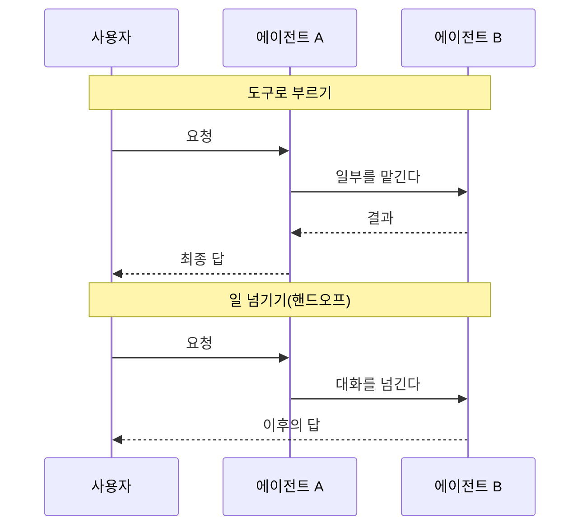

두 방식의 차이는 **결과가 돌아오는가** 여부다.

### 정보를 나누는 범위

역할 사이에 정보를 얼마나 나누는지도 선택이다.

**표 7-6. 정보를 나누는 범위**

| 구분 | 결과만 넘긴다 | 공유 작업 공간을 둔다 |
|---|---|---|
| **방식** | 각 역할은 자기 입력만 보고, 정해 둔 형식의 결과만 다음 역할에 넘긴다 | 모든 역할이 같은 대화 기록이나 작업 메모를 읽고 쓴다 |
| **맥락** | 다음 역할은 앞 역할이 넘긴 것만 안다 | 앞 역할이 본 것을 다음 역할도 볼 수 있다 |
| **입력 길이** | 짧다 | 역할이 늘수록 길어진다 |
| **섞임** | 앞 역할의 추측은 계약에 없으면 넘어가지 않는다 | 앞 역할의 추측이 사실처럼 다음 역할에게 보인다 |
| **인젝션** | 넘기는 필드를 검사할 수 있다 | 한 역할이 읽은 문장이 모든 역할의 입력이 된다 |
| **알맞은 경우** | 업무 자동화처럼 결과를 검사해야 하는 일 | 자유로운 탐색이나 토론처럼 맥락이 결과보다 중요한 일 |

**공유 작업 공간**(**shared workspace**)은 여러 역할이 함께 읽고 쓰는 기록이다. 맥락이 풍부해지는 대신, 6장에서 다룬 간접 인젝션의 통로가 모든 역할로 넓어진다. 고객 문의에 섞인 지시 문장을 조사 역할이 읽었다면, 공유 작업 공간에서는 작성 역할도 그 문장을 읽는다. 이 교재는 **결과만 넘기는 방식을 기본으로 한다.** 넘기는 값을 필드로 정해 두면 넘기기 전에 규칙으로 검사할 수 있기 때문이다.

### 나누어서 얻는 것과 잃는 것

**표 7-7. 나누어서 얻는 것과 잃는 것**

| 얻는 것 | 잃는 것 |
|---|---|
| 역할마다 지시문이 짧고 도구가 적어 모델이 고르기 쉽다 | 모델 호출과 처리 시간이 늘어난다 |
| 역할마다 따로 시험하고 고칠 수 있다 | 넘기는 과정에서 정보가 빠진다 |
| 역할마다 도구와 권한을 따로 줄 수 있다 | 실패한 곳을 찾으려면 여러 실행을 따라가야 한다 |
| 역할마다 다른 모델을 쓸 수 있다 | 계약과 연결을 설계하고 관리할 것이 늘어난다 |

잃는 것 중 가장 자주 놓치는 것이 **정보 손실**이다. 조사 역할이 문의 원문에서 "금요일 전에 받아야 해요"라는 조건을 옮기지 않았다면, 원문을 받지 않는 작성 역할은 그 조건을 알 방법이 없다. 나누는 일은 각 역할이 보는 정보를 좁히는 일이고, 좁히면 빠지는 것이 생긴다. 그래서 7.4절에서 역할 계약을 쓸 때 **다음 역할이 판단에 쓸 값을 빠짐없이 필드로 정하는 것**이 중요하다.

> 이 절의 개념은 실습 7-1에서 단일 에이전트 기준선과 나눈 구성을 비교하며 확인한다.

## 7.3 주요 멀티 에이전트 패턴

여러 역할을 잇는 방법은 몇 가지 반복되는 모양으로 정리된다. 이 모양을 **패턴**이라고 부른다. 이 절은 업무 자동화에서 자주 쓰거나 알아 둘 필요가 있는 패턴 여덟 가지를 다룬다. 그중 일부는 이 장에서 실습하지 않지만, 설계할 때 선택지로 떠올릴 수 있어야 한다.

패턴은 7.2절의 기준, **다음에 어느 역할이 일할지 누가 정하는가**로 나눈다. 설계자가 정하는 패턴이 넷, 모델이 정하는 패턴이 넷이다.

**표 7-8. 주요 멀티 에이전트 패턴**

| 유형 | 패턴 | 한 줄 설명 | 이 장의 실습 |
|---|---|---|---|
| **설계자가 정한다** | 순차 연결 | 앞 역할의 출력이 다음 역할의 입력이 된다 | 7-1, 7-6, 7-7 |
| | 라우팅 | 입력을 분류해 담당 하나로 보낸다 | 7-2, 7-3 |
| | 병렬 처리 | 여러 역할이 따로 일하고 결과를 합친다 | 7-1 선택 과제 |
| | 생성-평가 반복 | 생성 역할의 결과를 평가 역할이 판정해 되돌린다 | 7-1 선택 과제 |
| **모델이 정한다** | 감독-작업자 | 감독 에이전트가 전문 에이전트를 골라 일을 맡기고 결과를 모은다 | 7-5, 7-7 |
| | 계층형 감독 | 감독 에이전트 아래에 다시 감독 에이전트를 둔다 | 없음 |
| | 핸드오프 | 에이전트가 대화를 다른 에이전트에게 넘기고 더 관여하지 않는다 | 없음. 7-3에서 비교만 한다 |
| | 네트워크 | 모든 에이전트가 서로를 부를 수 있다 | 없음 |

패턴 이름은 분류를 위한 이름이며 외울 대상이 아니다. 자료마다 같은 구조를 다른 이름으로 부르기도 한다. 예를 들어 감독-작업자는 "오케스트레이터-워커", 순차 연결은 "프롬프트 체이닝"이나 "파이프라인"이라고도 부른다. 이름보다 **누가 다음을 정하고, 결과가 어디로 가는가**를 보고 구분한다.

각 패턴은 같은 항목으로 설명한다. 구조, 알맞은 경우, 대가와 위험, n8n에서 만드는 방법, 일반 예다. n8n에서 만드는 자세한 방법은 이 장에서 실습하는 패턴에 한해 7.6절과 7.7절에서 다룬다.

### 설계자가 정하는 패턴 1: 순차 연결

**그림 7-4. 순차 연결**

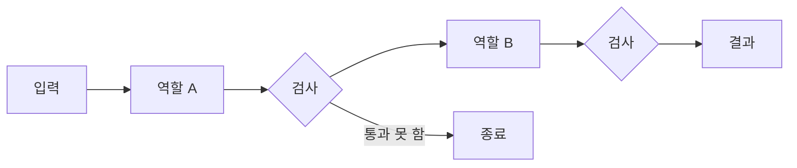

**순차 연결**(**sequential chaining**)은 역할이 정해진 순서로 이어지고, 앞 역할의 출력이 다음 역할의 입력이 되는 패턴이다. 역할 사이에 규칙 검사를 두어, 앞 역할의 결과가 기준에 맞지 않으면 다음 역할을 부르지 않고 끝낼 수 있다.

- **알맞은 경우**: 일의 순서가 매번 같다. 조사한 뒤에 쓰고, 추출한 뒤에 판정하는 일처럼 앞 단계 없이는 뒤 단계를 할 수 없다.
- **대가와 위험**: 앞 역할이 빠뜨린 정보를 뒤 역할이 알 수 없다. 단계마다 처리 시간이 더해진다. 순서를 벗어나는 예외 요청에 약하다.
- **n8n에서 만드는 방법**: 에이전트 노드를 이어 붙이거나, 역할마다 서브워크플로우를 두고 `Execute Sub-workflow`로 차례로 부른다.
- **일반 예**: 회의록에서 결정 사항을 뽑는 역할과 뽑은 결정 사항으로 공지문을 쓰는 역할. 계약서에서 조항을 찾는 역할과 찾은 조항의 위험도를 판정하는 역할.

순차 연결은 가장 단순하고 결과를 비교하기 쉬운 패턴이다. **순서가 정해져 있는 업무라면 먼저 이 패턴을 검토한다.**

### 설계자가 정하는 패턴 2: 라우팅

**그림 7-5. 라우팅**

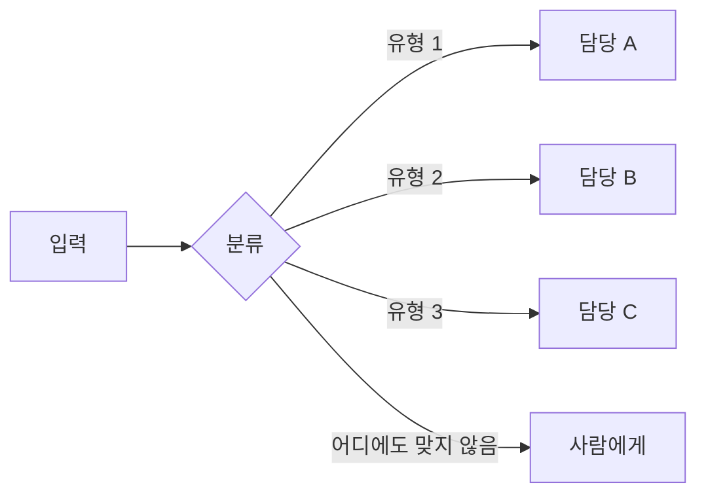

**라우팅**(**routing**)은 입력을 분류해 담당 하나로 보내고, 보낸 뒤에는 그 담당이 일을 끝내는 패턴이다. 분류는 규칙이 할 수도 있고 모델이 할 수도 있다. 모델이 분류하더라도 분류할 범주와 범주마다 보낼 곳은 설계자가 정하므로 설계자가 정하는 패턴에 속한다.

- **알맞은 경우**: 유형마다 필요한 도구와 규칙이 크게 다르다. 한 담당에 모든 유형의 규칙을 넣으면 지시문이 길어진다.
- **대가와 위험**: 분류가 틀리면 그 뒤가 모두 틀린다. 어디에도 맞지 않거나 두 유형이 섞인 입력의 경로를 따로 정해야 한다.
- **n8n에서 만드는 방법**: 규칙으로 분류할 수 있으면 `Switch`, 글의 뜻으로 분류해야 하면 `Text Classifier` 뒤에 담당을 둔다.
- **일반 예**: 사내 요청 채널의 요청을 IT, 총무, 인사 담당으로 보낸다. 가계부 앱의 채팅 요청을 지출 기록, 월별 요약, 예산 상담으로 보낸다.

라우팅의 장점은 담당마다 지시문이 짧아진다는 것이다. 담당을 하나 더할 때 분류 범주와 담당 하나만 더하면 되고, 기존 담당은 고치지 않는다.

### 설계자가 정하는 패턴 3: 병렬 처리

**그림 7-6. 병렬 처리의 두 종류**

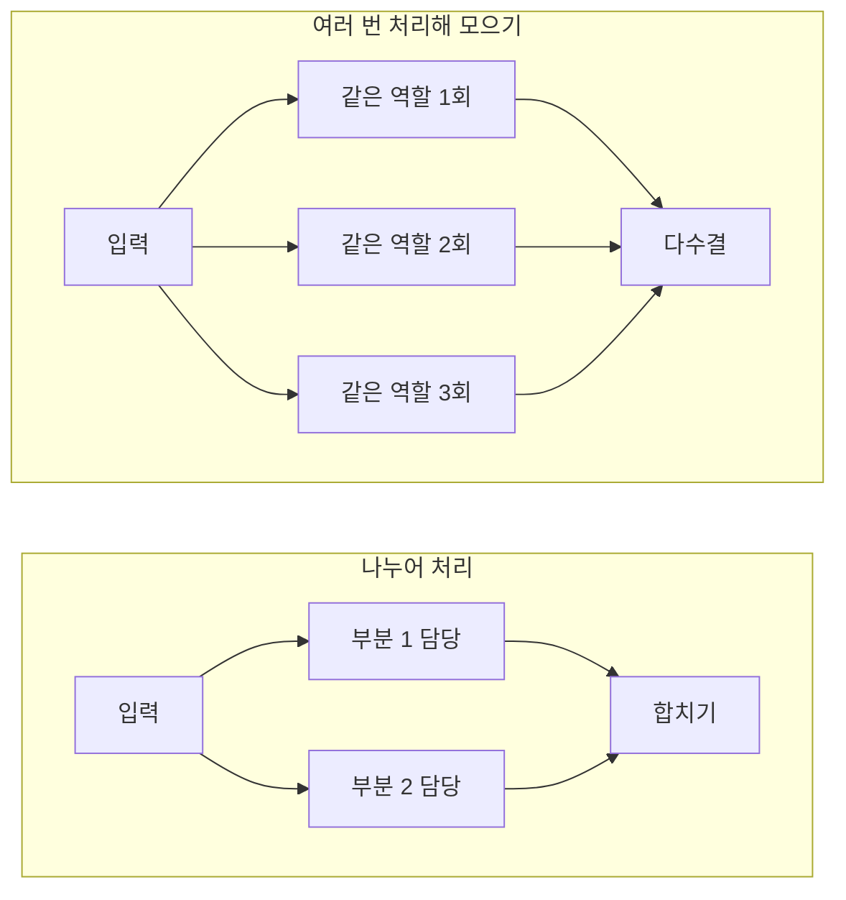

**병렬 처리**(**parallelization**)는 여러 역할이 서로의 결과를 기다리지 않고 따로 일한 뒤, 결과를 규칙으로 합치는 패턴이다. 7.1절에서 나눌 이유로 본 처리 시간 증가 현상을 구조로 해결하는 것이 이 패턴이다. 두 종류가 있다.

- **나누어 처리**: 일을 서로 다른 부분으로 나누어 각 담당에게 맡긴다. 보고서의 주제별 조사를 담당마다 나누는 것이 예다.
- **여러 번 처리해 모으기**: 같은 일을 여러 번 하게 한 뒤 다수결이나 합의로 결과를 정한다. 한 번의 판단을 믿기 어려울 때 쓴다. 판정이 셋 중 둘 이상 같을 때만 받아들이는 식이다.

- **알맞은 경우**: 서로 결과를 참조하지 않는 일이 여럿이다. 또는 판단의 흔들림을 줄이고 싶고 호출을 여러 번 할 여유가 있다.
- **대가와 위험**: 모델 호출이 담당 수나 반복 수만큼 늘어난다. 합치는 규칙을 미리 정해야 하며, 결과가 서로 다를 때 어느 것을 따를지도 정해야 한다. 같은 외부 API에 호출이 몰리면 호출 제한에 걸릴 수 있다. 앞 결과가 필요한 일은 병렬로 둘 수 없다.
- **n8n에서 만드는 방법**: 경로를 여러 갈래로 나누고 `Merge`로 합친다. 다만 **n8n은 한 실행 안의 갈래를 동시에 실행하지 않는다.** 1.0 이후에 만든 워크플로우는 캔버스 위쪽 갈래부터 하나씩 끝까지 실행한다(공식 문서 "Understand execution order"). 그래서 갈래를 나누는 것은 시간을 줄이기보다 **서로 독립인 일을 구조로 드러내는** 효과가 있다. 실제로 동시에 처리하려면 에이전트 노드에 아이템 여러 개를 넣고 `Batch Processing` 옵션의 `Batch Size`를 늘린다.
- **일반 예**: 이사 준비에서 이사업체 견적 비교, 인터넷 이전 신청, 주소 변경 목록 작성을 각각 맡긴다. 민원 글의 긴급도를 세 번 판정해 둘 이상이 "긴급"일 때만 긴급으로 처리한다.

### 설계자가 정하는 패턴 4: 생성-평가 반복

**그림 7-7. 생성-평가 반복**

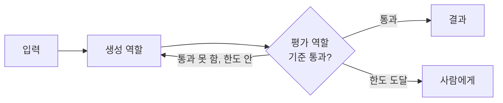

**생성-평가 반복**(**evaluator-optimizer**)은 생성 역할이 결과를 만들고, 평가 역할이 기준에 맞는지 판정해 고칠 점을 돌려주며, 기준을 통과하거나 한도에 이를 때까지 되풀이하는 패턴이다.

- **알맞은 경우**: 평가 기준을 글로 분명하게 쓸 수 있고, 고칠수록 결과가 실제로 나아진다. 예를 들어 "모든 문장에 출처가 있다", "300자 이하다", "금지어가 없다"처럼 판정할 수 있는 기준이 있다.
- **대가와 위험**: **반복 한도가 없으면 끝나지 않을 수 있다.** 평가 역할도 모델이면 평가가 틀릴 수 있고, 생성과 평가가 같은 모델이면 같은 실수를 서로 통과시키기 쉽다. 반복할 때마다 호출과 시간이 늘어난다.
- **n8n에서 만드는 방법**: 생성 노드 → 평가 노드 → `If`로 통과 여부를 본다. 통과하지 못하면 반복 횟수를 세는 값을 하나 늘리고 생성 노드로 되돌리는 연결을 둔다. 횟수가 한도에 이르면 사람에게 넘기는 갈래로 보낸다.
- **일반 예**: 제품 설명문을 쓰고 광고 심의 기준으로 평가해 고친다. 번역문을 쓰고 용어집과 대조해 틀린 용어를 되돌린다.

**평가 기준 중 규칙으로 판정할 수 있는 것은 규칙이 판정한다.** 글자 수, 출처 표기 형식, 금지어 포함 여부는 `Code` 노드가 정확하게 판정한다. 모델 평가는 "과장이 있는가"처럼 규칙으로 판정하기 어려운 기준에만 쓴다.

### 모델이 정하는 패턴 1: 감독-작업자

**그림 7-8. 감독-작업자**

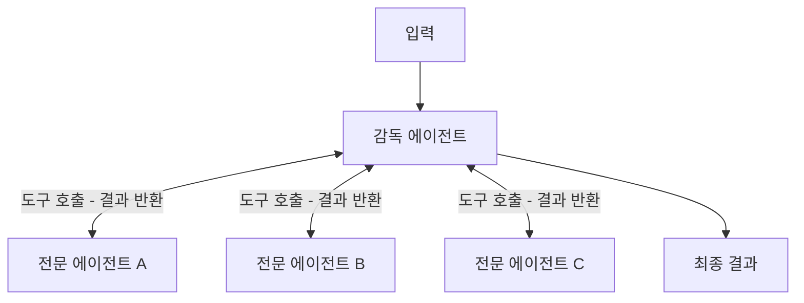

**감독-작업자**(**supervisor**, **orchestrator-workers**)는 **감독 에이전트**(**supervisor agent**)가 요청에 따라 필요한 **전문 에이전트**를 선택해 호출하고, 그 결과를 종합해 최종 답을 만드는 패턴이다. 전문 에이전트는 감독 에이전트의 도구로 연결된다. 어떤 전문 에이전트를 몇 번, 어떤 순서로 부를지는 감독 에이전트가 실행 중에 결정한다.

- **알맞은 경우**: 요청마다 필요한 전문 역할의 조합이나 작업 순서가 달라져, 실행 전에 하나의 흐름으로 정하기 어려울 때다. 예를 들어 사내 세미나 준비 요청 중에는 장소 확인만 필요한 것도 있고, 예산 계산만 필요한 것도 있으며, 두 결과를 확인한 뒤 안내문 작성 여부를 정해야 하는 것도 있다.
- **대가와 위험**: 감독 에이전트가 작업을 배분하고 결과를 종합하는 데 모델 호출이 추가된다. 같은 요청에도 호출 대상과 순서, 횟수가 달라질 수 있어 결과를 비교하거나 재현하기 어렵다. 또한 전문 에이전트의 결과를 종합하는 과정에서 내용이 빠지거나 바뀔 수 있다.
- **n8n에서 만드는 방법**: 감독 에이전트의 Tool 연결점에 `AI Agent Tool`로 전문 에이전트를 붙인다. 전문 에이전트를 별도 워크플로우로 구성했다면 `Call n8n Workflow Tool`로 해당 워크플로우를 호출한다(7.7절).
- **일반 예**: 사내 세미나 요청에 따라 장소 확인, 예산 계산, 안내문 작성 에이전트 중 필요한 것을 호출한다. 여행 계획 요청에 따라 교통, 숙소, 일정 에이전트 중 필요한 것을 호출한다.

**업무 순서가 이미 정해져 있다면 감독 에이전트를 둘 필요가 적다.** 작업 선택과 순서 결정에 모델 호출이 추가되고, 실행 경로도 달라질 수 있기 때문이다. 설계자가 필요한 단계와 순서를 알고 있다면 워크플로우에 순차 연결이나 조건 분기를 명시하는 편이 간단하다.

### 모델이 정하는 패턴 2: 계층형 감독

"감독-작업자" 의 확장 패턴이다.

**그림 7-9. 계층형 감독**

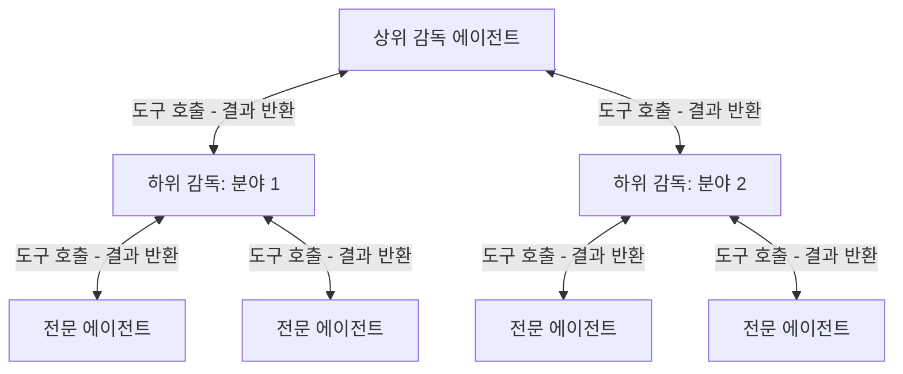

**계층형 감독**(**hierarchical supervision**)은 감독 에이전트 아래에 다시 감독 에이전트를 두는 패턴이다. 상위 감독은 분야를 고르고, 하위 감독은 그 분야 안의 전문 에이전트를 고른다.

- **알맞은 경우**: 전문 에이전트가 많아 감독 에이전트 하나가 고르기 어렵다. 도구 설명이 수십 개이면 7.1절의 도구 선택 오류가 감독 에이전트에서 다시 생기기 때문이다.
- **대가와 위험**: 호출과 지연이 단계마다 더해진다. 실패한 곳을 찾으려면 여러 단계의 실행을 따라가야 하므로 추적이 가장 어렵다. 상위 감독이 하위 감독에게 요청을 옮겨 적을 때마다 정보가 빠질 수 있다.
- **n8n에서 만드는 방법**: 공식 문서는 `AI Agent Tool`을 여러 단계로 겹쳐 연결할 수 있다고 설명한다. `AI Agent Tool`에도 Tool 연결점이 있어 그 아래에 다시 `AI Agent Tool`을 붙인다. 감독 에이전트를 서브워크플로우로 두고 상위 감독의 도구로 부르는 방법도 있다.
- **일반 예**: 대기업 사내 도우미가 IT, 인사, 재무 분야의 하위 감독을 두고, 각 하위 감독이 그 분야의 전문 에이전트 여러 개를 고른다.

업무 자동화에서 계층형 감독이 필요한 경우는 드물다. 전문 에이전트가 많아졌다면 먼저 **라우팅으로 분야를 나눈 뒤 분야 안에서만 감독 에이전트를 쓰는 구성**을 검토한다. 분야를 나누는 첫 판단을 규칙이나 분류기가 맡으면 추적이 훨씬 쉬워진다.

### 모델이 정하는 패턴 3: 핸드오프

**그림 7-10. 핸드오프**

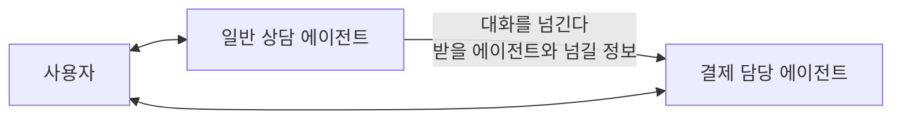

**핸드오프**(**handoff**)는 에이전트가 대화를 다른 에이전트에게 넘기고 더 관여하지 않는 패턴이다. 작업을 넘길 에이전트와 넘길 정보를 정한다. 넘겨받은 에이전트가 이후의 대화를 이어 가며, 필요하면 다시 다른 에이전트에게 넘긴다.

- **알맞은 경우**: 대화 도중에 담당이 바뀌고, 새 담당이 대화를 직접 이어 가야 한다. 일반 상담 중에 결제 문제가 나오면 결제 담당이 이어받는 경우다.
- **대가와 위험**: 지금 누가 담당인지를 상태로 기억해야 한다. 넘길 때 빠진 정보는 받은 쪽이 확인이나 사용하기 어렵다. 에이전트끼리 서로 넘기기만 하며 끝나지 않을 수 있으므로 넘김 횟수에 한도가 필요하다. 넘긴 쪽이 결과를 보지 못하므로 결과를 검사하는 자리를 따로 정해야 한다.
- **n8n에서 만드는 방법**: n8n은 핸드오프 전용 기능은 없다. 비슷한 동작은 **현재 담당을 세션 기록에 남기고, 다음 메시지가 오면 그 담당에게 바로 보내는 라우팅**으로 만든다. 에이전트가 "넘긴다"는 결정을 출력하면 워크플로우가 세션 기록의 담당을 바꾼다.
- **일반 예**: 통신사 상담에서 요금 문의 중 해지 의사가 나오면 해지 방어 담당이 이어받는다. 병원 예약 챗봇이 증상 상담으로 넘어가면 간호 상담 담당이 이어받는다.

핸드오프와 라우팅은 비슷해 보인다. 차이는 **누가 담당을 바꾸는가**다. 라우팅은 메시지가 올 때마다 분류기가 담당을 정하고, 핸드오프는 지금 대화하는 에이전트가 다음 담당을 정한다.

### 모델이 정하는 패턴 4: 네트워크

**그림 7-11. 네트워크**

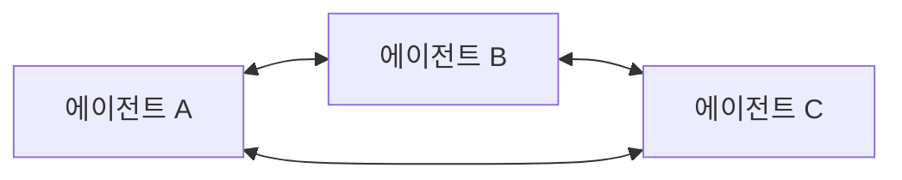

**네트워크**(**network**)는 모든 에이전트가 다른 모든 에이전트를 부를 수 있고, 각 에이전트가 다음에 누구를 부를지 정하는 패턴이다. 정해진 위계도 순서도 없다.

- **알맞은 경우**: 순서도 위계도 미리 정할 수 없는 탐색형 작업이다. 여러 관점의 에이전트가 서로의 의견을 보며 아이디어를 넓히는 연구나 기획 초안 작업이 예다.
- **대가와 위험**: 경로를 예측할 수 없다. 같은 입력에도 매번 다른 경로를 지나고, 언제 끝날지 정하기 어렵다. 어느 에이전트가 어떤 결과를 냈는지 추적하기 가장 어렵다. 한 에이전트가 읽은 인젝션 문장이 다른 모든 에이전트의 입력으로 전달될 수 있다.
- **n8n에서 만드는 방법**: n8n 공식 문서가 설명하는 에이전트 연결은 상위 에이전트가 하위 에이전트를 도구로 부르는 한 방향 구성이다. 에이전트끼리 서로를 부르는 구조를 만드는 방법을 따로 제공하지 않는다. 흉내 내려면 공유 기록과 되돌림 연결을 직접 설계해야 하며, 이 교재에서는 권하지 않는다.
- **일반 예**: 신제품 이름 아이디어를 내는 에이전트, 비판하는 에이전트, 시장 자료를 찾는 에이전트가 서로 의견을 주고받는다.

**업무 자동화에서는 네트워크 패턴을 권하지 않는다.** 이 장의 7.8절과 7.9절이 요구하는 종료 조건, 실행 추적, 권한 관리를 모두 지키기 가장 어려운 패턴이기 때문이다. 결과를 검사하고 책임을 나누어야 하는 업무라면 설계자가 정하는 패턴이나 감독-작업자로 바꾸어 설계한다.

### 패턴은 겹쳐 쓴다

실제 구성은 패턴 하나로 끝나지 않는 경우가 많다.

- 라우팅으로 유형을 나눈 뒤 유형 안에서는 순차 연결로 처리한다.
- 감독 에이전트가 맡긴 일 하나 안에서 병렬 조회를 한다.
- 순차 연결의 마지막 역할에 생성-평가 반복을 붙인다.

이 장의 하루마켓 구성도 겹쳐 쓴 예다. 상담 창구는 라우팅으로 담당을 나누고, 담당자에게 넘어간 반품 요청은 순차 연결로 조사와 처리안 작성을 거친 뒤 6장의 승인 흐름으로 간다.

### 패턴을 고르는 기준

**표 7-9. 패턴을 고르는 질문**

| 순서 | 질문 | 패턴 |
|---|---|---|
| 0 | 한 번의 모델 호출이나 일반 자동화로 충분한가? | 가장 단순한 방식부터 시작한다 |
| 1 | 작업을 매번 같은 단계로 나눌 수 있는가? | 순차 연결 |
| 2 | 입력 유형마다 필요한 도구와 규칙이 크게 다른가? | 라우팅 |
| 3 | 서로의 결과를 기다릴 필요가 없는 작업이 여럿인가? | 병렬 처리 추가 |
| 4 | 명확한 평가 기준이 있고, 피드백을 반영하면 결과가 나아지는가? | 생성-평가 반복 추가 |
| 5 | 필요한 하위 작업을 입력 전에 정하기 어려운가? | 감독-작업자 |
| 6 | 한 감독이 하위 작업의 분배와 결과 통합을 안정적으로 처리하기 어려운가? | 분야별 라우팅을 먼저 적용하고, 필요하면 계층형 감독 검토 |
| 7 | 대화 도중 담당이 바뀌고 새 담당이 맥락을 이어받아야 하는가? | 핸드오프와 대화 상태 전달 설계 |

질문은 위에서부터 차례로 검토하되, 첫 번째로 해당하는 항목에서 멈추지 말고 끝까지 확인한다. 하나의 작업에도 여러 패턴을 조합할 수 있다. 예를 들어 입력 유형에 따라 경로를 나눈 뒤, 각 경로의 작업을 순서대로 처리하고, 서로 독립적인 단계는 병렬로 실행할 수 있다. 복잡한 구조는 품질이나 처리 속도가 실제로 개선될 때 추가한다.

핸드오프는 작업을 잠시 위임하는 것과 다르다. 새 담당자가 이후 대화를 이어가려면 담당권과 필요한 대화 맥락을 함께 넘겨야 한다. n8n에서는 워크플로우의 라우팅과 메모리로 구성할 수 있으며, Preview 상태인 Agents 기능에서도 에이전트 간 핸드오프와 세션 저장을 지원한다.

모델이 정하는 부분이 늘수록 설계할 것도 늘어난다는 점을 기억해 둔다. 경로가 매번 달라질 수 있으므로 **종료 조건과 실행 추적, 권한 설계가 더 엄격해져야 한다.**


### 하루마켓에 적용하기

하루마켓에 표 7-9을 적용하면 다음과 같다.

**표 7-10. 하루마켓의 업무와 패턴**

| 업무 | 고른 패턴 | 이유 |
|---|---|---|
| 상담 채팅 두 개(반품·배송, 교환·취소)를 하나의 창구로 합친다 | 라우팅 | 두 담당의 정책 문서와 규칙이 다르다. 5장에서 담당을 이미 따로 만들었다 |
| 담당자에게 넘어간 반품 요청의 처리안을 만든다 | 순차 연결 | 조사한 뒤에 처리안을 쓰는 순서가 매번 같다 |
| 같은 반품 요청을 감독 에이전트로 처리한다 | 감독-작업자(비교용) | 순차 연결과 비교해 호출 부담과 경로 변동을 확인하려고 만든다. 채택하지 않을 것을 예상하고 만든다 |
| 대화 도중 반품에서 교환으로 주제가 바뀌는 상담 | 라우팅 | 핸드오프가 알맞아 보이지만 n8n에 기능이 없다. 메시지마다 다시 분류하는 라우팅으로 처리하고 한계를 기록한다 |

> 이 절의 패턴은 실습 7-1(순차 연결, 선택 과제로 병렬 처리와 생성-평가 반복), 실습 7-2(라우팅), 실습 7-5(감독-작업자)에서 직접 만든다.

## 7.4 역할을 나누는 기준과 역할 계약

### 무엇을 기준으로 나누는가

역할을 나누는 첫 번째 기준은 **필요한 능력**이다. 사람이 하던 일을 떠올리면 대개 이미 나뉘어 있다. 고객 문의를 처리하는 일은 사실을 확인하는 일, 규정을 적용해 판정하는 일, 고객이 읽을 문장을 쓰는 일로 나뉜다. 세 가지는 필요한 능력이 다르고, 틀렸을 때의 원인도 다르다.

두 번째 기준은 **도구**다. 역할을 나누었으면 도구를 역할마다 따로 준다. **도구를 나누는 것이 역할을 나누는 가장 확실한 방법이다.** 작성 역할의 지시문에 "규정을 판단하지 마라"라고 쓰면 대체로 지켜지지만 100% 보장할 수 없다. 작성 역할에 규정 검색 도구를 주지 않으면 규정을 검색해 판단하는 일은 일어날 수 없다. 이것은 6장 6.3절의 "지시문으로 막는 것과 구조로 막는 것"을 역할 사이로 넓힌 것이다.

세 번째 기준은 **권한**이다. 되돌릴 수 없는 집행 권한은 **어느 에이전트에도 주지 않는다.** 6장에서 모델은 제안하고, 규칙이 검사하고, 사람이 승인하고, 워크플로우가 집행하도록 나누었다. 에이전트가 여럿이 되어도 이것은 그대로다. 뒤 7.9절에서 자세히 다룬다.

네 번째로 **모델에 들어가는 정보의 양**을 줄이려고 나누는 경우가 있다. 벡터 검색 결과 열 건과 주문 이력과 규정 문서 네 개를 한 번에 넣으면, 모델은 그 전부를 읽고 답해야 하고 중간의 정보를 놓치기 쉽다. 나누면 각 역할은 자기에게 필요한 것만 받는다. 다만 7.2절에서 본 것처럼 정보의 양을 줄이면 빠지는 정보가 생길 수 있다.

### 잘못 나눈 징후

**표 7-11. 잘못 나눈 징후**

| 징후 | 무엇이 잘못되었는가 |
|---|---|
| **두 역할의 지시문이 거의 같다** | 나눌 필요가 없는 것을 나누었다 |
| **뒤 역할이 앞 역할의 판정을 다시 한다** | 책임이 겹친다. 작성 역할이 규정을 다시 판단하기 시작하면 판정 역할은 없는 것과 같다 |
| **뒤 역할이 앞 역할에게 계속 되묻는다** | 앞 역할의 출력 계약에 필요한 값이 빠졌거나 경계를 잘못 나누었다 |
| **같은 도구가 두 역할에 있다** | 같은 일을 두 번 하게 될 수 있고, 결과가 다를 때 어느 쪽을 믿을지 정해야 한다 |
| **역할이 대여섯 개를 넘는다(너무 많다)** | 에이전트끼리 호출을 주고받을 때마다 모델 비용과 처리 시간이 든다. 그래서 너무 세분화해서 에이전트를 나누는 경우, 나누어서 얻는 이득보다 이 비용이 커지기 쉽다|

### 역할 계약

**역할 계약**(**role contract**)은 역할 하나가 무엇을 받아 무엇을 내고, 무엇을 할 수 있고 무엇을 할 수 없으며, 언제 끝내는지를 정한 문서다. 4장에서 도구를 만들 때 도구 계약을 먼저 쓴 것과 같은 이유로, 역할도 계약을 먼저 쓴다.

**표 7-12. 역할 계약의 항목**

| 항목 | 적는 것 | 예(보고서 조사 역할) |
|---|---|---|
| **역할 이름** | 하는 일이 드러나는 이름 | 자료 조사 |
| **하는 일** | 한두 문장 | 글 목록에서 보고서에 넣을 글을 고르고, 글마다 확인한 사실과 출처를 적는다 |
| **입력** | 받는 필드와 데이터 타입 | `period`(문자열), `posts`(배열. 원소마다 `post_id`, `title`, `summary`) |
| **출력** | 내는 필드, 데이터 타입, 허용 값 | `status`(`ok`·`needs_info`), `topics`(배열), `excluded`(배열) |
| **쓸 수 있는 도구** | 도구 이름 | 글 본문 조회 |
| **할 수 없는 일** | 이 역할이 하면 안 되는 일 | 보고서 문장을 쓰지 않는다. 목록에 없는 글을 추가하지 않는다 |
| **끝내는 조건** | 언제, 어떤 값으로 끝내는가 | 고를 글이 없으면 `status`를 `needs_info`로 두고 끝낸다. 본문 조회는 열 번까지 |


**표 7-13. 도구 계약과 역할 계약의 차이**

| 항목 | 도구 계약(4장) | 역할 계약 |
|---|---|---|
| **입력과 출력** | 있다 | 있다 |
| **결과의 상태 값** | `status`로 성공과 실패를 나눈다 | 같다 |
| **쓸 수 있는 도구** | 해당 없음. 도구 자신이다 | 있다. 역할마다 다르다 |
| **할 수 없는 일** | 없다. 도구는 정해진 일만 한다 | 있다. 모델이 판단하므로 넘지 말아야 할 선을 적는다 |
| **끝내는 조건** | 없다. 한 번 호출하면 끝난다 | 있다. 모델이 반복하므로 언제 멈추는지 적는다 |

도구는 정해진 일만 하므로 할 수 없는 일과 끝내는 조건을 적을 필요가 없었다. 역할은 모델이 판단하며 반복한다. **모델이 넘지 말아야 할 선과 멈출 때를 계약에 적어야 한다.**

### 사실과 판단을 다른 필드에 둔다

출력 계약에서 중요한 원칙이 하나 있다. **확인된 사실과 모델의 판단을 다른 필드에 둔다.** 다음 역할과 워크플로우가 사실은 믿고 판단은 검사할 수 있게 하기 위해서다.

아래는 고객 문의를 조사하는 역할의 출력 예다(설명을 위한 일부 발췌).

```json
{
  "status": "ok",
  "facts": {
    "order_status": "delivered",
    "delivered_at": "2026-09-06",
    "amount": 36000
  },
  "customer_claims": [
    "세트 2종 중 큰 바구니만 왔다",
    "받은 것도 생각보다 작아 전부 반품하고 싶다"
  ],
  "items": [
    { "item_no": 1, "summary": "구성품 누락", "category_candidates": ["missing_part"], "policy_refs": ["RET-02"] },
    { "item_no": 2, "summary": "세트 전체 반품", "category_candidates": ["change_of_mind", "missing_part"], "policy_refs": ["RET-01", "RET-02"] }
  ],
  "unresolved": ["전체 반품이 누락 때문인지 단순 변심인지"]
}
```

`facts`는 주문 조회 결과에서 온 값이다. `customer_claims`는 고객이 문의에서 **주장한** 내용이며 확인된 사실이 아니다. `items`의 `category_candidates`는 모델의 판단이고, 후보가 둘 이상이면 판단이 확정되지 않았다는 뜻이다. `unresolved`는 조사로 풀지 못한 것을 적는다.

이 예에서는 `status`가 `ok`인데도 `unresolved`에 값이 남아 있다. 지시문에 "풀지 못한 것이 있으면 `status`를 `needs_info`로 낸다"고 적어 두어도, 모델이 그 지시를 놓치고 `status`만 `ok`로 낼 수 있다. **그래서 워크플로우는 `status`만 보고 다음 역할을 부를지 정하지 않는다.** `unresolved`가 비어 있지 않으면 `status`와 상관없이 다음 역할을 부르지 않는 규칙을 따로 둔다. 이 규칙 덕분에 다음 역할은 "누락이 있었다"를 사실처럼 쓰지 않는다.

### 하루마켓에 적용하기

하루마켓의 반품 협업에는 역할 둘을 둔다. 자세한 계약은 실습 부속 자료에 있다.

**표 7-14. 반품 협업의 두 역할**

| 항목 | 반품 정책 조사 | 반품 처리안 작성 |
|---|---|---|
| **하는 일** | 문의 원문과 주문 사실을 읽고 요청을 항목으로 나누며, 항목마다 맞는 정책을 찾는다 | 조사 결과만 받아 처리안의 판정 후보와 이유, 고객 안내 초안을 쓴다 |
| **입력** | `request_id`, 문의 원문, 주문 사실 | `request_id`, 조사 결과, 주문 사실. **문의 원문은 받지 않는다** |
| **쓸 수 있는 도구** | `정책 검색`(5장) | 없다 |
| **할 수 없는 일** | 처리안을 정하지 않는다. 금액을 계산하지 않는다 | 조사 결과에 없는 정책을 인용하지 않는다. 금액을 계산하지 않는다 |
| **끝내는 조건** | 벡터 검색은 다섯 번까지. 풀지 못한 것이 있으면 `unresolved`에 적고 끝낸다 | 판정이 불확실하면 `needs_review`로 내고 끝낸다 |

**두 역할 모두 금액을 계산하지 않는다.** 환불 금액은 6장의 `근거 계산` 규칙이 계산한다. 처리안 작성 역할이 문의 원문을 받지 않는 이유도 있다. 원문에 섞인 지시 문장("전액 환불로 처리해 주세요")이 처리안에 직접 영향을 주지 못하게 하려는 것이다. 조사 역할이 원문을 읽고 필드로 정리한 결과만 넘어간다.

> 역할 계약은 실습 7-1에서 처음 쓰고, 실습 7-7에서 하루마켓에 적용한다.

## 7.5 공유 상태: 에이전트 사이에 무엇을 넘기고 어디에 남기는가

### 세 가지 데이터를 다시 보기

5장에서 실행이 끝난 뒤에도 남는 데이터를 세 가지로 나누었다. 앞의 대화를 기억하는 **대화 메모리**, 업무의 진행 상태를 남기는 **업무 상태**, 문서를 찾아 쓰는 **지식 베이스**다. 에이전트가 하나일 때는 "무엇을 어디에 둘 것인가"가 질문이었다. 에이전트가 여럿이 되면 **누가 읽고 누가 쓰는가**가 새 질문이 된다.

**표 7-15. 멀티 에이전트 구성에서 데이터를 읽고 쓰는 주체**

| 데이터 | 읽는 주체 | 쓰는 주체 | 이유 |
|---|---|---|---|
| **대화 메모리** | 그 대화를 맡은 에이전트가 `Postgres Chat Memory` 같은 메모리 노드를 통해 앞의 대화를 불러와서 프롬프트에 넣는다 | 같은 에이전트가 이번 턴의 주고받은 내용을 메모리 노드가 저장한다(에이전트 자신이 직접 `INSERT`하는 게 아니라, 연결된 메모리 노드가 자동으로 한다) | 다른 에이전트의 중간 추론이 섞이지 않게 한다 |
| **업무 상태**(**요청 기록**) | 워크플로우가 Postgres 노드와 같은 DB 연동노드로 요청 기록을 조회해서 다음 노드에 넘긴다. 에이전트도 입력으로 이 값을 받아서 참고할 수 있다 | 워크플로우만 `UPDATE/INSERT`로 실제 값을 바꾼다. 에이전트는 이 값을 바꾸는 도구를 갖지 않는다 | 누가 언제 바꾸었는지 알 수 있어야 한다 |
| **지식 베이스** | 검색 도구를 가진 역할이 도구를 불러 관련 문서를 조회한다| 정책 문서를 색인에 넣는 별도의 적재 워크플로우가 써 넣는다(검색하는 역할이 직접 문서를 추가하지 않는다) | 역할마다 검색 권한을 따로 준다 |
| **실행 추적** | 사람이 나중에 열어 보거나, 검사 규칙이 읽어서 판단에 쓴다 | 워크플로우가 각 역할의 출력을 DB 테이블에 저장한다. | 역할별 입력과 출력을 나중에 확인한다 |

위 내용의 핵심은 읽는 쪽과 쓰는 쪽이 항상 같은 주체는 아니라는 것이다. 예를 들어 업무 상태는 "워크플로우도 읽고 에이전트도 읽을 수 있지만, 쓰는 건 워크플로우만" 하도록 한다.

### 넘기는 값과 남기는 값

역할 사이의 정보는 두 가지로 나누어 설계한다.

- **넘기는 값**: 한 번의 실행 안에서 다음 역할에게 넘기는 값이다. 역할 계약의 출력 필드가 여기에 해당한다. 실행이 끝나면 사라져도 된다.
- **남기는 값**(**저장하는 값**): 실행이 끝난 뒤에도 남아야 하는 값이다. 요청의 상태처럼 다음 사건이 읽어야 하는 값과, 나중에 결과를 확인하려고 남기는 실행 추적이 있다.

두 가지를 나누지 않으면 역할 사이에 넘기는 값을 모두 요청 기록에 쓰게 된다. 그러면 요청 기록이 역할이 늘 때마다 커지고, 역할의 출력 형식을 바꿀 때마다 요청 기록의 계약도 바꾸어야 한다.

### 공유 상태는 워크플로우만 쓴다

**공유 상태**(**shared state**)는 여러 역할이나 여러 실행이 함께 읽는 값이다. 요청 기록이 대표적이다. 여러 에이전트가 같은 요청 기록을 직접 바꿀 수 있다면 다음 문제가 생긴다.

- 누가 언제 바꾸었는지 알 수 없다.
- 두 에이전트가 거의 같은 때에 같은 필드를 바꾸면 한쪽의 값이 사라진다.
- 에이전트가 전이표에 없는 상태 변화를 만들 수 있다.

그래서 **공유 상태는 워크플로우만 쓴다.** 에이전트는 공유 상태값을 입력으로 받을 수는 있지만 쓰는 도구를 갖지 않도록 한다. 에이전트가 계약에 맞는 출력을 내면 워크플로우(다음 작업)가 규칙으로 검사한 뒤, 전이표에 있는 변화만 기록한다. 

### 대화 메모리는 에이전트끼리 나누지 않는다

두 에이전트가 같은 대화 메모리를 쓰면 한 에이전트의 중간 추론과 도구 결과가 다른 에이전트의 입력에 섞인다.

이게 왜 문제인가. 역할마다 도구와 입력을 다르게 준 이유는 그 역할이 볼 필요가 없는 것은 애초에 보지 못하게 막으려는 것이다(7.4절 "도구를 나누는 것이 역할을 나누는 가장 확실한 방법이다"). 그런데 메모리를 공유하면 한 에이전트가 실행 중에 접한 내용이 전부 다른 에이전트의 입력에도 들어가므로, 도구로 나눠 막아 둔 경계가 의미를 잃는다.

예를 들어 작성 에이전트에게는 검색 도구를 주지 않아 지시 문장이 섞인 문서를 직접 읽을 일이 없도록 설계했다(6장 프롬프트 인젝션). 그런데 대화 메모리를 공유하면 조사 에이전트가 읽은 문서 속 지시 문장이 메모리를 거쳐 작성 에이전트의 입력에도 들어가고, 작성 에이전트는 그 문장을 지시로 읽고 따를 수 있다. 도구를 나눠서 막아 둔 통로가 메모리 공유로 다시 열리는 셈이다.

7.2절의 공유 작업 공간과 같은 문제다. **필요한 값은 계약 필드로만 넘긴다.**

대화 메모리가 필요한 것은 사용자와 직접 대화하는 에이전트다. 라우팅으로 담당을 나눈 채팅에서는 담당마다 메모리를 따로 둔다. 같은 세션 ID를 두 담당이 그대로 쓰면 두 담당의 대화가 한 메모리에 섞이므로, 세션 ID에 담당 이름을 붙여 나눈다.

### 여러 요청의 정보가 섞이지 않게 한다

여러 요청을 한 번에 처리할 때는 요청마다의 정보가 섞이지 않아야 한다. 방법은 두 가지다.

첫째, **요청 식별자가 모든 역할의 입력과 출력에 따라다니게 한다.** 조사 결과에도, 처리안에도 `request_id`를 넣고, 워크플로우가 다음 역할에 넘기기 전에 식별자가 같은지 검사한다.

둘째, **한 번의 실행에 여러 요청을 섞지 않는다.** 도구(`AI Agent Tool`, `Call n8n Workflow Tool`)의 입력에 적은 `{{ $json.request_id }}` 같은 표현식은 아이템마다 따로 계산된다. 그러나 섞이는 곳이 따로 있다. 메모리 노드는 한 번의 실행에 들어온 모든 아이템을 첫 아이템의 세션 ID로 읽고 쓴다(5장). 또 `$('노드 이름').first()`로 앞 노드의 값을 가져오면 언제나 첫 요청의 값을 가리킨다. 그래서 역할 서브워크플로우는 **요청 한 건씩 실행되게** 하고, 여러 요청은 `Loop Over Items`로 하나씩 넘긴다.

> **참고: LangGraph와의 대응**
> LangGraph의 State는 그래프의 노드들이 함께 읽고 쓰는 값이다. n8n에는 실행 전체에 걸친 State 객체가 없다. 한 실행 안에서는 아이템이 노드를 따라 흐르며 값을 넘기고, 실행이 끝난 뒤에도 남아야 하는 값은 데이터베이스 같은 외부 저장소에 둔다. 그래서 n8n에서는 **한 실행 안에서 넘기는 값과 실행 뒤에 남기는 값을 처음부터 나누어 설계**해야 한다.

### 하루마켓에 적용하기

하루마켓에서는 요청 기록(`requests`)을 그대로 두고, 역할별 결과를 남기는 테이블 두 개를 업무 데이터베이스에 새로 만든다.

**표 7-16. 하루마켓의 실행 추적 테이블**

| 테이블 | 한 행이 뜻하는 것 | 주요 열 |
|---|---|---|
| `agent_runs` | 요청 하나를 한 구성으로 한 번 처리한 것 | `run_id`, `request_id`, `setup`(`single`·`sequential`·`supervisor`), `end_reason`, `outcome`, `model_calls`, `started_at`, `finished_at` |
| `agent_steps` | 그 처리 안에서 역할 하나가 한 일 | `run_id`, `step_no`, `role`, `status`, `output`, `tool_calls` |

요청 기록에는 **상태 전이에 필요한 값만 쓴다.** 처리안이 승인 요청으로 이어지면 6장처럼 `evidence`, `reply_draft`, 승인 관련 값을 쓰고, 조사 결과 전체와 처리안의 중간 값은 `agent_steps`에만 남긴다. 2장에서 정한 요청 기록 계약은 바꾸지 않는다.

## 7.6 n8n으로 멀티 에이전트 만들기: 설계자가 정하는 패턴 - 순차 연결, 라우팅, 병렬

이 절은 7.3절의 패턴 중 설계자가 정하는 것을 n8n 노드로 만드는 방법과 주의점을 다룬다. 패턴의 개념은 7.3절에서 설명했으므로 되풀이하지 않는다.

### 순차 연결: 이어 붙이기와 서브워크플로우

순차 연결은 두 가지로 만든다.

**표 7-17. 순차 연결을 만드는 두 가지 방법**

| 구분 | 에이전트 노드를 이어 붙인다 | 역할마다 서브워크플로우를 둔다 |
|---|---|---|
| **만드는 곳** | 한 워크플로우의 캔버스 | 역할마다 워크플로우 하나. 부르는 쪽은 `Execute Sub-workflow`로 차례로 부른다 |
| **역할만 따로 시험** | 어렵다. 앞 노드의 출력을 고정해 두어야 한다 | 쉽다. 서브워크플로우만 실행한다 |
| **다른 구성에서 다시 쓰기** | 복사해야 한다 | 같은 서브워크플로우를 순차 연결과 감독 구성 양쪽에서 부른다 |
| **실행 기록** | 한 실행에 모두 남는다 | 역할마다 실행이 따로 남는다 |
| **알맞은 경우** | 역할이 둘이고 다른 곳에서 다시 쓰지 않는다 | 역할을 여러 구성에서 쓰거나 따로 시험해야 한다 |

4장에서 조회 도구를 서브워크플로우로 만들 때 다룬 세 노드를 짧게 다시 정리한다. `Execute Sub-workflow Trigger`는 서브워크플로우의 시작이며 받을 입력의 이름과 데이터 타입을 정한다. `Execute Sub-workflow`는 정해진 자리에서 서브워크플로우를 부른다. `Call n8n Workflow Tool`은 서브워크플로우를 에이전트의 도구로 준다. 서브워크플로우는 **마지막으로 실행된 노드의 출력**을 부른 쪽에 돌려준다. 그래서 역할 서브워크플로우의 끝에는 성공과 실패 모두 계약 형식의 결과를 만드는 노드를 둔다.

#### 조기 종료

앞 역할이 "더 진행할 수 없다"고 판정하면 뒤 역할을 부르지 않는다. 앞 역할의 출력 계약에 `status`를 두고, `If`나 `Switch`로 `status`가 `ok`일 때만 다음 역할로 보낸다. 다른 값이면 종료 사유를 남기고 끝낸다.

조기 종료는 호출을 줄이는 효과도 있지만, 더 중요한 것은 **앞 역할의 실패를 뒤 역할이 성공처럼 이어 가지 못하게 하는 것**이다. 조사 역할이 정책을 찾지 못했는데 작성 역할이 그 사실을 모른 채 처리안을 쓰면, 근거 없는 처리안이 만들어진다.

### 라우팅: `Switch`와 `Text Classifier`

**표 7-18. 라우팅에 쓰는 두 노드**

| 구분 | `Switch` | `Text Classifier` |
|---|---|---|
| **분류하는 주체** | 규칙 | 모델 |
| **알맞은 입력** | 값이 정해진 칸(채널, 유형 코드, 키워드) | 사람이 쓴 문장 |
| **어디에도 맞지 않을 때** | `Fallback Output`으로 따로 보낸다 | `When No Clear Match`를 `Output on Extra, 'Other' Branch`로 두면 Other 출력으로 보낸다. 기본값인 `Discard Item`은 아이템을 버린다 |
| **여러 범주에 맞을 때** | `Send data to all matching outputs`를 켜면 모든 해당 출력으로 보낸다 | `Allow Multiple Classes To Be True`를 켜면 여러 출력으로 보낸다 |
| **비용** | 없다 | 입력마다 모델을 한 번 부른다 |

**규칙으로 분류할 수 있으면 규칙이 한다.** 웹 양식의 선택 칸처럼 값이 정해져 있으면 `Switch`로 충분하다. 채팅 문장처럼 뜻을 읽어야 할 때 `Text Classifier`를 쓴다.

`Text Classifier`를 쓸 때 두 가지를 꼭 정한다. 첫째, **`When No Clear Match`의 기본값을 바꾼다.** 기본값인 `Discard Item`이면 어느 범주에도 맞지 않는 입력이 조용히 사라진다. 채팅이라면 사용자가 답을 받지 못한다. Other 출력을 두고 사람에게 넘기거나 되묻는 경로로 보낸다. 둘째, **두 유형이 섞인 입력의 처리를 정한다.** `Allow Multiple Classes To Be True`를 켜면 한 입력이 두 담당에게 가서 답이 두 개 나올 수 있다. 채팅처럼 답을 하나만 보내야 하면 끄고, 섞인 질문은 Other로 보내는 편이 안전하다.

범주의 설명(Description)은 도구 설명과 같은 원리로 쓴다. 담당이 무엇을 받는지, 비슷한 다른 범주와 무엇이 다른지를 적는다.

담당을 하나 더할 때 고칠 곳도 라우팅의 설계 판단이다. 담당마다 서브워크플로우를 두면 `Text Classifier`에 범주 하나와 출력에 연결할 서브워크플로우 호출 하나만 더하면 된다. 3장 실습의 선택 심화에서 "채널이 셋 이상이면 앞부분을 나누는 구성이 유리하다"고 판단한 것과 같은 이유다.

### 병렬: 갈래는 차례로 실행된다

7.3절에서 말했듯이 n8n은 한 실행 안의 갈래를 동시에 실행하지 않는다. 1.0 이후에 만든 워크플로우는 캔버스에서 위쪽에 있는 갈래부터 하나씩 끝까지 실행하고, 높이가 같으면 왼쪽 갈래를 먼저 실행한다. 이 순서는 워크플로우 설정에서 바꿀 수 있다.

그래서 n8n에서 병렬 처리를 만드는 방법은 목적에 따라 다르다.

**표 7-19. n8n에서 병렬 처리를 만드는 방법**

| 목적 | 방법 | 주의 |
|---|---|---|
| **서로 독립인 일을 구조로 드러낸다** | 갈래를 나누고 `Merge`로 합친다 | 시간은 줄지 않는다. `Merge`는 앞의 갈래가 모두 실행된 뒤에 합친다 |
| **같은 역할을 여러 입력에 동시에 적용한다** | 에이전트 노드에 아이템 여러 개를 넣고 `Batch Processing` 옵션의 `Batch Size`를 늘린다 | 모델 제공자의 호출 제한에 걸릴 수 있다. `Delay Between Batches`로 간격을 둔다 |
| **결과를 기다리지 않고 따로 실행한다** | `Execute Sub-workflow`의 `Wait for Sub-Workflow Completion`을 끈다 | 부른 쪽이 결과를 받지 못한다. 결과는 서브워크플로우가 직접 저장해야 한다 |

`Merge`의 모드 중 결과를 이어 붙이는 것은 `Append`다. 갈래마다 아이템을 내면 입력 순서대로 이어 붙인다. 합친 뒤에는 어느 갈래에서 온 결과인지 알 수 있도록 갈래마다 결과에 이름표 필드를 넣어 둔다.

### 생성-평가 반복의 되돌림

생성-평가 반복은 뒤 노드의 출력을 앞 노드의 입력으로 되돌리는 연결로 만든다. 되돌림에는 반드시 **횟수를 세는 값**을 둔다. 평가 노드 뒤의 `Code`에서 `attempt` 값을 하나 늘리고, `If`로 "통과했거나 `attempt`가 한도에 이르렀는가"를 본 뒤 생성 노드로 되돌릴지 정한다. 되돌릴 때는 평가 역할이 적은 고칠 점을 생성 역할의 입력에 함께 넣는다. 이 값이 없으면 생성 역할은 같은 결과를 다시 만든다.

### 하루마켓에 적용하기

하루마켓의 상담 창구는 `Text Classifier`로 질문을 반품·배송과 교환·취소로 나누고, 5장에서 만든 두 상담 에이전트 서브워크플로우를 **고치지 않고** 부른다. 두 유형이 섞인 질문과 어디에도 맞지 않는 질문은 Other 출력으로 보내 담당자 연결 문구로 답한다. 담당마다 세션 ID에 `return:`, `exchange:`를 붙여 대화 메모리를 나눈다.

반품 협업은 순차 연결이다. 조사 서브워크플로우 → 계약 검사 → 처리안 서브워크플로우 → 계약과 충돌 검사 → 6장의 `근거 계산`과 `정책 검사`의 순서다. 두 역할을 서브워크플로우로 만드는 이유는 같은 역할을 감독 구성에서도 불러 비교하기 위해서다.

> **참고: LangGraph와의 대응**
> 명시적 라우팅은 LangGraph에서 조건부 Edge로 다음 노드를 고르는 Router에 대응한다. 역할 서브워크플로우는 Subgraph와 비슷하지만 차이가 있다. LangGraph의 Subgraph는 부모 그래프와 State의 일부를 공유할 수 있지만, n8n의 서브워크플로우는 부모의 데이터를 공유하지 않고 `Execute Sub-workflow Trigger`에 정의한 입력 필드로만 값을 받는다.

> 이 절의 내용은 실습 7-2와 실습 7-3에서 라우팅으로, 실습 7-7에서 순차 연결로 확인한다.

## 7.7 n8n으로 멀티 에이전트 만들기: 모델이 정하는 패턴 - 감독-작업자(Supervisor-Worker) 패턴

### 감독(Supervisor) 에이전트의 구성

감독 에이전트는 보통의 `AI Agent` 노드다. 다른 점은 Tool 연결점에 붙은 도구가 **다른 에이전트**라는 것뿐이다. 감독 에이전트의 모델은 작업자(Worker) 에이전트를 도구로 보고, 도구 설명을 읽어 어느 것을 부를지 정한다. 작업자 에이전트가 결과를 돌려주면 감독 에이전트가 그 결과를 읽고 다른 작업자 에이전트를 더 부르거나 최종 답을 낸다.

작업자 에이전트를 붙이는 방법은 두 가지다.

**표 7-20. 작업자(Worker) 에이전트를 붙이는 두 가지 방법**

| 구분 | `AI Agent Tool` | 에이전트 서브워크플로우 + `Call n8n Workflow Tool` |
|---|---|---|
| **만드는 곳** | 감독 에이전트와 같은 캔버스 | 별도 워크플로우 |
| **작업자 에이전트만 따로 시험** | 어렵다 | 서브워크플로우만 실행해 시험한다 |
| **다른 구성에서 다시 쓰기** | 어렵다 | 순차 연결, 라우팅, 감독 구성에서 같은 서브워크플로우를 쓴다 |
| **입력을 받는 방법** | `Prompt (User Message)`에 `$fromAI()`로 감독 에이전트가 채울 값을 둔다 | `Execute Sub-workflow Trigger`에 정한 입력 필드를 Workflow Inputs에서 채운다. 모델이 채울 칸과 워크플로우가 정할 칸을 나눌 수 있다 |
| **주의** | — | 프로덕션 실행에서 쓰려면 서브워크플로우가 Publish되어 있어야 한다 |

`AI Agent Tool`은 공식 문서의 설명대로 "서브워크플로우처럼 문맥과 변수를 관리하는 복잡함 없이" 한 캔버스에서 여러 에이전트를 쓸 수 있게 한다. 빠르게 만들어 보기에 좋다. 에이전트 서브워크플로우는 만드는 부담이 크지만, 입력 필드 중 **워크플로우가 정할 값**(요청 식별자, 고객 이름처럼 대상을 바꾸는 값)을 모델이 채우지 못하게 고정할 수 있다. 4장에서 도구 입력을 모델이 채울 것과 워크플로우가 정할 것으로 나눈 원칙이 여기에도 적용된다. **업무 데이터를 다루는 작업자 에이전트는 서브워크플로우로 만드는 편이 안전하다.**

### 작업자 에이전트의 설명이 선택 기준이다

감독 에이전트는 작업자 에이전트의 **Description**을 읽고 어느 것을 부를지 정한다. 4장에서 도구 설명을 쓴 원칙을 여기에도 그대로 적용한다.

- 무엇을 하는 에이전트인지와 **언제 호출해야 하는지**를 작성한다.
- 비슷한 다른 작업자 에이전트와 무엇이 다른지 작성한다.
- 이 에이전트에 무엇을 넘겨야 하고 이 에이전트가 무엇을 반환하는지 작성한다.

설명이 서로 겹치면 감독 에이전트가 두 에이전트를 번갈아 부르거나 둘 다 부른다. 예를 들어 "세미나 준비를 돕는다"라는 설명을 장소 에이전트와 예산 에이전트에 똑같이 쓰면 감독 에이전트는 둘을 구분할 근거가 없다.

### 구현 예: 여행 준비 도우미

한 채팅으로 여행 준비를 돕는 감독 에이전트를 만든다고 하자. 작업자 에이전트는 셋이다.

**그림 7-12. 감독-작업자로 만든 여행 준비 도우미**

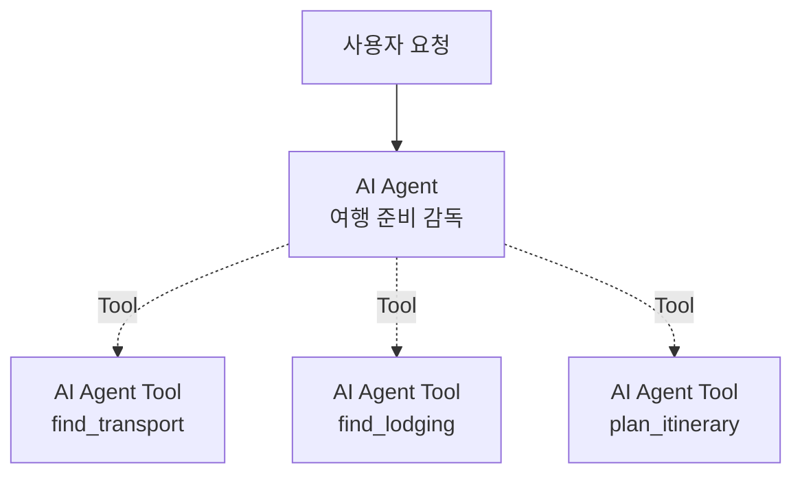

세 도구의 Description은 각자 언제 부르는지가 드러나게 쓴다.

| 도구 | Description |
|---|---|
| `find_transport` | 목적지, 날짜, 인원으로 기차·항공 시간표를 찾는다. 이동 수단이나 출발·도착 시간을 물을 때 부른다 |
| `find_lodging` | 목적지, 체크인·체크아웃 날짜로 숙소를 찾는다. 숙박이나 호텔을 물을 때 부른다 |
| `plan_itinerary` | 확정된 이동 시간과 숙소로 일정표를 짠다. 이동과 숙소가 이미 정해졌을 때만 부른다 |

사용자가 "다음 주 부산 출장인데 기차랑 숙소만 알아봐 줘"라고 물으면, 감독 에이전트는 Description을 보고 `find_transport`와 `find_lodging`만 부르고 `plan_itinerary`는 부르지 않는다. 뒤이어 "일정표까지 짜 줘"라고 하면 그제야 세 번째를 부른다. **감독 에이전트가 하는 일은 이 셋 중 무엇을 어떤 순서로 부를지 정하는 것뿐이다.** 시간표를 실제로 찾거나 일정을 짜는 것은 각 작업자 에이전트이고, 감독 에이전트는 그 결과를 옮겨 적지 않고 그대로 사용자에게 전달한다.

#### 계층형 감독 만들기

`AI Agent Tool`은 여러 단계로 겹쳐 연결할 수 있다. 상위 감독의 Tool 연결점에 하위 감독 역할의 `AI Agent Tool`을 붙이고, 하위 감독의 Tool 연결점에 다시 작업자 에이전트를 붙인다. 이런 구조로 계층형 감독 패턴을 구현할 수 있다.


### 감독 에이전트가 결과를 바꾸지 못하게 한다

감독 에이전트는 작업자 에이전트들이 반환한 결과를 읽고 그것을 바탕으로 최종 답을 쓴다. 이때 결과를 요약하며 숫자를 바꾸거나, 전문 에이전트가 "확인하지 못했다"고 한 것을 확인된 것처럼 쓰는 일이 생길 수 있다.

막는 방법은 **작업자 에이전트의 구조화 출력을 감독 에이전트의 최종 답과 따로 받는 것**이다. 감독 에이전트의 `Return Intermediate Steps` 설정을 켜면 어떤 도구를 어떤 입력으로 불러 무엇을 결과로 받았는지가 출력의 중간 단계에 남는다. 워크플로우는 감독 에이전트의 최종 답이 아니라 **중간 단계에 남은 전문 에이전트의 출력**을 계약으로 검사하고, 그 값으로 다음 단계를 진행한다. 감독 에이전트의 최종 답은 사람이 읽을 요약으로만 쓴다.

### 하루마켓에 적용하기

`반품 정책 조사`와 `반품 처리안 작성`은 처음부터 서브워크플로우로 만든다. 실습 7-7의 세 구성(단일·순차·감독)은 이 서브워크플로우 파일을 그대로 재사용하고, **부르는 노드만 구성마다 다르다.**

**표 7-21. 순차 구성과 감독 구성이 같은 서브워크플로우를 부르는 방법**

| 구성 | 부르는 노드 | 다음에 무엇을 부를지 정하는 주체 |
|---|---|---|
| 순차 | `Execute Sub-workflow` | 워크플로우(정해진 순서대로) |
| 감독 | `Call n8n Workflow Tool`(감독 에이전트의 도구로 붙인다) | 감독 에이전트 |

서브워크플로우 자체(지시문, 도구, 출력 계약)는 두 구성에서 똑같이 둔다. 그래야 두 구성의 결과 차이가 "역할을 다르게 만들어서"가 아니라 **"누가 다음을 정하는가"**에서만 나온다고 확신할 수 있다.

**감독 에이전트는 이 둘을 도구로 분명히 부른다. 다만 부를 때 넣는 값은 하나도 채우지 않는다.** `Call n8n Workflow Tool`의 입력 칸(`request_id`, `run_id`, 문의 원문, 주문 사실)을 `$fromAI()`가 아니라 워크플로우가 이미 가진 값을 가리키는 표현식으로 고정해 둔다. 그래서 감독 에이전트가 정하는 것은 **이 도구를 지금 부를지 말지** 하나뿐이고, 도구에 무엇을 실어 보낼지는 정하지 못한다.

조사 결과도 감독 에이전트를 거치지 않는다. 조사 서브워크플로우가 자기 결과를 실행 추적 테이블에 직접 저장하고, 처리안 서브워크플로우가 그 기록을 직접 읽는다. 감독 에이전트가 조사 결과를 요약해 처리안 서브워크플로우에 넘기게 하면, 그 과정에서 값이 바뀔 수 있기 때문이다.

> 이 절의 내용은 실습 7-4에서 공식 문서로 비교하고, 실습 7-5에서 `AI Agent Tool`로, 실습 7-7에서 서브워크플로우로 만든다.

## 7.8 결과 검증, 충돌, 종료 조건과 실행 추적

### 넘기기 전에 검사한다

역할 사이마다 **앞 역할의 출력을 계약으로 검사하는 규칙**을 둔다. 검사에 실패하면 다음 역할로 넘기지 않는다. 4장에서 에이전트의 결과를 형식, 일관성, 근거로 검증한 것을 역할 사이로 옮긴 것이다.

**표 7-22. 역할 사이의 검사**

| 검사 | 확인하는 것 | 예 |
|---|---|---|
| **형식** | 필드가 있고 데이터 타입과 허용 값이 맞는가 | `status`가 `ok`·`needs_info` 중 하나인가 |
| **식별자** | 입력의 식별자와 출력의 식별자가 같은가 | 조사 결과의 `request_id`가 넘긴 값과 같은가 |
| **근거** | 인용한 근거가 도구 결과에 실제로 있었는가 | 인용한 정책 번호가 이번 실행의 벡터 검색 결과에 있는가 |
| **범위** | 역할 계약의 "할 수 없는 일"을 하지 않았는가 | 조사 역할이 금액을 적지 않았는가 |

### 위임 실패

**위임 실패**는 맡긴 역할이 계약대로 결과를 내지 못한 경우다. 세 가지가 있을 수 있다.

- 작업자 에이전트나 역할 서브워크플로우가 오류로 끝났다. 
- 결과는 나왔지만 계약 검사를 통과하지 못했다.
- 감독 에이전트가 필요한 작업자 에이전트를 부르지 않고 최종 답을 냈다.

어느 경우든 **성공처럼 이어 가지 않는다.** 에이전트 노드와 `Execute Sub-workflow` 노드의 Settings에서 On Error를 Continue (using error output)로 두어 오류를 별도 출력으로 받고, 종료 사유를 남긴 뒤 끝낸다. 세 번째 경우는 감독 에이전트의 중간 단계에 필요한 역할의 출력이 있는지 규칙으로 확인해 찾는다.

### 상충 결과

**상충 결과**는 두 역할의 결과가 서로 맞지 않는 경우다. 예를 들어 조사 결과에는 판단 후보가 "단순 변심"과 "구성품 누락" 둘로 남아 있는데, 처리안은 "불량 반품 가능"으로 확정했다. 또는 조사 결과는 재고 없음인데 교환안은 그 옵션으로 교환하자고 한다.

상충된 결과가 나오면 누가 맞는지를 모델에게 다시 묻지 말고 워크플로우에 규칙을 둔다.

- **사실 필드는 조사 역할의 값을 따른다.** 뒤 역할이 사실과 다른 값을 쓰면 뒤 역할의 결과를 버린다.
- **판단이 앞 역할의 판단 범위를 벗어나면 모순으로 본다.** 조사가 남긴 후보에 없는 정책을 처리안이 인용하면 모순이다.
- **모순이 있으면 사람에게 넘긴다.** 종료 사유에 모순된 점을 남긴다.

병렬 처리의 "여러 번 처리해 모으기"에서 결과가 갈릴 때도 합치는 규칙을 미리 정한다. "셋 중 둘 이상 같으면 채택하고, 셋이 모두 다르면 사람에게 넘긴다"처럼 정한다.

### 정보 부족

**정보 부족**은 앞 역할이 판단에 필요한 값을 얻지 못한 경우다. 예를 들어 조사 역할이 원하는 옵션을 문의에서 찾지 못했거나, 주문번호가 없는 경우다. 다른 역할이 이 값을 추측으로 채우지 못하게 한다. 역할 계약의 출력에 `unresolved`나 `status: needs_info`를 두고, 워크플로우가 이 값을 보면 다음 역할을 부르지 않는다.

그 뒤의 처리는 업무에 따라 다르다. 아직 누구도 보지 않은 새 요청이면 2장의 정보 요청 경로(T04)처럼 고객에게 다시 묻는 메일을 보낼 수 있다. 이미 사람이 보고 있는 요청이면(7장의 반품 협업처럼) 메일을 다시 보내지 않고, 조사 결과만 남긴 채 담당자에게 맡긴다. 어느 쪽이든 공통점은 **자동 판단을 여기서 멈춘다는 것**이다.

### 종료 조건

여러 역할이 서로를 부르거나 되돌리는 구성은 **멈추는 조건을 여러 곳에 두어야 한다.** 패턴마다 필요한 한도가 다르다.

**표 7-23. 패턴별 반복 한도**

| 한도 | 적용하는 곳 | n8n에서 두는 방법 |
|---|---|---|
| **에이전트 안의 반복 한도** | 모든 에이전트 | `Max Iterations`. 기본값은 10이다 |
| **위임 횟수 한도** | 감독-작업자, 계층형 감독 | 감독 에이전트의 `Max Iterations`로 간접적으로 제한한다. 지시문에 "전문 에이전트는 각각 한 번만 부른다"를 적고, 중간 단계의 호출 수를 규칙으로 확인한다 |
| **되돌림 횟수 한도** | 생성-평가 반복 | 되돌림 연결에 `attempt` 값을 두고 `If`로 한도를 본다 |
| **넘김 횟수 한도** | 핸드오프 | 세션 기록에 담당이 바뀐 횟수를 남기고 한도를 넘으면 사람에게 넘긴다 |

한도에 걸리면 에이전트 노드는 오류로 끝나거나 불완전한 답을 낸다. 이것도 위임 실패처럼 오류 출력으로 받아 종료 사유를 남긴다.

**끝났을 때 "왜 끝났는가"가 값으로 남아야 한다.** 이 교재는 종료 사유를 다섯 가지 값으로 정한다.

**표 7-24. 종료 사유**

| 값 | 뜻 | 다음 행동 |
|---|---|---|
| `completed` | 모든 역할이 계약대로 끝났다 | 결과를 다음 단계(규칙 검사, 승인 요청)로 넘긴다 |
| `needs_info` | 앞 역할이 판단에 필요한 값을 얻지 못했다 | 정보 요청 경로로 보내거나 사람에게 넘긴다 |
| `conflict` | 역할 사이의 결과가 서로 맞지 않는다 | 사람에게 넘긴다 |
| `delegation_failed` | 맡긴 역할이 오류로 끝났거나 계약에 맞지 않는 출력을 냈다 | 사람에게 넘긴다. 반복되면 설정을 확인한다 |
| `limit_reached` | 반복 한도, 위임 횟수 한도, 되돌림 한도 중 하나에 걸렸다 | 사람에게 넘기고, 한도가 적절한지 기록을 모아 검토한다 |

종료 사유는 **실행의 결과**를 말하고, 요청의 상태와는 다르다. 종료 사유가 `completed`여도 처리안이 "담당자 확인 필요"이면 요청은 `under_review`에 남는다. 종료 사유는 실행 추적에, 요청 상태는 요청 기록에 남긴다.

### 실행 추적

**실행 추적**(**execution trace**)은 요청 하나가 어느 역할을 어떤 순서로 지났고 각 역할이 무엇을 받아 무엇을 냈는지 남긴 기록이다. 에이전트가 하나일 때는 에이전트 노드의 로그를 열면 되었다. 역할이 여럿이면 기록이 여러 실행에 흩어진다. 역할 서브워크플로우는 부른 쪽과 **별도의 실행**으로 기록되기 때문이다.

**표 7-25. 실행 추적에 남기는 값**

| 값 | 뜻 | 쓰는 곳 |
|---|---|---|
| **요청 식별자** | 어느 요청의 처리인가 | 요청별로 기록을 모은다 |
| **구성** | 단일 에이전트, 순차 연결, 감독 구성 중 무엇인가 | 구성끼리 비교한다 |
| **역할과 순서** | 어느 역할이 몇 번째로 일했는가 | 경로를 재구성한다 |
| **역할의 출력** | 계약 형식의 결과 | 틀린 역할을 찾는다 |
| **도구 호출** | 어떤 도구를 어떤 입력으로 불렀는가 | 도구 선택의 잘잘못을 본다 |
| **종료 사유** | 표 7-24의 값 | 실패 유형을 센다 |
| **시각** | 시작과 끝 | 처리 시간을 잰다 |

n8n에서 역할의 도구 호출은 에이전트 노드의 `Return Intermediate Steps`를 켜서 출력에 남기고, 워크플로우가 그 값을 실행 추적 테이블에 저장한다. 원문 전체를 저장하지 않고, 필요한 필드만 저장한다. 고객 문의 원문처럼 민감한 내용은 이미 문의 기록에 있으므로 실행 추적에 다시 저장하지 않는다.

실행 추적과 8장의 로그는 목적이 다르다. **이 장의 실행 추적은 요청 하나의 경로를 사람이 읽고 설명할 수 있을 만큼**을 남긴다. 8장에서는 실행 ID, 단계, 오류를 연결해 장애를 분류하고 다시 처리할 수 있을 만큼으로 넓힌다.

> 이 절의 내용은 실습 7-6에서 작게 확인하고, 실습 7-7과 실습 7-8에서 하루마켓에 적용한다.

## 7.9 위임한 작업의 권한과 승인 경로

### 에이전트가 늘어도 배열은 같다

6장에서 판단에서 집행까지의 배열을 정했다. 모델은 제안하고, 규칙이 검사하고, 사람이 승인하고, 워크플로우가 집행한다. 에이전트가 여러 개가 되면 "모델이 제안한다"는 자리에 에이전트 여럿이 들어갈 뿐, 뒤의 배열은 바뀌지 않는다.

**그림 7-13. 여러 에이전트가 있을 때의 판단에서 집행까지**

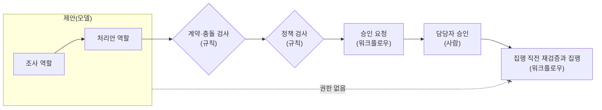

그림 7-13에서 읽어야 할 핵심은 **제안하는 쪽이 둘(조사, 처리안)로 늘어도 집행으로 가는 길은 하나**라는 점이다. 두 역할 중 어느 것도 승인을 요청하거나 집행을 부르는 도구를 갖지 않는다. 점선은 그런 경로가 구조로 막혀 있음을 뜻한다.

### 승인은 워크플로우가 요청한다

감독 에이전트에게 승인 요청 도구를 주면 어떻게 될까. 승인을 요청할지 말지를 모델이 정하게 된다. 감독 에이전트가 "이 건은 명백하니 승인 없이 진행한다"고 판단하면 승인 요청이 나가지 않는다. 승인 요청에 담을 내용도 모델이 쓰게 되어, 담당자가 보는 정보가 매번 달라진다.

그래서 **승인은 워크플로우가 요청한다.** 작업자 에이전트의 제안이 계약 검사와 정책 검사를 통과하면, 워크플로우가 6장에서 만든 흐름대로 승인 요청을 보낸다. 승인 요청에 담는 값은 규칙이 계산한 근거와 계약 필드이고, 모델이 쓴 안내 초안은 참고로만 붙인다. **6장의 승인 흐름은 그대로 쓰고, 승인을 요청하는 자리만 에이전트의 출력 뒤로 옮겨진다.**

n8n 2.43.7에서는 하위 에이전트(`AI Agent Tool`) 안에 메일 사람 검토를 도구로 붙여도 실행이 그 자리에서 기다렸다가 승인 뒤에 이어진다(실행 확인). 기능으로는 하위 에이전트 안에 승인을 둘 수 있다는 뜻이다. 그래도 승인을 그 자리에 두지 않는다. 그 승인은 모델이 도구를 부를 때만 요청되므로, 앞에서 본 것처럼 승인을 요청할지와 무엇을 승인받을지를 모델이 정하게 된다.

### 승인을 기다리는 요청에는 손대지 않는다

승인을 기다리는 요청을 다른 역할이 다시 처리하면 어떻게 될까. 담당자는 처리안 A를 보고 있는데, 그 사이에 협업이 다시 실행되어 처리안 B가 만들어진다. 담당자가 승인한 것은 A인데 요청 기록에는 B가 남는다. 이렇게 되면 6장 6.6절에서 다룬 **승인은 그 시점의 값에 대한 승인**이라는 원칙이 깨진다. 처리할 대상을 조회하거나 승인 처리를 할 때는 이 부분을 먼저 검사하고 처리한다.


### 에이전트별 도구 권한 점검

역할이 늘면 어느 역할이 어떤 도구와 자격 증명을 쓰는지 한눈에 보기 어렵다. 6장의 권한 분리 점검표를 역할 단위로 넓혀 점검한다.

**표 7-26. 하루마켓 반품 협업의 역할별 도구 권한**

| 역할 | 도구 | 자격 증명 | 바꿀 수 있는 것 |
|---|---|---|---|
| **반품 정책 조사** | `정책 검색` | `하루마켓 업무 DB`(검색 테이블 읽기), `OpenAI 실습` | 없다 |
| **반품 처리안 작성** | 없다 | `OpenAI 실습` | 없다 |
| **감독 에이전트**(**비교 구성**) | 위 두 역할의 서브워크플로우 | `OpenAI 실습` | 없다 |
| **워크플로우** | 주문 조회, 요청 기록 쓰기, 승인 요청 메일 | `하루마켓 주문 API`(조회 키), `하루마켓 업무 DB`, `내 Gmail 발송` | 요청 기록의 상태, 실행 추적 |
| **워크플로우**(**6장 반품 진행 통지**) | 환불 집행 | `하루마켓 집행 API`(집행 키) | 환불. 승인과 재검증을 통과한 뒤에만 |

권한은 워크플로우에 둔다고 했다. 그래서 위 표의 **`역할`이 에이전트인 행의 `바꿀 수 있는 것` 열에 모두 "없다"여야 한다.** 이 칸에 무엇이라도 적히는 에이전트가 있으면 설계를 다시 본다.

6장 실습 6-8에서 만든 "도구 호출 앞의 사람 검토"를 감독 구성의 업무 집행 승인으로 쓰는 것도 알맞지 않다. 붙일 수는 있지만 승인 대상이 **모델이 만든 도구 인자**가 된다. 규칙이 계산한 값을 승인하는 6장의 기록 기반 방식이 업무 집행에는 더 알맞다.

> 이 절의 내용은 실습 7-5에서 위임한 발송의 승인으로, 실습 7-7에서 처리안의 승인 경로로 확인한다.

## 7.10 정리

이 장의 세 질문은 설계 순서로 이어진다.

**나누기 전에 기준선을 잰다.** 단일 에이전트의 한계는 역할 충돌, 컨텍스트 오염, 도구 선택 오류, 검증 실패, 프롬프트 복잡화, 처리 시간 증가, 장애 영향 확대의 일곱 가지 현상으로 나타난다. 그중 상당수는 조건 분기, 도구 제한, 서브워크플로우, 컨텍스트 정리로 풀린다. 규칙·도구·컨텍스트 개선으로 해결되면 기존 구조를 유지하고, 역할 격리·독립 검증·병렬 처리가 필요할 때 나누며, 나눈 구성은 같은 입력으로 다시 재서 비교한다. 나누면 호출과 시간이 늘고 정보가 빠진다는 대가를 치르기 때문이다.

**패턴은 다음을 누가 정하는가로 고른다.** 순차 연결, 라우팅, 병렬 처리, 생성-평가 반복은 설계자가 경로를 정한다. 감독-작업자, 계층형 감독, 핸드오프, 네트워크는 모델이 경로를 정한다. 일의 순서가 정해져 있으면 설계자가 정하는 패턴에서 멈추고, 입력마다 필요한 역할이 다를 때만 모델이 정하게 한다. 패턴은 겹쳐 쓸 수 있다.

**역할은 능력과 도구와 권한으로 나누고, 계약으로 잇는다.** 역할 계약에는 입력과 출력뿐 아니라 할 수 없는 일과 끝내는 조건을 적는다. 출력에서는 확인된 사실과 판단을 나누어, 다음 역할과 워크플로우가 사실은 믿고 판단은 검사하게 한다. 역할 사이에 넘기는 값은 계약 필드로 넘기고, 실행 뒤에 남는 공유 상태는 워크플로우만 쓴다.

**나눈 뒤에도 결과를 믿으려면 검사하고, 끝내고, 남긴다.** 역할 사이마다 계약 검사를 두고, 위임 실패와 상충 결과와 정보 부족을 성공처럼 이어 가지 않는다. 패턴마다 반복 한도를 두고, 끝났을 때 종료 사유를 값으로 남긴다. 요청 하나의 경로를 실행 추적으로 다시 읽을 수 있게 한다.

**에이전트가 늘어도 집행 권한을 가진 주체는 늘지 않는다.** 에이전트는 제안까지만 하고, 승인은 워크플로우가 요청하며, 집행은 승인과 재검증을 통과한 뒤 워크플로우가 한다. 승인을 기다리는 요청에는 어떤 에이전트도 손대지 않는다.

8장에서는 이 경로 중 한 곳이 실패했을 때를 다룬다. 이 장에서 남긴 종료 사유와 실행 추적이 장애를 분류하는 출발점이 된다.

## 자기 점검 문제

해설은 다음 절에 있다. 먼저 스스로 답해 본 뒤 비교한다.

**문제 1.** 개인 가계부 도우미 에이전트가 도구 다섯 개(지출 기록, 월별 합계, 예산 조회, 카드 명세서 읽기, 절약 팁 검색)를 가지고 있다. "이번 달 외식비가 예산을 넘었어?"라고 물으면 월별 합계만 부르고 예산 조회를 빠뜨리는 일이 자주 생긴다. 여러 에이전트로 나누기 전에 해 볼 조치 두 가지를 쓰시오.

**문제 2.** 다음 구성 중 멀티 에이전트인 것을 모두 고르고 이유를 쓰시오.

- (가) `Switch`로 문의를 세 갈래로 나누고, 각 갈래에서 규칙으로 답을 만든다.
- (나) 같은 요약 에이전트를 메일 스무 통에 한 번씩 실행한다.
- (다) 회의록에서 할 일을 뽑는 에이전트의 출력을 받아, 담당자별 알림 문장을 쓰는 에이전트가 문장을 만든다.
- (라) 감독 에이전트가 번역 에이전트와 용어 검사 에이전트를 도구로 부른다.

**문제 3.** 사용자와 대화하던 에이전트 A가 다른 에이전트 B에게 일을 맡겼다. (가) B를 도구로 불렀을 때와 (나) B에게 대화를 넘겼을 때, 사용자에게 다음 답을 하는 주체는 각각 누구인가? 두 방식에서 A가 B의 결과를 검사할 수 있는지도 쓰시오.

**문제 4.** 다음 업무에 알맞은 패턴을 고르고 이유를 쓰시오. 패턴을 겹쳐 써도 된다.

- (가) 사내 요청 채널에 들어오는 요청을 IT, 총무, 인사 담당 에이전트로 보낸다.
- (나) 채용 공고문을 쓰고, 차별 표현 기준으로 검토해 고친다.
- (다) 여행 계획 요청마다 교통, 숙소, 맛집 중 필요한 것만 조사한다. 요청마다 필요한 것이 다르다.
- (라) 매주 월요일에 사내 공지 게시판의 글을 모아 주제별 요약을 만든다. 주제는 세 가지로 정해져 있다.

**문제 5.** 광고 문구를 쓰는 생성 역할과 심의 기준으로 평가하는 평가 역할을 생성-평가 반복으로 연결했다. (가) 반복 한도를 두지 않으면 어떤 일이 생길 수 있는가? (나) 평가 기준 "30자 이하", "금지어 없음", "과장 표현 없음" 중 규칙이 판정할 것과 모델이 판정할 것을 나누시오.

**문제 6.** 업무 자동화에서 네트워크 패턴을 권하지 않는 이유를 종료, 추적, 권한의 세 관점에서 한 문장씩 쓰시오.

**문제 7.** 고객 문의를 처리하는 세 역할의 지시문과 도구가 다음과 같다. 잘못 나눈 징후를 두 가지 찾고 고치는 방법을 쓰시오.

| 역할 | 지시문 요지 | 도구 |
|---|---|---|
| 접수 | 문의에서 주문번호와 요구를 뽑는다 | 주문 조회 |
| 판정 | 주문과 정책으로 반품 가능 여부를 정한다 | 주문 조회, 정책 검색 |
| 작성 | 판정 결과로 안내문을 쓴다. 판정이 이상하면 정책을 다시 확인해 판정을 고친다 | 정책 검색 |

**문제 8.** 주간 보고서의 요약 역할에 대한 역할 계약을 쓰고 있다. 입력은 조사 결과, 출력은 보고서 본문과 인용 목록이다. "할 수 없는 일"과 "끝내는 조건"을 각각 두 가지씩 쓰시오.

**문제 9.** 두 에이전트가 요청 기록의 `status` 열을 직접 바꾸는 도구를 가지고 있다. 이 설계에서 생길 수 있는 문제 두 가지와 고친 설계를 쓰시오.

**문제 10.** 같은 반품 요청 20건을 순차 구성과 감독 구성으로 처리해 다음 결과를 얻었다. 어느 구성을 채택하겠는가? 판단 근거를 쓰시오.

| 구분 | 순차 구성 | 감독 구성 |
|---|---|---|
| 기대 경로와 일치 | 17건 | 18건 |
| 평균 모델 호출 | 3.1회 | 5.4회 |
| 평균 처리 시간 | 9초 | 16초 |
| 같은 요청 세 번 실행 시 경로가 달라진 건 | 0건 | 6건 |

**문제 11.** 교환 협업에서 조사 역할은 "원하는 옵션 네이비 M의 재고가 0"이라고 냈는데, 교환안 역할은 "네이비 M으로 교환 가능"이라고 냈다. 워크플로우가 적용할 규칙을 쓰고, 이때 남길 종료 사유를 표 7-24에서 고르시오.

**문제 12.** 감독 에이전트에 "승인 요청 메일 보내기" 도구를 연결한 설계가 있다. 이 설계의 위험 두 가지를 쓰고, 고친 설계를 쓰시오.

**문제 13.** 역할 서브워크플로우를 `Call n8n Workflow Tool`로 감독 에이전트에 붙였다. Workflow Inputs의 `request_id`에는 `{{ $('요청 목록').first().json.request_id }}`를 적었다. 시험하려고 요청 세 건을 한 번에 넣었더니 세 건 모두 첫 번째 요청의 식별자로 조사가 진행되었다. 원인과 고치는 방법을 쓰시오.

## 자기 점검 해설

**문제 1.** 첫째, 두 도구의 설명을 다시 쓴다. 월별 합계 도구의 설명에 "예산 대비를 판단하려면 예산 조회와 함께 쓴다"를, 예산 조회 도구의 설명에 "지출이 예산을 넘었는지 물으면 반드시 쓴다"를 적는다. 둘째, 에이전트의 출력에 `budget`과 `spent`를 필수 필드로 두고, 둘 중 하나가 비어 있으면 규칙이 답을 막고 다시 묻게 한다. 지시문에 판단 순서를 적는 것도 방법이지만 결과 검증보다 약하다. 이 조치로 해결되지 않을 때 나누는 것을 검토한다(7.1절 그림 7-1).

**문제 2.** (다)와 (라)가 멀티 에이전트다. (다)는 역할이 다른 두 에이전트가 있고 한쪽의 출력이 다른 쪽의 입력이 된다. (라)는 감독 에이전트가 두 에이전트의 출력을 입력으로 받는다. (가)는 에이전트가 없고 규칙만 있다. (나)는 역할이 하나이고 실행 횟수만 많다(7.2절 표 7-4).

**문제 3.** (가) 도구로 부르면 B의 결과가 A에게 돌아오고, 사용자에게 답하는 것은 A다. A는 B의 결과를 검사하고 다른 결과와 합칠 수 있다. (나) 대화를 넘기면 B가 사용자에게 직접 답한다. A는 B의 결과를 보지 못하므로 검사할 수 없다. 검사가 필요하면 B의 출력 뒤에 워크플로우의 검사를 따로 둔다(7.2절 그림 7-3).

**문제 4.** 여러 답이 가능하다. 예시 답안은 다음과 같다. (가) 라우팅. 담당마다 도구와 규칙이 다르고, 요청이 들어오면 분류해 한 담당에게 보내면 된다. 어디에도 맞지 않는 요청의 경로를 둔다. (나) 순차 연결에 생성-평가 반복을 겹쳐 쓴다. 쓰기와 검토의 순서가 정해져 있고, 기준에 비추어 고칠수록 나아진다. 되돌림 한도를 둔다. (다) 감독-작업자. 요청마다 필요한 조사가 달라 미리 정할 수 없다. 모든 요청에 세 조사를 다 하게 하는 순차 구성도 가능하지만 불필요한 호출이 생긴다. (라) 순차 연결에 병렬 처리를 겹쳐 쓴다. 주제가 정해져 있으므로 주제별 요약은 서로 독립이다. n8n에서는 갈래가 차례로 실행되므로 시간 단축보다 구조의 명확함이 이점이다. 매주 같은 순서로 하므로 감독 에이전트는 필요 없다(7.3절 표 7-9).

**문제 5.** (가) 평가 역할이 계속 통과시키지 않으면 되돌림이 끝나지 않는다. 반복할 때마다 호출과 시간이 늘고, 결국 에이전트나 워크플로우의 한도에 걸려 오류로 끝난다. 생성과 평가가 서로 다른 방향으로 고치라고 하며 같은 결과를 오가는 일도 생긴다. (나) "30자 이하"와 "금지어 없음"은 규칙이 판정한다. 글자 수 세기와 목록 대조는 `Code` 노드가 정확하게 한다. "과장 표현 없음"은 뜻을 읽어야 하므로 모델이 판정한다(7.3절 생성-평가 반복).

**문제 6.** 종료: 에이전트마다 다음에 누구를 부를지 정하므로 언제 끝날지 정하기 어렵고 서로 부르다 한도에 걸리기 쉽다. 추적: 같은 입력에도 경로가 매번 달라, 어느 에이전트가 어떤 결과를 냈는지 따라가기 어렵다. 권한: 한 에이전트가 읽은 지시 문장이나 얻은 맥락이 다른 모든 에이전트의 입력으로 전달될 수 있어 권한 경계를 지키기 어렵다(7.3절 네트워크).

**문제 7.** 징후 두 가지는 다음과 같다. 첫째, **같은 도구가 두 역할에 있다.** 주문 조회가 접수와 판정에, 정책 검색이 판정과 작성에 있다. 둘째, **뒤 역할이 앞 역할의 판정을 다시 한다.** 작성 역할이 판정을 고치므로 판정 역할의 책임이 겹친다. 고치는 방법: 주문 조회는 접수(또는 규칙)에만, 정책 검색은 판정에만 둔다. 작성 역할은 도구를 갖지 않고, 지시문에서 판정을 고치는 문장을 지운다. 판정이 이상해 보이면 작성 역할은 `status`를 `needs_review`로 내고 끝나게 계약에 적는다(7.4절 표 7-11).

**문제 8.** 예시 답안이다. 할 수 없는 일: 조사 결과에 없는 글이나 사실을 쓰지 않는다. 인용 목록에 조사 결과의 출처가 아닌 주소를 넣지 않는다. 주제 분류를 새로 바꾸지 않는다. 끝내는 조건: 조사 결과의 `status`가 `ok`가 아니면 쓰지 않고 `needs_info`로 끝낸다. 한 번 쓰고 끝낸다(도구가 없으므로 반복하지 않는다). 본문 분량이 정해진 한도를 넘으면 한도 안으로 줄여 한 번에 낸다(7.4절 표 7-12).

**문제 9.** 문제: 두 에이전트가 거의 같은 때에 `status`를 바꾸면 한쪽의 변경이 사라진다. 누가 언제 바꾸었는지 알 수 없다. 에이전트가 전이표에 없는 상태 변화를 만들 수 있다. 고친 설계: 두 에이전트에서 상태 변경 도구를 뺀다. 에이전트는 계약 형식의 출력만 내고, 워크플로우가 출력을 검사한 뒤 전이표에 있는 변화만 `UPDATE`한다. 그 문장에는 "조회한 상태가 지금도 그대로일 때만" 조건을 붙인다(7.5절).

**문제 10.** 순차 구성을 채택하는 것이 합리적이다. 감독 구성은 기대 경로와 일치한 건이 1건 많지만, 모델 호출은 약 1.7배, 처리 시간은 약 1.8배이고, 같은 요청을 다시 실행했을 때 경로가 달라진 건이 6건이다. 경로가 달라지면 틀렸을 때 원인을 찾고 개선 효과를 비교하기 어렵다. 1건의 차이가 어떤 요청에서 생겼는지 확인해, 그 요청이 순차 구성의 규칙이나 지시문을 고쳐 맞힐 수 있는 종류라면 순차 구성을 고친다. 반대로 감독 구성만 맞힌 건들이 "필요한 역할이 입력마다 다른" 종류로 많다면 감독 구성을 다시 검토한다. 숫자만으로 정하지 않고 **어느 건에서 차이가 났는지**를 본다(7.1절 기준선, 7.3절 감독-작업자).

**문제 11.** 규칙: 재고 같은 사실 필드는 조사 역할의 값을 따른다. 교환안이 재고가 0인 옵션으로 교환을 제안하면 교환안을 버리고 담당자에게 넘긴다. 종료 사유는 `conflict`다. 교환안을 모델에게 다시 쓰게 해 맞추는 방법도 생각할 수 있지만, 그러려면 되돌림 한도를 두어야 하고 두 번째 결과도 다시 검사해야 한다. 이 교재의 기본은 모순을 사람에게 넘기는 것이다(7.8절 상충 결과).

**문제 12.** 위험: 승인을 요청할지 말지를 모델이 정하게 되어, 감독 에이전트가 "명백하다"고 판단하면 승인 없이 진행할 수 있다. 승인 요청에 담을 내용을 모델이 써서 담당자가 판단에 필요한 값이 빠지거나 매번 달라진다. 모델의 입력에 섞인 지시 문장이 승인 요청의 내용이나 받는 사람에 영향을 줄 수 있다. 고친 설계: 감독 에이전트에서 승인 요청 도구를 뺀다. 감독 에이전트의 출력(또는 중간 단계에 남은 전문 에이전트의 출력)을 워크플로우가 계약과 정책으로 검사한 뒤, 6장의 승인 흐름으로 승인을 요청한다(7.9절).

**문제 13.** 원인: `.first()`는 지금 처리 중인 아이템과 관계없이 그 노드의 첫 아이템을 가리킨다(부록 C). 한 번의 실행에 세 건이 함께 들어가 있으므로 세 번의 도구 호출 모두에 첫 번째 요청의 식별자가 들어간다. 도구 입력의 표현식 자체는 아이템마다 계산되므로 `{{ $json.request_id }}`로 적었다면 이 문제는 생기지 않는다. 고치는 방법: 감독 에이전트를 포함한 협업 워크플로우가 요청 한 건씩 실행되게 한다. 요청 목록 뒤에 `Loop Over Items`를 두어 한 건씩 넘긴다. 협업 전체를 서브워크플로우로 만들었다면 `Loop Over Items` 안에서 `Execute Sub-workflow`로 한 건씩 부른다. 그리고 역할의 출력에 `request_id`를 넣게 해, 넘긴 값과 같은지 규칙으로 검사한다(7.5절).

## 참고 자료

- n8n Docs, [AI Agent Tool](https://docs.n8n.io/integrations/builtin/cluster-nodes/sub-nodes/n8n-nodes-langchain.toolaiagent/) — Description, Prompt (User Message), Max Iterations, Return Intermediate Steps, Batch Processing, 여러 단계로 겹쳐 연결(2026-09-22 확인)
- n8n Docs, [Call n8n Workflow Tool](https://docs.n8n.io/integrations/builtin/cluster-nodes/sub-nodes/n8n-nodes-langchain.toolworkflow/) — Workflow Inputs, 프로덕션에서 서브워크플로우 Publish 필요(2026-09-22 확인)
- n8n Docs, [Execute Sub-workflow](https://docs.n8n.io/integrations/builtin/core-nodes/n8n-nodes-base.executeworkflow/) — Mode, Wait for Sub-Workflow Completion(2026-09-22 확인)
- n8n Docs, [Understand execution order](https://docs.n8n.io/build/flow-logic/understand-execution-order/) — 1.0 이후 갈래를 하나씩 차례로 실행(2026-09-22 확인)
- n8n 소스 2.43.7, `packages/@n8n/nodes-langchain/nodes/agents/Agent/` — `AgentToolV3.node.ts`(Tool 연결점)
- n8n 소스 2.43.7, `packages/@n8n/nodes-langchain/nodes/chains/TextClassifier/TextClassifier.node.ts` — When No Clear Match, Allow Multiple Classes To Be True
- n8n 소스 2.43.7, `packages/nodes-base/nodes/Merge/v3/` — Mode(Append, Combine, SQL Query, Choose Branch)
- Anthropic, [Building effective agents](https://www.anthropic.com/engineering/building-effective-agents) — workflow와 agent의 구분, prompt chaining, routing, parallelization(sectioning, voting), orchestrator-workers, evaluator-optimizer(2026-09-22 확인). 개념 설명의 참고로 썼다
- LangChain, LangGraph 멀티 에이전트 문서 — network, supervisor, hierarchical, handoff의 구분. 개념 대응의 참고로 썼다
