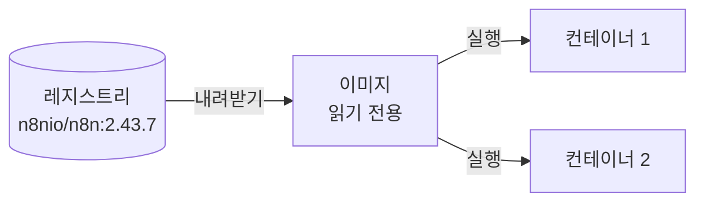

# 부록 A. Docker 기초와 n8n 실행 환경

> 적용 버전: n8n 2.43.7 셀프 호스팅 Community Edition, PostgreSQL 17. 공식 문서 확인일: 2026-09-16.

## 이 부록에서 다루는 문제

3장 실습 3-1은 명령 한 줄로 n8n과 데이터베이스를 실행한다. 그 명령은 잘 동작하지만, 구성 파일의 각 줄이 무엇을 하는지 모르는 채로 쓰면 곧 막힌다. 포트를 바꿔야 할 때 어디를 고쳐야 하는지, 자격 증명의 주소 칸에 왜 `localhost`가 아니라 `db`를 넣어야 하는지, `.env`를 고쳤는데 왜 그대로인지 같은 질문에 답할 수 없다. 이 질문들은 n8n을 몰라서가 아니라 컨테이너를 몰라서 생긴다.

이 부록은 그 간격을 메운다. 다만 Docker 자체를 다루는 것이 목적은 아니다. **n8n을 실행하고, 유지하고, 문제가 생겼을 때 어디를 볼지 아는 데 필요한 만큼**만 설명한다. 이미지를 최적화하거나 여러 서버에 나누어 배포하는 내용은 다루지 않는다.

이 부록을 읽으면 다음을 할 수 있다.

- 이미지와 컨테이너의 관계를 설명하고, 이미지 태그로 n8n 버전을 고정하는 이유를 말한다.
- 컨테이너를 지워도 남아야 하는 데이터를 볼륨으로 두고, 볼륨과 바인드 마운트를 구분한다.
- 포트 연결, 환경 변수, 컨테이너 사이의 이름 찾기가 어떻게 동작하는지 설명한다.
- `docker run`과 그 주요 옵션, 상태와 로그를 보는 명령을 읽고 쓴다.
- Dockerfile이 언제 필요한지 판단하고, 기본 지시어로 이루어진 파일을 읽는다.
- 구성 파일 하나로 여러 컨테이너를 함께 실행하고, 3장 실습의 `compose.yml`을 줄 단위로 읽는다.

읽기 전에 낱말 하나를 구분해 둔다. 이 부록에서 **실행한다**는 말은 컨테이너를 동작시키는 일을 가리킨다. n8n에서 워크플로우를 한 번 수행한 단위를 뜻하는 **실행**(**execution**)과는 다른 말이며, 그 뜻으로 쓸 때는 '워크플로우 실행'이나 '실행 기록'처럼 적는다.

3장 3.2절은 **실행 환경에서 지켜야 할 다섯 가지**를 다룬다. 그 절이 "무엇을 잃으면 안 되는가"에 답한다면, 이 부록은 "그것이 Docker에서 어떤 장치로 지켜지는가"에 답한다. 두 문서를 함께 읽으면 좋다.

## A.1 이미지와 컨테이너

### 설치의 어려움에서 출발하기

프로그램 하나를 서버에서 실행하려면 그 프로그램만 있으면 되는 것이 아니다. 실행에 필요한 런타임이 맞는 버전으로 설치되어 있어야 하고, 프로그램이 의존하는 다른 패키지도 필요하다. 그래서 내 컴퓨터에서는 잘 실행되던 것이 다른 컴퓨터에서는 실행되지 않는 일이 생긴다. 같은 컴퓨터 안에서도 문제가 생긴다. 프로젝트 두 개가 같은 런타임의 다른 버전을 요구하면 둘 중 하나는 실행할 수 없다.

컨테이너는 이 문제를 **프로그램과 그 실행에 필요한 것들을 함께 묶어 두는 방식**으로 푼다. 이렇게 묶어 둔 것을 가져와 그대로 실행하면, 내 컴퓨터에 무엇이 설치되어 있든 그 안은 같은 상태다.

### 이미지와 컨테이너의 관계

**이미지**(**image**)는 컨테이너를 만들기 위한 읽기 전용 템플릿이다. 프로그램과 실행에 필요한 파일, 라이브러리, 설정이 모두 들어 있고, 한 번 만들어지면 바뀌지 않는다. **컨테이너**(**container**)는 그 이미지를 실제로 실행한 것이다.

**표 A-1. 이미지와 컨테이너**

| 구분 | 이미지 | 컨테이너 |
|---|---|---|
| **무엇인가** | 실행에 필요한 것이 모두 들어 있는 템플릿 | 이미지를 실행해 동작하고 있는 것 |
| **바뀌는가** | 바뀌지 않는다 | 실행하면서 안의 파일이 바뀐다 |
| **몇 개인가** | 하나 | 같은 이미지로 여러 개를 실행할 수 있다 |
| **지우면** | 다시 내려받으면 된다 | 안에서 바뀐 것이 함께 사라진다 |
| **n8n의 예** | `n8nio/n8n:2.43.7` | 그 이미지로 실행한 n8n 하나 |

표 A-1에서 읽어야 할 핵심은 마지막 줄이다. **컨테이너를 지우면 그 안에서 바뀐 것이 함께 사라진다.** 만든 워크플로우를 컨테이너 안에 그냥 두면 안 되는 이유가 여기 있고, 이 문제를 푸는 방법이 A.2의 볼륨이다.

그림 A-1은 이미지 하나로 컨테이너를 여러 개 실행하는 모습이다.

**그림 A-1. 이미지와 컨테이너**



그림 A-1에서 읽어야 할 핵심은 이미지가 컨테이너의 **출발 상태**라는 점이다. 같은 이미지로 실행한 컨테이너 둘은 처음에는 똑같지만, 실행한 뒤에는 각자 다르게 바뀐다.

### 레지스트리와 태그

이미지는 **레지스트리**(**registry**)라는 저장소에서 내려받는다. 기본 레지스트리는 Docker Hub이고, n8n의 공식 이미지는 `n8nio/n8n`이라는 이름으로 올라와 있다.

이름 뒤에 콜론으로 붙이는 것이 **태그**(**tag**)이고 대개 버전을 가리킨다. `n8nio/n8n:2.43.7`은 2.43.7 버전의 이미지다. 태그를 적지 않으면 `latest`가 붙는다. 그런데 이 태그는 **항상 최신이라는 뜻이 아니다**. 이미지를 만든 쪽이 그렇게 표시해 둔 것일 뿐이고, 그 표시가 가리키는 실제 버전은 시간이 지나면 바뀐다.

그래서 이 교재는 `compose.yml`에 `n8nio/n8n:2.43.7`처럼 버전을 정확히 적는다. 3장 3.1절에서 "n8n은 버전 업데이트가 잦다"고 한 것과 이어진다. 태그를 고정해 두면 몇 달 뒤에 같은 구성 파일로 실행해도 교재와 같은 화면을 보게 된다.

버전을 올릴 때는 새 태그의 이미지를 내려받고 컨테이너를 다시 만든다.

```bash
docker pull n8nio/n8n:2.43.7
```

## A.2 컨테이너 밖에 두어야 하는 것

컨테이너는 언제든 지웠다 다시 만들 수 있는 것으로 다룬다. 그러려면 **지워지면 안 되는 것**과 **바깥에서 넣어 주어야 하는 것**을 컨테이너 밖에 두어야 한다. 여기에 네 가지 장치가 쓰인다.

### 볼륨과 바인드 마운트

**볼륨**(**volume**)은 Docker가 관리하는 저장 공간이다. 컨테이너는 볼륨을 자기 폴더처럼 쓰지만, 컨테이너를 지워도 볼륨은 남는다. 이름을 붙여 두고 컨테이너 안의 경로에 연결한다.

```yaml
volumes:
  - n8n_data:/home/node/.n8n
```

왼쪽이 볼륨 이름이고 오른쪽이 컨테이너 안의 경로다. n8n은 자기 설정을 `/home/node/.n8n`에 두므로, 이 연결이 있으면 컨테이너를 다시 만들어도 설정이 남는다.

비슷해 보이지만 성격이 다른 것이 **바인드 마운트**(**bind mount**)다. 이쪽은 **내 컴퓨터의 특정 파일이나 폴더**를 컨테이너 안에 보이게 한다. 왼쪽에 이름 대신 경로를 적는다.

```yaml
volumes:
  - ./업무DB_초기화.sql:/docker-entrypoint-initdb.d/10-harumarket.sql:ro
```

내 작업 폴더의 `업무DB_초기화.sql` 파일을 컨테이너 안의 저 경로에 보이게 한다는 뜻이다. 끝의 `ro`는 컨테이너가 이 파일을 읽기만 하고 고치지는 못하게 하는 표시다.

**표 A-2. 볼륨과 바인드 마운트**

| 구분 | 볼륨 | 바인드 마운트 |
|---|---|---|
| **무엇을 연결하는가** | Docker가 관리하는 저장 공간 | 내 컴퓨터의 파일이나 폴더 |
| **적는 방법** | `이름:컨테이너경로` | `./내경로:컨테이너경로` |
| **주로 담는 것** | 실행하면서 쌓이는 데이터 | 내가 미리 만들어 둔 파일 |
| **탐색기로 확인 할 수 있는가** | 쉽지 않다 | 그냥 내 파일이다 |

표 A-2에서 읽어야 할 핵심은 방향이 서로 다르다는 점이다. **볼륨은 컨테이너가 만들어 내는 것을 담고, 바인드 마운트는 내가 준비한 것을 컨테이너에 넣어 준다.**

### 포트 연결

컨테이너 안에서 실행되는 프로그램은 컨테이너 안의 포트를 쓴다. 그 상태로는 내 브라우저에서 닿을 수 없다. 두 포트를 연결해 주어야 한다.

```yaml
ports:
  - "5678:5678"
```

**왼쪽이 내 컴퓨터의 포트이고 오른쪽이 컨테이너 안의 포트다.** 이 순서를 기억해 두면 포트 충돌을 만났을 때 어디를 고칠지 바로 알 수 있다. 내 컴퓨터에서 5678을 다른 프로그램이 이미 쓰고 있다면 왼쪽만 바꾼다.

```yaml
ports:
  - "15678:5678"
```

컨테이너 안의 n8n은 그대로 5678을 쓰고, 나는 `http://localhost:15678`로 접속한다. 오른쪽까지 바꾸면 n8n이 사용하지 않는 포트로 연결하게 되어 화면이 열리지 않는다.

### 환경 변수

컨테이너는 이미지에서 그대로 만들어지므로 누가 실행하든 내용이 같다. 그래서 데이터베이스 비밀번호나 시간대처럼 **쓰는 사람마다 달라지는 값은 이미지 안에 넣을 수 없다.** 컨테이너를 만들 때 바깥에서 넣어 주어야 하고, 이렇게 전달하는 값이 **환경 변수**(**environment variable**)다.

여기서 꼭 기억할 것이 하나 있다. **환경 변수는 컨테이너를 만들 때 전달된다.** 이미 실행 중인 컨테이너에 값을 새로 넣을 수는 없다. 그래서 `.env`를 고쳤다면 컨테이너를 다시 만들어야 적용된다. 3장 실습에서 시간대를 고친 뒤 `docker compose up -d`를 다시 실행하는 이유가 이것이다.

### 컨테이너끼리 서로를 찾는 방법

컨테이너 여러 개를 함께 실행하면 Docker가 이들을 하나의 네트워크에 넣는다. 이때 구성 파일에 적은 컨테이너 하나하나를 **서비스**(**service**)라고 부른다. 이 안에서 **컨테이너는 서비스 이름으로 서로를 찾는다.** 구성 파일에 `db`라는 이름으로 적은 서비스는 다른 컨테이너에서 `db`라는 이름으로 접속할 수 있다.

이 교재가 다른 곳에서 말하는 '외부 서비스'와는 다른 뜻이다. 그쪽은 메일이나 메신저처럼 n8n이 연결하는 바깥의 시스템을 가리키고, 여기서는 구성 파일 안의 컨테이너 하나를 가리킨다.

초보자가 가장 자주 막히는 곳이 여기다. n8n 컨테이너 안에서 `localhost`는 **내 컴퓨터가 아니라 n8n 컨테이너 자기 자신**을 가리킨다. 데이터베이스는 다른 컨테이너에 있으므로 `localhost`로는 닿지 않는다.

**표 A-3. 같은 대상을 부르는 이름이 위치에 따라 달라진다**

| 무엇을 가리키는가 | 내 컴퓨터(브라우저, 터미널)에서 | 다른 컨테이너 안에서 |
|---|---|---|
| n8n 화면 | `http://localhost:5678` | `http://n8n:5678` |
| PostgreSQL | 포트를 열어 두었을 때만 닿는다 | `db`의 `5432` |

표 A-3에서 읽어야 할 핵심은 **어디에서 부르는지에 따라 이름이 달라진다**는 점이다. 3장 실습 3-1에서 업무 데이터베이스 자격 증명의 Host 칸에 `db`를 넣는 것은 그 접속을 n8n 컨테이너가 하기 때문이고, Port 칸에 `5432`를 넣는 것도 컨테이너 안의 포트이기 때문이다.

## A.3 컨테이너를 다루는 명령

### 하나를 실행하는 가장 짧은 방법

n8n 공식 문서는 컨테이너 하나로 n8n을 실행하는 방법을 다음과 같이 안내한다. 볼륨을 먼저 만들고, 그 볼륨을 연결해 컨테이너를 실행한다.

```bash
docker volume create n8n_data
```

```bash
docker run -it --rm --name n8n -p 5678:5678 -e GENERIC_TIMEZONE="Asia/Seoul" -e TZ="Asia/Seoul" -e N8N_RUNNERS_ENABLED=true -v n8n_data:/home/node/.n8n n8nio/n8n
```

이 한 줄에 A.2에서 본 것이 모두 들어 있다. 옵션을 하나씩 떼어 읽으면 다음과 같다.

**표 A-4. 실행 명령의 주요 옵션**

| 옵션 | 뜻 | 이 명령에서 하는 일 |
|---|---|---|
| `--name` | 컨테이너에 이름을 붙인다 | 이름을 `n8n`으로 정해 다음 명령에서 가리키기 쉽게 한다 |
| `-p` | 포트를 연결한다 | 내 컴퓨터의 5678을 컨테이너의 5678에 연결한다 |
| `-e` | 환경 변수를 전달한다 | 시간대와 실행 설정을 넣는다. 값마다 한 번씩 적는다 |
| `-v` | 볼륨이나 폴더를 연결한다 | `n8n_data` 볼륨을 설정 디렉터리에 연결한다 |
| `-d` | 백그라운드로 실행한다 | 이 명령에는 없다. 아래 설명 참조 |
| `-it` | 터미널을 붙인다 | 로그가 화면에 이어서 나온다 |
| `--rm` | 멈추면 컨테이너를 지운다 | 시험 삼아 실행할 때 뒷정리를 줄인다 |

표 A-4에서 주의할 것은 마지막 두 줄이다. `-it --rm`은 **잠깐 실행해 보고 마는 방식**이다. 터미널을 닫으면 멈추고, 멈추면 컨테이너가 지워진다. 볼륨은 남으므로 데이터를 잃지는 않지만, 계속 실행해 두려면 `-d`로 백그라운드에서 실행하고 `--rm`은 빼야 한다.

### 상태를 보고 다루는 명령

**표 A-5. 자주 쓰는 명령**

| 명령 | 하는 일 | 언제 쓰는가 |
|---|---|---|
| `docker ps` | 실행 중인 컨테이너를 보여 준다 | 정상적으로 실행되었는지 확인할 때 |
| `docker ps -a` | 멈춘 것까지 보여 준다 | 실행되었다가 종료된 컨테이너를 찾을 때 |
| `docker logs <이름>` | 컨테이너가 남긴 로그를 보여 준다 | 실행되지 않거나 이상할 때 가장 먼저 |
| `docker stop <이름>` | 컨테이너를 멈춘다 | 잠시 멈춰 둘 때 |
| `docker rm <이름>` | 멈춘 컨테이너를 지운다 | 다시 만들기 전에 |
| `docker exec -it <이름> sh` | 컨테이너 안에서 명령을 실행한다 | 안의 파일이나 상태를 직접 볼 때 |
| `docker images` | 내려받은 이미지를 보여 준다 | 어떤 버전이 있는지 확인할 때 |
| `docker volume ls` | 볼륨 목록을 보여 준다 | 데이터가 어디 남아 있는지 확인할 때 |

문제가 생겼을 때의 순서는 거의 정해져 있다. **먼저 실행 중인지 보고, 그렇지 않거나 이상하면 로그를 본다.** `docker ps`와 `docker logs`가 그 두 명령이다. 메시지를 읽지 않고 설정부터 고치면 원인을 지나치기 쉽다.

### 명령 한 줄로는 부족해지는 지점

`docker run` 한 줄로도 n8n은 실행된다. 그런데 3장의 구성은 n8n만으로 끝나지 않는다. PostgreSQL도 함께 실행해야 하고, n8n이 그 데이터베이스를 쓰도록 환경 변수를 여러 개 넣어야 하며, 데이터베이스가 준비된 뒤에 n8n이 시작해야 한다.

이것을 `docker run`으로 하면 긴 명령을 두 번 실행하고 순서까지 손으로 맞춰야 한다. 그 명령을 어딘가 적어 두지 않으면 다음에 같은 환경을 다시 만들 수도 없다. 이 문제를 푸는 것이 A.5의 Docker Compose다.

## A.4 Dockerfile: 이미지를 직접 만들 때

### 언제 필요한가

지금까지는 남이 만들어 올려 둔 이미지를 내려받아 썼다. **Dockerfile**은 그 이미지를 직접 만들 때 쓰는 파일이다. 무엇을 바탕으로, 무엇을 더 넣어, 어떻게 시작할지를 적어 둔 설명서에 가깝다.

n8n을 쓰면서 이미지를 직접 만들어야 하는 경우는 많지 않다. 대표적인 경우는 **공식 이미지에 없는 것을 이미지 안에 넣어 두고 싶을 때**다. 커뮤니티 노드나 코드 노드에서 쓸 패키지를 미리 넣어 둔 이미지를 만들면, 컨테이너를 다시 만들어도 그것들이 그대로 들어 있다.

다만 커뮤니티 노드는 n8n 화면에서 설치하는 방법도 있다. 공식 문서는 화면에서 설치하는 방법, 명령줄로 설치하는 방법, 환경 변수로 지정하는 방법을 함께 안내한다. 이미지를 직접 만드는 것은 그중 한 가지 선택지이고, 설치한 것을 구성 파일과 함께 관리하고 싶을 때 유리하다.

**이 교재의 실습에서는 Dockerfile을 쓰지 않는다.** 공식 이미지를 그대로 쓰기 때문이다. 이 절은 나중에 필요해졌을 때 읽을 수 있도록 구조만 익혀 두는 자리다.

### 기본 지시어

**표 A-6. Dockerfile의 기본 지시어**

| 지시어 | 하는 일 |
|---|---|
| `FROM` | 무엇을 바탕으로 만들지 정한다. 대개 첫 줄이다 |
| `USER` | 이어지는 명령을 어떤 사용자로 실행할지 정한다 |
| `RUN` | 이미지를 만드는 동안 명령을 실행한다. 패키지 설치가 대표적이다 |
| `COPY` | 내 폴더의 파일을 이미지 안으로 넣는다 |
| `WORKDIR` | 이어지는 명령이 실행될 위치를 정한다 |
| `ENV` | 이미지에 기본 환경 변수를 정해 둔다 |
| `CMD` | 컨테이너가 시작될 때 실행할 명령을 정한다 |

`RUN`과 `CMD`는 헷갈리기 쉽다. `RUN`은 **이미지를 만드는 동안 한 번** 실행되고, `CMD`는 **그 이미지로 컨테이너를 실행할 때마다** 실행된다. 패키지 설치는 `RUN`이고, 프로그램을 시작하는 것은 `CMD`다.

다음은 공식 이미지에 패키지를 더한 이미지를 만드는 모습을 보여 주는 개념 설명용 예시다. 실제로 적용할 때는 넣으려는 패키지의 설치 방법을 공식 문서에서 확인한다.

```dockerfile
FROM n8nio/n8n:2.43.7
USER root
RUN npm install -g <패키지 이름>
USER node
```

`USER`가 두 번 나오는 이유는, 패키지를 설치하려면 권한이 필요하지만 실행은 원래 사용자로 되돌려 놓아야 하기 때문이다. `<패키지 이름>`은 실제 이름으로 바꿀 자리표시자다.

만든 파일로 이미지를 만들 때는 `build` 명령을 쓴다. `-t`는 만들 이미지에 붙일 이름과 태그이고, 끝의 점은 현재 폴더를 뜻한다.

```bash
docker build -t my-n8n:2.43.7 .
```

이렇게 만든 이미지는 `n8nio/n8n:2.43.7` 대신 구성 파일에 적어 쓸 수 있다.

### 층으로 쌓인다는 것

Dockerfile의 각 줄은 이미지에 **층**(**layer**)을 하나씩 쌓는다. 같은 줄을 다시 만들 때 바뀐 것이 없으면 Docker는 이전에 만든 층을 그대로 재사용한다. 그래서 자주 바뀌는 내용을 아래쪽에 두면 다시 만드는 시간이 짧아진다.

이 성질 때문에 주의할 점이 하나 있다. 비밀번호나 키를 `ENV`나 `RUN`으로 이미지에 넣으면 **그 값이 이미지 안에 남는다**. 이미지를 받은 사람은 그 값을 볼 수 있다. 비밀은 이미지가 아니라 컨테이너를 실행할 때 환경 변수로 넣는다. 3장이 `.env`를 따로 두는 이유와 같다.

## A.5 Docker Compose: 여러 컨테이너를 함께

### 명령 대신 파일로 적는다

Docker Compose는 **여러 컨테이너의 실행 방법을 구성 파일 하나에 적어 두고 한 번에 실행하는 도구**다. `docker run`에 옵션으로 주던 것을 그대로 파일의 항목으로 옮긴 것이라고 보면 된다.

파일로 적으면 세 가지가 달라진다. 긴 명령을 외우지 않아도 되고, 컨테이너 사이의 관계를 한곳에서 볼 수 있으며, 파일을 건네주면 다른 사람이 같은 환경을 그대로 만들 수 있다.

**표 A-7. 구성 파일의 주요 항목**

| 항목 | 하는 일 | `docker run`에서는 |
|---|---|---|
| `services` | 실행할 컨테이너들을 적는다. 각 이름이 서비스 이름이 된다 | 명령을 따로따로 실행 |
| `image` | 어떤 이미지로 실행할지 정한다 | 명령의 마지막 인자 |
| `environment` | 환경 변수를 전달한다 | `-e` |
| `volumes` | 볼륨이나 폴더를 연결한다 | `-v` |
| `ports` | 포트를 연결한다 | `-p` |
| `restart` | 멈췄을 때 다시 시작할지 정한다 | `--restart` |
| `depends_on` | 다른 서비스가 준비된 뒤에 시작하게 한다 | 직접 순서를 맞춰야 한다 |
| `healthcheck` | 서비스가 실제로 준비되었는지 검사할 방법을 정한다 | 직접 확인해야 한다 |
| 최상위 `volumes` | 쓸 볼륨의 이름을 선언한다 | `docker volume create` |

표 A-7에서 눈여겨볼 것은 `depends_on`과 `healthcheck`다. 컨테이너가 **실행되었다는 것과 쓸 준비가 되었다는 것은 다르다.** 데이터베이스는 프로세스가 시작된 뒤에도 접속을 받기까지 시간이 조금 걸린다. 그 사이에 n8n이 접속을 시도하면 실패한다. 그래서 준비되었는지 검사할 방법을 `healthcheck`에 적고, `depends_on`에서 그 검사를 통과할 때까지 기다리게 한다.

### 값을 파일에서 읽어 오기

구성 파일에는 비밀번호를 직접 쓰지 않고 `${이름}`으로 자리만 비워 둔다. Compose는 구성 파일과 같은 폴더의 `.env` 파일에서 그 값을 읽어 채운다.

```ini
POSTGRES_PASSWORD=직접-정한-비밀번호
TIMEZONE=Asia/Seoul
```

```yaml
environment:
  POSTGRES_PASSWORD: ${POSTGRES_PASSWORD}
  TZ: ${TIMEZONE}
```

두 파일로 나누는 이유는 **구성과 비밀을 따로 두기 위해서다.** 구성 파일은 팀에 공유해도 되지만 `.env`는 공유해서도 저장소에 올려서도 안 된다. 나누어 두면 같은 구성 파일을 여러 사람이 받아 각자의 `.env`만 채워 쓸 수 있다. 이 구분은 3장 3.2절에서 다시 다룬다.

값을 적을 때 두 가지를 주의한다. **값에 따옴표를 붙이지 않고, 줄 끝에 공백을 남기지 않는다.** 따옴표와 공백이 값의 일부로 들어가 비밀번호가 틀리게 된다.

### 자주 쓰는 명령

모든 명령은 구성 파일이 있는 폴더에서 실행한다.

**표 A-8. Compose 명령과 그 결과**

| 명령 | 하는 일 | 컨테이너 | 볼륨 |
|---|---|---|---|
| `docker compose up -d` | 구성대로 만들어 백그라운드에서 실행한다 | 없으면 만들고 바뀌었으면 다시 만든다 | 없으면 만든다 |
| `docker compose ps` | 서비스 상태를 보여 준다 | 그대로 | 그대로 |
| `docker compose logs <서비스> --tail 50` | 최근 로그를 보여 준다 | 그대로 | 그대로 |
| `docker compose stop` | 멈춘다 | 남는다 | 남는다 |
| `docker compose down` | 컨테이너를 멈추고 지운다 | 지운다 | **남는다** |
| `docker compose down -v` | 컨테이너를 지우고 볼륨까지 지운다 | 지운다 | **지운다** |
| `docker compose exec <서비스> sh` | 컨테이너 안에서 명령을 실행한다 | 그대로 | 그대로 |

표 A-8에서 반드시 구분해야 할 두 줄은 마지막 `down`과 `down -v`다. `-v` 하나가 붙고 안 붙고에 따라 **만든 워크플로우와 업무 데이터가 남기도 하고 사라지기도 한다**. 되돌릴 수 없으므로 `-v`는 처음 상태로 되돌리려고 할 때만 쓴다.

`up -d`가 "바뀌었으면 다시 만든다"는 점도 기억해 둘 만하다. `.env`나 구성 파일을 고친 뒤 이 명령을 다시 실행하면 필요한 컨테이너만 다시 만들어진다. 환경 변수를 고쳤을 때 이 명령을 다시 실행하는 이유가 A.2에서 본 그것이다.

### 3장 구성 파일 읽기

이제 3장 실습의 [`compose.yml`](실습/03/템플릿_가이드/env/compose.yml)을 열어 보면 낯선 줄이 거의 없다. 서비스가 둘 있고, 각각에 이미지와 환경 변수와 볼륨이 붙어 있다.

**표 A-9. 3장 구성 파일의 설정과 그것이 지키는 것**

| 구성 파일의 설정 | 무엇을 하는가 | 3장 표 3-3의 어느 항목인가 |
|---|---|---|
| `image: n8nio/n8n:2.43.7` | n8n 버전을 고정한다 | — (3.1절의 버전 고정) |
| `volumes: n8n_data:/home/node/.n8n` | n8n의 설정을 컨테이너 밖에 남긴다 | 영속 저장 |
| `volumes: db_data:/var/lib/postgresql/data` | 두 데이터베이스의 파일을 남긴다 | 영속 저장, 데이터베이스 |
| `POSTGRES_DB: n8n` | 내부 저장 데이터베이스를 만든다 | 데이터베이스 |
| `업무DB_초기화.sql` 바인드 마운트 | 업무 데이터베이스와 표를 만든다 | 데이터베이스 |
| `DB_POSTGRESDB_HOST: db` | n8n이 접속할 데이터베이스의 위치 | 데이터베이스 |
| `N8N_ENCRYPTION_KEY` | 자격 증명을 푸는 키를 지정한다 | 암호화 키, 자격 증명 |
| `GENERIC_TIMEZONE`, `TZ` | 일정 트리거와 시스템의 시간대를 맞춘다 | 시간대 |
| `ports: "5678:5678"` | 브라우저가 닿을 수 있게 한다 | — |
| `depends_on` + `healthcheck` | 데이터베이스가 준비된 뒤 n8n을 시작한다 | — |

표 A-9에서 읽어야 할 핵심은 왼쪽 줄들이 그저 설정이 아니라 **3장에서 지켜야 한다고 한 것들을 실제로 지키는 장치**라는 점이다. 구성 파일을 고칠 일이 생기면, 그 줄이 무엇을 지키고 있었는지 먼저 확인한다.

시간대를 두 곳에 적는 이유도 여기서 분명해진다. `TZ`는 컨테이너 시스템의 시간대이고 `GENERIC_TIMEZONE`은 일정으로 실행하는 트리거의 기준 시간대다. 둘을 함께 맞춰야 화면에 보이는 시각과 실제로 실행되는 시각이 일치한다.

## A.6 자주 헷갈리는 다섯 가지

- **localhost가 가리키는 곳이 위치마다 다르다.**
    - 컨테이너 안에서 `localhost`는 그 컨테이너 자신이다. 다른 컨테이너를 가리킬 때는 서비스 이름을 쓴다. 자격 증명의 Host 칸에 `db`를 넣는 이유다.
- **포트는 왼쪽이 내 컴퓨터, 오른쪽이 컨테이너다.**
    - 충돌이 나면 왼쪽만 바꾸고 접속 주소도 그 번호로 바꾼다. 오른쪽을 바꾸면 열리지 않는다.
- **환경 변수를 고쳤으면 컨테이너를 다시 만들어야 한다.**
    - 실행 중인 컨테이너에는 새 값이 들어가지 않는다. `docker compose up -d`를 다시 실행한다.
- **데이터베이스 초기화 스크립트는 볼륨이 비어 있을 때만 실행된다.**
    - 이미 한 번 실행한 뒤에 스크립트를 고쳐도 다시 실행되지 않는다. 처음부터 다시 만들려면 볼륨까지 지워야 하고, 그러면 만든 워크플로우도 함께 사라진다.
- **latest 태그는 버전 고정이 아니다.**
    - 태그를 적지 않으면 나중에 실행할 때 다른 버전이 올 수 있다. 교육과 운영에서는 버전을 정확히 적는다.

실제로 증상을 만났을 때의 확인 순서는 [`환경점검표.md`](실습/03/템플릿_가이드/guides/환경점검표.md)에 증상별로 정리되어 있다. 이 부록은 그 점검표가 왜 그렇게 확인하라고 하는지를 설명한다.

## A.7 정리

컨테이너로 실행한다는 것은 프로그램과 실행에 필요한 것이 모두 들어 있는 이미지를 가져와 그대로 실행한다는 뜻이다. 이미지는 바뀌지 않고 컨테이너는 지웠다 다시 만들 수 있으므로, **남아야 하는 것은 컨테이너 밖에 둔다.** 실행하면서 쌓이는 데이터는 볼륨에, 내가 준비한 파일은 바인드 마운트로, 사람마다 달라지는 값은 환경 변수로 넣는다.

컨테이너 하나는 `docker run`에 옵션을 붙여 실행할 수 있지만, n8n처럼 데이터베이스와 함께 실행해야 하고 시작 순서까지 맞춰야 하는 구성은 구성 파일에 적는 편이 낫다. Docker Compose가 그 일을 하고, `.env`로 비밀을 따로 두면 같은 구성 파일을 여럿이 나누어 쓸 수 있다. Dockerfile은 공개 이미지에 없는 것을 넣어 이미지를 직접 만들 때 필요하며, 이 교재의 실습 범위에서는 쓰지 않는다.

이 부록의 내용은 3장 실습 3-1을 따라 하는 데 필요한 만큼이다. 컨테이너를 여러 서버에 나누어 실행하거나, 이미지 크기를 줄이거나, 운영 환경의 보안을 다루는 일은 이 범위 밖이다. 필요해지면 Docker 공식 문서에서 같은 방법으로 찾아 읽는다. 3장 3.6절에서 익힌 **요구를 검색 문장으로 바꾸고 공식 문서에서 확인한 뒤 작게 실행해 보는 절차**는 n8n 노드를 찾을 때만 쓰는 것이 아니다.

## 자기 점검 문제

해설은 문제 뒤의 [자기 점검 해설](#자기-점검-해설)에 있다. 먼저 스스로 답을 적어 본 뒤 확인한다.

**문제 1.** 같은 구성 파일로 실행한 환경에서 다음 세 가지를 한 뒤, 만든 워크플로우가 남아 있는지 각각 답하고 이유를 쓰시오.

- (가) `docker compose stop`을 실행한 뒤 다시 `docker compose up -d`
- (나) `docker compose down`을 실행한 뒤 다시 `docker compose up -d`
- (다) `docker compose down -v`를 실행한 뒤 다시 `docker compose up -d`

**문제 2.** 컴퓨터에서 5678 포트를 다른 프로그램이 이미 쓰고 있다. 구성 파일의 `ports`를 어떻게 고쳐야 하고, 고친 뒤 브라우저 주소는 무엇이 되는가? `5678:5678`의 오른쪽 숫자를 바꾸면 왜 안 되는지도 쓰시오.

**문제 3.** n8n 노드의 자격 증명에서 데이터베이스 Host 칸에 `localhost`를 넣었더니 연결이 되지 않는다. 원인을 설명하고 올바른 값을 쓰시오. 같은 데이터베이스를 내 컴퓨터의 다른 프로그램에서 접속하려면 무엇이 더 필요한지도 쓰시오.

**문제 4.** 다음 두 줄은 모두 `volumes`에 적는다. 각각 무엇을 연결하는지 구분하고, 둘 중 어느 쪽이 내 컴퓨터의 탐색기에서 파일을 열어 볼 수 있는지 쓰시오.

```yaml
- db_data:/var/lib/postgresql/data
- ./업무DB_초기화.sql:/docker-entrypoint-initdb.d/10-harumarket.sql:ro
```

**문제 5.** 팀에서 쓸 n8n 이미지에 코드 노드용 패키지를 미리 넣어 두려 한다. Dockerfile에서 그 설치를 `RUN`으로 적어야 하는지 `CMD`로 적어야 하는지 고르고 이유를 쓰시오. 또한 데이터베이스 비밀번호를 이 Dockerfile의 `ENV`로 넣으면 안 되는 이유를 쓰시오.

## 자기 점검 해설

**문제 1 해설.**

- (가) **남는다.** `stop`은 컨테이너를 멈추기만 하고 지우지 않는다. 다시 실행하면 멈추기 전 상태가 이어진다.
- (나) **남는다.** `down`은 컨테이너를 지우지만 볼륨은 남긴다. 워크플로우는 컨테이너 안이 아니라 데이터베이스에 있고, 데이터베이스의 파일은 `db_data` 볼륨에 있다.
- (다) **사라진다.** `-v`는 볼륨까지 지운다. 워크플로우, 자격 증명, 업무 데이터가 모두 없어지고 되돌릴 수 없다.

세 경우의 차이를 만드는 것은 컨테이너를 지우는지가 아니라 **볼륨을 지우는지**다.

**문제 2 해설.** 왼쪽 숫자만 바꾼다. 예를 들어 `"15678:5678"`로 고치고 브라우저에서는 `http://localhost:15678`로 접속한다.

오른쪽은 컨테이너 안의 포트이고, 그 포트는 n8n이 요청을 받는 번호다. 오른쪽을 바꾸면 n8n이 사용하지 않는 포트로 연결하게 되어 화면이 열리지 않는다. 포트 충돌은 내 컴퓨터 쪽에서 난 문제이므로 내 컴퓨터 쪽 번호만 바꾸면 된다.

**문제 3 해설.** 그 접속을 시도하는 것은 n8n 컨테이너이고, 컨테이너 안에서 `localhost`는 n8n 컨테이너 자기 자신을 가리킨다. 데이터베이스는 다른 컨테이너에 있으므로 닿지 않는다. 올바른 값은 구성 파일에 적은 서비스 이름인 `db`이고, 포트는 컨테이너 안의 `5432`다.

내 컴퓨터의 다른 프로그램에서 접속하려면 `db` 서비스에도 `ports`를 추가해 컨테이너의 5432를 내 컴퓨터의 포트에 연결해야 한다. 이 교재의 구성에는 그 설정이 없다. 데이터베이스를 바깥에 열어 두는 것은 필요할 때만 하고, 열었다면 비밀번호 관리에 더 주의한다.

**문제 4 해설.** 첫 줄은 볼륨이다. 왼쪽이 이름이고, Docker가 관리하는 저장 공간을 컨테이너 안의 데이터 디렉터리에 연결한다. 둘째 줄은 바인드 마운트다. 왼쪽이 경로이고, 내 작업 폴더의 파일을 컨테이너 안에 보이게 한다. 끝의 `ro`는 읽기만 허용한다는 표시다.

탐색기에서 열어 볼 수 있는 것은 둘째 줄이다. 내 폴더에 있는 그냥 파일이기 때문이다. 볼륨은 Docker가 관리하는 영역이라 그렇게 열어 보도록 만들어진 것이 아니다.

**문제 5 해설.** `RUN`으로 적는다. 설치는 **이미지를 만드는 동안 한 번** 일어나야 하고, 그래야 그 이미지로 실행한 컨테이너에 패키지가 이미 들어 있다. `CMD`는 컨테이너가 시작될 때마다 실행되는 명령을 정하는 자리이고, n8n 이미지에서는 n8n을 시작하는 명령이 이미 거기 들어 있다. 설치를 `CMD`에 적으면 n8n이 시작되지 않는다.

비밀번호를 `ENV`로 넣으면 그 값이 이미지 안에 남는다. 이미지를 받은 사람은 값을 볼 수 있고, 비밀번호를 바꾸려면 이미지를 다시 만들어야 한다. 비밀은 이미지가 아니라 컨테이너를 실행할 때 환경 변수로 넣고, 값은 `.env`처럼 공유하지 않는 파일에 둔다.

## 참고 자료

모든 자료의 확인일은 2026-09-16이며, 적용 버전은 n8n 2.43.7이다.

- n8n Docs, [Install with Docker](https://docs.n8n.io/deploy/host-n8n/install-options/install-with-docker) — `docker volume create`와 `docker run`의 옵션, 이미지 이름과 태그, 설정 디렉터리 `/home/node/.n8n`, `GENERIC_TIMEZONE`과 `TZ`의 역할, `docker pull`로 버전 올리기
- n8n Docs, [Install using Docker Compose](https://docs.n8n.io/deploy/host-n8n/install-options/install-using-docker-compose) — 구성 파일로 여러 서비스를 함께 실행하는 방식
- n8n Docs, [Community nodes installation and management](https://docs.n8n.io/integrations/community-nodes/installation-and-management) — 커뮤니티 노드를 화면, 명령줄, 환경 변수로 설치하는 방법
- n8n Docs, [Set a custom encryption key](https://docs.n8n.io/deploy/host-n8n/configure-n8n/basic-configuration/configuration-examples/set-a-custom-encryption-key) — 암호화 키의 생성과 지정
- Docker Docs, [Docker Compose](https://docs.docker.com/compose/) — 구성 파일의 항목과 `docker compose` 명령
- Docker Docs, [Docker overview](https://docs.docker.com/get-started/docker-overview/) — 이미지는 컨테이너를 만들기 위한 읽기 전용 템플릿이고, 컨테이너는 이미지를 실행한 것이라는 정의
- Docker Docs, [Volumes](https://docs.docker.com/engine/storage/volumes/) — 볼륨과 바인드 마운트의 차이
- Docker Docs, [Dockerfile reference](https://docs.docker.com/reference/dockerfile/) — `FROM`, `RUN`, `COPY`, `ENV`, `CMD` 등 지시어
