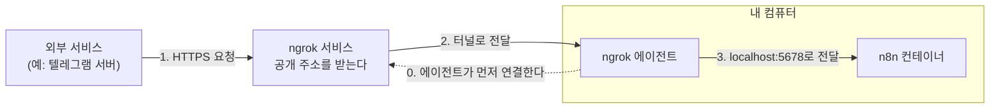

# 부록 D. ngrok으로 HTTPS 주소 만들기


## 이 부록에서 다루는 문제

워크플로우(workflow)는 n8n이 정해진 시각에 스스로 시작하기도 하고, 외부 서비스가 n8n을 호출해서 시작하기도 한다. 예를 들어 텔레그램 봇이 새 메시지를 받으면 텔레그램 서버가 그 메시지를 n8n으로 보낸다. 그런데 내 컴퓨터에서 실행하는 n8n의 주소는 `http://localhost:5678`이고, 외부 서비스는 이 주소로 n8n을 찾아올 수 없다.

이 부록은 이 문제가 왜 생기는지 설명하고, 터널 서비스인 ngrok이 어떻게 해결하는지 설명한다. 설치 방법은 D.3절에서 다루고, n8n 실행 환경과 연결하는 순서는 실습 3-1에서 따라 한다. ngrok의 기능을 모두 다루지 않고, n8n을 외부 서비스와 연결하는 데 필요한 만큼만 설명한다.

이 부록을 읽으면 다음을 할 수 있다.

- 외부 서비스가 n8n을 호출할 때 공개 주소가 필요한 이유를 설명한다.
- 쓰려는 서비스가 웹훅 주소에 어떤 조건을 요구하는지 공식 문서에서 확인한다.
- ngrok이 외부 요청을 내 컴퓨터의 n8n까지 전달하는 경로를 설명한다.
- macOS나 Windows에 ngrok을 설치하고 공개 주소를 확인한다.
- `N8N_WEBHOOK_URL`, `N8N_PROXY_HOPS`, `N8N_EDITOR_BASE_URL`의 역할을 설명한다.
- 터널을 열면 무엇이 공개되는지 알고, 지켜야 할 사항을 적용한다.

## D.1 공개 주소가 필요한 이유

### 호출 방향에 따라 필요한 주소가 다르다

n8n과 외부 서비스 사이의 연결은 어느 쪽이 먼저 호출하는지에 따라 두 가지로 나뉜다.

**표 D-1. 호출 방향과 필요한 주소**

| 호출 방향 | 예 | 공개 주소 |
|---|---|---|
| **n8n → 외부 서비스** | API 호출, 메일 발송, 모델 호출 | 필요하지 않다 |
| **외부 서비스 → n8n** | 텔레그램 새 메시지 전달, 결제 완료 알림 수신 | 필요하다 |

n8n이 먼저 호출할 때는 내 컴퓨터에서 밖으로 요청을 보내므로 내 컴퓨터에 공개 주소가 없어도 된다. 반대로 외부 서비스가 먼저 호출하려면 그 서비스가 인터넷에서 찾아올 수 있는 주소가 있어야 한다. 외부 서비스가 사건이 생길 때마다 미리 등록된 주소로 데이터를 보내는 방식을 **웹훅**(**webhook**)이라고 한다.

`localhost`는 공개 주소가 될 수 없다. `localhost`는 그 이름을 사용하는 컴퓨터 자신을 가리키기 때문이다. 텔레그램 서버에 `http://localhost:5678`을 등록하면 텔레그램 서버는 내 컴퓨터가 아니라 자기 자신에게 연결을 시도한다. 게다가 가정이나 회사의 네트워크는 바깥에서 먼저 들어오는 연결을 보통 막아 둔다.

사람이 브라우저로 여는 주소도 마찬가지다. n8n이 만든 입력 폼이나 승인 링크를 같은 컴퓨터에서 열면 `localhost` 주소로 충분하지만, 다른 사람의 컴퓨터나 휴대폰에서 열려면 공개 주소가 필요하다.

### HTTPS를 요구하는 서비스가 많다

**HTTPS**는 웹 요청의 내용을 암호화해 보내고, 인증서로 상대 서버를 확인하는 통신 방식이다. 웹훅에는 고객이 보낸 메시지나 결제 정보처럼 보호해야 할 내용이 실릴 수 있다. 그래서 웹훅 주소에 HTTPS를 요구하는 서비스가 많다. 다음 표는 두 서비스의 예다.

**표 D-2. 웹훅 주소 조건의 예**

| 서비스 | 웹훅 주소 조건 |
|---|---|
| **텔레그램 봇** | HTTPS 주소만 등록할 수 있다. 포트는 443, 80, 88, 8443 중 하나여야 한다 |
| **Stripe 결제** | 실제 결제 환경(live mode)에서는 HTTPS 주소와 유효한 서버 인증서가 필요하다. 내 컴퓨터에서 개발할 때는 HTTP를 쓸 수 있다 |

표 D-2에서 보듯 조건은 서비스마다 다르다. 그러므로 새 서비스를 연결할 때는 그 서비스의 공식 문서에서 웹훅 주소 조건을 먼저 확인한다. HTTPS를 요구하지 않는 서비스라도 공개 주소로 데이터를 받을 때는 HTTPS를 쓰는 편이 안전하다.

### 공개 주소를 만드는 세 가지 방법

공개 HTTPS 주소를 만드는 방법은 ngrok만 있는 것이 아니다.

**표 D-3. 공개 HTTPS 주소를 만드는 방법**

| 방법 | 준비할 것 | 적합한 상황 |
|---|---|---|
| **n8n Cloud** | n8n Cloud 요금제 | 서버를 직접 운영하지 않을 때 |
| **서버와 리버스 프록시** | 항상 켜져 있는 서버, 도메인, 인증서, 프록시 설정 | 업무에서 계속 운영할 때 |
| **터널 서비스** | 터널 서비스 계정과 내 컴퓨터의 터널 프로그램 | 내 컴퓨터에서 학습하거나 개발할 때 |

이 교재는 터널 서비스를 사용한다. 셀프 호스팅 환경을 내 컴퓨터에서 실행하므로 서버와 도메인을 따로 준비하지 않아도 되기 때문이다. 다만 터널은 내 컴퓨터와 터널 프로그램이 켜져 있는 동안에만 동작한다. 항상 받아야 하는 업무 요청을 처리한다면 다른 두 방법을 검토한다.

## D.2 ngrok이 하는 일

**터널**(**tunnel**)은 내 컴퓨터와 바깥의 서비스 사이에 미리 열어 둔 연결이고, 외부 요청은 이 연결을 통해 내 컴퓨터까지 전달된다. **ngrok**은 이 터널과 공개 주소를 제공하는 서비스다. 내 컴퓨터에서 실행하는 ngrok 프로그램을 **에이전트**(**agent**)라고 한다.

그림 D-1은 외부 서비스가 보낸 요청이 n8n까지 전달되는 경로를 보여 준다.

**그림 D-1. ngrok을 거쳐 n8n까지 전달되는 요청**




그림 D-1에서 확인할 핵심은 점선의 방향이다. `ngrok http 5678`을 실행하면 에이전트가 내 컴퓨터에서 ngrok 서비스로 먼저 연결한다. 안에서 밖으로 나가는 연결이므로 공유기의 포트를 따로 열지 않아도 된다. 그 뒤 공개 주소로 요청이 오면 ngrok 서비스가 이미 열려 있는 터널로 요청을 에이전트에 넘기고, 에이전트가 `localhost:5678`로 전달한다. n8n의 응답은 같은 경로를 거슬러 돌아간다. HTTPS 인증서는 ngrok 서비스 쪽에서 처리하므로 내가 따로 발급하지 않아도 된다.

ngrok을 쓸 때는 다음 두 가지 용어를 만난다.

- **authtoken**은 에이전트가 어느 계정으로 연결하는지 증명하는 문자열이다. 비밀번호처럼 관리한다.
- **개발 도메인**(**dev domain**)은 ngrok이 계정마다 자동으로 정해 주는 공개 주소의 이름이다. 예를 들면 `your-assigned-name.ngrok-free.dev`와 같다. 무료 계정에서는 이름을 직접 정할 수 없지만, 에이전트를 다시 시작해도 이름이 바뀌지 않는다. 그래서 n8n과 외부 서비스에 주소를 한 번만 등록하면 된다.

터널이 닫혀 있거나 컴퓨터가 잠자기 상태이면 외부 요청은 n8n에 도착하지 못한다. 실패한 요청을 다시 보내 주는지는 서비스마다 다르므로 터널로 받은 요청이 빠짐없이 도착한다고 가정하지 않는다.

## D.3 ngrok 설치와 공개 주소 확인

설치는 계정 만들기, 프로그램 설치, authtoken 등록, 공개 주소 확인의 네 단계로 진행한다. 무료 플랜을 사용한다.

### 1단계: 계정을 만든다

[ngrok](https://ngrok.com)에서 무료 계정을 만들고 로그인한다. [authtoken 페이지](https://dashboard.ngrok.com/get-started/your-authtoken)에서 authtoken을 복사한다.

### 2단계: 프로그램을 설치한다

macOS에서는 Homebrew로 설치한다. Homebrew가 없으면 [macOS 내려받기 페이지](https://ngrok.com/download/mac-os)에서 압축 파일을 내려받아 설치한다.

```bash
brew install ngrok
```

Windows에서는 PowerShell에서 Microsoft Store 판을 설치한다. 공식 안내는 이 방법을 권장한다. 직접 내려받은 실행 파일은 Windows Defender가 잘못 차단하는 경우가 있기 때문이다. 다른 방법은 [Windows 내려받기 페이지](https://ngrok.com/download/windows)에 있다.

```bash
winget install ngrok -s msstore
```

설치가 끝나면 터미널을 새로 열고 다음 명령으로 확인한다. 사용법이 표시되면 설치된 것이다.

```bash
ngrok help
```

### 3단계: authtoken을 등록한다

`<내-authtoken>`을 복사한 값으로 바꿔 실행한다. 등록은 컴퓨터마다 한 번만 하면 된다.

```bash
ngrok config add-authtoken "<내-authtoken>"
```

### 4단계: 공개 주소를 확인한다

다음 명령은 내 컴퓨터의 5678 포트로 연결되는 터널을 연다.

```bash
ngrok http 5678
```

터미널 화면에 `https://`로 시작하는 공개 주소가 나타난다. 무료 계정이면 `https://your-assigned-name.ngrok-free.dev`와 같은 형식(format)이다. 이 주소를 복사해 둔 뒤 저장하고 터미널을 닫는다. n8n의 소유자 계정을 만들기 전에는 터널을 열어 두지 않는다. 이유는 D.6절에서 설명한다.

## D.4 n8n에 공개 주소를 알려 주는 이유

터널을 연 것만으로는 충분하지 않다. n8n 컨테이너는 자신이 5678 포트에서 요청을 받는다는 것만 알고, 터널의 공개 주소는 알지 못한다. 그런데 `Webhook`이나 `Telegram Trigger` 같은 트리거(trigger) 노드는 자신의 주소를 직접 만들어서 화면에 보여 주거나 외부 서비스에 등록한다. 공개 주소를 알려 주지 않으면 n8n은 `localhost` 주소를 만들고, 텔레그램은 HTTPS 주소가 아니라는 오류로 등록을 거부한다.

n8n 앞에서 요청을 먼저 받아 n8n으로 넘겨주는 프로그램을 **리버스 프록시**(**reverse proxy**)라고 한다. 이 구성에서는 ngrok이 그 역할을 한다. 이 구성에는 다음 세 환경 변수가 필요하다.

**표 D-4. 공개 주소와 관련된 n8n 환경 변수**

| 환경 변수 | 역할 | 값 |
|---|---|---|
| **`N8N_WEBHOOK_URL`** | Test URL과 Production URL의 앞부분을 정한다 | 공개 주소. 끝에 `/`를 붙인다 |
| **`N8N_PROXY_HOPS`** | n8n 앞에 있는 리버스 프록시의 수를 알려 준다 | ngrok 하나이므로 `1` |
| **`N8N_EDITOR_BASE_URL`** | 사용자가 편집 화면에 접속하는 주소를 정한다 | `http://localhost:5678` |

`N8N_WEBHOOK_URL`을 적으면 `Webhook` 노드의 Test URL과 Production URL이 모두 공개 주소로 표시된다. 그래서 내 컴퓨터에서 시험 요청을 보낼 때도 터널이 열려 있어야 한다. 반면 편집 화면에는 계속 `http://localhost:5678`로 접속한다. 그래서 `N8N_EDITOR_BASE_URL`을 함께 적는다. 이 값이 없으면 n8n은 OAuth 콜백 주소처럼 편집 화면을 기준으로 만드는 주소까지 공개 주소로 만든다. 그러면 내가 `localhost`로 로그인해 시작한 OAuth 인증이 공개 주소로 돌아와 인증 흐름이 어긋날 수 있다. 예전 문서나 예제에 나오는 `WEBHOOK_URL`도 같은 역할을 하는 변수이며, 공식 문서는 이 이름을 지원 중단 예정으로 표시하고 `N8N_WEBHOOK_URL`을 안내한다.

외부 서비스에 주소를 등록할 때는 서비스의 제약도 확인한다. 예를 들어 텔레그램은 앱 하나에 웹훅 하나만 등록할 수 있어서, `Telegram Trigger`의 Test URL과 Production URL을 번갈아 쓰면 앞서 등록한 주소가 덮어쓰인다. n8n 공식 문서는 시험용 봇을 따로 만들거나 시험하는 동안 워크플로우를 `Unpublish`하는 방법을 안내한다.

## D.5 무료 플랜의 범위

ngrok 무료 플랜의 주요 한도는 다음과 같다. 요금제와 한도는 바뀔 수 있으므로 사용 전에 [공식 문서](https://ngrok.com/docs/pricing-limits/free-plan-limits)에서 다시 확인한다.

**표 D-5. ngrok 무료 플랜의 주요 한도**(2026년 11월 확인)

| 항목 | 한도 |
|---|---|
| **데이터 전송** | 월 1GB |
| **HTTP 요청** | 월 20,000건, 분당 4,000건 |
| **동시에 켜 둘 수 있는 엔드포인트** | 최대 3개 |
| **개발 도메인** | 1개 |

무료 플랜에는 경고 페이지도 있다. 브라우저로 공개 주소를 열면 ngrok의 경고 페이지가 먼저 나오고, `Visit`을 누르면 원래 페이지로 이동한다. 한 번 누르면 쿠키가 저장되어 그 브라우저에서는 7일 동안 다시 나오지 않는다. 입력 폼이나 승인 링크를 다른 사람에게 보내면 그 사람도 이 페이지를 먼저 보게 된다.

공식 문서는 API를 제공하거나 프로그램으로 호출하는 경우에는 경고 페이지가 영향을 주지 않는다고 설명한다. 명령줄에서 보낸 시험 요청에 경고 페이지의 HTML이 돌아오면 요청 헤더에 `ngrok-skip-browser-warning`을 더한다.

## D.6 터널을 열 때 지킬 것

`ngrok http 5678`은 웹훅 주소만 공개하지 않는다. n8n의 5678 포트 전체를 인터넷에 공개하므로 **편집 화면의 로그인 페이지도 공개 주소로 열린다.** 경고 페이지는 방문자에게 안내만 할 뿐 접근을 막는 장치가 아니다. 그래서 다음을 지킨다.

- **소유자 계정을 만든 뒤 터널을 연다.** 소유자 계정이 없는 n8n은 처음 접속한 사람이 소유자 계정을 만들 수 있다.
- **소유자 계정에 긴 비밀번호를 쓴다.** 다른 서비스에 쓰는 비밀번호를 다시 쓰지 않는다.
- **필요할 때만 터널을 연다.** 작업이 끝나면 `Ctrl+C`로 에이전트를 종료한다.
- **authtoken과 공개 주소를 공유하지 않는다.** authtoken을 화면 공유나 저장소에 노출하지 않는다.
- **실제 데이터를 받을 때는 웹훅 인증을 설정한다.** Production URL을 아는 사람은 누구나 이 주소를 호출할 수 있으므로, `Webhook` 노드의 Authentication처럼 호출자를 확인하는 설정을 쓴다.
- **회사 컴퓨터와 업무 데이터는 보안 정책을 먼저 확인한다.** 터널은 회사 네트워크 안의 컴퓨터를 바깥에 공개하는 일이므로 허가가 필요할 수 있다.

## D.7 정리

외부 서비스가 n8n을 호출하려면 그 서비스가 인터넷에서 찾아올 수 있는 주소가 있어야 하고, 텔레그램처럼 HTTPS 주소만 받는 서비스도 있다. ngrok은 내 컴퓨터에서 밖으로 먼저 터널을 연결해 공개 HTTPS 주소로 들어온 요청을 n8n까지 전달한다. n8n은 공개 주소를 스스로 알 수 없으므로 `N8N_WEBHOOK_URL`로 알려 주어야 한다.

새 서비스를 연결할 때는 호출 방향부터 판단한다. 외부 서비스가 호출하는 방향이라면 공식 문서에서 주소 조건을 확인하고, 그 조건에 맞는 공개 주소를 준비한다. 터널은 내 컴퓨터가 켜져 있는 동안에만 동작하고 편집 화면까지 공개하므로 학습과 개발에 쓰고, 필요할 때만 연다.

## 참고 자료

- n8n Docs, [Configure webhook URLs with reverse proxy](https://docs.n8n.io/deploy/host-n8n/configure-n8n/basic-configuration/configuration-examples/configure-webhook-urls-with-reverse-proxy) — `N8N_WEBHOOK_URL`, `N8N_PROXY_HOPS`, `WEBHOOK_URL`의 지원 중단 예정 표시
- n8n Docs, [Endpoints environment variables](https://docs.n8n.io/hosting/configuration/environment-variables/endpoints/) — 웹훅 주소 환경 변수
- n8n Docs, [Deployment environment variables](https://docs.n8n.io/hosting/configuration/environment-variables/deployment/) — `N8N_EDITOR_BASE_URL`, `N8N_PROXY_HOPS`
- n8n 소스 코드, [url.service.ts](https://github.com/n8n-io/n8n/blob/n8n@2.43.7/packages/@n8n/backend-services/src/services/url.service.ts) — 웹훅 주소와 편집 화면 주소를 만드는 순서
- n8n Docs, [Telegram Trigger common issues](https://docs.n8n.io/integrations/builtin/trigger-nodes/n8n-nodes-base.telegramtrigger/common-issues/) — HTTPS 주소 조건, 앱당 웹훅 하나의 제약과 대처 방법
- Telegram, [Bot API: setWebhook](https://core.telegram.org/bots/api#setwebhook) — 웹훅 주소의 HTTPS 조건과 지원 포트
- Stripe Docs, [Receive Stripe events in your webhook endpoint](https://docs.stripe.com/webhooks) — 실제 결제 환경의 HTTPS 조건
- ngrok Docs, [Free Plan Limits](https://ngrok.com/docs/pricing-limits/free-plan-limits) — 무료 플랜 한도와 경고 페이지
- ngrok, [Download for macOS](https://ngrok.com/download/mac-os), [Download for Windows](https://ngrok.com/download/windows) — 운영체제별 설치 명령과 authtoken 등록
- ngrok Docs, [Domains](https://ngrok.com/docs/universal-gateway/domains) — 개발 도메인의 배정 방식
