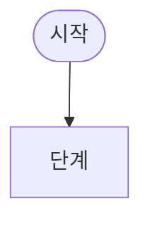

# 워크플로우 설계서: (업무 이름)

- 작성자:
- 작성일:
- 이어받은 결과물: (1장 업무 분해도의 파일 이름)
- 대상 요청 유형:
- 사용한 자료: (사례 목록, 주문 목록, 사건 목록, 정책 문서 등)

## 1. 데이터 계약

### 1.1 문의 기록

| 필드 | 데이터 타입 | 필수 | 형식·허용 값 | 만드는 단계(판단 주체) | 없거나 틀릴 때 |
|---|---|---|---|---|---|
|  |  |  |  |  |  |

### 1.2 요청 기록

| 필드 | 데이터 타입 | 필수 | 형식·허용 값 | 만드는 단계(판단 주체) | 없거나 틀릴 때 |
|---|---|---|---|---|---|
|  |  |  |  |  |  |

### 1.3 단계별 입출력

| 단계 | 읽는 필드 | 쓰거나 바꾸는 필드 | 실패할 때 남기는 값 |
|---|---|---|---|
| 접수 |  |  |  |
| 분류 |  |  |  |
| 조회 |  |  |  |
| 판단 |  |  |  |
| 승인 |  |  |  |
| 응답 |  |  |  |

### 1.4 JSON 예시

(사례 하나의 요청 기록을 JSON으로 적는다)

```json
{
}
```

## 2. 상태와 흐름도

### 2.1 상태 값

| 상태 값 | 뜻 | 이 상태에서 기다리는 것 |
|---|---|---|
|  |  |  |

### 2.2 상태 전이표

| 번호 | 현재 상태 | 사건 | 조건 | 다음 상태 | 실행되는 일 |
|---|---|---|---|---|---|
|  |  |  |  |  |  |

### 2.3 실패 경로

| 실패 유형 | 관찰할 사실(필드와 값) | 행동 | 다음 상태 |
|---|---|---|---|
| 정보 누락 |  |  |  |
| 조회 실패 |  |  |  |
| 정책 불일치 |  |  |  |
| 승인 거절·만료 |  |  |  |

### 2.4 승인

| 항목 | 내용 |
|---|---|
| 승인하는 역할 |  |
| 승인 대상 |  |
| 승인 요청에 담는 정보 |  |
| 기한과 기한을 넘겼을 때 |  |
| 거절했을 때 |  |
| 기록하는 값 |  |

### 2.5 종료 조건과 반복 한도

| 종료 사유 값 | 조건 | 마지막으로 하는 일 |
|---|---|---|
|  |  |  |

| 반복되는 동작 | 한도 | 한도에 도달했을 때 |
|---|---|---|
|  |  |  |

### 2.6 흐름도



## 3. 인수 조건

### 3.1 사례별 인수 조건

| 사례 | 입력 요약 | 기대 경로 | 기대 상태 | 핵심 필드의 기대 값 | 확인 방법 |
|---|---|---|---|---|---|
|  |  |  |  |  |  |

### 3.2 측정 초안

| 구분 | 지표 | 세는 방법 | 사용하는 필드 |
|---|---|---|---|
| 품질 |  |  |  |
| 시간 |  |  |  |
| 비용 |  |  |  |

### 3.3 기록 항목

| 필드 | 뜻 | 남기는 값의 예 |
|---|---|---|
|  |  |  |

## 4. 가정과 아직 정해지지 않은 사항

- 
