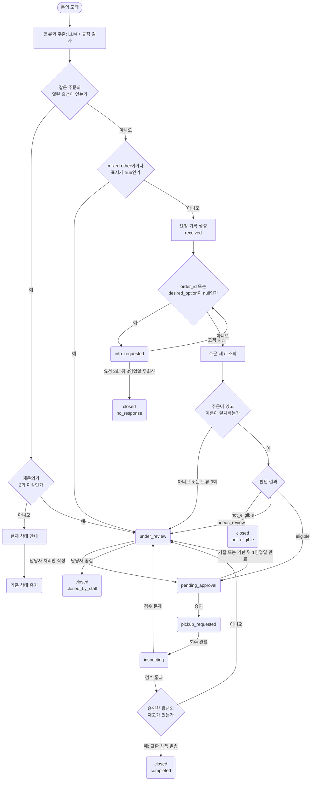

# 워크플로우 설계서: 하루마켓 교환 요청

> 실습 2-4의 예시 답안

- 작성자: 예시 답안
- 작성일: 202X-XX-XX
- 이어받은 결과물: `01_업무분해도_교환취소.md`(1장 실습 1-4 예시 답안), `02_워크플로우설계서_반품.md`(실습 2-3 예시 답안)
- 대상 요청 유형: 교환(`exchange_option`, `exchange_other_product`, `mixed`, `other`)
- 사용한 자료: `교환요청_사례.csv`(INQ-101, INQ-102, INQ-109~INQ-115), `주문목록.csv`, `재고목록.csv`, `교환진행_사건.csv`(EX-001~EX-008), `쇼핑몰_정책요약.md`

## 1. 데이터 계약

### 1.1 문의 기록

반품과 같은 계약을 쓴다. 교환 문의는 메일로 들어오므로 `channel`이 `email`이고, `order_id`는 메일 본문과 제목에서 LLM이 추출한 뒤 규칙으로 형식을 검사한다.

| 필드 | 데이터 타입 | 필수 | 형식·허용 값 | 만드는 단계(판단 주체) | 없거나 틀릴 때 |
|---|---|---|---|---|---|
| `inquiry_id` | 문자열 | 접수부터 | `INQ-` 뒤 숫자 세 자리 이상 | 접수(규칙) | 접수하지 않고 오류로 기록한다 |
| `received_at` | 문자열(시각) | 접수부터 | ISO 8601, `+09:00` 포함 | 접수(규칙) | 접수하지 않고 오류로 기록한다 |
| `channel` | 문자열 | 접수부터 | `web`, `email` | 접수(규칙) | 접수하지 않고 오류로 기록한다 |
| `customer_name` | 문자열 | 접수부터 | 빈 문자열이 아님 | 접수(규칙) | 고객에게 이름을 요청한다 |
| `order_id` | 문자열 또는 `null` | 조회 전까지 | `O-` 뒤 숫자 네 자리 | 접수(웹: 규칙 검사 / 메일: LLM 추출 + 규칙 검사) | 고객에게 주문번호를 요청한다 |
| `message` | 문자열 | 접수부터 | 빈 문자열이 아님 | 접수(규칙) | 접수하지 않고 오류로 기록한다 |
| `detected_type` | 문자열 또는 `null` | 분류 이후 | 1장의 유형 아홉 값(`shipping_status`, `return_change_of_mind`, `return_defect`, `exchange_option`, `exchange_other_product`, `cancel_full`, `cancel_partial`, `mixed`, `other`) | 분류(LLM + 규칙 검사) | 목록 밖이면 한 번 다시 분류하고, 그래도 밖이면 `other`로 기록한다 |
| `flags` | 객체 | 분류 이후 | `reason_unclear`, `dispute_mentioned`, `repeat_mentioned`(모두 불리언) | 분류(LLM + 규칙 검사) | 불리언이 아니면 `true`로 보고 담당자에게 넘긴다 |
| `request_id` | 문자열 또는 `null` | 요청이 생기면 | `REQ-` 뒤 숫자 네 자리 이상 | 접수(규칙) | 요청을 만들지 않는 문의는 `null`로 둔다 |

### 1.2 요청 기록

| 필드 | 데이터 타입 | 필수 | 형식·허용 값 | 만드는 단계(판단 주체) | 없거나 틀릴 때 |
|---|---|---|---|---|---|
| `request_id` | 문자열 | 생성부터 | `REQ-` 뒤 숫자 네 자리 이상 | 접수(규칙) | — |
| `request_type` | 문자열 | 생성부터 | `exchange_option`, `exchange_other_product`, `mixed`, `other` | 생성(문의 기록의 `detected_type`을 옮긴다) | 허용 값 밖이면 `other`로 기록해 `under_review` |
| `exchange_reason` | 문자열 또는 `null` | 판단 전까지 | `change_of_mind`, `defect` | 분류(LLM + 규칙 검사) | 판단할 수 없으면 `null`로 두고 판단에서 `needs_review`. `defect`이면 사실 확인이 필요하므로 `needs_review` |
| `desired_option` | 문자열 또는 `null` | 판단 전까지 | 같은 상품의 재고 목록에 있는 옵션 표기(예: `L`, `네이비 M`) | 분류(LLM 추출), 조회(규칙 검사), 고객 회신(LLM 추출 + 규칙 검사) | `null`이면 `info_requested`. 같은 상품의 옵션이 아니면 판단에서 불가 사유로 남긴다 |
| `request_status` | 문자열 | 생성부터 | 2.1절의 일곱 값 | 각 단계(규칙) | 전이표에 없는 변화는 적용하지 않고 오류로 기록한다 |
| `customer_name` | 문자열 | 생성부터 | 문의 기록의 값 | 접수(규칙) | — |
| `order_id` | 문자열 또는 `null` | 조회 전까지 | `O-` 뒤 숫자 네 자리 | 접수(LLM 추출 + 규칙 검사), 고객 회신 | `info_requested` |
| `order` | 객체 또는 `null` | 판단 전까지 | `product_name`(문자열), `option`(문자열, 현재 옵션), `order_status`(`paid`·`preparing`·`shipped`·`delivered`), `delivered_at`(날짜 또는 `null`), `amount`(정수) | 조회(규칙) | 주문 없음, 이름 불일치, 조회 오류 한도 초과면 `null`로 두고 `under_review` |
| `flags` | 객체 | 생성부터 | `reason_unclear`, `dispute_mentioned`, `repeat_mentioned`(모두 불리언) | 생성(문의 기록의 `flags`를 옮긴다) | 하나라도 `true`이면 `under_review` |
| `info_request_count` | 정수 | 생성부터 | 0~3. 주문번호 요청과 원하는 옵션 요청을 합쳐 센다 | 접수, 분류, 기한 확인(규칙) | — |
| `last_info_request_at` | 문자열(시각) 또는 `null` | 첫 정보 요청 이후 | ISO 8601 | 정보 요청(규칙) | — |
| `evidence` | 객체 또는 `null` | 판단 이후 | `checked_at`(시각), `days_since_delivery`(정수), `policy_ref`(정책 문서 번호, 예: `EXC-01`), `decision`(`eligible`·`not_eligible`·`needs_review`), `decision_reason`(문자열), `checks`(배열. 원소마다 `name`, `result`(`pass`·`fail`), `value`), `exchange_deadline`(날짜. 교환 신청 기한), `requested_option`(조회에 쓴 옵션 표기), `stock`(정수. 원하는 옵션의 재고), `stock_checked_at`(시각. 재고 확인 시각), `shipping_fee_customer`(정수. 단순 변심 `6000`, 불량 `0`), `reasons`(배열. 교환할 수 없는 이유), `available_options`(배열. 재고가 있는 같은 상품의 다른 옵션) | 판단(규칙) | 계산에 필요한 값이 없으면 `decision`을 `needs_review`로 |
| `reply_draft` | 문자열 또는 `null` | 승인 요청 시 | 고객 안내 초안 | 판단 뒤 초안 작성(LLM) | 작성에 실패하면 `null`로 두고 승인 요청에 "안내문 직접 작성 필요"를 표시한다 |
| `handover_reason` | 문자열 또는 `null` | `under_review`로 넘길 때 | 반품의 값(`mixed_or_other`, `flagged`, `order_not_found`, `name_mismatch`, `lookup_error`, `needs_review`, `approval_rejected`, `approval_expired`, `inspection_failed`, `revalidation_failed`, `repeat_inquiry`)에 `stock_unavailable`(발송 직전 재고 없음)을 더한다 | 넘기는 단계(규칙) | — |
| `approval_status` | 문자열 또는 `null` | 승인 요청 이후 | `pending`, `approved`, `rejected`, `expired` | 승인 요청(규칙), 승인 응답(사람), 기한 확인(규칙) | — |
| `approval_due_at` | 문자열(시각) 또는 `null` | 승인 요청 이후 | 승인 요청 시각의 1영업일 뒤 | 승인 요청(규칙) | — |
| `lead_notified_at` | 문자열(시각) 또는 `null` | 팀장 알림 이후 | ISO 8601 | 기한 확인(규칙) | — |
| `approval_decided_at` | 문자열(시각) 또는 `null` | 승인·거절·만료 이후 | ISO 8601 | 승인 응답(사람), 기한 확인(규칙) | — |
| `approval_note` | 문자열 또는 `null` | 거절 시 | 거절 사유 | 승인 응답(사람) | 비어 있으면 담당자가 넘겨받아 처리할 때 채운다 |
| `approved_option` | 문자열 또는 `null` | 승인 이후 | 승인 시점의 `desired_option` | 승인 응답을 받을 때(규칙이 복사) | — |
| `approved_shipping_fee` | 정수 또는 `null` | 승인 이후 | 승인 시점의 `evidence.shipping_fee_customer` | 승인 응답을 받을 때(규칙이 복사) | — |
| `close_reason` | 문자열 또는 `null` | `closed`가 될 때 | `completed`, `not_eligible`, `no_response`, `closed_by_staff` | 종결하는 단계(규칙 또는 사람) | — |
| `created_at`, `updated_at` | 문자열(시각) | 생성부터 | ISO 8601 | 규칙 | — |

`stock_checked_at`을 두는 이유는 재고가 계속 바뀌는 값이기 때문이다. "재고가 있었다"는 근거는 언제 확인했는지와 함께 남아야 한다. `policy_ref`에 쓸 정책 문서 번호는 5장에서 정한다.

### 1.3 단계별 입출력

| 단계 | 읽는 필드 | 쓰거나 바꾸는 필드 | 실패할 때 남기는 값 |
|---|---|---|---|
| 접수 | 메일 제목과 본문 | 문의 기록의 `inquiry_id`, `received_at`, `channel`(`email`), `customer_name`, `order_id`(LLM 추출 + 형식 검사), `message` | 주문번호를 찾지 못하거나 형식이 틀리면 `order_id`는 `null` |
| 분류 | 문의 기록의 `message` | 문의 기록의 `detected_type`, `flags`. 열린 요청이 없으면 요청 기록을 만들고 `request_id`, `request_type`, `exchange_reason`, `desired_option`, `flags`, `request_status`(`received`), `info_request_count`(`0`), `created_at`을 채운다 | 목록 밖 유형은 한 번 다시 분류하고 그래도 밖이면 `other`. 원하는 옵션을 찾지 못하면 `desired_option`은 `null` |
| 조회 | `order_id`, `customer_name`, `desired_option` | `order`(현재 옵션 포함), 원하는 옵션의 재고 | `order`는 `null`, `handover_reason`은 `order_not_found`, `name_mismatch`, `lookup_error` 중 하나 |
| 판단 | `request_type`, `exchange_reason`, `order`, 재고, 정책 | `evidence`(경과일, 재고와 확인 시각, 고객 부담 배송비, 불가 사유, 재고가 있는 다른 옵션), `reply_draft` | 계산에 필요한 값이 없거나 `exchange_reason`이 `defect` 또는 `null`이면 `evidence.decision`을 `needs_review`로 |
| 승인 | `evidence`, `reply_draft`, 담당자 응답, 기한 | `approval_status`, `approval_due_at`, `lead_notified_at`, `approval_decided_at`, `approval_note`, `approved_option`, `approved_shipping_fee` | 거절은 `rejected`와 `approval_note`, 만료는 `expired`. 둘 다 `handover_reason`을 남긴다 |
| 응답 | `request_status`, `approved_option`, 회수·검수 사건, 발송 직전 재고 | 고객 안내 발송 기록, 교환 상품 발송 요청, `close_reason`, `updated_at` | 검수에서 문제가 나오면 `inspection_failed`, 발송 직전 재고가 0이면 `stock_unavailable` |

### 1.4 JSON 예시

INQ-101의 요청 기록을 승인 대기 시점 기준으로 적었다. 교환 기한은 수령일(09-06)에서 7일 뒤인 2026-09-13이다.

```json
{
  "request_id": "REQ-0101",
  "request_type": "exchange_option",
  "exchange_reason": "change_of_mind",
  "desired_option": "L",
  "request_status": "pending_approval",
  "customer_name": "오승현",
  "order_id": "O-2001",
  "order": {
    "product_name": "면 티셔츠",
    "option": "M",
    "order_status": "delivered",
    "delivered_at": "2026-09-06",
    "amount": 19000
  },
  "flags": {
    "reason_unclear": false,
    "dispute_mentioned": false,
    "repeat_mentioned": false
  },
  "info_request_count": 0,
  "last_info_request_at": null,
  "evidence": {
    "checked_at": "2026-09-10T08:55:00+09:00",
    "days_since_delivery": 4,
    "policy_ref": "EXC-01",
    "decision": "eligible",
    "decision_reason": "수령 후 4일로 교환 기한 7일 안이고, 같은 상품의 L 옵션 재고가 있다",
    "checks": [
      { "name": "owner_match", "result": "pass", "value": "오승현" },
      { "name": "order_status", "result": "pass", "value": "delivered" },
      { "name": "within_deadline", "result": "pass", "value": "4일 / 기한 2026-09-13" },
      { "name": "same_product_option", "result": "pass", "value": "면 티셔츠 M → L" },
      { "name": "stock_available", "result": "pass", "value": "L 재고 12" }
    ],
    "exchange_deadline": "2026-09-13",
    "requested_option": "L",
    "stock": 12,
    "stock_checked_at": "2026-09-10T08:55:00+09:00",
    "shipping_fee_customer": 6000,
    "reasons": [],
    "available_options": ["L"]
  },
  "reply_draft": "오승현 고객님, 면 티셔츠(O-2001)를 L 사이즈로 교환하는 신청이 접수되었습니다. 단순 변심 교환이라 왕복 배송비 6,000원은 고객님 부담이며, 회수 일정은 따로 안내드리겠습니다.",
  "handover_reason": null,
  "approval_status": "pending",
  "approval_due_at": "2026-09-11T08:55:00+09:00",
  "lead_notified_at": null,
  "approval_decided_at": null,
  "approval_note": null,
  "approved_option": null,
  "approved_shipping_fee": null,
  "close_reason": null,
  "created_at": "2026-09-10T08:55:00+09:00",
  "updated_at": "2026-09-10T08:55:00+09:00"
}
```

## 2. 상태와 흐름도

### 2.1 상태 값

상태 값 일곱 가지는 반품과 같다. 승인 결과는 `approval_status`에만 둔다.

| 상태 값 | 뜻 | 이 상태에서 기다리는 것 |
|---|---|---|
| `received` | 접수되어 자동 처리 중이다 | 이번 실행의 분류·조회·판단 결과 |
| `info_requested` | 고객에게 필요한 정보를 요청했다 | 고객의 회신 또는 요청 기한 |
| `under_review` | 담당자에게 넘겼다 | 담당자의 처리안 작성 또는 종결 |
| `pending_approval` | 처리안의 승인을 요청했다 | 담당자의 승인 응답 또는 승인 기한 |
| `pickup_requested` | 승인 후 택배사에 회수를 요청했다 | 택배사의 회수 완료 통지 |
| `inspecting` | 회수한 상품을 검수하고 있다 | 창고의 검수 결과 |
| `closed` | 처리가 끝났다 | 없음 |

### 2.2 상태 전이표

| 번호 | 현재 상태 | 사건 | 조건 | 다음 상태 | 실행되는 일 |
|---|---|---|---|---|---|
| T01 | (없음) | 분류 완료 | 같은 `order_id`의 열린 요청이 없고 유형과 표시가 정상이다 | `received` | 분류 결과를 옮겨 요청 기록을 만든다 |
| T02 | 기존 요청의 상태 | 문의 도착 | 같은 `order_id`의 열린 요청이 있고, 연결 후 재문의가 1회다 | 변화 없음 | 문의를 연결하고 현재 상태를 안내한다 |
| T03 | 기존 요청의 상태(`under_review` 제외) | 문의 도착 | 같은 `order_id`의 열린 요청이 있고, 연결 후 재문의가 2회 이상이다 | `under_review` | 문의를 연결하고 `handover_reason`을 `repeat_inquiry`로 |
| T04 | `received` | 접수 검사 | `order_id`가 `null` | `info_requested` | 주문번호를 요청하고 `info_request_count` + 1, `last_info_request_at` 기록 |
| T04a | `received` | 접수 검사 | `order_id`는 있고 `desired_option`이 `null` | `info_requested` | 원하는 옵션을 요청하고 `info_request_count` + 1, `last_info_request_at` 기록 |
| T05 | `info_requested` | 고객 회신 | 주문번호가 형식에 맞거나, 원하는 옵션을 추출할 수 있다 | `received` | 회신한 값을 채우고 조회부터 처리한다 |
| T06 | `info_requested` | 기한 확인 | `last_info_request_at`의 1영업일 뒤가 지났고 `info_request_count`가 3 미만 | 변화 없음 | 다시 요청하고 `info_request_count` + 1, `last_info_request_at` 갱신 |
| T07 | `info_requested` | 기한 확인 | `info_request_count`가 3이고 `last_info_request_at`의 3영업일 뒤가 지났다 | `closed` | 종결을 안내하고 `close_reason`을 `no_response`로 |
| T08 | (없음) | 분류 완료 | 같은 `order_id`의 열린 요청이 없고, 유형이 `mixed`·`other`이거나 표시 중 하나가 `true` | `under_review` | 요청 기록을 `under_review`로 만들고 `handover_reason`을 `mixed_or_other` 또는 `flagged`로 |
| T09 | `received` | 조회 완료 | 주문이 없다 / 이름이 다르다 / 조회 오류가 3회 반복되었다 | `under_review` | `handover_reason`을 `order_not_found` / `name_mismatch` / `lookup_error`로. 주문 정보와 재고를 안내하지 않는다 |
| T10 | `received` | 판단 완료 | `evidence.decision`이 `not_eligible`(기한 초과, 다른 상품, 재고 없음) | `closed` | 불가 사유를 안내하고 `close_reason`을 `not_eligible`로. 재고 없음이면 `available_options`와 반품 선택지를 함께 안내한다 |
| T11 | `received` | 판단 완료 | `evidence.decision`이 `needs_review`(불량 사유, 사유 판단 불가 등) | `under_review` | `handover_reason`을 `needs_review`로 |
| T12 | `received` | 판단 완료 | `evidence.decision`이 `eligible` | `pending_approval` | 안내 초안을 쓰고 승인을 요청한다. 승인 요청에 원하는 옵션, 재고와 확인 시각, 고객 부담 배송비를 담는다. `approval_status` `pending`, `approval_due_at` 설정 |
| T13 | `pending_approval` | 담당자 응답 | 승인 | `pickup_requested` | `approval_status` `approved`, `approval_decided_at`, `approved_option`, `approved_shipping_fee`를 기록하고 회수를 요청하며 안내를 보낸다 |
| T14 | `pending_approval` | 담당자 응답 | 거절 | `under_review` | `approval_status` `rejected`, 사유를 기록하고 `handover_reason`을 `approval_rejected`로 |
| T15 | `pending_approval` | 기한 확인 | `approval_due_at`이 지났고 `lead_notified_at`이 `null` | 변화 없음 | CS 팀장에게 알리고 `lead_notified_at` 기록 |
| T16 | `pending_approval` | 기한 확인 | `approval_due_at`의 1영업일 뒤가 지났다 | `under_review` | `approval_status` `expired`, `handover_reason`을 `approval_expired`로 |
| T17 | `under_review` | 담당자 처리 | 처리안 작성 | `pending_approval` | 승인을 요청하고 새 기한을 정한다 |
| T18 | `under_review` | 담당자 처리 | 종결 | `closed` | 담당자가 작성한 안내를 보내고 `close_reason`을 `closed_by_staff`로 |
| T19 | `pickup_requested` | 택배사 통지 | 회수 완료 | `inspecting` | 검수를 요청한다 |
| T20 | `inspecting` | 창고 통지 | 검수 통과이고 `approved_option`의 재고가 1 이상이다 | `closed` | 재고를 다시 확인해 기록하고 `approved_option`으로 교환 상품 발송을 요청한다. 완료를 안내하고 `close_reason` `completed` |
| T21 | `inspecting` | 창고 통지 | 검수에서 문제 발견 | `under_review` | 교환 상품을 보내지 않고 `handover_reason`을 `inspection_failed`로 |
| T22 | `inspecting` | 창고 통지 | 검수 통과이지만 `approved_option`의 재고가 0이다 | `under_review` | 교환 상품을 보내지 않고 `handover_reason`을 `stock_unavailable`로 |

INQ-101을 `교환진행_사건.csv`로 따라가면 다음과 같다.

| 시각 | 사건 | 적용한 전이 | 바뀌는 값 |
|---|---|---|---|
| 09-10 08:55 | 문의 INQ-101 도착 | T01 → T12 | 1.4절의 값. `request_status` `pending_approval` |
| 09-10 11:30 | 담당자 승인(EX-001) | T13 | `request_status` `pickup_requested`, `approval_status` `approved`, `approved_option` `L`, `approved_shipping_fee` `6000` |
| 09-14 10:05 | 재문의 INQ-115 도착 | T02 | INQ-115의 `request_id`를 `REQ-0101`로 채운다. 상태는 그대로 |
| 09-14 15:00 | 회수 완료(EX-005) | T19 | `request_status` `inspecting` |
| 09-15 10:30 | 검수 통과(EX-007) | T20 | L 재고를 다시 확인하고 발송을 요청한다. `request_status` `closed`, `close_reason` `completed` |

### 2.3 실패 경로

| 실패 유형 | 관찰할 사실(필드와 값) | 행동 | 다음 상태 |
|---|---|---|---|
| 정보 누락 | `order_id`가 `null`이거나 `desired_option`이 `null` | 빠진 값을 요청하고 `info_request_count` + 1, `last_info_request_at`을 기록한다. 원하는 옵션을 추측하지 않는다 | `info_requested`. 한도 뒤 무회신이면 `closed`(`no_response`) |
| 조회 실패 | 주문이 없음, 주문자 이름 불일치, 조회 오류 3회 | 주문 정보와 재고를 안내하지 않는다. `handover_reason`을 `order_not_found`, `name_mismatch`, `lookup_error`로 남긴다 | `under_review` |
| 정책 불일치 | `evidence.decision`이 `not_eligible`(기한 초과, 다른 상품, 재고 없음). `needs_review`이거나 검수 문제, 발송 직전 재고 없음 | 조건 불충족은 사유를 안내하고, 재고 없음이면 재고가 있는 다른 옵션과 반품 선택지를 함께 안내한다. 기준이 없거나 집행 직전 조건이 바뀌면 `handover_reason`을 남긴다 | 조건 불충족은 `closed`(`not_eligible`), 나머지는 `under_review` |
| 승인 거절·만료 | `approval_status`가 `rejected` 또는 `expired` | 거절 사유를 남긴다. `handover_reason`을 `approval_rejected` 또는 `approval_expired`로 남긴다 | `under_review` |

### 2.4 승인

| 항목 | 교환 승인의 설계 |
|---|---|
| **승인하는 역할** | CS 담당자 |
| **승인 대상** | 교환할 옵션과 고객 부담 배송비가 포함된 교환 처리안 |
| **승인 요청에 담는 정보** | 주문 정보(현재 옵션), 원하는 옵션, `evidence`(경과일, 적용 정책, 재고와 확인 시각, 고객 부담 배송비), 고객 안내 초안 `reply_draft`, 문의 원문 |
| **기한과 기한을 넘겼을 때** | 승인 요청 후 1영업일. 넘기면 CS 팀장에게 알리고 `lead_notified_at`을 남긴다. 다시 1영업일이 지나면 `expired`로 바꾸어 담당자 처리로 전환한다 |
| **거절했을 때** | 거절 사유를 `approval_note`에 남기고 `under_review`로 전환한다 |
| **기록하는 값** | `approval_status`, `approval_due_at`, `lead_notified_at`, `approval_decided_at`, `approval_note`, `approved_option`, `approved_shipping_fee` |

### 2.5 종료 조건과 반복 한도

| 종료 사유 값 | 조건 | 마지막으로 하는 일 |
|---|---|---|
| `completed` | 검수를 통과하고 발송 직전 재고를 확인해, 승인한 옵션으로 교환 상품 발송을 요청했다 | 교환 완료를 안내한다 |
| `not_eligible` | 판단 결과 정책 조건을 충족하지 않는다(기한 초과, 다른 상품, 재고 없음) | 불가 사유와 적용한 정책을 안내한다. 재고 없음이면 다른 선택지를 함께 안내한다 |
| `no_response` | 정보 요청의 반복 한도가 끝날 때까지 고객이 회신하지 않았다 | 종결을 안내하고, 다시 문의하면 새로 접수한다고 알린다 |
| `closed_by_staff` | 담당자가 넘겨받은 요청을 직접 처리하고 종결했다 | 담당자가 작성한 안내를 보낸다 |

| 반복되는 동작 | 한도 | 한도에 도달했을 때 |
|---|---|---|
| **고객에게 정보 요청** | 첫 요청 뒤 1영업일 간격으로 재요청 최대 2회. 주문번호와 원하는 옵션 요청을 합쳐 센다 | 마지막 요청 뒤 3영업일 동안 회신이 없으면 `closed`(`no_response`) |
| **승인 대기** | 승인 요청 뒤 1영업일 | CS 팀장에게 알리고, 다시 1영업일 뒤 `expired`로 바꾸어 `under_review` |
| **주문·재고 조회 시스템 오류** | 다시 시도 최대 3회 | `under_review`로 넘긴다. 재시도 간격은 8장에서 다룬다 |
| **분류·추출 결과 검사 실패** | 다시 분류 1회 | `other`로 기록하고 `under_review`로 넘긴다 |
| **같은 요청의 재문의** | 재문의 2회부터 | 즉시 `under_review`로 넘긴다(하루마켓 정책) |
| **발송 직전 재고 확인** | 1회 | 재고가 0이면 `under_review`(`stock_unavailable`) |

반복 한도의 수치는 반품 설계서와 같은 값을 쓴다. 사건이 없는 두 사례의 기한은 다음과 같다.

| 사례 | 기준 | 계산 | 결과 |
|---|---|---|---|
| INQ-109 | 첫 요청 09-10(목) 10:40 | 1영업일 뒤 | 재요청 1: 09-11(금) 10:40 |
| INQ-109 | 재요청 1 | 1영업일 뒤(주말 제외) | 재요청 2: 09-14(월) 10:40 |
| INQ-109 | 재요청 2 | 3영업일 뒤 | 종결: 09-17(목) 10:40 이후 첫 기한 확인 |
| INQ-113 | 승인 요청 09-10(목) 14:20 | 1영업일 뒤 | 기한 경과, 팀장 알림: 09-11(금) 14:20 이후 첫 기한 확인 |
| INQ-113 | 승인 기한 09-11(금) 14:20 | 1영업일 뒤(주말 제외) | 만료, 담당자 처리 전환: 09-14(월) 14:20 이후 첫 기한 확인 |

### 2.6 흐름도



## 3. 인수 조건

### 3.1 사례별 인수 조건

| 사례 | 입력 요약 | 기대 경로 | 기대 상태 | 핵심 필드의 기대 값 | 확인 방법 |
|---|---|---|---|---|---|
| INQ-101 | O-2001 면 티셔츠 M → L, 수령 후 4일, L 재고 12. 승인·회수·검수 통과 사건이 있다 | T01 → T12 → T13 → T02(INQ-115) → T19 → T20 | `closed`(09-15 10:30) | `request_id` `REQ-0101`, `desired_option` `L`, `evidence.stock` `12`, `approved_option` `L`, `approved_shipping_fee` `6000`, 연결된 문의 2건, `close_reason` `completed` | 발송 직전 재고 확인 기록이 있는지, 발송한 옵션이 승인한 옵션과 같은지 확인한다 |
| INQ-102 | O-2002 후드 집업 그레이 M → 네이비 M, 수령 후 2일, 네이비 M 재고 0 | T01 → T10 | `closed` | `request_id` `REQ-0102`, `desired_option` `네이비 M`, `evidence.stock` `0`, `evidence.decision` `not_eligible`, `close_reason` `not_eligible` | 안내에 네이비 L과 반품 선택지가 있는지, 승인 요청이 없는지 확인한다 |
| INQ-109 | O-2011 슬리퍼, 원하는 사이즈를 적지 않음. 사건 없음 | T01 → T04a → T06 → T06 → T07 | `closed`(09-17 10:40 이후) | `request_id` `REQ-0103`, `desired_option` `null`, `info_request_count` `3`, `close_reason` `no_response` | 요청 3회의 시각을 확인하고, 사이즈를 추측해 교환을 진행하지 않았는지 확인한다 |
| INQ-110 | 주문 목록에 없는 O-2099 | T01 → T09 | `under_review` | `request_id` `REQ-0104`, `order` `null`, `handover_reason` `order_not_found` | 주문 정보나 재고를 안내한 기록이 없는지 확인한다 |
| INQ-111 | 문의자 윤지우, 주문자 윤지후 | T01 → T09 | `under_review` | `request_id` `REQ-0105`, `order` `null`, `handover_reason` `name_mismatch` | 주문 정보나 재고를 안내한 기록이 없는지 확인한다 |
| INQ-112 | O-2013 면 티셔츠 L → M, 수령 후 3일. 승인 거절(착용 흔적)과 담당자 종결 사건 | T01 → T12 → T14 → T18 | `closed`(09-11 09:40) | `request_id` `REQ-0106`, `desired_option` `M`, `approval_status` `rejected`, `approval_note`에 착용 흔적, `approved_option` `null`, `close_reason` `closed_by_staff` | 회수 요청 기록이 없는지 확인한다 |
| INQ-113 | O-2014 슬리퍼 250 → 260, 수령 후 1일, 260 재고 7. 사건 없음(승인 무응답) | T01 → T12 → T15 → T16 | `under_review`(09-14 14:20 이후) | `request_id` `REQ-0107`, `approval_due_at` `2026-09-11T14:20:00+09:00`, `approval_status` `expired`, `handover_reason` `approval_expired` | 팀장 알림이 1회뿐인지, 회수 요청이 없는지 확인한다 |
| INQ-114 | O-2015 후드 집업 네이비 L → 그레이 L, 수령 후 2일, 그레이 L 재고 3. 승인·회수 뒤 검수에서 문제 발견 | T01 → T12 → T13 → T19 → T21 | `under_review`(09-15 13:20) | `request_id` `REQ-0108`, `approved_option` `그레이 L`, `handover_reason` `inspection_failed`, `close_reason` `null` | 교환 상품 발송 기록이 없는지 확인한다 |
| INQ-115 | 09-14, O-2001의 진행 상황 재문의 | T02 | REQ-0101이 `pickup_requested` 유지 | INQ-115의 `request_id`가 `REQ-0101` | 새 요청 기록이 생기지 않았는지 확인한다 |

### 3.2 측정 초안

| 구분 | 지표 | 세는 방법 | 사용하는 필드 |
|---|---|---|---|
| **품질** | 분류 일치율 | 인수 조건 사례 중 기대 유형과 같은 `request_type`의 수 ÷ 요청 기록이 만들어진 사례 수 | `request_type` |
| **품질** | 옵션 추출 일치율 | 기대한 옵션과 같은 `desired_option`의 수 ÷ 옵션을 추출한 사례 수 | `desired_option` |
| **품질** | 판단 일치율 | 기대 결과와 같은 `evidence.decision`의 수 ÷ 판단까지 간 사례 수 | `evidence.decision` |
| **품질** | 잘못된 주문 안내 수 | 조회 실패 사례에서 주문 정보나 재고를 안내한 건수. 목표는 0 | 기록 항목의 안내 결과 |
| **시간** | 첫 안내까지 걸린 시간 | 첫 고객 안내 기록의 시각 − `created_at` | 기록 항목, `created_at` |
| **시간** | 승인 대기 시간 | `approval_decided_at` − 승인 요청 시각 | 승인 필드, 기록 항목 |
| **비용** | 요청당 LLM 호출 수 | 판단 주체가 LLM인 기록 항목 수 ÷ 요청 수 | 기록 항목 |
| **비용** | 담당자 이관 비율 | `under_review`를 거친 요청 수 ÷ 전체 요청 수. `handover_reason`별로 나누어 본다 | `handover_reason`, 기록 항목 |
| **비용** | 발송 직전 재고 없음 건수 | `handover_reason`이 `stock_unavailable`인 요청 수 | `handover_reason` |

### 3.3 기록 항목

반품과 같은 기록 항목을 쓴다. 발송 직전 재고 확인도 `step` `respond`의 한 줄로 남기고, `result`에 `stock_ok` 또는 `stock_unavailable`을 적는다.

| 필드 | 뜻 | 남기는 값의 예 |
|---|---|---|
| `log_id` | 기록 한 줄의 식별자 | `LOG-000123` |
| `request_id` | 관련 요청 | `REQ-0001` |
| `inquiry_id` | 이 기록을 만든 문의(있을 때) | `INQ-016` |
| `execution_id` | n8n 실행의 식별자 | 3장 이후 실제 값을 채운다 |
| `step` | 단계 | `intake`, `classify`, `lookup`, `decide`, `approval`, `respond`, `event`, `deadline_check` |
| `actor` | 판단 주체 또는 사건을 만든 쪽 | `rule`, `llm`, `cs_staff`, `cs_lead`, `courier`, `warehouse` |
| `from_status`, `to_status` | 상태 변화. 변화가 없으면 같은 값 | `pending_approval`, `pickup_requested` |
| `result` | 결과를 요약한 코드 | `eligible`, `order_not_found`, `reply_sent` |
| `error` | 오류 코드. 없으면 `null` | `lookup_timeout` |
| `logged_at` | 기록 시각 | `2026-09-10T15:00:00+09:00` |
| `workflow_version` | 워크플로우 버전 | 10장에서 채운다 |

기록 항목에는 고객 메시지 원문, 고객 이름, 안내문 전문을 넣지 않는다.

## 4. 가정과 아직 정해지지 않은 사항

- 경과일과 교환 기한은 수령일 다음 날부터 달력 날짜로 센다. 정책은 수령 당일을 포함하는지 밝히지 않는다.
- `교환요청_사례.csv`의 `order_id`는 메일 본문과 제목에서 찾은 주문번호를 옮긴 것으로 본다. 원하는 옵션은 본문에서 LLM이 추출한다.
- 반복 한도와 기한의 수치는 반품 설계서와 같은 가정을 쓴다.
- 재고가 없을 때는 재고가 있는 다른 옵션을 선택지로만 안내하고, 고객이 고르면 새 문의로 접수한다.
- 승인할 때 재고를 예약하지 않고 발송 직전에만 다시 확인한다. 재고가 자주 부족한 상품이라면 승인 시 예약하는 방식을 검토한다. 두 실행이 같은 재고를 동시에 바꾸는 처리는 8장에서 다룬다.
- 교환 처리 중 같은 주문으로 다른 유형의 요청(예: 반품)이 오는 경우의 처리는 정하지 않았다. 담당자에게 넘기는 줄을 더하는 방안을 검토한다.
- 고객 부담 배송비를 받는 방법은 정하지 않았다.
- `policy_ref`의 정책 문서 번호는 5장에서, `execution_id`는 3장 이후, `workflow_version`은 10장에서 채운다.
