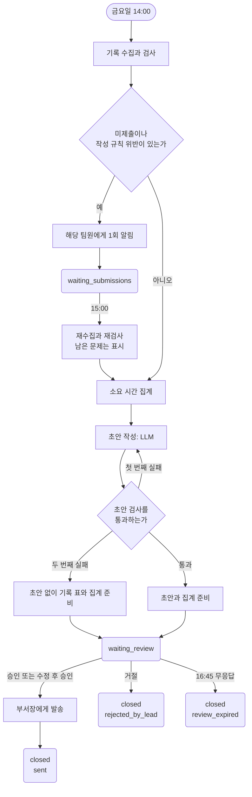

# 흐름 설계: 주간 업무 보고서

> 실습 2-2의 예시 답안이다..

- 작성자: 예시 답안
- 작성일: 202X-XX-XX
- 대상: 교육운영팀의 주간 업무 보고서 작성 흐름(2026-09-14~09-18, 금요일 14시 시작, 17시까지 발송)
- 사용한 자료: [`주간보고서_시나리오.md`](../템플릿_가이드/data/주간보고서_시나리오.md), [`주간업무기록_샘플.csv`](../템플릿_가이드/data/주간업무기록_샘플.csv)(E-01~E-09)

## 1. 데이터 계약

### 1.1 단계별 입출력

| 단계 | 읽는 값 | 만드는 값 | 판단 주체 |
|---|---|---|---|
| **수집** | 업무기록 시트, 기간(`period_start` `2026-09-14`, `period_end` `2026-09-18`), 팀원 명단 | `entries`: 기간과 상관없이 최근 기록 행의 배열 | 규칙 |
| **검사** | `entries`, 팀원 명단 | `valid_entries`, `excluded_entries`(`entry_id`와 `reason`), `missing_members` | 규칙 |
| **집계** | `valid_entries` | `hours_by_member`: 팀원 이름별 소요 시간 합계 | 규칙 |
| **초안** | `valid_entries` | `draft_sections`: 보고서 1~3절의 문장과 근거 | LLM + 규칙 검사 |
| **확인** | 초안, 집계, 제외·미제출 목록 | `review_result`(`approved`, `edited`, `rejected`), `final_report` | 사람(팀장) |
| **발송** | `final_report` | `sent_at` | 규칙 |

제외 사유 `reason`의 허용 값은 `invalid_hours`(소요 시간이 숫자가 아님), `out_of_period`(기간 밖 날짜), `invalid_status`(진행 상태가 목록 밖), `invalid_category`(업무 구분이 목록 밖), `empty_content`(내용이 빔)다.

### 1.2 초안의 계약과 검사 규칙

팀장의 걱정(기록에 없는 성과를 써 넣는 것)을 막으려고 초안의 문장마다 근거 기록의 `entry_id`를 함께 받는다.

```json
{
  "draft_sections": [
    {
      "section": "done",
      "sentences": [
        { "text": "10월 신규 과정 커리큘럼 초안에 팀 내부 검토 의견을 반영했다.", "entry_ids": ["E-02"] }
      ]
    }
  ]
}
```

초안 검사 규칙은 네 가지다.

1. `section`은 `done`, `in_progress`, `blocked` 중 하나다.
2. 모든 문장에 `entry_ids`가 1개 이상 있다.
3. `entry_ids`는 모두 `valid_entries`에 있다.
4. 인용한 기록의 `status`가 문장이 속한 `section`과 같다.

소요 시간 합계 같은 숫자는 초안에 쓰게 하지 않고 집계 단계의 결과를 보고서에 붙인다.

### 1.3 샘플 검사 결과

| 대상 | 검사 결과 | 이유 |
|---|---|---|
| E-05 | 제외, `invalid_hours` | 소요 시간이 `반나절`로 숫자가 아니다 |
| E-07 | 제외, `out_of_period` | 날짜 2026-09-11은 이번 주 기간 밖이다 |
| 최유진 | `missing_members` | 기간 안의 기록이 하나도 없다 |
| E-01~E-04, E-06, E-08, E-09 | 유효 | 규칙을 모두 지킨다 |

## 2. 상태와 흐름도

### 2.1 상태 값

| 상태 값 | 뜻 | 이 상태에서 기다리는 것 |
|---|---|---|
| `waiting_submissions` | 팀원의 제출·수정 대기 | 15시 재수집 시각 |
| `waiting_review` | 팀장 확인 대기 | 팀장의 응답, 16:45 기한 |
| `closed` | 끝남. 이유는 종료 사유로 남긴다 | 없음 |

### 2.2 상태 전이표

| 번호 | 현재 상태 | 사건 | 조건 | 다음 상태 | 실행되는 일 |
|---|---|---|---|---|---|
| T01 | (없음) | 금요일 14:00 | 미제출이나 작성 규칙 위반이 있다 | `waiting_submissions` | 수집과 검사, 해당 팀원에게 1회 알림 |
| T02 | (없음) | 금요일 14:00 | 미제출과 작성 규칙 위반이 없다 | `waiting_review` | 수집과 검사, 집계, 초안 작성과 검사, 팀장에게 전달 |
| T03 | `waiting_submissions` | 15:00 | — | `waiting_review` | 재수집과 재검사, 남은 문제 표시, 집계, 초안 작성과 검사, 팀장에게 전달 |
| T04 | `waiting_review` | 팀장 응답 | 승인 또는 수정 후 승인 | `closed`(`sent`) | 부서장에게 발송, `sent_at` 기록 |
| T05 | `waiting_review` | 팀장 응답 | 거절 | `closed`(`rejected_by_lead`) | 발송하지 않는다. 팀장이 직접 처리한다 |
| T06 | `waiting_review` | 16:45 | 응답이 없다 | `closed`(`review_expired`) | 발송하지 않고 팀장에게 알린다 |

### 2.3 실패 경로

| 실패 | 관찰할 사실 | 행동 | 다음 상태 |
|---|---|---|---|
| **미제출** | `missing_members`가 비어 있지 않다 | 14시에 해당 팀원에게 1회 알리고, 15시에 다시 수집한다. 그래도 없으면 보고서에 "미제출"로 표시하고 진행한다 | `waiting_submissions` → 초안 작성 |
| **작성 규칙 위반** | `excluded_entries`에 `out_of_period` 외의 사유가 있다 | 14시에 작성자에게 1회 수정을 요청하고 15시에 다시 검사한다. 그래도 틀리면 제외하고 보고서에 "제외 n건"을 표시한다 | `waiting_submissions` → 초안 작성 |
| **기간 밖 기록** | `reason`이 `out_of_period`다 | 알리지 않고 제외한다. 지난주 기록이므로 수정할 대상이 아니다 | 변화 없음 |
| **초안 검사 실패** | 근거 없는 문장, 제외된 기록 인용, 목록 밖 `section` | 한 번 다시 작성하게 한다. 또 실패하면 초안 없이 유효 기록 표와 집계만 팀장에게 보내고 "초안 작성 실패"를 표시한다 | `waiting_review` |
| **팀장 거절** | `review_result`가 `rejected`다 | 발송하지 않는다. 팀장이 직접 작성해 보낸다 | `closed`(`rejected_by_lead`) |
| **팀장 무응답** | 16:45까지 응답이 없다 | 발송하지 않고 팀장에게 기한이 지났음을 알린다 | `closed`(`review_expired`) |

팀장이 응답하지 않을 때 자동으로 보내지 않는 이유는 시나리오의 발송 권한 조건 때문이다. 부서장에게 가는 메일은 팀장이 확인한 뒤에만 보낼 수 있다.

### 2.4 승인

| 항목 | 내용 |
|---|---|
| 승인하는 역할 | 팀장 |
| 승인 대상 | 부서장에게 보낼 주간 업무 보고서 |
| 승인 요청에 담는 정보 | 초안(초안 작성에 실패했으면 유효 기록 표와 "초안 작성 실패"), 집계, 제외·미제출 목록 |
| 기한과 기한을 넘겼을 때 | 16:45까지. 넘기면 발송하지 않고 팀장에게 알린 뒤 `closed`(`review_expired`) |
| 거절했을 때 | 발송하지 않는다. 팀장이 직접 작성해 보내고 `closed`(`rejected_by_lead`) |
| 기록하는 값 | `review_result`(`approved`, `edited`, `rejected`), `final_report`, `sent_at` |

### 2.5 종료 조건과 반복 한도

| 구분 | 값 또는 동작 | 조건 또는 한도 | 끝나거나 한도에 도달했을 때 |
|---|---|---|---|
| **종료 사유** | `sent` | 팀장이 승인하거나 수정해 승인했고 발송이 끝났다 | 발송 시각을 남긴다 |
| **종료 사유** | `rejected_by_lead` | 팀장이 초안을 거절했다 | 팀장이 직접 처리한다 |
| **종료 사유** | `review_expired` | 16:45까지 팀장이 응답하지 않았다 | 발송하지 않고 팀장에게 알린다 |
| **반복 한도** | 팀원 알림 | 14시에 1회 | 15시 재수집 뒤 남은 문제는 표시하고 진행한다 |
| **반복 한도** | 재수집·재검사 | 15시에 1회 | 결과를 그대로 초안 작성에 쓴다 |
| **반복 한도** | 초안 재작성 | 1회 | 초안 없이 기록 표와 집계를 전달한다 |
| **반복 한도** | 팀장 확인 대기 | 16:45까지 | `closed`(`review_expired`) |

16:45는 팀장이 수정한 뒤 17시 발송 기한까지 여유를 두기 위해 정한 가정이다.

샘플이 15시 재검사 때도 고쳐지지 않았을 때의 소요 시간 합계는 다음과 같다.

| 팀원 | 합계 | 계산 |
|---|---|---|
| 김도현 | 6.5시간 | E-01 3 + E-02 2 + E-03 1.5 |
| 이수아 | 2시간 | E-04 1 + E-06 1. E-05는 제외 |
| 박준영 | 3시간 | E-08 1 + E-09 2. E-07은 제외 |
| 최유진 | 미제출 | — |

### 2.6 흐름도



기다리는 지점은 두 곳이고, 두 곳 모두 기다림이 끝나는 시각이 정해져 있다. 그래서 어떤 경우에도 17시 전에 흐름이 끝난다.
