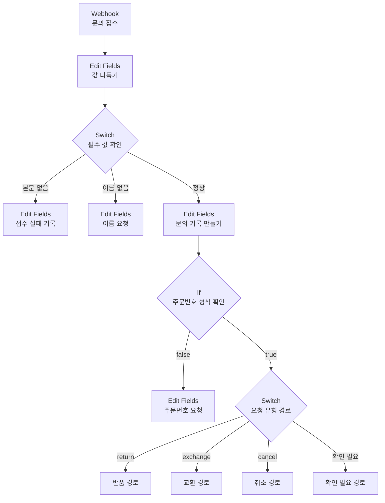

# 웹 문의 정규화 워크플로우 노드 설정(빈칸)

> 3장 실습 3-6에서 워크플로우를 만들면서 이 문서의 빈칸과 질문을 채운다.
> 값이 무엇인지보다 **왜 그 값이어야 하는지**를 설명할 수 있어야 한다. 완성본은 풀이를 마친 뒤 받는다.

## 전체 구성

## 1. `Webhook` — 이름: 문의 접수

| 파라미터 | 값 | 이 값을 고른 이유 |
|---|---|---|
| **HTTP Method** | | |
| **Path** | `harumarket-inquiry` | |
| **Respond** | Immediately |  |

문의 양식이 보낸 값은 받은 데이터의 어느 키 아래에 들어 있는가?

-

## 2. `Edit Fields (Set)` — 이름: 값 다듬기

**Include in Output**을 어떻게 두어야 하는가? 그 이유는?

-

| 필드 이름 | 데이터 타입 | 값 |
|---|---|---|
| `name_raw` | String | |
| `order_no_raw` | String | |
| `content_raw` | String | `{{ $ifEmpty($json.body.content, "").trim() }}` (주어짐) |

`$ifEmpty`로 감싸지 않고 `{{ $json.body.name.trim() }}`이라고만 적으면 W-3에서 무슨 일이 생기는가? 직접 바꿔 보고 적는다.

-

## 3. `Switch` — 이름: 필수 값 확인

| 순서 | 조건 | Rename Output |
|---|---|---|
| 1 | | `본문 없음` |
| 2 | | `이름 없음` |
| — | Fallback Output | |

본문 검사를 이름 검사보다 먼저 두는 이유는 무엇인가? 2장 계약의 어느 칸이 근거인가?

-

## 4~5. `Edit Fields (Set)` — 이름: 접수 실패 기록 / 이름 요청

두 노드가 각각 어떤 값을 남겨야 나중에 "왜 여기로 왔는지" 알 수 있는가?

| 노드 | 필드 이름 | 값 |
|---|---|---|
| 접수 실패 기록 | | |
| 이름 요청 | | |

## 6. `Edit Fields (Set)` — 이름: 문의 기록 만들기

2장 문의 기록 계약의 일곱 필드를 모두 채운다. 값을 넣을 수 없는 필드가 있다면 빈 문자열이 아니라 `null`로 두고 그 이유를 적는다.

| 필드 이름 | 데이터 타입 | 값 | 계약 근거 또는 `null`로 둔 이유 |
|---|---|---|---|
| `inquiry_id` | | | |
| `received_at` | | | |
| `channel` | | | |
| `customer_name` | | | |
| `order_id` | | | |
| `message` | | | |
| `request_id` | | | |

`order_id`를 빈 문자열이 아니라 `null`로 두어야 하는 이유는 무엇인가?

-

## 7. `If` — 이름: 주문번호 형식 확인

| 조건 | 값 |
|---|---|
| | |

`order_id`가 `null`인 경우와 형식이 틀린 경우를 다른 경로로 나눌 필요가 있는가? 판단과 이유를 적는다.

-

## 8. `Edit Fields (Set)` — 이름: 주문번호 요청

| 필드 이름 | 값 |
|---|---|
| | |

## 9. `Switch` — 이름: 요청 유형 경로

| 순서 | 조건 | Rename Output |
|---|---|---|
| 1 | | |
| 2 | | |
| 3 | | |
| 4 | | |
| — | Fallback Output | |

**Send data to all matching outputs**를 켜면 W-6의 결과가 어떻게 달라지는가? 켠 상태와 끈 상태를 각각 실행해 보고 적는다.

-

## 10. `No Operation, do nothing`

경로 끝에 이 노드를 두는 이유는 무엇인가?

-

## 시험 결과 대조표

6건을 보낸 뒤 직접 채운다.

| 사례 | 지나는 경로 | `order_id` | 마지막으로 도달하는 노드 | 기대와 달랐는가 |
|---|---|---|---|---|
| W-1 | | | | |
| W-2 | | | | |
| W-3 | | | | |
| W-4 | | | | |
| W-5 | | | | |
| W-6 | | | | |
