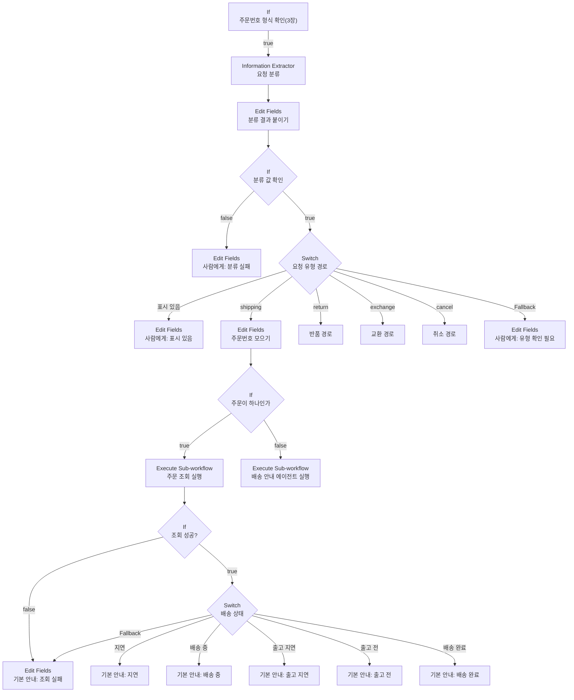
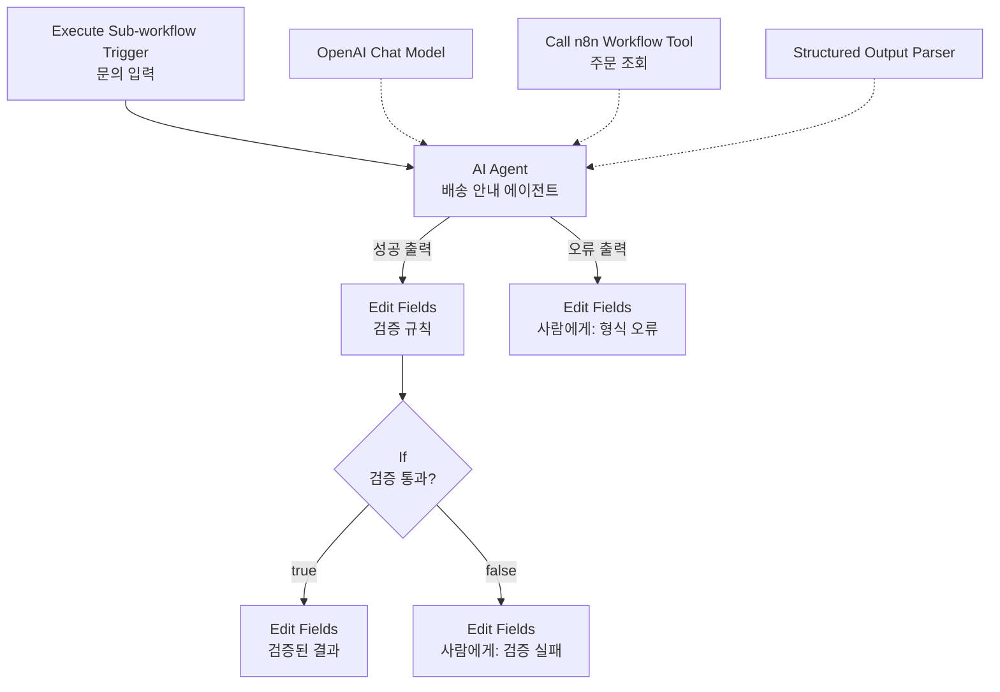
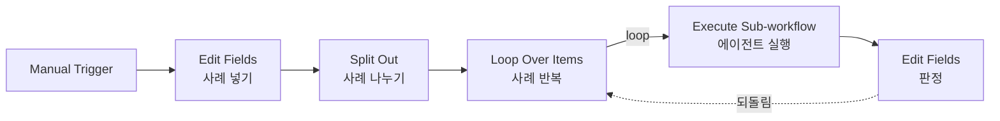

# 배송 안내 노드 설정(완성본)

> 4장 실습 4-6의 완성 예제다. 세 워크플로우의 설정을 적었다.
> 1. `웹 문의 처리`: 3장 `웹 문의 정규화`를 확장해 분류와 배송 경로를 더한다
> 2. `배송 안내 에이전트`: 주문이 여러 개인 배송 문의를 맡는 서브워크플로우
> 3. `계약 테스트 실행`: 에이전트를 사례별로 실행해 결과를 판정한다
>
> 시스템 메시지와 스키마는 [`배송안내_시스템메시지.md`](배송안내_시스템메시지.md), 분류 지시문은 [`분류추출_지시문.md`](분류추출_지시문.md)에 있다.
> 식이 길어 보이는 칸은 모두 Expression으로 바꾼 뒤 붙여 넣는다.

## 1. 워크플로우 `웹 문의 처리`

3장 `웹 문의 정규화` 워크플로우를 복제해 이름을 `웹 문의 처리`로 바꾸고 시작한다. 3장의 `문의 접수`부터 `주문번호 형식 확인`까지는 그대로 두고, 그 뒤의 키워드 `Switch`와 경로 끝 노드를 지운 뒤 아래를 붙인다.



`반품 경로`, `교환 경로`, `취소 경로`는 3장처럼 `No Operation, do nothing` 노드로 둔다. 웹으로 들어온 교환 문의는 이 장에서 처리하지 않는다(메일 교환 문의는 실습 4-7).

두 경로 모두 `Loop Over Items`를 두지 않는다. `문의 접수`(Webhook)는 요청 한 번을 item 하나로 만들고, 그 뒤의 노드도 item을 여러 개로 나누지 않으므로 이 워크플로우는 한 번 실행될 때 문의 한 건만 처리한다. 그래서 두 `Execute Sub-workflow`를 Run once with all items로 두어도 서브워크플로우는 문의 한 건으로 한 번 실행된다. 기본 경로는 안내 노드 여섯 개(`기본 안내: 조회 실패`, `지연`, `배송 중`, `출고 지연`, `출고 전`, `배송 완료`)에서, 에이전트 경로는 `배송 안내 에이전트 실행`에서 끝난다.

### 1-1. `Information Extractor` — 이름: 요청 분류

| 파라미터 | 값 |
|---|---|
| **Text** | `{{ $json.message }}` |
| **Schema Type** | Define using JSON Schema. 스키마는 `분류추출_지시문.md` 2절 |
| **Options → System Prompt Template** | `분류추출_지시문.md` 1절 |
| **Chat Model 연결** | `OpenAI Chat Model`(자격 증명 `OpenAI 실습`, Model `gpt-6-luna`) |

실행한 뒤 **출력 패널에서 추출 결과가 어느 필드 아래 있는지 먼저 확인한다.** 아래 설정은 결과가 `output` 아래에 있다고 보고 적었다. 다르면 `$json.output` 부분을 화면에 맞게 고친다.

### 1-2. `Edit Fields (Set)` — 이름: 분류 결과 붙이기

**Mode**는 JSON Output이다. `Information Extractor`는 추출 결과만 내보내므로 앞의 문의 기록을 이름으로 불러와 합친다.

```text
{{ JSON.stringify(Object.assign({}, $('문의 기록 만들기').item.json, {
  detected_type: $json.output.detected_type,
  flags: {
    dispute_mentioned: $json.output.dispute_mentioned,
    repeat_mentioned: $json.output.repeat_mentioned
  }
})) }}
```

### 1-3. `If` — 이름: 분류 값 확인

| 조건 | 값 |
|---|---|
| Boolean — is true | `{{ ["shipping_status","return_change_of_mind","return_defect","exchange_option","exchange_other_product","cancel_full","cancel_partial","mixed","other"].includes($json.detected_type) && typeof $json.flags.dispute_mentioned === "boolean" && typeof $json.flags.repeat_mentioned === "boolean" }}` |

스키마로 형식을 정했더라도 뒤의 분기가 이 값에 의존하므로 규칙으로 한 번 더 확인한다. false 출력의 `사람에게: 분류 실패` 노드는 **Include in Output**을 All Input Fields로 두고 `result` `handed_over`, `reason` `classification_invalid`를 더한다.

2장 계약은 목록 밖의 값이 나오면 한 번 다시 분류하라고 정했다. 이 장에서는 다시 분류하는 반복을 만들지 않고 바로 사람에게 넘긴다. 반복과 재시도는 8장에서 다룬다.

### 1-4. `Switch` — 이름: 요청 유형 경로

**Mode**는 Rules, **Fallback Output**은 Extra Output이다.

| 순서 | 조건 | Rename Output |
|---|---|---|
| 1 | Boolean — `{{ $json.flags.dispute_mentioned \|\| $json.flags.repeat_mentioned }}` — is true | `표시 있음` |
| 2 | String — `{{ $json.detected_type }}` — is equal to — `shipping_status` | `shipping` |
| 3 | String — `{{ $json.detected_type }}` — starts with — `return_` | `return` |
| 4 | String — `{{ $json.detected_type }}` — starts with — `exchange_` | `exchange` |
| 5 | String — `{{ $json.detected_type }}` — starts with — `cancel_` | `cancel` |
| — | Fallback(`mixed`, `other`) | — |

표시 규칙을 맨 앞에 둔다. 배송 문의여도 분쟁이나 재문의를 언급하면 사람에게 넘기기로 1장에서 정했기 때문이다. `표시 있음`과 Fallback 출력에 붙이는 두 노드는 `result` `handed_over`와 `reason` `flagged`, `mixed_or_other`를 더한다(2장 `handover_reason` 값).

### 1-5. `Edit Fields (Set)` — 이름: 주문번호 모으기

**Include in Output**은 All Input Fields다.

| 필드 이름 | 데이터 타입 | 값 |
|---|---|---|
| `order_ids` | Array | `{{ ($json.message.toUpperCase().match(/O-[0-9]{4}/g) \|\| []).concat([$json.order_id]).removeDuplicates() }}` |

문장에서 찾은 주문번호와 `order_id` 칸의 값을 합쳐 중복을 없앤다. `removeDuplicates()`는 n8n이 배열에 더한 기능이다.

### 1-6. `If` — 이름: 주문이 하나인가

| 조건 | 값 |
|---|---|
| Number — `{{ $json.order_ids.length }}` — is equal to | `1` |

true가 기본 경로, false가 에이전트 경로다.

### 1-7. `Execute Sub-workflow` — 이름: 주문 조회 실행

| 파라미터 | 값 |
|---|---|
| **Source / Workflow** | Database / `주문 조회` |
| **Workflow Inputs** | `order_id`: `{{ $json.order_id }}`, `customer_name`: `{{ $json.customer_name }}` |
| **Mode** | Run once with all items(이 워크플로우에는 문의 한 건만 들어오므로 한 번 실행된다) |

출력은 도구 결과 계약(`status`, `answer`, `evidence`)이다.

### 1-8. `If` — 이름: 조회 성공?

| 조건 | 값 |
|---|---|
| String — `{{ $json.status }}` — is equal to | `ok` |

false 출력의 `기본 안내: 조회 실패`는 JSON Output 모드로 다음 식을 넣는다.

```text
{{ JSON.stringify({
  status: "handoff",
  answer: null,
  evidence: [{ order_id: $json.evidence.order_id, tool_status: $json.status }]
}) }}
```

### 1-9. `Switch` — 이름: 배송 상태

**Mode**는 Rules, **Fallback Output**은 Extra Output이다. 규칙은 위에서부터 검사하고 처음 맞는 출력으로만 보낸다.

| 순서 | 조건 | Rename Output |
|---|---|---|
| 1 | Boolean — `{{ $json.answer.order_status === "shipped" && $json.answer.shipping.delay_check_required === true }}` — is true | `지연` |
| 2 | String — `{{ $json.answer.order_status }}` — is equal to — `shipped` | `배송 중` |
| 3 | Boolean — `{{ ["paid","preparing"].includes($json.answer.order_status) && $json.answer.shipping.ship_overdue === true }}` — is true | `출고 지연` |
| 4 | Boolean — `{{ ["paid","preparing"].includes($json.answer.order_status) }}` — is true | `출고 전` |
| 5 | String — `{{ $json.answer.order_status }}` — is equal to — `delivered` | `배송 완료` |
| — | Fallback | — |

1번과 3번 규칙은 주문 상태를 먼저 확인한 뒤 `shipping` 안의 값을 읽는다. 배송 완료된 주문은 `shipping`이 `null`이므로 순서를 바꾸면 식이 오류를 낸다. Fallback은 `기본 안내: 조회 실패`에 연결한다.

### 1-10. 기본 안내 노드 다섯 개

모두 JSON Output 모드에 식 하나를 넣는다. 안내 문장은 규칙이 만든다. 1장에서 "배송 안내는 안내문 틀로" 정한 것을 따른다.

**기본 안내: 배송 중**

```text
{{ JSON.stringify({
  status: "answered",
  answer: "주문하신 " + $json.answer.product_name + " 주문(" + $json.answer.order_id + ")은 " + $json.answer.shipped_at + "에 출고되어 배송 중이며, " + $json.answer.shipping.expected_delivery_from + "부터 " + $json.answer.shipping.expected_delivery_to + " 사이에 도착할 예정입니다.",
  evidence: [{
    order_id: $json.answer.order_id,
    tool_status: "ok",
    order_status: $json.answer.order_status,
    expected_from: $json.answer.shipping.expected_delivery_from,
    expected_to: $json.answer.shipping.expected_delivery_to,
    delay_check_required: false
  }]
}) }}
```

나머지 네 노드는 `status`, `answer`, `evidence`의 값만 다르다.

| 노드 | `status` | `answer` | `evidence`의 `expected_from`, `expected_to`, `delay_check_required` |
|---|---|---|---|
| `기본 안내: 지연` | `handoff` | `"주문하신 " + 상품 + " 주문(" + 주문번호 + ")은 " + shipped_at + "에 출고되었지만 배송이 늦어지고 있어, 담당자가 택배사에 확인한 뒤 다시 안내드리겠습니다."` | 도착 예정일 두 개, `true` |
| `기본 안내: 출고 지연` | `handoff` | `null` | 출고 예정일 두 개, `null` |
| `기본 안내: 출고 전` | `answered` | `"주문하신 " + 상품 + " 주문(" + 주문번호 + ")은 " + expected_ship_from + "부터 " + expected_ship_to + " 사이에 출고될 예정입니다."` | 출고 예정일 두 개, `null` |
| `기본 안내: 배송 완료` | `answered` | `"주문하신 " + 상품 + " 주문(" + 주문번호 + ")은 " + delivered_at + "에 배송이 완료되었습니다."` | `null`, `null`, `null` |

### 1-11. `Execute Sub-workflow` — 이름: 배송 안내 에이전트 실행

| 파라미터 | 값 | 이유 |
|---|---|---|
| **Source / Workflow** | Database / `배송 안내 에이전트` | |
| **Workflow Inputs** | `customer_name`: `{{ $json.customer_name }}`, `order_id`: `{{ $json.order_id }}`, `message`: `{{ $json.message }}`, `order_ids`: `{{ $json.order_ids }}` | |
| **Mode** | Run once with all items | 이 워크플로우는 한 번 실행될 때 문의 한 건만 처리하므로 **에이전트도 문의 한 건으로 실행된다.** 그래서 에이전트의 도구에 넣는 고객 이름이 다른 문의와 섞이지 않는다. 여러 문의를 한꺼번에 넣으면 섞일 수 있다(실습 4-6의 여러 문의 시험) |

## 2. 워크플로우 `배송 안내 에이전트`



### 2-1. `Execute Sub-workflow Trigger` — 이름: 문의 입력

**Input data mode**는 Define using fields below다.

| 필드 | 데이터 타입 |
|---|---|
| `customer_name` | String |
| `order_id` | String |
| `message` | String |
| `order_ids` | Array |

### 2-2. `AI Agent` — 이름: 배송 안내 에이전트

| 파라미터 | 값 | 이유 |
|---|---|---|
| **Prompt** | Define below. 식은 `배송안내_시스템메시지.md` 2절 | 문의 문장과 주문번호 목록만 준다 |
| **Require Specific Output Format** | 켬 | 결과를 결과 계약 형식으로 받는다 |
| **Options → System Message** | `배송안내_시스템메시지.md` 1절 | |
| **Options → Max Iterations** | `5` | 한 문의의 주문번호는 실습 사례에서 최대 두 개다. 여유를 두어 5로 정한다(가정) |
| **Options → Return Intermediate Steps** | 켬 | 도구를 어떤 입력으로 불렀는지 결과에 함께 남긴다 |
| **Settings → On Error** | Continue (using error output) | 형식이 맞지 않는 답이 나와 노드가 실패해도 사람에게 넘기는 경로로 보낸다 |

### 2-3. `OpenAI Chat Model`

| 파라미터 | 값 |
|---|---|
| **Credential** | `OpenAI 실습` |
| **Model** | `gpt-6-luna` |

### 2-4. `Call n8n Workflow Tool` — 이름: order_lookup

| 파라미터 | 값 | 누가 채우는가 |
|---|---|---|
| **Description** | `배송안내_시스템메시지.md` 3절 | — |
| **Source / Workflow** | Database / `주문 조회` | — |
| **Workflow Inputs → order_id** | `{{ $fromAI('order_id', 'O- 뒤에 숫자 네 자리인 주문번호. 문의에 적힌 주문번호 목록에 있는 값만 넣는다', 'string') }}` | 모델 |
| **Workflow Inputs → customer_name** | `{{ $json.customer_name }}` | 워크플로우 |

`customer_name`을 `$fromAI()`로 두지 않는다. 모델이 이름을 바꾸어 부르면 다른 고객의 주문 정보를 받을 수 있기 때문이다.

서브워크플로우 `주문 조회`를 **Publish**하지 않으면 프로덕션 실행에서 이 도구 호출이 실패한다. 편집 화면에서 시험할 때는 저장만으로 된다.

### 2-5. `Structured Output Parser`

**Schema Type**은 Define using JSON Schema이고 스키마는 `배송안내_시스템메시지.md` 4절이다.

### 2-6. `Edit Fields (Set)` — 이름: 검증 규칙

**Include in Output**은 All Input Fields다. 규칙 하나를 필드 하나로 만들어 어느 규칙에 걸렸는지 실행 결과에서 바로 보이게 한다. 모두 데이터 타입은 Boolean이다.

| 필드 이름 | 확인하는 것 | 값 |
|---|---|---|
| `r_status` | 형식: `status`가 허용 값인가 | `{{ ["answered","needs_info","handoff"].includes($json.output.status) }}` |
| `r_answer` | 일관성: 사람에게 넘기지 않으면 안내문이 있는가 | `{{ $json.output.status === "handoff" \|\| (typeof $json.output.answer === "string" && $json.output.answer.trim() !== "") }}` |
| `r_lookup` | 일관성: 안내했다면 모든 조회가 성공했고 지연 대상이 없는가 | `{{ $json.output.status === "handoff" \|\| (Array.isArray($json.output.evidence) && $json.output.evidence.length > 0 && $json.output.evidence.every(e => e.tool_status === "ok" && e.delay_check_required !== true)) }}` |
| `r_evidence` | 근거: 근거의 주문이 문의에 있었고, 답에 나온 주문번호는 모두 조회에 성공한 주문인가 | `{{ Array.isArray($json.output.evidence) && $json.output.evidence.every(e => $('문의 입력').item.json.order_ids.includes(e.order_id)) && ($ifEmpty($json.output.answer, "").toUpperCase().match(/O-[0-9]{4}/g) \|\| []).every(id => $json.output.evidence.some(e => e.order_id === id && e.tool_status === "ok")) }}` |
| `r_handoff_answer` | 일관성: 조회 실패로 넘긴다면 안내문이 비어 있는가 | `{{ !($json.output.status === "handoff" && Array.isArray($json.output.evidence) && $json.output.evidence.some(e => e.tool_status !== "ok") && $json.output.answer) }}` |

표 안에서는 `\|\|`로 적었지만 화면에는 세로줄 두 개(`||`)로 입력한다.

### 2-7. `If` — 이름: 검증 통과?

| 조건 | 값 |
|---|---|
| Boolean — is true | `{{ $json.r_status && $json.r_answer && $json.r_lookup && $json.r_evidence && $json.r_handoff_answer }}` |

### 2-8. 결과 노드 세 개

모두 JSON Output 모드다.

**검증된 결과**

```text
{{ JSON.stringify({
  status: $json.output.status,
  answer: $json.output.answer,
  evidence: $json.output.evidence,
  validation: { passed: true, failed_rules: [] }
}) }}
```

**사람에게: 검증 실패**

```text
{{ JSON.stringify({
  status: "handoff",
  answer: null,
  evidence: $ifEmpty($json.output.evidence, []),
  validation: {
    passed: false,
    failed_rules: ["r_status","r_answer","r_lookup","r_evidence","r_handoff_answer"].filter(k => !$json[k])
  }
}) }}
```

**사람에게: 형식 오류**(에이전트 노드의 오류 출력에 연결)

```text
{{ JSON.stringify({
  status: "handoff",
  answer: null,
  evidence: [],
  validation: { passed: false, failed_rules: ["output_format"] }
}) }}
```

## 3. 워크플로우 `계약 테스트 실행`



### 3-1. `Edit Fields (Set)` — 이름: 사례 넣기

JSON Output 모드로 [`배송안내_계약테스트사례.json`](../test-cases/배송안내_계약테스트사례.json)의 내용을 붙여 넣는다.

### 3-2. `Split Out` — 이름: 사례 나누기

**Fields To Split Out**은 `cases`다.

### 3-3-0. `Loop Over Items` — 이름: 사례 반복

기본값(Batch Size 1)을 그대로 둔다. loop 출력을 `에이전트 실행`에 연결하고, `판정`의 출력을 다시 이 노드의 입력으로 되돌린다.

### 3-3. `Execute Sub-workflow` — 이름: 에이전트 실행

| 파라미터 | 값 |
|---|---|
| **Source / Workflow** | Database / `배송 안내 에이전트` |
| **Workflow Inputs** | `customer_name`, `order_id`, `message`, `order_ids`에 각각 `{{ $json.필드이름 }}` |
| **Mode** | Run once with all items(`Loop Over Items`가 한 번에 하나씩 내보내므로 사례마다 따로 실행된다) |

### 3-4. `Edit Fields (Set)` — 이름: 판정

**Include in Output**은 No Other Input Fields다.

| 필드 이름 | 데이터 타입 | 값 |
|---|---|---|
| `case` | String | `{{ $('사례 나누기').item.json.case }}` |
| `expected_status` | String | `{{ $('사례 나누기').item.json.expected_status }}` |
| `actual_status` | String | `{{ $json.status }}` |
| `status_match` | Boolean | `{{ $json.status === $('사례 나누기').item.json.expected_status }}` |
| `validation_passed` | Boolean | `{{ $json.validation.passed }}` |
| `answer_null_ok` | Boolean | `{{ !$('사례 나누기').item.json.expected_answer_null \|\| $json.answer === null }}` |
| `evidence_summary` | String | `{{ $json.evidence.map(e => e.order_id + ":" + e.tool_status).join(", ") }}` |
| `answer` | String | `{{ $ifEmpty($json.answer, "(없음)") }}` |

`$('사례 나누기').item`은 서브워크플로우를 지난 뒤에도 같은 사례의 입력을 가리킨다. 판정 결과의 `case`가 사례 순서와 맞는지 확인한다. 맞지 않으면 판정표를 믿지 말고 실습 문서의 자주 하는 실수를 본다.

## 4. 시험 결과 대조표

| 사례 | 경로 | 기대 `status` | 확인할 점 |
|---|---|---|---|
| D-1 | 기본 경로 | `answered` | 2026-09-10부터 2026-09-14 사이 도착 예정 |
| D-2 | 기본 경로 | `handoff` | 지연 안내문이 있고 `delay_check_required`가 `true` |
| D-3 | 에이전트 | `answered` | 조회 2회, 두 주문 모두 2026-09-10부터 2026-09-11 사이 출고 예정 |
| D-4 | 에이전트 | `handoff` | O-1003이 `name_mismatch`, `answer`가 `null` |
| D-5 | 에이전트 | `handoff` | O-2070이 `order_not_found`, `answer`가 `null` |
| D-6 | 에이전트 | `needs_info` | 조회는 O-2005, O-2006 두 번뿐이고 정확한 주문번호를 묻는다 |
| D-7 | 기본 경로 | `handoff` | `answer`가 `null`, 출고 예정일이 2026-09-08로 지났다 |
| 인증 실패 | 두 경로 | `handoff` | 모든 근거가 `auth_failed`, `answer`가 `null` |
