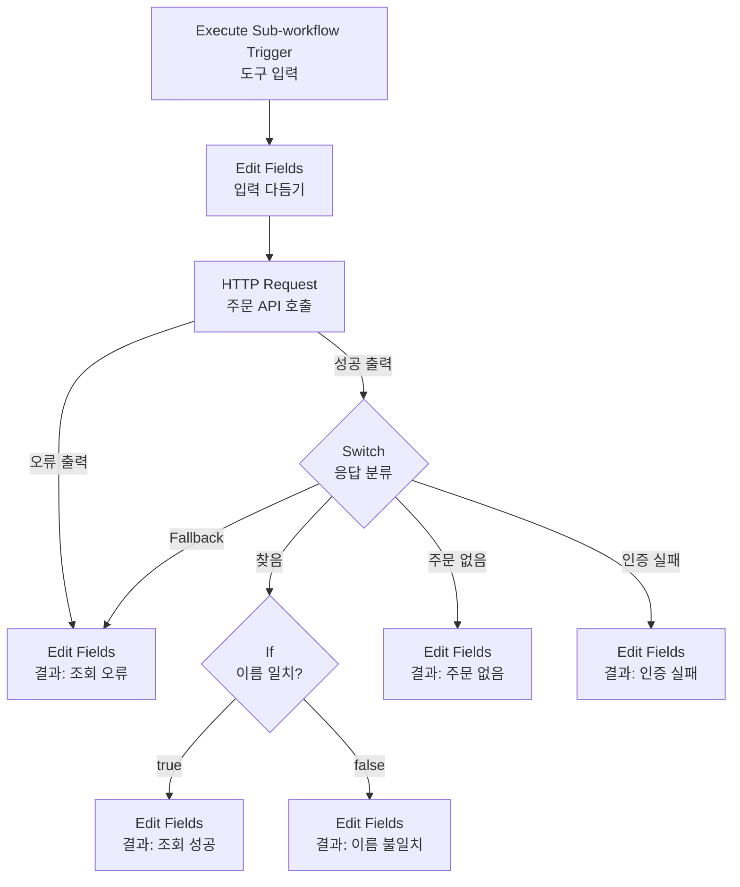

# 주문 조회 도구 노드 설정(완성본)

> 4장 실습 4-5의 완성 예제다. 서브워크플로우 `주문 조회`와 그것을 시험하는 워크플로우 `주문 조회 시험`의 설정을 적었다.
> 노드 이름은 표현식에서 참조하므로 표에 적은 그대로 붙인다.
> 화면의 칸 이름은 n8n 2.43.7 기준으로 적었다. 화면과 다르면 화면의 표기를 따르고 [`외부연결_점검표.md`](../guides/외부연결_점검표.md)를 본다.

## 전체 구성



서브워크플로우는 마지막으로 실행된 노드의 출력을 돌려준다. 입력이 한 건이면 다섯 개의 `결과:` 노드 중 하나만 실행되므로 그 노드의 출력이 도구의 결과가 된다.

## 워크플로우 `주문 조회`

### 1. `Execute Sub-workflow Trigger` — 이름: 도구 입력

캔버스에는 When Executed by Another Workflow로 표시된다.

| 파라미터 | 값 | 이유 |
|---|---|---|
| **Input data mode** | Define using fields below | 부르는 쪽이 어떤 값을 넘겨야 하는지 화면에 드러난다 |
| **필드 1** | `order_id` / String | 조회할 주문번호 |
| **필드 2** | `customer_name` / String | 문의한 고객의 이름. 주문자와 대조한다 |

### 2. `Edit Fields (Set)` — 이름: 입력 다듬기

**Include in Output**은 All Input Fields로 둔다.

| 필드 이름 | 데이터 타입 | 값 |
|---|---|---|
| `order_id` | String | `{{ $ifEmpty($json.order_id, "").trim() }}` |
| `customer_name_clean` | String | `{{ $ifEmpty($json.customer_name, "").replace(/\(.*?\)/g, "").trim() }}` |

`customer_name_clean`은 괄호와 그 안의 글자를 지우고 앞뒤 공백을 없앤 이름이다. 메일 문의의 경우  표시 이름이 `윤지우 (Jiwoo Yoon)` 형식으로 넘어 올 수 있는데 이것을 `윤지우`로 처리한다.

### 3. `HTTP Request` — 이름: 주문 API 호출

| 파라미터 | 값 | 이유 |
|---|---|---|
| **Method** | GET | 조회만 한다 |
| **URL** | `http://mock-api:8000/orders/{{ $json.order_id }}` | n8n 컨테이너 안에서는 서비스 이름으로 부른다 |
| **Authentication** | Generic Credential Type | 모의 API는 전용 자격 증명 유형이 없다 |
| **Generic Auth Type** | Header Auth | 명세가 `X-API-Key` 헤더를 요구한다 |
| **Header Auth** | `하루마켓 주문 API` | 실습 4-5의 4단계에서 만든 자격 증명 |
| **Options → Response → Include Response Headers and Status** | 켬 | 상태 코드를 다음 노드에서 읽는다 |
| **Options → Response → Never Error** | 켬 | 404, 401 응답에서 멈추지 않는다 |
| **Settings → On Error** | Continue (using error output) | 서버에 연결하지 못한 경우도 결과로 바꾼다 |

On Error를 바꾸면 노드에 출력이 두 개 생긴다. 위쪽 성공 출력은 4번에, 아래쪽 오류 출력은 `결과: 조회 오류`에 연결한다.

두 옵션을 켠 뒤의 출력은 `statusCode`와 `body`를 가진다. 정상 응답이면 `body` 아래에 명세의 필드가, 오류 응답이면 `body.error` 아래에 오류 코드가 있다. **실제 출력 패널에서 필드 이름을 먼저 확인한 뒤** 다음 노드를 설정한다.

### 4. `Switch` — 이름: 응답 분류

**Mode**는 Rules, **Options**에서 **Fallback Output**을 Extra Output으로 둔다.

| 순서 | 조건 | Rename Output |
|---|---|---|
| 1 | Number — `{{ $json.statusCode }}` — is equal to — `200` | `찾음` |
| 2 | Boolean — `{{ $json.statusCode === 404 && $json.body.error && $json.body.error.code === "ORDER_NOT_FOUND" }}` — is true | `주문 없음` |
| 3 | Number — `{{ $json.statusCode }}` — is equal to — `401` | `인증 실패` |
| — | 어느 규칙에도 맞지 않음(Fallback Output) | — |

2번 규칙이 상태 코드만 보지 않고 오류 코드까지 보는 이유는 404가 "없는 주문"과 "없는 경로" 두 뜻으로 오기 때문이다. 주문번호가 비어 `/orders/`로 호출되면 404 `NOT_FOUND`가 오는데, 이것을 없는 주문으로 안내하면 틀린다.

Fallback 출력은 `결과: 조회 오류`에 연결한다. 400, 5xx가 여기로 간다.

### 5. `If` — 이름: 이름 일치?

| 조건 | 값 |
|---|---|
| String — `{{ $json.body.customer_name }}` — is equal to | `{{ $('입력 다듬기').item.json.customer_name_clean }}` |

**이름 확인을 모델에게 맡기지 않고 여기서 한다.** 일치하지 않으면 주문 정보를 빼고 결과를 돌려주므로, 이 도구를 부른 에이전트는 다른 고객의 주문 정보를 볼 수 없다.

### 6. `Edit Fields (Set)` — 이름: 결과: 조회 성공

**Mode**는 JSON Output으로 두고, JSON 칸을 Expression으로 바꾼 뒤 아래 식 하나를 넣는다. 결과 전체를 한 식으로 만들면 `null`과 객체가 데이터 타입 그대로 나간다.

```text
{{ JSON.stringify({
  status: "ok",
  answer: {
    order_id: $json.body.order_id,
    product_name: $json.body.product_name,
    option: $json.body.option,
    order_status: $json.body.order_status,
    ordered_at: $json.body.ordered_at,
    shipped_at: $json.body.shipped_at,
    delivered_at: $json.body.delivered_at,
    shipping: $json.body.shipping
  },
  evidence: {
    source: "GET /orders/" + $('입력 다듬기').item.json.order_id,
    order_id: $('입력 다듬기').item.json.order_id,
    http_status: $json.statusCode,
    as_of: $json.body.as_of,
    checked_at: $now.toISO()
  }
}) }}
```

`answer`에 `customer_name`과 `amount`를 넣지 않는다. 배송 안내에 쓰지 않는 값을 모델에 넘기지 않기 위해서다.

### 7. 나머지 결과 노드

네 노드 모두 6번과 같이 JSON Output 모드에 식 하나를 넣는다. `status`와 `evidence.http_status`, `evidence.as_of`만 다르다.

```text
{{ JSON.stringify({
  status: "name_mismatch",
  answer: null,
  evidence: {
    source: "GET /orders/" + $('입력 다듬기').item.json.order_id,
    order_id: $('입력 다듬기').item.json.order_id,
    http_status: $ifEmpty($json.statusCode, null),
    as_of: null,
    checked_at: $now.toISO()
  }
}) }}
```

| 노드 이름 | `status` 자리에 넣을 값 |
|---|---|
| `결과: 이름 불일치` | `"name_mismatch"` |
| `결과: 주문 없음` | `"order_not_found"` |
| `결과: 인증 실패` | `"auth_failed"` |
| `결과: 조회 오류` | `"lookup_error"` |

`http_status`를 `$ifEmpty`로 감싸는 이유는 연결 실패로 오류 출력에서 들어온 아이템에는 `statusCode`가 없기 때문이다. `evidence.order_id`는 도구를 부른 쪽이 결과만 보고도 어느 주문의 결과인지 알 수 있게 넣는다.

워크플로우 이름을 `주문 조회`로 저장한다.

## 워크플로우 `주문 조회 시험`

### 1. `Manual Trigger`

설정할 값이 없다.

### 2. `Edit Fields (Set)` — 이름: 사례 넣기

**Mode**는 JSON Output으로 두고 아래를 붙여 넣는다.

```json
{
  "cases": [
    { "case": "정상", "order_id": "O-1002", "customer_name": "이준호" },
    { "case": "미존재", "order_id": "O-9999", "customer_name": "이준호" },
    { "case": "이름 불일치", "order_id": "O-1003", "customer_name": "문가온" },
    { "case": "괄호 병기", "order_id": "O-2012", "customer_name": "윤지후 (Jihu Yoon)" },
    { "case": "형식 오류", "order_id": "O-12", "customer_name": "김서연" }
  ]
}
```

### 3. `Split Out` — 이름: 사례 나누기

| 파라미터 | 값 |
|---|---|
| **Fields To Split Out** | `cases` |

### 4. `Loop Over Items` — 이름: 사례 반복

기본값(Batch Size 1)을 그대로 둔다. loop 출력을 `주문 조회 실행`에 연결하고, `주문 조회 실행`의 출력을 다시 이 노드의 입력으로 되돌린다.

### 5. `Execute Sub-workflow` — 이름: 주문 조회 실행

| 파라미터 | 값 | 이유 |
|---|---|---|
| **Source** | Database | 같은 n8n에 저장한 워크플로우를 부른다 |
| **Workflow** | From list에서 `주문 조회` | |
| **Workflow Inputs** | `order_id`: `{{ $json.order_id }}`, `customer_name`: `{{ $json.customer_name }}` | 서브워크플로우가 정의한 두 입력이 자동으로 표시된다 |
| **Mode** | Run once with all items | `Loop Over Items`가 한 번에 하나씩 내보내므로, 사례마다 따로 실행되어 결과가 섞이지 않는다 |

## 시험 결과 대조표

| 사례 | `status` | `answer`의 요점 | `evidence.http_status` |
|---|---|---|---|
| 정상 | `ok` | `order_status` `shipped`, `shipping.expected_delivery_from` `2026-09-10`, `expected_delivery_to` `2026-09-14` | `200` |
| 미존재 | `order_not_found` | `null` | `404` |
| 이름 불일치 | `name_mismatch` | `null`. O-1003의 주문자는 박지우다 | `200` |
| 괄호 병기 | `ok` | 괄호를 지운 `윤지후`가 주문자와 같다 | `200` |
| 형식 오류 | `lookup_error` | `null` | `400` |
| 인증 실패 | `auth_failed` | `null` | `401` |

인증 실패는 `주문 API 호출` 노드의 자격 증명을 `주문 API 잘못된 키`로 바꾸고 정상 사례만 다시 실행해 확인한다. 확인한 뒤 **자격 증명을 원래대로 되돌린다.**
