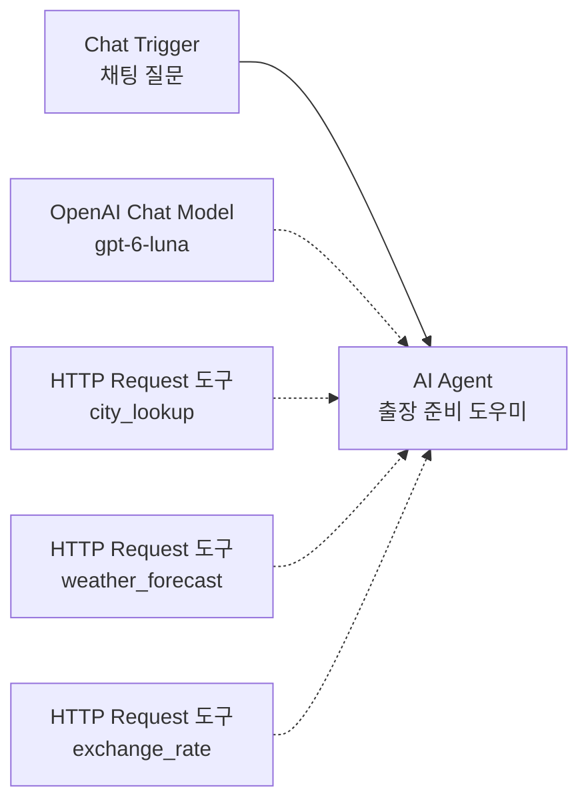

# 출장 준비 도우미 노드 설정(완성본)

> 4장 실습 4-4의 완성 예제다. 워크플로우 `출장 준비 도우미`의 노드 설정, 시스템 메시지, 도구 설명, 시험 질문을 적었다.
> 노드 이름은 표에 적은 그대로 붙인다. 도구의 이름은 모델이 읽는 이름이기도 하다.

## 전체 구성



## 1. `Chat Trigger` — 이름: 채팅 질문

캔버스에는 When chat message received로 표시된다. 기본 설정을 그대로 쓴다. **Make Chat Publicly Available**은 끈 채로 둔다. 편집 화면의 채팅 창에서만 시험하기 때문이다.

## 2. `AI Agent` — 이름: 출장 준비 도우미

| 파라미터 | 값 | 이유 |
|---|---|---|
| **Prompt** | 연결된 채팅 트리거의 메시지를 쓰는 기본값 | 채팅 창에 입력한 질문이 그대로 모델에 들어간다 |
| **Require Specific Output Format** | 끔 | 이 실습은 사람이 읽는 답만 확인한다 |
| **Options → System Message** | 아래 시스템 메시지 | |
| **Options → Max Iterations** | `5` | 가장 긴 질문도 도구 세 번이면 끝난다. 여유를 두고 5로 정한다(가정) |

**시스템 메시지**

```text
너는 회사 직원의 해외 출장 준비를 돕는 도우미다.
오늘 날짜는 {{ $now.toFormat('yyyy-MM-dd') }}이고 요일은 {{ $now.setLocale('ko').toFormat('cccc') }}이다.

도구 사용 규칙
- 날씨를 물으면 먼저 "city_lookup"로 좌표를 얻고, 그 좌표로 "weather_forecast"를 부른다.
- 환율을 물으면 "exchange_rate"를 부른다.
- 날씨나 환율과 관계없는 질문에는 도구를 부르지 않는다.

답을 쓰는 규칙
- 강수 확률, 기온, 환율 같은 숫자는 도구 결과에 있는 값만 쓴다. 기억이나 짐작으로 숫자를 만들지 않는다.
- 환율은 도구가 돌려준 rate를 "1 기준 통화 = rate 대상 통화" 형태로 그대로 알린다. 100엔당 금액 같은 환산 계산을 하지 않는다.
- "다음 주 화요일"처럼 날짜를 가리키는 말을 날짜로 바꾸었으면, 답에 그 날짜를 YYYY-MM-DD로 적어 사용자가 확인할 수 있게 한다.
- 예보 결과의 날짜 목록에 그 날짜가 없으면 아직 예보가 없다고 답한다.
- 도구가 오류를 돌려주거나 결과가 비어 있으면 무엇을 찾지 못했는지 그대로 알린다.
- 한국어로 세 문장 이내로 답한다.
```

시스템 메시지 칸은 표현식을 쓸 수 있다. 칸을 Expression으로 바꾼 뒤 붙여 넣어야 `{{ }}` 안의 날짜가 계산된다.

## 3. `OpenAI Chat Model`

| 파라미터 | 값 |
|---|---|
| **Credential** | `OpenAI 실습`(실습 4-2에서 만든 자격 증명) |
| **Model** | `gpt-6-luna` |

Options는 비워 둔다.

## 4. 도구 세 개

세 도구 모두 `AI Agent`의 Tool 연결점에서 **HTTP Request** 도구를 골라 추가한다. 모두 **Options → Response → Never Error**를 켠다. 도구가 오류 응답을 받아도 에이전트 실행이 멈추지 않고, 모델이 오류 내용을 읽을 수 있게 하기 위해서다.

값 칸 옆의 별 모양 버튼을 누르면 그 칸이 `$fromAI()` 표현식으로 바뀐다. 아래 표의 표현식을 직접 적어도 같다.

### 도구 1 — 이름: city_lookup

**Description**

```text
도시 이름으로 위도, 경도, 나라, 시간대를 찾는다. 날씨 예보를 조회하기 전에 반드시 먼저 쓴다.
결과의 results 배열에서 첫 번째 원소의 latitude, longitude를 쓴다.
results 필드가 없으면 그 이름의 도시를 찾지 못한 것이다.
```

| 파라미터 | 값 |
|---|---|
| **Method** | GET |
| **URL** | `https://geocoding-api.open-meteo.com/v1/search` |
| **Send Query Parameters** | 켬 |
| **Query Parameters** | `name`: `{{ $fromAI('city', '찾을 도시 이름. 예: 도쿄, Osaka', 'string') }}` / `count`: `1` / `language`: `ko` |

### 도구 2 — 이름: weather_forecast

**Description**

```text
위도와 경도로 오늘부터 16일 동안의 일별 예보를 가져온다.
위도와 경도는 반드시 "city_lookup"이 돌려준 값을 넣는다.
결과의 daily.time은 날짜 목록이고, 같은 순서로 precipitation_probability_max(강수 확률 %),
temperature_2m_max(최고 기온 °C), temperature_2m_min(최저 기온 °C)이 들어 있다.
```

| 파라미터 | 값 |
|---|---|
| **Method** | GET |
| **URL** | `https://api.open-meteo.com/v1/forecast` |
| **Send Query Parameters** | 켬 |
| **Query Parameters** | `latitude`: `{{ $fromAI('latitude', 'city_lookup 결과의 latitude', 'number') }}` / `longitude`: `{{ $fromAI('longitude', 'city_lookup 결과의 longitude', 'number') }}` / `daily`: `precipitation_probability_max,temperature_2m_max,temperature_2m_min` / `timezone`: `auto` / `forecast_days`: `16` |

`timezone`을 `auto`로 두면 날짜가 그 도시의 현지 날짜로 계산된다.

### 도구 3 — 이름: exchange_rate

**Description**

```text
두 통화 사이의 최신 환율을 가져온다. 통화는 ISO 4217 세 글자 코드(KRW, JPY, USD, EUR 등)로 쓴다.
결과의 rate는 base 통화 1단위가 quote 통화로 얼마인지를 뜻한다. 금액 환산은 하지 않는다.
```

| 파라미터 | 값 |
|---|---|
| **Method** | GET |
| **URL** | `https://api.frankfurter.dev/v2/rate/{{ $fromAI('base', '기준 통화 코드. 예: JPY', 'string') }}/{{ $fromAI('quote', '대상 통화 코드. 예: KRW', 'string') }}` |

### 외부망이 막힌 환경

기본 주소만 모의 API의 대체 경로로 바꾼다. 나머지 설정은 같다.

| 도구 | 바꿀 URL |
|---|---|
| city_lookup | `http://mock-api:8000/practice/geocoding/v1/search` |
| weather_forecast | `http://mock-api:8000/practice/forecast/v1/forecast` |
| exchange_rate | `http://mock-api:8000/practice/frankfurter/v2/rate/...`(뒤의 두 `$fromAI()`는 그대로) |

대체 경로는 서울, 도쿄, 오사카와 원화에서 엔화·달러·유로로 바꾸는 환율만 준비되어 있다.

## 5. 시험 질문

채팅 창에 하나씩 보낸다. 질문마다 실행 기록에서 실제로 부른 도구와 순서를 적는다. 아래의 "예상 호출"은 설계 의도이며 모델이 다르게 부를 수 있다.

| 번호 | 질문 | 예상 호출 | 확인할 점 |
|---|---|---|---|
| Q1 | 다음 주 화요일 도쿄 날씨 어때? | city_lookup → weather_forecast | 답에 날짜(YYYY-MM-DD)가 있는가, 그 날짜가 맞는 화요일인가 |
| Q2 | 엔화 환율 알려 줘 | exchange_rate | 통화 코드를 무엇으로 넣었는가, 환산 계산을 하지 않았는가 |
| Q3 | 오사카 출장인데 이번 주 금요일에 우산 필요할까? 환율도 알려 줘 | city_lookup → weather_forecast, exchange_rate | 도구를 몇 번 불렀는가, 순서가 어떻게 되는가 |
| Q4 | 출장비 정산은 어떻게 해? | 없음 | 도구를 부르지 않았는가 |
| Q5 | 한 달 뒤 런던 날씨 알려 줘 | city_lookup → weather_forecast | 16일 밖의 날짜를 지어내지 않고 예보가 없다고 답하는가 |
| Q6 | 달나라 날씨는 어때? | city_lookup | 결과가 없을 때 찾지 못했다고 답하는가 |
