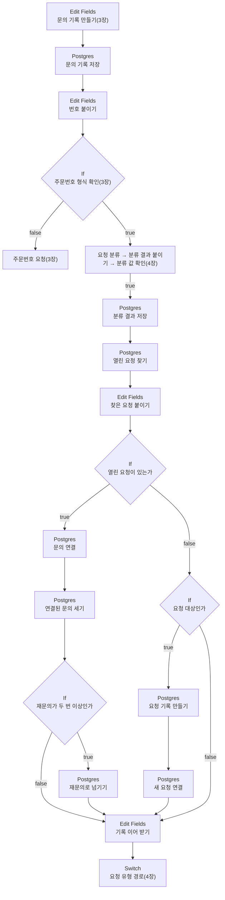

# 문의 저장 노드 설정(완성본)

> 5장 실습 5-4의 완성 예제다. 4장 `웹 문의 처리`에 문의 기록 저장, 분류 결과 저장, 요청 기록 연결을 더한다.
> Postgres 노드는 모두 자격 증명 `하루마켓 업무 DB`, Operation `Execute Query`로 둔다.
> SQL 문의 `$1`, `$2` 자리에는 **Options → Query Parameters**에 적은 배열의 값이 차례로 들어간다. 고객이 쓴 문장을 SQL 문에 `{{ }}`로 이어 붙이지 않는다.
> 식이 길어 보이는 칸은 모두 Expression으로 바꾼 뒤 붙여 넣는다. 이 설정표는 n8n에서 실행해 확인하지 않았다(실행 확인 대기).

## 0. 시작하기 전에

4장 결과물 `04_웹문의처리.json`을 내보내 두었는지 확인한다. 이 장에서는 `웹 문의 처리`를 복제하지 않고 그대로 고친다. 복제하면 두 워크플로우가 같은 `Webhook` 경로(`harumarket-inquiry`)를 쓰게 되어, 나중에 둘 다 **Publish**하면 충돌한다.

## 1. 전체 구성

바뀌는 곳은 두 군데다. `문의 기록 만들기` 바로 뒤와 `분류 값 확인`의 true 출력 뒤다. 4장의 나머지 노드는 그대로 둔다.



그림에서 `기록 이어 받기`는 여러 갈래가 다시 모이는 곳이다. 한 번의 실행에서 문의 한 건은 이 중 한 갈래만 지나므로 `기록 이어 받기`도 한 번만 실행된다.

## 2. 문의 기록 저장

### 2-1. `Postgres` — 이름: 문의 기록 저장

`문의 기록 만들기`와 `주문번호 형식 확인` 사이의 연결을 지우고 이 노드를 끼운다.

```sql
INSERT INTO inquiries (received_at, channel, customer_name, order_id, message)
VALUES ($1, $2, $3, $4, $5)
RETURNING inquiry_id;
```

| 옵션 | 값 |
|---|---|
| **Query Parameters** | `{{ [ $json.received_at, $json.channel, $json.customer_name, $json.order_id, $json.message ] }}` |

`inquiry_id`는 열 목록에 넣지 않는다. 열 목록에서 빠진 열에는 기본값이 들어가므로, 변경 스크립트가 정한 번호 발급 규칙이 번호를 만든다. `RETURNING inquiry_id`는 방금 발급한 번호를 출력으로 돌려받는 부분이다.

`order_id`가 `null`인 문의도 여기서 저장한다. 주문번호가 없어도 문의를 받았다는 사실은 남아야 하기 때문이다.

### 2-2. `Edit Fields (Set)` — 이름: 번호 붙이기

**Mode**는 JSON Output이다. `문의 기록 저장`은 발급한 번호만 내보내므로 앞의 문의 기록을 이름으로 불러와 번호를 붙인다.

```text
{{ JSON.stringify(Object.assign({}, $('문의 기록 만들기').item.json, { inquiry_id: $json.inquiry_id })) }}
```

출력을 `주문번호 형식 확인`에 연결한다.

### 2-3. 4장 노드에서 고칠 곳

4장 `분류 결과 붙이기`(배송안내_노드설정.md 1-2)의 식에서 `$('문의 기록 만들기')`를 `$('번호 붙이기')`로 바꾼다. 그래야 분류 결과에 `inquiry_id`가 함께 담긴다.

## 3. 분류 결과 저장

### 3-1. `Postgres` — 이름: 분류 결과 저장

`분류 값 확인`의 true 출력과 `요청 유형 경로` 사이에 끼운다. 목록 밖의 값은 `분류 값 확인`에서 이미 걸러졌으므로 이 노드에는 허용 값만 들어온다.

```sql
UPDATE inquiries
SET detected_type = $2, flags = $3::jsonb
WHERE inquiry_id = $1
RETURNING inquiry_id;
```

| 옵션 | 값 |
|---|---|
| **Query Parameters** | `{{ [ $json.inquiry_id, $json.detected_type, JSON.stringify($json.flags) ] }}` |

`flags`는 객체이므로 `JSON.stringify()`로 JSON 글자로 바꾸어 넘기고, SQL 문에서 `::jsonb`로 jsonb 데이터 타입으로 바꾼다.

## 4. 요청 기록 연결

2장 전이표의 T01, T02, T03, T08을 구현한다. 요청 연결은 **유형이 아니라 주문번호로** 정한다. 같은 주문에 끝나지 않은 요청이 있으면 새 문의가 어떤 유형으로 분류되었든 그 요청에 연결한다.

### 4-1. `Postgres` — 이름: 열린 요청 찾기

```sql
SELECT (
  SELECT request_id
  FROM requests
  WHERE order_id = $1 AND request_status <> 'closed'
  ORDER BY created_at DESC
  LIMIT 1
) AS open_request_id;
```

| 옵션 | 값 |
|---|---|
| **Query Parameters** | `{{ [ $('분류 결과 붙이기').item.json.order_id ] }}` |

주문번호는 `$json`이 아니라 `분류 결과 붙이기`에서 가져온다. 바로 앞의 `분류 결과 저장`은 `RETURNING inquiry_id`로 문의 번호만 내보내므로, `$json.order_id`로 읽으면 값이 비어 열린 요청을 찾지 못하고 재문의가 요청에 연결되지 않는다.

바깥 `SELECT`가 괄호 안의 조회 결과를 한 칸으로 감싼다. 열린 요청이 없으면 `open_request_id`가 `null`인 행이 **하나** 나온다. 괄호 없이 안쪽 조회만 실행하면 요청이 없을 때 행이 하나도 나오지 않고, 행이 없으면 다음 노드가 실행되지 않는다.

`request_status <> 'closed'`가 "끝나지 않은"의 뜻이다. 이 조건을 빠뜨리면 이미 끝난 요청에 새 문의가 연결된다.

### 4-2. `Edit Fields (Set)` — 이름: 찾은 요청 붙이기

**Mode**는 JSON Output이다.

```text
{{ JSON.stringify(Object.assign({}, $('분류 결과 붙이기').item.json, { open_request_id: $json.open_request_id })) }}
```

이 노드 뒤로는 문의 기록의 모든 값과 `open_request_id`가 함께 흐른다.

### 4-3. `If` — 이름: 열린 요청이 있는가

| 조건 | 값 |
|---|---|
| String — `{{ $json.open_request_id }}` — is not empty | — |

### 4-4. `Postgres` — 이름: 문의 연결(true 출력)

```sql
UPDATE inquiries SET request_id = $2 WHERE inquiry_id = $1 RETURNING request_id;
```

| 옵션 | 값 |
|---|---|
| **Query Parameters** | `{{ [ $json.inquiry_id, $json.open_request_id ] }}` |

### 4-5. `Postgres` — 이름: 연결된 문의 세기

```sql
SELECT count(*)::int AS linked_count FROM inquiries WHERE request_id = $1;
```

| 옵션 | 값 |
|---|---|
| **Query Parameters** | `{{ [ $json.request_id ] }}` |

`count(*)`는 행의 수를 센다. `::int`는 결과를 정수로 바꾼다. 바꾸지 않으면 큰 정수 데이터 타입으로 나와 n8n에서 글자로 보일 수 있다.

요청과 문의의 연결은 2장 계약과 3장 초기화 스크립트가 모두 문의 기록의 `request_id`로 나타낸다. 요청 기록에는 연결된 문의의 목록을 두지 않으므로, 요청에 연결된 문의 목록과 개수는 이처럼 문의 기록을 조회해서 얻는다.

### 4-6. `If` — 이름: 재문의가 두 번 이상인가

| 조건 | 값 |
|---|---|
| Number — `{{ $json.linked_count - 1 }}` — is greater than or equal to | `2` |

연결된 문의 수에서 처음 문의 한 건을 빼면 재문의 횟수다. 재문의가 1회면 T02(상태 그대로), 2회 이상이면 T03이다.

### 4-7. `Postgres` — 이름: 재문의로 넘기기(true 출력)

```sql
UPDATE requests
SET request_status = 'under_review', handover_reason = 'repeat_inquiry', updated_at = now()
WHERE request_id = $1 AND request_status <> 'under_review'
RETURNING request_id, request_status;
```

| 설정 | 값 | 이유 |
|---|---|---|
| **Options → Query Parameters** | `{{ [ $('문의 연결').item.json.request_id ] }}` | |
| **Settings → Always Output Data** | 켬 | T03은 이미 `under_review`인 요청을 바꾸지 않는다. 그러면 바뀐 행이 없어 출력이 비고, 출력이 비면 다음 노드가 실행되지 않는다. 이 설정은 출력이 비어도 빈 아이템 하나를 내보낸다 |

### 4-8. `If` — 이름: 요청 대상인가(4-3의 false 출력)

| 조건 | 값 |
|---|---|
| Boolean — `{{ ["return_change_of_mind","return_defect","exchange_option","exchange_other_product","mixed"].includes($json.detected_type) }}` — is true | — |

배송 문의(`shipping_status`), 취소 문의(`cancel_full`, `cancel_partial`), 기타 문의(`other`)는 요청 기록을 만들지 않고 false 출력으로 간다. 이 장에서는 이런 문의의 처리 결과를 따로 저장하지 않는다(6장).

### 4-9. `Postgres` — 이름: 요청 기록 만들기(true 출력)

```sql
INSERT INTO requests (request_type, request_status, customer_name, order_id, flags, handover_reason, desired_option)
VALUES ($1, $2, $3, $4, $5::jsonb, $6, $7)
RETURNING request_id, request_status, handover_reason;
```

| 옵션 | 값 |
|---|---|
| **Query Parameters** | 아래 식 |

```text
{{ [
  $json.detected_type,
  ($json.detected_type === "mixed" || $json.flags.dispute_mentioned || $json.flags.repeat_mentioned) ? "under_review" : "received",
  $json.customer_name,
  $json.order_id,
  JSON.stringify($json.flags),
  $json.detected_type === "mixed" ? "mixed_or_other" : (($json.flags.dispute_mentioned || $json.flags.repeat_mentioned) ? "flagged" : null),
  $ifEmpty($json.desired_option, null)
] }}
```

둘째 값과 여섯째 값이 2장 전이표의 규칙이다.

| 조건 | `request_status` | `handover_reason` | 전이 |
|---|---|---|---|
| 유형이 `mixed` | `under_review` | `mixed_or_other` | T01 → T08 |
| 분쟁이나 재문의 언급 표시가 참 | `under_review` | `flagged` | T01 → T08 |
| 그 밖 | `received` | `null` | T01 |

웹 문의의 분류는 원하는 옵션을 뽑지 않으므로 `desired_option`은 `null`이 된다. 메일 교환 문의(실습 5-7)에서는 4장에서 뽑은 고객 표현이 들어간다.

### 4-10. `Postgres` — 이름: 새 요청 연결

```sql
UPDATE inquiries SET request_id = $2 WHERE inquiry_id = $1 RETURNING request_id;
```

| 옵션 | 값 |
|---|---|
| **Query Parameters** | `{{ [ $('찾은 요청 붙이기').item.json.inquiry_id, $json.request_id ] }}` |

### 4-11. `Edit Fields (Set)` — 이름: 기록 이어 받기

**Mode**는 JSON Output이다. 세 갈래(`재문의가 두 번 이상인가`의 false 출력, `재문의로 넘기기`, `새 요청 연결`)와 `요청 대상인가`의 false 출력을 모두 이 노드에 연결한다.

```text
{{ JSON.stringify($('찾은 요청 붙이기').item.json) }}
```

Postgres 노드를 지나면 아이템이 SQL 결과로 바뀐다. 이 노드가 문의 기록의 값을 되살려 4장 `요청 유형 경로`에 넘긴다. 출력을 `요청 유형 경로`에 연결한다.

## 5. 시험 결과 대조표

[`업무DB_실습초기화.sql`](../env/업무DB_실습초기화.sql)의 [가]를 실행한 직후, [`반품문의_요청샘플.json`](../data/반품문의_요청샘플.json)의 여섯 건을 차례로 한 건씩 보냈을 때의 기대 결과다. 번호는 이 순서로 보냈을 때의 값이다. 중간에 편집 화면에서 저장 노드를 따로 실행했다면 번호가 밀린다.

| 사례 | `inquiry_id` | `detected_type` | 지나는 갈래 | `request_id` | 요청의 `request_status` | `handover_reason` |
|---|---|---|---|---|---|---|
| R-1 | `INQ-201` | `return_change_of_mind` | 요청 기록 만들기 | `REQ-1001` | `received` | `null` |
| R-2 | `INQ-202` | 모델 결과를 적는다 | 문의 연결(재문의 1회) | `REQ-1001` | `received`(그대로) | `null` |
| R-3 | `INQ-203` | 모델 결과를 적는다 | 문의 연결 → 재문의로 넘기기 | `REQ-1001` | `under_review` | `repeat_inquiry` |
| R-4 | `INQ-204` | `return_defect` | 요청 기록 만들기 | `REQ-1002` | `received` | `null` |
| W-6 | `INQ-205` | `mixed` | 요청 기록 만들기 | `REQ-1003` | `under_review` | `mixed_or_other` |
| D-1 | `INQ-206` | `shipping_status` | 요청 대상인가 false | `null` | — | — |

R-2와 R-3의 `detected_type`은 모델에 따라 `return_change_of_mind`나 `other`가 나올 수 있다. 요청 연결은 유형이 아니라 같은 주문의 열린 요청으로 정하므로 어느 쪽이든 결과가 같아야 한다. R-3에서 `repeat_mentioned`가 참으로 나오면 4장 `요청 유형 경로`의 `표시 있음`으로도 간다.

확인하는 SQL 문은 [`SQL_확인문장.md`](../guides/SQL_확인문장.md)의 1절에 있다.
