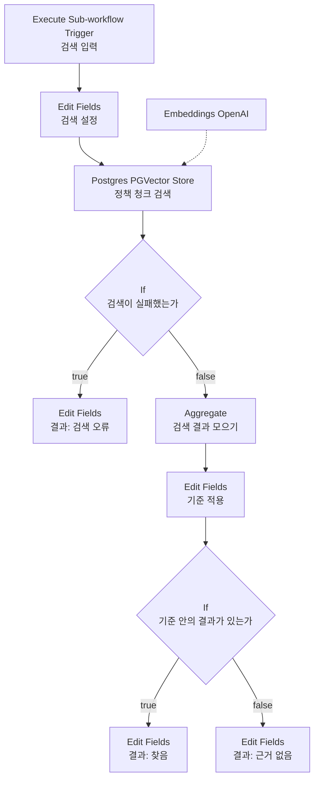

# 정책 검색 도구 노드 설정(완성본)

> 5장 실습 5-6의 서브워크플로우 `정책 검색`의 완성 설정이다. 4장 `주문 조회`처럼 입력과 결과가 정해진 도구를 만든다.
> 반품·배송 상담(실습 5-6)과 교환·취소 상담(실습 5-7)이 이 서브워크플로우 하나를 함께 쓴다.
> n8n 2.43.7에서 이 설정대로 실행해 4절의 기대 결과와 `search_error`를 확인했다.

## 1. 도구 계약 요약

| 항목 | 내용 |
|---|---|
| **하는 일** | 정책 문서 청크 중 검색어와 뜻이 가까운 것을 찾고, 점수 기준 안의 청크만 돌려준다 |
| **입력** | `query`(모델이 채운다), `group`(워크플로우가 정한다) |
| **결과** | `status`, `answer`, `evidence`. 4장 도구 결과 계약과 같은 모양이다 |

| `status` | 언제 나오는가 | `answer` |
|---|---|---|
| `ok` | 점수 기준 안의 청크가 하나 이상이다 | 기준 안의 청크 배열 |
| `no_match` | 청크는 돌아왔지만 모두 기준 밖이거나, 돌아온 청크가 없다 | `null` |
| `search_error` | 임베딩 호출이나 데이터베이스 연결이 실패했다 | `null` |

**점수 기준은 이 도구 안의 규칙이 적용한다.** 모델에게 "관련이 적으면 쓰지 마라"고 부탁하지 않는다. 모델은 기준 밖의 청크를 아예 받지 않는다.

## 2. 구성



서브워크플로우는 마지막으로 실행된 노드의 출력을 돌려준다. 결과 노드 세 개(`결과: 찾음`, `결과: 근거 없음`, `결과: 검색 오류`) 뒤에 다른 노드를 붙이지 않는다.

## 3. 노드 설정

### 3-1. `Execute Sub-workflow Trigger` — 이름: 검색 입력

**Input data mode**는 Define using fields below다.

| 필드 | 데이터 타입 |
|---|---|
| `query` | String |
| `group` | String |

### 3-2. `Edit Fields (Set)` — 이름: 검색 설정

**Include in Output**은 No Other Input Fields다.

| 필드 이름 | 데이터 타입 | 값 | 뜻 |
|---|---|---|---|
| `query` | String | `{{ $json.query }}` | |
| `group` | String | `{{ $json.group }}` | |
| `limit` | Number | `4` | 가져올 청크 수 |
| `score_threshold` | Number | 실습 5-5에서 정한 값(예: `0.55`) | 점수 기준. `0.55`는 설명용 값이다 |
| `score_direction` | String | `lower_is_closer` | 실습 5-5에서 확인한 점수의 방향 |

점수 기준을 이 노드에 모아 두면 기준을 바꿀 때 한 곳만 고치면 되고, 결과의 `evidence`에도 어떤 기준으로 걸렀는지가 남는다.

### 3-3. `Postgres PGVector Store` — 이름: 정책 청크 검색

| 설정 | 값 | 이유 |
|---|---|---|
| **Credential** | `하루마켓 업무 DB` | |
| **Operation Mode** | Get Many | 점수를 받아 규칙으로 거르기 위해서다 |
| **Table Name** | `policy_chunks` | |
| **Prompt** | `{{ $json.query }}` | |
| **Limit** | `{{ $json.limit }}` | |
| **Include Metadata** | 켬 | |
| **Options → Metadata Filter** | Name `group`, Value `{{ $json.group }}` | 부른 쪽이 정한 문서 묶음 안에서만 찾는다 |
| **Settings → Always Output Data** | 켬 | 테이블이 비어 결과가 하나도 없어도 다음 노드가 실행되게 한다 |
| **Settings → On Error** | Continue (using regular output) | 임베딩 호출이나 데이터베이스 오류가 나도 워크플로우를 멈추지 않는다. 오류인지는 다음 `If`가 가린다 |

`Embeddings OpenAI`는 `정책 적재`와 같게 Credential `OpenAI 실습`, Model `text-embedding-3-large`로 붙인다.

**On Error를 Continue (using error output)로 두지 않는다.** 이 노드는 오류가 나면 오류를 던지는 노드다. n8n은 오류를 던진 노드가 Continue로 설정되어 있으면 그 노드의 **입력 아이템을 성공 출력으로** 넘기고, 오류 출력에는 오류 정보가 담긴 아이템만 옮긴다. 그래서 오류 출력을 써도 오류가 오류 출력으로 가지 않고, 결과가 `no_match`(근거 없음)로 바뀐다. 대신 다음 노드에서 출력의 모양으로 오류를 가린다.

### 3-4. `If` — 이름: 검색이 실패했는가

| 조건 | 값 |
|---|---|
| Boolean — is true | `{{ $json.document === undefined && $json.query !== undefined }}` |

`정책 청크 검색`의 출력은 세 경우에 모양이 다르다. 청크를 찾으면 아이템마다 `document`와 `score`가 있다. 찾은 청크가 없으면 Always Output Data 때문에 빈 아이템(`{}`) 하나가 나온다. 오류가 나면 입력 아이템(`검색 설정`의 `query`, `group`, …)이 그대로 나온다. 그래서 "`document`가 없는데 `query`가 있다"면 오류다. true 출력은 `결과: 검색 오류`에, false 출력은 `검색 결과 모으기`에 연결한다.

### 3-5. `Aggregate` — 이름: 검색 결과 모으기

| 파라미터 | 값 |
|---|---|
| **Aggregate** | All Item Data (Into a Single List) |
| **Put Output in Field** | `hits` |

벡터 검색 결과 여러 아이템을 배열 하나로 모은다. 결과가 없어 빈 아이템 하나가 왔다면 `hits`는 `[{}]`가 된다.

### 3-6. `Edit Fields (Set)` — 이름: 기준 적용

**Include in Output**은 All Input Fields다.

| 필드 이름 | 데이터 타입 | 값 |
|---|---|---|
| `returned` | Number | `{{ $json.hits.filter(h => h.document).length }}` |
| `kept` | Array | `{{ $json.hits.filter(h => h.document && h.score <= $('검색 설정').item.json.score_threshold).map(h => ({ doc_id: h.document.metadata.doc_id, title: h.document.metadata.title, version: h.document.metadata.version, text: h.document.pageContent, score: Math.round(h.score * 1000) / 1000 })) }}` |
| `index_version` | String | `{{ $ifEmpty($json.hits.filter(h => h.document).map(h => h.document.metadata.index_version)[0], "") }}` |

`h.score <= 기준`은 점수가 거리(작을수록 가까움)일 때의 식이다. 실습 5-5에서 점수가 유사도(클수록 가까움)로 확인되었다면 `>=`로 바꾸고 `score_direction`도 `higher_is_closer`로 고친다.

### 3-7. `If` — 이름: 기준 안의 결과가 있는가

| 조건 | 값 |
|---|---|
| Number — `{{ $json.kept.length }}` — is greater than | `0` |

### 3-8. 결과 노드 세 개

모두 JSON Output 모드다. 세 노드의 `evidence`는 같은 모양이다.

**결과: 찾음**

```text
{{ JSON.stringify({
  status: "ok",
  answer: $json.kept,
  evidence: {
    source: "policy_chunks",
    query: $('검색 설정').item.json.query,
    group: $('검색 설정').item.json.group,
    limit: $('검색 설정').item.json.limit,
    score_threshold: $('검색 설정').item.json.score_threshold,
    score_direction: $('검색 설정').item.json.score_direction,
    returned: $json.returned,
    index_version: $json.index_version,
    searched_at: $now.toISO()
  }
}) }}
```

**결과: 근거 없음**은 `status`를 `"no_match"`, `answer`를 `null`로 바꾸고 나머지는 같다.

**결과: 검색 오류**(`검색이 실패했는가`의 true 출력에 연결)

```text
{{ JSON.stringify({
  status: "search_error",
  answer: null,
  evidence: {
    source: "policy_chunks",
    query: $('검색 설정').item.json.query,
    group: $('검색 설정').item.json.group,
    returned: 0,
    searched_at: $now.toISO()
  }
}) }}
```

오류의 원문 메시지는 결과에 담지 않는다. 원문은 이 서브워크플로우의 실행 기록에 남는다. 4장에서 "API 키가 올바르지 않습니다" 같은 메시지를 모델에게 넘기지 않은 것과 같은 이유다.

## 4. 도구만 먼저 시험하기

에이전트에 붙이기 전에 새 워크플로우 `정책 검색 시험`에서 도구만 실행한다.

| 노드 | 설정 |
|---|---|
| `Manual Trigger` | — |
| `Edit Fields (Set)` 이름 `질문 넣기` | JSON Output으로 [`검색확인_질문.json`](../test-cases/검색확인_질문.json)을 붙여 넣는다 |
| `Split Out` 이름 `질문 나누기` | Fields To Split Out: `questions` |
| `Loop Over Items` 이름 `질문 반복` | 기본값. loop 출력을 `정책 검색 실행`에 연결하고 그 출력을 되돌린다 |
| `Execute Sub-workflow` 이름 `정책 검색 실행` | Workflow: `정책 검색`. Workflow Inputs: `query` ← `{{ $json.question }}`, `group` ← `shipping_return`. Mode: Run once with all items |

기대 결과는 다음과 같다. 점수 기준을 실습 5-5의 결과로 정했다면 Q-1~Q-4는 `ok`, Q-5와 Q-6은 `no_match`여야 한다. 그렇지 않으면 기준을 다시 본다.

| 질문 | 기대 `status` | `answer`에 있어야 할 문서 |
|---|---|---|
| Q-1 | `ok` | `RET-01` |
| Q-2 | `ok` | `RET-02` |
| Q-3 | `ok` | `SHP-01` |
| Q-4 | `ok` | `SHP-02` |
| Q-5 | `no_match` | — |
| Q-6 | `no_match` | — |

`search_error`는 `정책 청크 검색`의 Credential을 잠시 틀린 비밀번호로 만든 자격 증명으로 바꾸어 확인한다. **확인한 뒤 되돌린다.** Table Name을 없는 테이블 이름으로 바꾸는 방법은 쓰지 않는다. `Postgres PGVector Store`는 테이블이 없으면 오류를 내지 않고 그 이름의 빈 테이블을 새로 만들어, 결과가 `no_match`로 나온다.

## 5. 도구 이름과 도구 설명

에이전트에서는 `Call n8n Workflow Tool` 노드로 이 서브워크플로우를 부른다. **노드 이름은 영문으로 붙인다.** 이 교재는 `policy_search`를 쓴다. n8n은 노드 이름을 도구 이름으로 모델에게 보내는데, 영문자, 숫자, 밑줄, 하이픈이 아닌 글자는 밑줄로 바꾼다. 한국어 이름을 붙이면 모델이 받는 도구 이름이 `_`처럼 뜻이 없는 글자가 된다.

도구 설명(Description)은 [`정책상담_시스템메시지.md`](정책상담_시스템메시지.md)의 3절에 있다.
