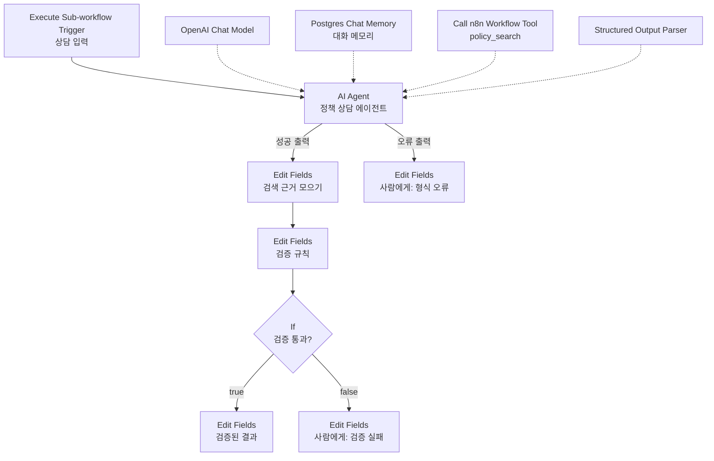
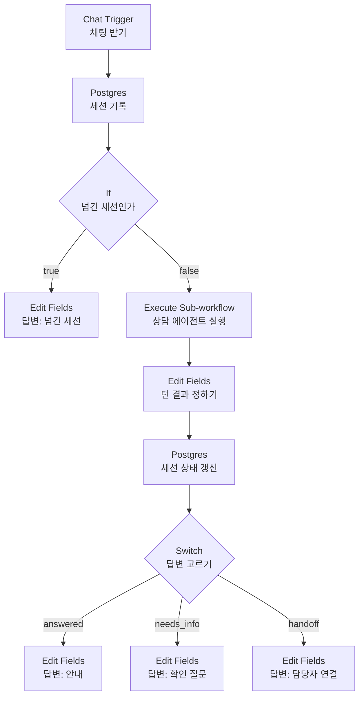
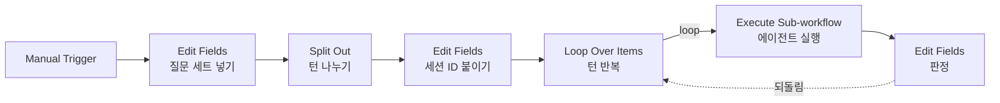

# 정책 상담 노드 설정(완성본)

> 5장 실습 5-6의 완성 예제다. 세 워크플로우의 설정을 적었다.
> 1. `정책 상담 에이전트`: 대화 한 턴을 받아 메모리와 검색 도구로 답하고 결과를 검증하는 서브워크플로우
> 2. `정책 상담 채팅`: 채팅 메시지를 받아 세션 기록을 관리하고 에이전트를 부르는 워크플로우
> 3. `근거 평가 실행`: 질문 세트를 대화 단위로 에이전트에 보내 판정하는 워크플로우
>
> 시스템 메시지, 도구 설명, 스키마, 고정 문구는 [`정책상담_시스템메시지.md`](정책상담_시스템메시지.md)에 있다. 검색 도구는 [`정책검색도구_노드설정.md`](정책검색도구_노드설정.md)의 `정책 검색`을 쓴다.
> 식이 길어 보이는 칸은 모두 Expression으로 바꾼 뒤 붙여 넣는다. 이 설정표는 n8n에서 실행해 확인하지 않았다(실행 확인 대기).

## 1. 워크플로우 `정책 상담 에이전트`



### 1-1. `Execute Sub-workflow Trigger` — 이름: 상담 입력

**Input data mode**는 Define using fields below다.

| 필드 | 데이터 타입 |
|---|---|
| `session_id` | String |
| `message` | String |

### 1-2. `AI Agent` — 이름: 정책 상담 에이전트

| 파라미터 | 값 | 이유 |
|---|---|---|
| **Source for Prompt** (**User Message**) | Define below | 이 워크플로우는 채팅 트리거가 아니라 다른 워크플로우가 부른다 |
| **Prompt** (**User Message**) | `{{ $json.message }}` | 고객 문장만 준다 |
| **Require Specific Output Format** | 켬 | 결과를 결과 계약 형식으로 받는다 |
| **Options → System Message** | 시스템 메시지 문서의 1절 | |
| **Options → Max Iterations** | `5` | 한 질문에 벡터 검색은 세 번까지로 지시했다. 여유를 두어 5로 정한다(가정) |
| **Options → Return Intermediate Steps** | 켬 | 도구를 어떤 검색어로 불러 무엇을 받았는지 출력에 남긴다. 인용 검증이 이 값을 읽는다 |
| **Settings → On Error** | Continue (using error output) | 형식이 맞지 않는 답이나 반복 한도 초과로 노드가 실패해도 사람에게 넘기는 결과를 낸다 |

### 1-3. `OpenAI Chat Model`

| 파라미터 | 값 |
|---|---|
| **Credential** | `OpenAI 실습` |
| **Model** | `gpt-6-luna` |

### 1-4. `Postgres Chat Memory` — 이름: 대화 메모리

| 파라미터 | 값 | 이유 |
|---|---|---|
| **Credential** | `하루마켓 업무 DB` | 메모리를 업무 데이터베이스의 테이블에 둔다 |
| **Session ID** | Define below | 이 워크플로우는 채팅 트리거와 직접 연결되어 있지 않다 |
| **Key** | `{{ $json.session_id }}` | 부른 쪽이 넘긴 세션 ID로 메모리를 나눈다 |
| **Table Name** | `chat_memory` | 변경 스크립트가 미리 만든 테이블이다 |
| **Context Window Length** | `5` | 최근 다섯 번의 주고받음을 모델에 보낸다(가정) |

Session ID를 Connected Chat Trigger Node로 두면 이 서브워크플로우 안에는 채팅 트리거가 없어서 세션 ID를 찾지 못한다. 한 번의 실행에 턴이 여러 개 들어오면 메모리는 모든 턴을 첫 아이템의 세션 ID로 읽고 쓴다. 그래서 이 서브워크플로우는 **언제나 대화 한 턴씩** 부른다.

### 1-5. `Call n8n Workflow Tool` — 이름: policy_search

| 파라미터 | 값 | 누가 채우는가 |
|---|---|---|
| **Description** | 시스템 메시지 문서의 3절 | — |
| **Source / Workflow** | Database / `정책 검색` | — |
| **Workflow Inputs → query** | `{{ $fromAI('query', '정책 문서를 찾을 검색어. 고객이 무엇을 묻는지 드러나는 한국어 문장으로, 앞의 대화에서 생략된 말을 채워 쓴다', 'string') }}` | 모델 |
| **Workflow Inputs → group** | `shipping_return` | 워크플로우 |

**노드 이름을 `policy_search`로 붙인다.** 모델은 이 이름으로 도구를 구별한다. 한국어 이름은 모델에게 뜻이 없는 글자로 전달된다.

`group`을 모델이 채우게 두지 않는다. 반품·배송 상담이 교환·취소 문서를 근거로 답하지 않게 하는 범위 제한이기 때문이다.

### 1-6. `Structured Output Parser`

**Schema Type**은 Define using JSON Schema이고 스키마는 시스템 메시지 문서의 4절이다.

### 1-7. `Edit Fields (Set)` — 이름: 검색 근거 모으기

**Include in Output**은 All Input Fields다. 에이전트 출력의 `intermediateSteps`에서 `policy_search`를 부른 기록만 골라, 검색어와 결과 상태와 돌려받은 문서를 정리한다.

| 필드 이름 | 데이터 타입 | 값 |
|---|---|---|
| `search_calls` | Array | 아래 식 |

```text
{{ ($json.intermediateSteps || [])
  .filter(s => s.action && s.action.tool === "policy_search")
  .map(s => [].concat(typeof s.observation === "string" ? JSON.parse(s.observation) : s.observation)[0])
  .map(r => ({
    query: r.evidence ? r.evidence.query : null,
    status: r.status,
    index_version: r.evidence ? r.evidence.index_version : null,
    score_threshold: r.evidence ? r.evidence.score_threshold : null,
    docs: (r.answer || []).map(c => ({ doc_id: c.doc_id, version: String(c.version), title: c.title, score: c.score }))
  })) }}
```

**처음 실행한 뒤 출력 패널에서 `intermediateSteps`의 구조를 먼저 확인한다.** 이 식은 원소마다 `action.tool`에 도구 이름이, `observation`에 도구 결과의 JSON 글자가 있다고 보고 적었다. 도구 결과가 배열로 감싸여 있어도 읽히도록 `[].concat(...)[0]`을 썼다. 화면의 구조가 다르면 필드 이름을 화면에 맞게 고친다.

### 1-8. `Edit Fields (Set)` — 이름: 검증 규칙

**Include in Output**은 All Input Fields다. 규칙 하나를 필드 하나로 만든다. 모두 데이터 타입은 Boolean이다.

| 필드 이름 | 검증 단계 | 확인하는 것 | 값 |
|---|---|---|---|
| `r_status` | 형식 | `status`가 허용 값인가 | `{{ ["answered","needs_info","handoff"].includes($json.output.status) }}` |
| `r_evidence_format` | 형식 | `evidence`가 배열이고 원소마다 문서 번호 형식과 버전이 있는가 | `{{ Array.isArray($json.output.evidence) && $json.output.evidence.every(e => /^[A-Z]{3}-[0-9]{2}$/.test(e.doc_id) && String($ifEmpty(e.version, "")) !== "") }}` |
| `r_answer` | 일관성 | 담당자에게 넘겼다면(`handoff`) 안내문이 `null`이고, 넘기지 않았다면 안내문이 있는가 | `{{ $json.output.status === "handoff" ? $json.output.answer === null : (typeof $json.output.answer === "string" && $json.output.answer.trim() !== "") }}` |
| `r_has_evidence` | 일관성 | 고객 질문에 답했다면(`answered`) 근거가 하나 이상인가 | `{{ $json.output.status !== "answered" \|\| (Array.isArray($json.output.evidence) && $json.output.evidence.length > 0) }}` |
| `r_cited_in_search` | 근거 | 인용한 문서가 모두 이번 턴에 `ok`로 벡터 검색된 문서인가 | `{{ Array.isArray($json.output.evidence) && $json.output.evidence.every(e => $json.search_calls.some(c => c.status === "ok" && c.docs.some(d => d.doc_id === e.doc_id && d.version === String(e.version)))) }}` |
| `r_ids_in_answer` | 근거 | 안내문에 나온 문서 번호가 모두 인용 목록에 있는가 | `{{ ($ifEmpty($json.output.answer, "").match(/[A-Z]{3}-[0-9]{2}/g) \|\| []).every(id => Array.isArray($json.output.evidence) && $json.output.evidence.some(e => e.doc_id === id)) }}` |

표 안에서는 `\|\|`로 적었지만 화면에는 세로줄 두 개(`||`)로 입력한다.

`r_cited_in_search`가 이 장의 핵심 규칙이다. 모델이 쓴 출처를 믿지 않고, **그 출처가 이번 턴의 벡터 검색 결과에 실제로 있었는지**를 규칙으로 확인한다. 이전 턴에서 벡터 검색한 문서는 인정하지 않는다. 시스템 메시지가 정책 사실을 답할 때마다 이번 질문에 대해 벡터 검색하라고 지시한 이유다.

### 1-9. `If` — 이름: 검증 통과?

| 조건 | 값 |
|---|---|
| Boolean — is true | `{{ $json.r_status && $json.r_evidence_format && $json.r_answer && $json.r_has_evidence && $json.r_cited_in_search && $json.r_ids_in_answer }}` |

### 1-10. 결과 노드 세 개

모두 JSON Output 모드다.

**검증된 결과**

```text
{{ JSON.stringify({
  status: $json.output.status,
  answer: $json.output.answer,
  evidence: $json.output.evidence,
  sources: $json.output.evidence.map(e => ({
    doc_id: e.doc_id,
    version: String(e.version),
    title: ($json.search_calls.flatMap(c => c.docs).find(d => d.doc_id === e.doc_id) || {}).title
  })),
  search_calls: $json.search_calls,
  validation: { passed: true, failed_rules: [] }
}) }}
```

`sources`는 고객에게 보여 줄 출처 줄을 만드는 재료다. 문서 제목은 모델이 쓴 것이 아니라 벡터 검색 결과의 메타데이터에서 가져온다.

**사람에게: 검증 실패**

```text
{{ JSON.stringify({
  status: "handoff",
  answer: null,
  evidence: Array.isArray($json.output.evidence) ? $json.output.evidence : [],
  sources: [],
  search_calls: $json.search_calls,
  validation: {
    passed: false,
    failed_rules: ["r_status","r_evidence_format","r_answer","r_has_evidence","r_cited_in_search","r_ids_in_answer"].filter(k => !$json[k])
  }
}) }}
```

**사람에게: 형식 오류**(에이전트 노드의 오류 출력에 연결)

```text
{{ JSON.stringify({
  status: "handoff",
  answer: null,
  evidence: [],
  sources: [],
  search_calls: [],
  validation: { passed: false, failed_rules: ["output_format"] }
}) }}
```

## 2. 워크플로우 `정책 상담 채팅`



`Chat Trigger`는 마지막으로 실행된 노드의 `output` 필드를 채팅 창에 답으로 보낸다. 그래서 세션 상태를 저장하는 `세션 상태 갱신`을 답변 노드보다 **앞에** 둔다. 답변 노드 뒤에 다른 노드를 붙이면 그 노드의 출력이 답으로 가서 채팅 창에 엉뚱한 내용이 나온다.

### 2-1. `Chat Trigger` — 이름: 채팅 받기

| 파라미터 | 값 | 이유 |
|---|---|---|
| **Make Chat Publicly Available** | 끔 | 실습 5-6에서는 편집 화면의 채팅 창으로 시험한다. 실습 5-7(라)에서 켠다 |
| **Options → Response Mode** | When Last Node Finishes(기본값) | 마지막 노드의 `output`을 답으로 보낸다 |

출력에는 `sessionId`(대화를 나누는 값)와 `chatInput`(고객이 보낸 문장)이 있다. 처음 실행한 뒤 출력 패널에서 두 필드의 이름을 확인한다.

### 2-2. `Postgres` — 이름: 세션 기록

| 설정 | 값 |
|---|---|
| **Credential** | `하루마켓 업무 DB` |
| **Operation** | Execute Query |
| **Options → Query Parameters** | `{{ [ $json.sessionId, "shipping_return" ] }}` |

```sql
INSERT INTO chat_sessions (session_id, topic, turn_count)
VALUES ($1, $2, 1)
ON CONFLICT (session_id) DO UPDATE
SET turn_count = chat_sessions.turn_count + 1, last_message_at = now()
RETURNING session_id, status, turn_count, needs_info_count;
```

`ON CONFLICT (session_id) DO UPDATE`는 같은 세션 ID의 행이 이미 있으면 새로 넣지 않고 그 행을 고친다는 뜻이다. 대화의 첫 메시지에서는 행이 생기고, 이어지는 메시지에서는 턴 수가 늘어난다.

### 2-3. `If` — 이름: 넘긴 세션인가

| 조건 | 값 |
|---|---|
| String — `{{ $json.status }}` — is equal to | `handed_off` |

true 출력의 `답변: 넘긴 세션`은 **Include in Output**을 No Other Input Fields로 두고 `output`(String) 필드 하나에 시스템 메시지 문서 5절의 "넘긴 세션에 다시 메시지가 왔을 때" 문구를 넣는다. **이 갈래에서는 에이전트를 실행하지 않는다.**

### 2-4. `Execute Sub-workflow` — 이름: 상담 에이전트 실행

| 파라미터 | 값 |
|---|---|
| **Source / Workflow** | Database / `정책 상담 에이전트` |
| **Workflow Inputs** | `session_id`: `{{ $('채팅 받기').item.json.sessionId }}`, `message`: `{{ $('채팅 받기').item.json.chatInput }}` |
| **Mode** | Run once with all items |

채팅 메시지 하나가 실행 하나를 시작하므로 이 노드에는 언제나 아이템이 하나만 들어온다. 그래서 `Loop Over Items`를 두지 않아도 대화 한 턴씩 실행된다.

### 2-5. `Edit Fields (Set)` — 이름: 턴 결과 정하기

**Include in Output**은 All Input Fields다. 에이전트의 결과와 세션 기록을 합쳐, 확인 질문 한도와 넘긴 이유를 규칙으로 정한다.

| 필드 이름 | 데이터 타입 | 값 |
|---|---|---|
| `needs_info_count` | Number | `{{ $('세션 기록').item.json.needs_info_count + ($json.status === "needs_info" ? 1 : 0) }}` |
| `final_status` | String | `{{ ($json.status === "needs_info" && $('세션 기록').item.json.needs_info_count + 1 > 2) ? "handoff" : $json.status }}` |
| `handoff_reason` | String | 아래 식 |

```text
{{ !$json.validation.passed
  ? ($json.validation.failed_rules.includes("output_format") ? "output_format" : "validation_failed")
  : ($json.status === "needs_info" && $('세션 기록').item.json.needs_info_count + 1 > 2)
    ? "info_limit"
    : $json.status !== "handoff"
      ? ""
      : $json.search_calls.some(c => c.status === "search_error")
        ? "search_error"
        : ($json.search_calls.length > 0 && $json.search_calls.every(c => c.status === "no_match"))
          ? "no_evidence"
          : "agent_handoff" }}
```

`handoff_reason`의 값과 뜻은 다음과 같다.

| 값 | 뜻 |
|---|---|
| `validation_failed` | 결과 검증에 걸렸다 |
| `output_format` | 결과가 형식에 맞지 않거나 에이전트 노드가 실패했다 |
| `info_limit` | 확인 질문이 한도(2회, 가정)를 넘었다 |
| `search_error` | 벡터 검색이 실패했다 |
| `no_evidence` | 벡터 검색은 했지만 점수 기준 안의 청크가 없었다 |
| `agent_handoff` | 청크에 기준이 없거나, 주문 개별 사실을 물어 모델이 넘겼다 |

### 2-6. `Postgres` — 이름: 세션 상태 갱신

| 설정 | 값 |
|---|---|
| **Operation** | Execute Query |
| **Options → Query Parameters** | `{{ [ $('채팅 받기').item.json.sessionId, $json.needs_info_count, $json.final_status, $json.handoff_reason ] }}` |

```sql
UPDATE chat_sessions
SET needs_info_count = $2,
    status          = CASE WHEN $3 = 'handoff' THEN 'handed_off' ELSE status END,
    handoff_reason  = CASE WHEN $3 = 'handoff' THEN $4 ELSE handoff_reason END,
    handed_off_at   = CASE WHEN $3 = 'handoff' THEN now() ELSE handed_off_at END
WHERE session_id = $1
RETURNING session_id, status;
```

### 2-7. `Switch` — 이름: 답변 고르기

**Mode**는 Rules, **Fallback Output**은 Extra Output이다. Fallback은 `답변: 담당자 연결`에 연결한다.

| 순서 | 조건 | Rename Output |
|---|---|---|
| 1 | String — `{{ $('턴 결과 정하기').item.json.final_status }}` — is equal to — `answered` | `answered` |
| 2 | String — `{{ $('턴 결과 정하기').item.json.final_status }}` — is equal to — `needs_info` | `needs_info` |
| 3 | String — `{{ $('턴 결과 정하기').item.json.final_status }}` — is equal to — `handoff` | `handoff` |

### 2-8. 답변 노드 세 개

모두 **Include in Output**을 No Other Input Fields로 두고 `output`(String) 필드 하나를 만든다.

| 노드 | `output`의 값 |
|---|---|
| `답변: 안내` | `{{ $('턴 결과 정하기').item.json.answer + "\n\n참고한 규정: " + $('턴 결과 정하기').item.json.sources.map(s => s.title + "(" + s.doc_id + ")").join(", ") }}` |
| `답변: 확인 질문` | `{{ $('턴 결과 정하기').item.json.answer }}` |
| `답변: 담당자 연결` | 시스템 메시지 문서 5절의 "담당자에게 넘길 때" 문구 |

**출처 줄은 모델이 쓰지 않는다.** 검증을 통과한 `sources`로 규칙이 붙인다. 모델이 안내문에 문서 번호를 직접 적게 두면, 벡터 검색하지 않은 문서 번호를 적어도 고객은 알 수 없다.

## 3. 워크플로우 `근거 평가 실행`



### 3-1. `Edit Fields (Set)` — 이름: 질문 세트 넣기

JSON Output 모드로 [`근거평가_질문세트_반품배송.json`](../test-cases/근거평가_질문세트_반품배송.json)의 내용을 붙여 넣는다.

### 3-2. `Split Out` — 이름: 턴 나누기

**Fields To Split Out**은 `turns`다. 아이템 9개가 질문 세트의 순서대로 나온다.

### 3-3. `Edit Fields (Set)` — 이름: 세션 ID 붙이기

**Include in Output**은 All Input Fields다.

| 필드 이름 | 데이터 타입 | 값 |
|---|---|---|
| `session_id` | String | `{{ "eval-" + $execution.id + "-" + $json.conversation }}` |

**대화 단위로 세션 ID를 만든다.** 같은 `conversation` 값을 가진 S-1과 S-2는 같은 세션 ID를 받아 이어지는 대화가 되고, 나머지는 서로 다른 세션이 된다. 실행 번호를 넣었으므로 평가를 다시 실행하면 새 세션이 되어 이전 평가의 메모리와 섞이지 않는다. 모든 턴에 같은 세션 ID를 넣으면 앞 질문의 대화가 뒤 질문에 섞여 평가가 무의미해진다.

### 3-4. `Loop Over Items` — 이름: 턴 반복

기본값(Batch Size 1)을 그대로 둔다. loop 출력을 `에이전트 실행`에 연결하고, `판정`의 출력을 다시 이 노드의 입력으로 되돌린다. 한 턴이 끝나야 다음 턴이 시작되므로, S-2를 처리할 때는 S-1의 대화가 이미 메모리에 저장되어 있다.

### 3-5. `Execute Sub-workflow` — 이름: 에이전트 실행

| 파라미터 | 값 |
|---|---|
| **Source / Workflow** | Database / `정책 상담 에이전트` |
| **Workflow Inputs** | `session_id`: `{{ $json.session_id }}`, `message`: `{{ $json.message }}` |
| **Mode** | Run once with all items |

### 3-6. `Edit Fields (Set)` — 이름: 판정

**Include in Output**은 No Other Input Fields다. `T`는 `$('세션 ID 붙이기').item.json`을 줄여 적은 것이다. 화면에는 줄이지 않고 적는다.

| 필드 이름 | 데이터 타입 | 값 |
|---|---|---|
| `case` | String | `{{ T.case }}` |
| `conversation` | String | `{{ T.conversation }}` |
| `question` | String | `{{ T.message }}` |
| `expected_status` | String | `{{ T.expected_status + (T.also_acceptable.length ? " (또는 " + T.also_acceptable.join(", ") + ")" : "") }}` |
| `actual_status` | String | `{{ $json.status }}` |
| `status_ok` | Boolean | `{{ $json.status === T.expected_status \|\| T.also_acceptable.includes($json.status) }}` |
| `queries` | String | `{{ $json.search_calls.map(c => c.query).join(" / ") }}` |
| `searched` | String | `{{ $json.search_calls.map(c => c.status + ": " + c.docs.map(d => d.doc_id + "(" + d.score + ")").join(" ")).join(" / ") }}` |
| `retrieval_hit` | String | `{{ T.expected_docs.length === 0 ? "해당 없음" : (T.expected_docs.every(d => $json.search_calls.some(c => c.docs.some(x => x.doc_id === d))) ? "예" : "아니오") }}` |
| `cited` | String | `{{ $json.evidence.map(e => e.doc_id).join(", ") }}` |
| `citation_ok` | String | `{{ $json.evidence.length === 0 ? "해당 없음" : (!$json.validation.failed_rules.includes("r_cited_in_search") && (T.expected_docs.length === 0 \|\| $json.evidence.some(e => T.expected_docs.includes(e.doc_id))) ? "예" : "아니오") }}` |
| `leak` | Boolean | `{{ T.must_not_contain.some(w => $ifEmpty($json.answer, "").includes(w)) }}` |
| `validation` | String | `{{ $json.validation.passed ? "통과" : $json.validation.failed_rules.join(", ") }}` |
| `answer` | String | `{{ $ifEmpty($json.answer, "(없음)") }}` |
| `index_version` | String | `{{ $ifEmpty($json.search_calls.map(c => c.index_version).filter(v => v)[0], "") }}` |
| `session_id` | String | `{{ T.session_id }}` |

`판정`은 자동으로 정할 수 있는 것만 정한다. **답변 근거는 사람이 판정한다.** 답변의 내용이 인용한 문서에 실제로 있는지 보는 판정이다. `answer`와 인용 문서를 나란히 읽고 근거 평가표에 적는다.

`$('세션 ID 붙이기').item`이 서브워크플로우를 지난 뒤에도 같은 턴을 가리키는지 `case`와 `question`으로 확인한다. 어긋나면 판정표를 믿지 말고 실습 문서의 자주 하는 실수를 본다.

## 4. 시험 결과 대조표

| 사례 | 기대 `status` | 찾아야 할 문서 | 확인할 점 |
|---|---|---|---|
| S-1 | `answered` | `RET-01` | 6,000원, 환불 금액에서 차감 |
| S-2 | `answered` | `RET-02` | 검색어에 "불량"과 "반품"이 함께 들어간다(앞의 대화를 이어받음) |
| S-3 | `answered` | `SHP-01` | 1~2영업일 |
| S-4 | `answered` | `SHP-02` | 1~3영업일. 특정 날짜를 지어내지 않는다 |
| S-5 | `answered` 또는 `needs_info` | `RET-01` | "무료"라고 답하지 않는다 |
| S-6 | `needs_info` 또는 `handoff` | — | 환불 기간을 지어내지 않는다 |
| S-7 | `handoff` | `RET-02` | 세트 일부 불량의 처리 방법을 지어내지 않는다 |
| S-8 | `handoff` | — | `no_evidence`가 기대 사유다 |
| S-9 | `handoff` | — | 주문을 조회하거나 배송 위치를 지어내지 않는다 |
