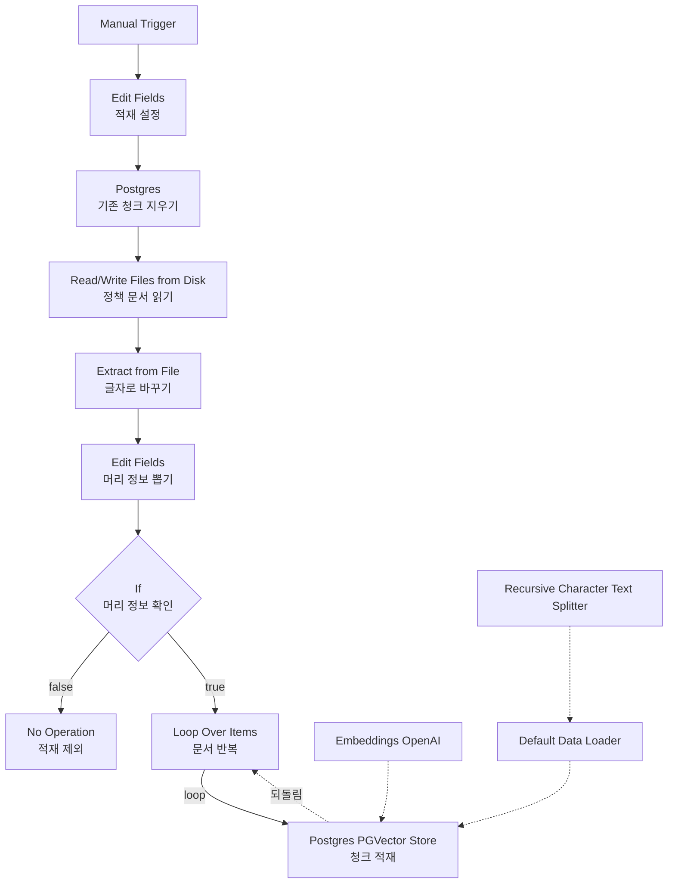
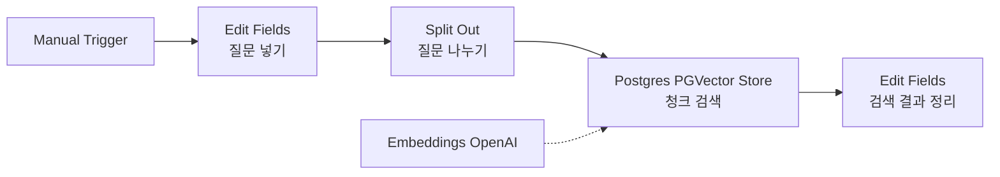

# 정책 적재 노드 설정(완성본)

> 5장 실습 5-5의 완성 예제다. 두 워크플로우의 설정을 적었다.
> 1. `정책 적재`: 정책 문서 폴더의 파일을 읽어 청크로 나누고 임베딩해 `policy_chunks` 테이블에 저장한다
> 2. `검색 확인`: 질문을 벡터 검색해 청크와 점수를 표로 본다
>
> 식이 길어 보이는 칸은 모두 Expression으로 바꾼 뒤 붙여 넣는다. 이 설정표는 n8n에서 실행해 확인하지 않았다(실행 확인 대기). 청크 수는 분할 규칙을 계산해 예상한 값이다.

## 1. 워크플로우 `정책 적재`

**지우는 단계가 적재보다 앞에 있다.** 적재 노드는 넣기만 하고 같은 문서의 옛 청크를 알아서 지우지 않는다. 지우지 않고 다시 적재하면 같은 청크가 두 벌이 되고, 문서를 고친 뒤라면 옛 규정과 새 규정이 함께 벡터 검색된다.

### 1-1. `Edit Fields (Set)` — 이름: 적재 설정

**Include in Output**은 No Other Input Fields다. 반품·배송과 교환·취소를 적재할 때 이 노드의 값만 바꾼다.

| 필드 이름 | 데이터 타입 | 값 | 뜻 |
|---|---|---|---|
| `group` | String | `shipping_return` | 문서 묶음. 지우는 범위와 검색 범위가 이 값으로 정해진다 |
| `folder` | String | `/files/policies/shipping_return/*.md` | 읽을 파일. 컨테이너 안의 경로다 |
| `index_version` | String | `{{ $now.toFormat('yyyyLLdd-HHmm') }}` | 색인 버전. 이번 적재를 언제 했는지 남긴다 |
| `embedding_model` | String | `text-embedding-3-large` | 기록용 값. `Embeddings OpenAI`의 Model과 같게 적는다 |

`embedding_model`은 모델을 정하는 설정이 아니라 **기록**이다. 실제로 쓰이는 모델은 `Embeddings OpenAI` 노드의 Model이다. 두 곳이 어긋나면 기록이 틀리므로, 모델을 바꿀 때는 두 곳을 함께 고친다.

### 1-2. `Postgres` — 이름: 기존 청크 지우기

| 설정 | 값 |
|---|---|
| **Credential** | `하루마켓 업무 DB` |
| **Operation** | Execute Query |
| **Query** | `DELETE FROM policy_chunks WHERE metadata->>'group' = $1;` |
| **Options → Query Parameters** | `{{ [ $json.group ] }}` |
| **Settings → Always Output Data** | 켬 |

`metadata->>'group'`은 jsonb 열 `metadata` 안의 `group` 값을 글자로 꺼낸다. 이 조건 때문에 반품·배송을 다시 적재할 때 교환·취소 청크는 지워지지 않는다. **조건을 빠뜨리면 테이블 전체가 지워진다.**

Always Output Data를 켜는 이유는 지운 행이 없을 때도 다음 노드가 실행되게 하기 위해서다.

### 1-3. `Read/Write Files from Disk` — 이름: 정책 문서 읽기

| 파라미터 | 값 |
|---|---|
| **Operation** | Read File(s) From Disk |
| File(s) Selector | `{{ $('적재 설정').first().json.folder }}` |

출력은 파일마다 아이템 하나다. 파일 내용은 바이너리 데이터로 `data`라는 이름 아래에 담긴다. 반품·배송 폴더면 아이템 6개가 나와야 한다.

`$('적재 설정').first()`는 `적재 설정` 노드의 첫 아이템을 가리킨다. 설정 노드는 언제나 아이템이 하나뿐이므로 `first()`로 읽는다.

### 1-4. `Extract from File` — 이름: 글자로 바꾸기

| 파라미터 | 값 |
|---|---|
| **Operation** | Extract From Text File |
| **Input Binary Field** | `data` |
| **Destination Output Field** | `data` |

출력의 `data` 필드에 파일 내용이 글자로 담긴다.

### 1-5. `Edit Fields (Set)` — 이름: 머리 정보 뽑기

**Include in Output**은 No Other Input Fields다. 정책 문서 첫머리의 머리 정보를 정규식으로 뽑아 메타데이터로 쓸 값을 만들고, 임베딩할 본문에서는 머리 정보를 지운다.

| 필드 이름 | 데이터 타입 | 값 |
|---|---|---|
| `doc_id` | String | `{{ ($json.data.match(/문서 번호: *([A-Z]{3}-[0-9]{2})/) \|\| [])[1] }}` |
| `title` | String | `{{ ($json.data.match(/^# ([^\r\n]+)/m) \|\| [])[1] }}` |
| `version` | String | `{{ ($json.data.match(/버전: *([0-9]+)/) \|\| [])[1] }}` |
| `effective_from` | String | `{{ ($json.data.match(/시행일: *([0-9]{4}-[0-9]{2}-[0-9]{2})/) \|\| [])[1] }}` |
| `group` | String | `{{ $('적재 설정').first().json.group }}` |
| `index_version` | String | `{{ $('적재 설정').first().json.index_version }}` |
| `embedding_model` | String | `{{ $('적재 설정').first().json.embedding_model }}` |
| `content` | String | `{{ $json.data.replace(/\r\n/g, "\n").replace(/^- (문서 번호\|버전\|시행일\|분류):.*\n/gm, "").replace(/^> .*\n/gm, "").replace(/\n{3,}/g, "\n\n").trim() }}` |

표 안에서는 `\|`로 적었지만 화면에는 세로줄 하나(`|`)나 두 개(`||`)로 입력한다.

`content`의 첫 `replace`는 Windows에서 만든 파일의 줄 끝(`\r\n`)을 `\n`으로 맞춘다. 둘째는 머리 정보 네 줄을, 셋째는 `>`로 시작하는 안내 줄을 지운다. 머리 정보는 메타데이터로 따로 저장하므로 본문에 남겨 임베딩할 이유가 없다.

### 1-6. `If` — 이름: 머리 정보 확인

| 조건 | 값 |
|---|---|
| String — `{{ $json.doc_id }}` — matches regex | `^[A-Z]{3}-[0-9]{2}$` |
| String — `{{ $json.title }}` — is not empty | — |
| String — `{{ $json.version }}` — is not empty | — |

세 조건은 AND로 묶는다. false 출력의 `적재 제외`(`No Operation, do nothing`)에 아이템이 있으면 그 파일의 머리 정보 형식이 틀린 것이다. **메타데이터가 빈 채로 적재하면 그 청크는 출처를 밝힐 수 없고, 문서 번호로 지울 수도 없다.**

### 1-7. `Loop Over Items` — 이름: 문서 반복

기본값(Batch Size 1)을 그대로 둔다. loop 출력을 `청크 적재`에 연결하고, `청크 적재`의 출력을 다시 이 노드의 입력으로 되돌린다.

메타데이터를 붙이는 `Default Data Loader`의 표현식은 문서(아이템)마다 따로 계산된다. 그래서 문서 여러 개를 한 번에 적재해도 청크마다 제 문서의 번호가 붙는다. 이 실습은 문서를 한 건씩 적재하지만, 메타데이터 때문에 꼭 그래야 하는 것은 아니다.

### 1-8. `Postgres PGVector Store` — 이름: 청크 적재

| 파라미터 | 값 | 이유 |
|---|---|---|
| **Credential** | `하루마켓 업무 DB` | 업무 데이터베이스에 저장한다 |
| **Operation Mode** | Insert Documents | |
| **Table Name** | `policy_chunks` | 변경 스크립트가 미리 만든 테이블이다. 기본값 `n8n_vectors`로 두면 새 테이블이 생긴다 |

Options는 비워 둔다. Distance Strategy의 기본값은 Cosine이다.

### 1-9. `Embeddings OpenAI`

| 파라미터 | 값 |
|---|---|
| **Credential** | `OpenAI 실습` |
| **Model** | `text-embedding-3-large` |

Options에 Dimensions를 더하지 않는다. 더하지 않으면 모델의 기본 차원(3072)으로 임베딩하며, 이 값이 `policy_chunks.embedding`의 차원과 같다.

### 1-10. `Default Data Loader`

| 파라미터 | 값 |
|---|---|
| **Type of Data** | JSON |
| **Mode** | Load Specific Data |
| **Data** | `{{ $json.content }}` |
| **Text Splitting** | Custom |
| **Options → Metadata** | 아래 표의 일곱 항목 |

| Name | Value |
|---|---|
| `doc_id` | `{{ $json.doc_id }}` |
| `title` | `{{ $json.title }}` |
| `version` | `{{ $json.version }}` |
| `effective_from` | `{{ $json.effective_from }}` |
| `group` | `{{ $json.group }}` |
| `index_version` | `{{ $json.index_version }}` |
| `embedding_model` | `{{ $json.embedding_model }}` |

### 1-11. `Recursive Character Text Splitter`

`Default Data Loader`의 Text Splitter 연결점에 붙인다.

| 파라미터 | 값 | 이유 |
|---|---|---|
| **Chunk Size** | `200` | 정책 문서의 절 한두 개가 청크 하나가 되는 크기다. 글자 수로 센다 |
| **Chunk Overlap** | `20` | 절 경계에서 잘릴 때 앞 청크의 끝을 조금 겹친다. 절 단위로 잘리면 겹치지 않는다 |
| **Options → Split Code** | `markdown` | 제목(`##`)을 먼저 경계로 삼아 자른다 |

### 1-12. 예상 결과

분할 규칙을 계산해 예상한 청크 수다. 실제 실행 결과와 다르면 실제 결과를 적고, 문서를 고쳤는지와 분할 설정을 먼저 확인한다.

| 문서 | 반품·배송 청크 수 | 문서 | 교환·취소 청크 수 |
|---|---:|---|---:|
| `COM-01` | 2 | `EXC-01` | 1 |
| `SHP-01` | 2 | `EXC-02` | 1 |
| `SHP-02` | 2 | `EXC-03` | 1 |
| `RET-01` | 2 | `EXC-04` | 1 |
| `RET-02` | 2 | `CAN-01` | 1 |
| `RET-03` | 1 | `CAN-02` | 2 |
| **합계** | **11** | **합계** | **7** |

`markdown` 분할은 잘라 낸 자리의 `## `를 청크에 남기지 않는다. 그래서 둘째 청크는 `## ` 없이 절 제목의 글자로 시작한다. 정책 문서의 절 제목을 "단순 변심 반품의 배송비"처럼 무엇에 관한 절인지 드러나게 쓴 이유다.

## 2. 워크플로우 `검색 확인`

### 2-1. `Edit Fields (Set)` — 이름: 질문 넣기

JSON Output 모드로 [`검색확인_질문.json`](../test-cases/검색확인_질문.json)의 내용을 붙여 넣는다.

### 2-2. `Split Out` — 이름: 질문 나누기

**Fields To Split Out**은 `questions`다. 아이템 6개가 나온다.

### 2-3. `Postgres PGVector Store` — 이름: 청크 검색

| 파라미터 | 값 | 이유 |
|---|---|---|
| **Credential** | `하루마켓 업무 DB` | |
| **Operation Mode** | Get Many | 벡터 검색 결과를 아이템으로 받아 점수까지 본다 |
| **Table Name** | `policy_chunks` | |
| **Prompt** | `{{ $json.question }}` | 검색어 |
| **Limit** | `4` | 질문마다 가까운 청크 4개 |
| **Include Metadata** | 켬(기본값) | 문서 번호를 본다 |
| **Options → Metadata Filter** | Name `group`, Value `shipping_return` | 반품·배송 문서 안에서만 찾는다 |

`Embeddings OpenAI`는 `정책 적재`와 **같은 모델**(`text-embedding-3-large`)로 붙인다. 모델이 다르면 차원이 달라 오류가 나거나, 차원이 같더라도 숫자 목록끼리 비교할 수 없어 엉뚱한 결과가 나온다.

출력은 질문마다 청크 4개, 모두 24개 아이템이다. 아이템마다 `document.pageContent`(청크 글), `document.metadata`(메타데이터), `score`가 있다.

### 2-4. `Edit Fields (Set)` — 이름: 검색 결과 정리

**Include in Output**은 No Other Input Fields다.

| 필드 이름 | 데이터 타입 | 값 |
|---|---|---|
| `question_id` | String | `{{ $('질문 나누기').item.json.id }}` |
| `rank` | Number | `{{ $itemIndex % 4 + 1 }}` |
| `doc_id` | String | `{{ $json.document.metadata.doc_id }}` |
| `score` | Number | `{{ Math.round($json.score * 1000) / 1000 }}` |
| `chunk_head` | String | `{{ $json.document.pageContent.slice(0, 40) }}` |

`rank`는 질문마다 결과가 정확히 4개일 때만 맞다. 표의 청크가 4개보다 적으면 순위가 어긋나므로 `question_id`와 함께 읽는다.

**`score`의 방향을 먼저 확인한다.** 이 저장소는 점수로 코사인 거리를 돌려주는 것으로 알려져 있다. 거리는 작을수록 가깝다. 질문마다 1위 결과의 점수가 2~4위보다 작으면 거리이고, 크면 유사도다. 확인한 방향을 기록한 뒤 점수 기준을 정한다.
