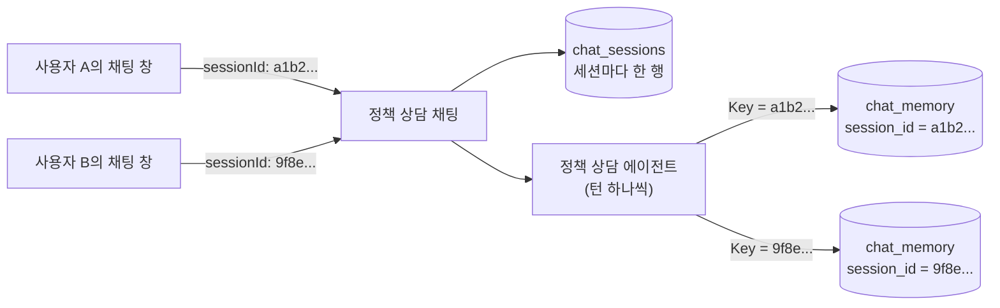
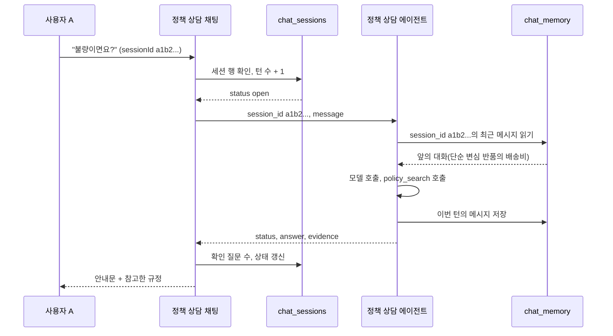
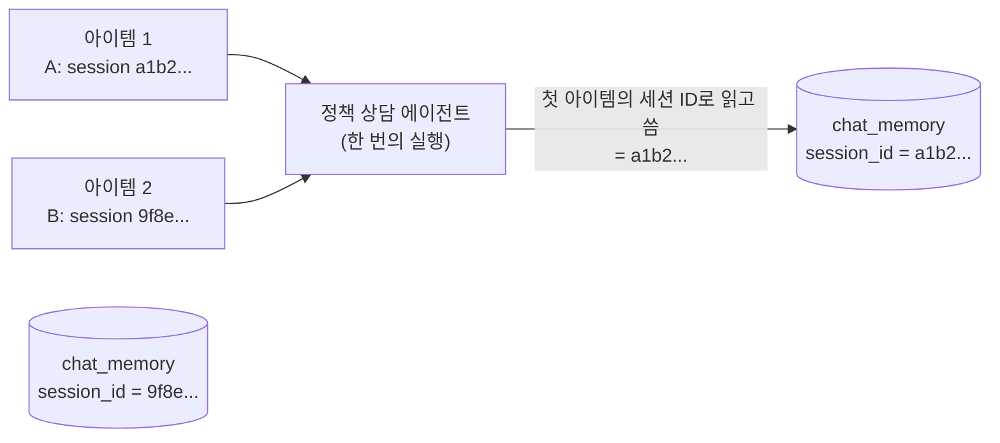

# 세션 도식

> 5장 실습 5-6, 5-7에서 세션 ID와 대화 메모리가 어떻게 이어지는지 보여 주는 도식이다. 이론 5.3절과 함께 읽는다.

## 1. 두 사용자, 두 세션

사용자 A와 B가 같은 상담 채팅을 따로 연다. 채팅 화면이 대화마다 세션 ID를 만들고, 메시지를 보낼 때마다 세션 ID를 함께 보낸다.

- `chat_sessions`에는 세션마다 **한 행**이 있고, 메시지가 올 때마다 그 행의 턴 수와 상태가 바뀐다.
- `chat_memory`에는 세션마다 **여러 행**이 쌓인다. 한 턴에 사용자 메시지와 모델의 답이 들어가고, 도구를 불렀다면 도구 호출과 도구 결과도 들어간다.
- 에이전트는 이번 메시지의 세션 ID로 `chat_memory`에서 그 세션의 행만 읽는다. A의 행과 B의 행은 세션 ID로 나뉜다.

## 2. 한 턴에서 일어나는 일

## 3. 기억이 섞이는 경우: 한 번의 실행에 두 대화

에이전트가 한 번 실행될 때 턴 두 개가 함께 들어오면 어떻게 되는가? 메모리 노드는 한 번의 실행에 입력 아이템이 여러 개 들어오면 모든 턴을 첫 아이템의 세션 ID로 읽고 쓴다. 도구의 입력이나 문서 로더의 메타데이터는 아이템마다 따로 계산되지만, 메모리는 그렇지 않다.

그래서 B의 턴도 A의 세션 ID로 메모리를 읽고 쓴다. B는 A의 대화를 앞의 대화로 받아 답하고, B의 메시지는 A의 메모리에 저장된다. `9f8e...`의 메모리는 비어 있다. 실제 결과는 실습 5-7(라)에서 SQL로 확인한다.

**고치는 방법은 대화 한 턴씩 실행하는 것이다.** 채팅 트리거는 메시지 하나마다 실행을 시작하므로 저절로 한 턴씩 실행된다. 평가처럼 여러 턴을 한 번에 넣는 워크플로우에서는 `Loop Over Items`로 한 턴씩 에이전트에 보낸다.

## 4. 세션 ID가 하는 일과 하지 않는 일

| 구분 | 세션 ID |
|---|---|
| **하는 일** | 어느 대화의 메모리를 불러올지 정한다. 세션 기록의 행을 찾는다 |
| **하지 않는 일** | 그 사람이 누구인지 증명하지 않는다. 주문 정보를 볼 권한을 주지 않는다 |
| **누가 만드는가** | 채팅 화면(브라우저)이 만든다. 모델이 만들거나 바꾸지 않는다 |
| **새로 생기는 때** | 새 대화를 시작할 때, 다른 브라우저나 시크릿 창에서 열 때 |
