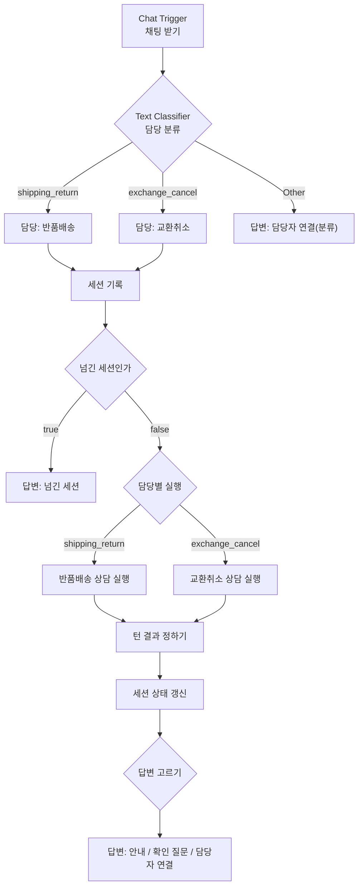

# 상담 창구 노드 설정(완성본)

> 7장 실습 7-3의 완성 예제다. 5장 워크플로우 `정책 상담 채팅`([`정책상담_노드설정.md`](../../../05/템플릿_가이드/configs/정책상담_노드설정.md) 2절)을 복제해 고친다.
> **5장의 두 상담 에이전트 서브워크플로우(`정책 상담 에이전트`, `교환 취소 상담 에이전트`)는 고치지 않는다.**
> 적용 버전은 n8n 2.43.7이다. 이 설정표대로 만들어 공개 채팅 주소로 분류 시험 10건과 주제 전환 대화를 보내 확인했다.

## 1. 바꿀 곳 요약

| 노드 | 5장 | 7장 |
|---|---|---|
| `채팅 받기` | 그대로 | 그대로 |
| `담당 분류`(새로 더한다) | 없다 | `Text Classifier`. 2절 |
| `담당: 반품배송`, `담당: 교환취소`(새로 더한다) | 없다 | `Edit Fields`. 3절 |
| `답변: 담당자 연결(분류)`(새로 더한다) | 없다 | `담당 분류`의 Other 출력. 5장 `답변: 담당자 연결`과 같은 문구 |
| `세션 기록` | 세션 ID는 채팅 트리거의 값, `topic`은 `shipping_return` 고정 | 담당 노드가 정한 `session_id`와 `topic`을 쓴다. 4절 |
| `담당별 실행`(새로 더한다) | 없다 | `Switch`. 5절 |
| `상담 에이전트 실행` | 하나 | 둘로 나눈다. 5절 |
| `턴 결과 정하기`, `답변 고르기`, 답변 노드 | `$('세션 기록').item`을 읽는다 | 그대로. 두 실행 노드의 출력을 모두 `턴 결과 정하기`에 연결한다 |
| `세션 상태 갱신` | 세션 ID는 채팅 트리거의 값 | 담당 노드가 정한 `session_id`를 쓴다. 6절 |

## 2. `Text Classifier` — 이름: 담당 분류

| 파라미터 | 값 |
|---|---|
| **Text to Classify** | `{{ $json.chatInput }}` |
| **Options → When No Clear Match** | `Output on Extra, 'Other' Branch` |
| **Options → Allow Multiple Classes To Be True** | 끔 |

| Category | Description |
|---|---|
| `shipping_return` | 배송 기간, 배송 상태, 반품 기한, 반품 배송비, 불량·오배송 반품, 환불에 관한 질문. 다른 범주의 질문이 함께 섞여 있으면 여기에 넣지 않는다 |
| `exchange_cancel` | 교환 기한, 교환 배송비, 교환할 수 없는 경우, 주문 취소, 부분 취소, 결제 취소에 관한 질문. 다른 범주의 질문이 함께 섞여 있으면 여기에 넣지 않는다 |

반품과 교환을 **함께** 묻는 질문(C-08)은 Other로 보내 담당자 연결 문구를 내보낸다. 한 담당은 자기 부분만 답할 수 있기 때문이다. Description 끝의 "섞여 있으면 여기에 넣지 않는다"가 이 일을 한다. 이 구절이 없으면 C-08이 `shipping_return`으로 가서 교환 기한은 답하지 못한다(2.43.7, 이전 실습 모델 `gpt-5.6-luna`에서 세 번 모두). 구절을 둔 뒤에도 나머지 질문의 분류는 달라지지 않았다. 실습 7-2의 섞인 요청과 같은 방법이다.

## 3. `Edit Fields` — 이름: 담당: 반품배송, 담당: 교환취소

**Include in Output**은 No Input Fields다.

| 필드 | 데이터 타입 | `담당: 반품배송` | `담당: 교환취소` |
|---|---|---|---|
| `topic` | String | `shipping_return` | `exchange_cancel` |
| `session_id` | String | `{{ 'return:' + $('채팅 받기').item.json.sessionId }}` | `{{ 'exchange:' + $('채팅 받기').item.json.sessionId }}` |
| `message` | String | `{{ $('채팅 받기').item.json.chatInput }}` | 같다 |

**담당마다 세션 ID를 다르게 만든다.** 두 상담 에이전트는 받은 `session_id`로 대화 메모리를 나누므로(5장 `Postgres Chat Memory`의 Key), 같은 채팅이라도 담당이 다르면 메모리가 따로 쌓인다. 5장 `chat_sessions`의 `topic`은 두 값 중 하나만 받으므로, 세션 기록의 행도 담당마다 따로 생긴다.

## 4. `Postgres` — 이름: 세션 기록

SQL은 5장과 같다. Query Parameters만 바꾼다.

| 옵션 | 값 |
|---|---|
| **Query Parameters** | `{{ [ $json.session_id, $json.topic ] }}` |

## 5. `Switch` — 이름: 담당별 실행, `Execute Sub-workflow` 둘

`넘긴 세션인가`의 false 출력에 `담당별 실행`을 연결한다.

| 출력 이름 | 조건 |
|---|---|
| `shipping_return` | String — `{{ $('세션 기록').item.json.topic }}` — is equal to — `shipping_return` |
| `exchange_cancel` | 같은 식 — is equal to — `exchange_cancel` |

5장 `세션 기록`의 SQL은 `RETURNING session_id, status, turn_count, needs_info_count`다. `topic`을 돌려주지 않으므로 **`RETURNING` 줄에 `topic`을 더한다.** 더하지 않으면 위 조건이 항상 거짓이 된다.

| 노드 | Workflow | Workflow Inputs |
|---|---|---|
| `반품배송 상담 실행` | `정책 상담 에이전트` | `session_id` ← `{{ $('세션 기록').item.json.session_id }}`, `message` ← `{{ $('채팅 받기').item.json.chatInput }}` |
| `교환취소 상담 실행` | `교환 취소 상담 에이전트` | 같다 |

두 노드의 출력을 모두 `턴 결과 정하기`에 연결한다. 한 번의 채팅 메시지에서는 둘 중 하나만 실행된다.

## 6. `Postgres` — 이름: 세션 상태 갱신

SQL은 5장과 같다. Query Parameters의 첫 값만 바꾼다.

| 옵션 | 값 |
|---|---|
| **Query Parameters** | `{{ [ $('세션 기록').item.json.session_id, $json.needs_info_count, $json.final_status, $json.handoff_reason ] }}` |

5장처럼 `$('채팅 받기').item.json.sessionId`를 그대로 두면 담당 접두어가 없는 세션 ID로 행을 찾으므로 아무 행도 바뀌지 않는다.

## 7. 구성 그림

## 8. 시험 기록 양식

| 질문 | 기대 담당 | 실제 담당 | 답의 상태(answered·needs_info·handoff) | 5장과 비교 | 메모 |
|---|---|---|---|---|---|
| C-01 | shipping_return | | | 5장 S-1 | |
| C-02 | shipping_return | | | 5장 S-4 | |
| C-03 | shipping_return | | | | |
| C-04 | exchange_cancel | | | | |
| C-05 | exchange_cancel | | | 5장 X-1 | |
| C-06 | exchange_cancel | | | 5장 X-6 | |
| C-07 | 어느 쪽이든 | | | | |
| C-08 | Other | | | | |
| C-09 | exchange_cancel | | | | |
| C-10 | Other | | | | |

주제가 바뀌는 대화(`topic_switch`)는 아래에 적는다.

| 순서 | 실제 담당 | 담당이 앞의 대화를 알고 답했는가 | 메모 |
|---|---|---|---|
| (1) | | 해당 없음 | |
| (2) | | | |
| (3) | | | |
