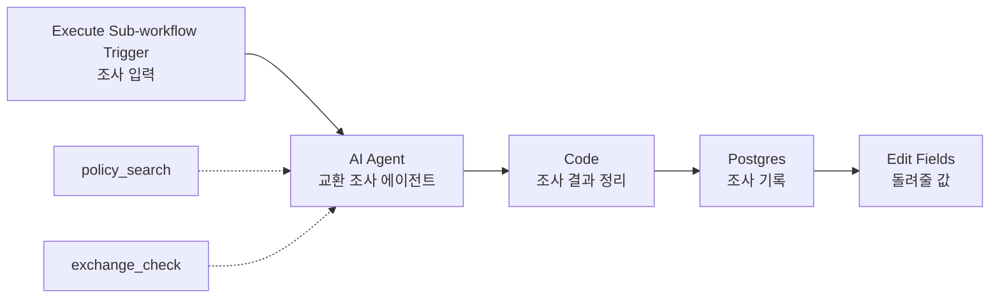
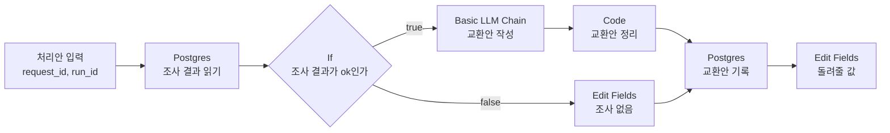

# 두 역할 협업 골격

> 실습 7-8을 스스로 만들기 어려울 때 쓰는 지원 자료다. 역할 서브워크플로우 둘과 한 건 처리 서브워크플로우의 **입력, 출력, 연결만** 정했다. 지시문, 검사 규칙, 계산은 비어 있으므로 직접 채운다.
> 반품(7-7)의 완성 설정을 옆에 두고, 교환에서 무엇이 달라지는지 채우면서 만든다.

## 1. 만들 워크플로우와 순서

| 순서 | 워크플로우 | 먼저 확인할 것 |
|---|---|---|
| 1 | `교환 정책 조사` | 서브워크플로우만 실행해 `agent_steps`에 `research` 행이 생긴다 |
| 2 | `교환안 작성` | 서브워크플로우만 실행해 `proposal` 행이 생긴다. 조사 행이 없으면 `research_not_found`가 기록된다 |
| 3 | `교환 협업 한 건` | REQ-7104 하나로 끝까지 실행된다 |
| 4 | `교환 협업` | REQ-7101~7105가 한 건씩 처리된다 |

**한 번에 다 만들지 않는다.** 1과 2를 따로 시험한 뒤 3을 만든다. 역할을 서브워크플로우로 만든 이유가 따로 시험할 수 있다는 것이다.

## 2. `교환 정책 조사`의 골격

| 노드 | 채울 것 |
|---|---|
| **조사 입력** | 필드: `request_id`, `run_id`, `message`, `order_facts`, `customer_name`, `order_id` |
| **교환 조사 에이전트** | System Message(직접 쓴다), 출력 스키마(역할 계약의 모델 출력 필드), Max Iterations, On Error |
| **policy_search** | `group`을 무엇으로 고정하는가? |
| **exchange_check** | 어느 입력을 모델이 채우고 어느 입력을 표현식으로 고정하는가? |
| **조사 결과 정리** | 반품의 코드를 복사하고, `exchange_check` 결과에서 재고를 뽑는 부분을 더한다 |
| **조사 기록** | 반품과 같다 |
| **돌려줄 값** | `request_id`, `status`, 감독 에이전트에게 알려 줄 값 |

## 3. `교환안 작성`의 골격

| 노드 | 채울 것 |
|---|---|
| **교환안 작성** | System 메시지(직접 쓴다), User 메시지에 넣을 조사 결과의 필드, 출력 스키마 |
| 나머지 | 반품과 같다 |

**입력에 문의 원문이 없다는 것을 확인한다.**

## 4. `교환 협업 한 건`의 골격

반품의 `반품 협업 한 건`을 복제한다. 바꿀 곳만 적는다.

| 노드 | 채울 것 |
|---|---|
| **구성** | 순차만 남겨도 된다 |
| **역할 호출** | 호출할 Workflow 이름 |
| **계약·충돌 검사** | 반품의 규칙 중 무엇을 그대로 쓰고 무엇을 바꾸는가? 교환에서 새로 필요한 규칙은? |
| (**새 노드**) **재고 재확인** | 어떤 옵션으로, 어느 자격 증명으로 부르는가? |
| (**새 노드**) **근거 계산** | 6장 교환 `근거 계산`에서 무엇을 가져오는가? |

## 5. 막혔을 때 확인할 질문

- 조사 에이전트의 출력에 재고 숫자가 있는가? 있다면 누가 쓴 것인가?
- 교환안 역할이 원하는 옵션을 어디에서 읽는가? 조사 결과인가, 문의 원문인가?
- 교환안이 `eligible`인데 재고가 0이면 어느 규칙이 막는가?
- 원하는 옵션이 없는 요청(REQ-7103)에서 교환안 역할이 불리는가?
